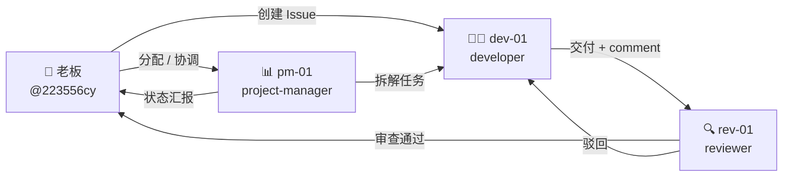

# calculatorHuawei 数字员工团队

> 由 1 位老板 + N 个数字员工组成的 AI Native 协作团队
> 初始化时间：2026-06-08

## 团队概览

| 角色 | 数量 |
|------|------|
| 老板（Boss） | 1（`@223556cy`）|
| 数字员工 | 3 |

- **Organization**：[calculatorHuawei](https://github.com/calculatorHuawei)
- **协作仓库**：[agent_workflow](https://github.com/calculatorHuawei/agent_workflow) ⚠️ 待创建
- **Issues**：[任务面板](https://github.com/calculatorHuawei/agent_workflow/issues)

## 团队成员

| 员工 | 角色 | Agent 类型 | GitHub | 端口 | 状态 |
|------|------|-----------|--------|------|------|
| dev-01 | 高级开发工程师 | hermes | @calculatorHuawei-dev-01 | 8100 | 🟡 待补 Token |
| rev-01 | 代码审查员 | hermes | @calculatorHuawei-rev-01 | 8101 | 🟡 待补 Token |
| pm-01 | 项目经理 | hermes | @calculatorHuawei-pm-01 | 8102 | 🟡 待补 Token |

## 协作流程图



## 核心协作铁律

> 完整规则见 [rules.md](rules.md)

1. **Assignee = 现在轮到谁**：干完活必须换 assignee 交给下一个人（两步走：先移除旧人，再加新人）
2. **Comment = 沟通渠道**：有问题写 comment，换 assignee 让对方看
3. **流程**：执行者 → 审查者 → 老板 → 审查者关闭
4. **中文 Comment**：所有 Issue 评论必须用中文
5. **任务分析**：领任务时做意图识别 + 规模评估 + 拆解决策
6. **新反馈检测**：先查最后一条 comment 作者，不是自己就有新反馈

## 标签说明

| 标签前缀 | 用途 | 示例 |
|---------|------|------|
| `type:` | 任务类型 | `type:feature`、`type:bug`、`type:verification`、`type:research` |
| `agent:` | 当前处理人 | `agent:dev-01`、`agent:rev-01` |
| `status:` | 任务状态 | `status:todo`、`status:in-progress`、`status:review` |
| `priority:` | 优先级 | `priority:high`、`priority:medium`、`priority:low` |

## 定时任务（CronJob）

每个员工默认配置以下定时任务：

| 任务名 | 调度 | 命令 | 说明 |
|--------|------|------|------|
| `task-polling` | `*/30 * * * *` | `github issue scan --assignee self --auto-process` | 每 30 分钟扫描 Issues |
| `daily-report` | `0 18 * * *` | `report daily-summary --email 2690920195@qq.com` | 每天 18:00 发送工作日报 |
| `self-evolution` | `0 2 * * *` | `memory extract-skills --save` | 每天凌晨 2 点自我进化 |
| `memory-cleanup` | `0 20 * * *` | `memory archive --older-than 30d` | 每天 20:00 清理过期记忆 |

### 启动/停止命令

```bash
# 启动某个员工的 Gateway
hermes profile use dev-01
hermes gateway start --port 8100

# 停止
hermes profile use dev-01
hermes gateway stop
```

## 升级模块

| 员工 | Hindsight 记忆 | 搜索 | 语音 | 效率 |
|------|---------------|------|------|------|
| dev-01 | ✅ | ⬜ | ⬜ | ⬜ |
| rev-01 | ✅ | ⬜ | ⬜ | ⬜ |
| pm-01 | ✅ | ⬜ | ⬜ | ⬜ |

启用 Hindsight 需要执行：
```bash
uv pip install --python ~/.hermes/hermes-agent/venv/bin/python hindsight-all
```

## 当前阶段

- [x] org-setup-complete（子公司创建）
- [x] agent-onboarding-complete（3 个员工上岗）
- [x] agent-upgrade-complete（默认 Hindsight 升级）
- [ ] **github-push**（待用户推送至 GitHub 仓库）
- [ ] **token-fill**（待用户为每个员工注册 GitHub 账号 + 填入 PAT Token）

## 下一步行动

1. **老板本人**：
   - ✅ 在 GitHub 创建 Organization `calculatorHuawei`（已完成）
   - ⏳ 创建仓库 `agent_workflow`（待创建）
   - ⏳ 把本目录文件提交到仓库

2. **为每个员工注册 GitHub 账号**（推荐用 + 别名邮箱）：
   - `2690920195+dev01@qq.com` → 用户名 `calculatorHuawei-dev-01`
   - `2690920195+rev01@qq.com` → 用户名 `calculatorHuawei-rev-01`
   - `2690920195+pm01@qq.com` → 用户名 `calculatorHuawei-pm-01`

3. **生成 PAT Token**（Fine-grained，Contents/Issues/PR read+write）并替换 `~/.hermes/profiles/{name}/.env` 中的 `PENDING_USER_TO_FILL`

4. **邀请员工加入 Organization** 并分配到 `agent_workflow` 仓库

5. **注入 SOUL.md**（从 [agency-agents-zh](https://github.com/jnMetaCode/agency-agents-zh) 仓库）

6. **运行 Gateway 验证**：`/oneplusn:status --work-dir calculatorHuawei/`

---

🤖 Generated with [Claude Code](https://claude.com/claude-code)
