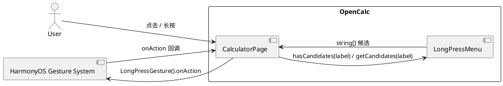
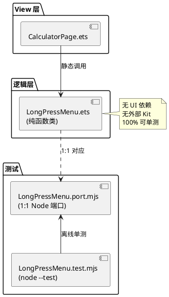

# Design — Issue #16 长按弹出选择菜单

> aid-workflow 20260616-requirement-add-long-press-menu
> 由 mod-design skill 生成 · 标记 [推断] 的内容为基于设计推断
> 生成时间: 2026-06-16

## 1 概述

### 1.1 应用定位
OpenCalc HarmonyOS 端口的科学模式**手势增强**。为科学函数按钮增加长按手势,长按时弹出反函数候选菜单,提升反三角函数入口的可达性。

### 1.2 核心交互
- **短按** `sin` → 表达式追加 `sin(` (维持原行为)
- **长按** `sin` ≥500ms → 屏幕中央弹出菜单 [arcsin, arccos, arctan] → 点击 `arcsin` → 表达式追加 `arcsin(` + 菜单关闭
- 点击菜单外区域 → 菜单关闭,表达式不变

### 1.3 技术栈概览
- **框架**: ArkTS (HarmonyOS API 12+), ArkUI 声明式
- **状态管理**: V1 (`@State`)
- **手势**: 系统 `LongPressGesture` (默认 500ms)
- **新增 Kit**: 无 (沿用 `@kit.ArkUI`)
- **Native 模块**: 无
- **测试**: Node.js 端口 + `node --test` (与 issue #11 一致)

## 2 功能清单

| 功能名 | 说明 | 入口 | 优先级 |
|--------|------|------|--------|
| 长按触发菜单 | BtnFunc 长按 ≥500ms 弹候选 | CalculatorPage.BtnFunc | P0 |
| 候选菜单显示 | 居中垂直列表,半透明遮罩 | LongPressMenuPanel @Builder | P0 |
| 点选候选 | 调用 onFunc(item) | onLongPressCandidate | P0 |
| 点外面关闭 | 点击遮罩区关闭 | LongPressMenuPanel 遮罩 | P0 |
| 静态注册表 | LONG_PRESS_REGISTRY Map | LongPressMenu.REGISTRY | P0 |
| 可扩展 | 修改 Map 一行新增映射 | LongPressMenu.REGISTRY | P0 |
| 短按不变 | onClick 不变 | BtnFunc.onClick | P0 |

## 3 实现模型

### 3.1 上下文视图



### 3.2 总体架构



### 3.3 HAP/HAR/HSP 模块划分
不涉及。本 issue 在 entry HAP 内新增 1 个 ets 文件,无新模块。

### 3.4 设计系统规格
沿用现有 CalculatorPage 主题(见 `getBg()`/`getBtnBg()`/`getFuncBg()`)。新增:

| 元素 | 规格 |
|------|------|
| 遮罩背景 | `#000000` opacity 0.4 |
| 菜单容器 | width 60%, border-radius 12, padding 16 |
| 菜单项 | height 44, fontSize 16, fontColor `getT1()` |
| 菜单项背景 | `getPanelBg()` |
| 菜单项分隔线 | height 1, `getT2()` opacity 0.2 |

### 3.5 CalculatorPage 模块设计

#### 3.5.1 模块介绍
View 层入口组件,本期**修改**(扩展,不重写)。

#### 3.5.2 功能描述
- 修改 `BtnFunc(l: string)` Builder,增加长按手势
- 新增 `@State showLongPressMenu: boolean = false`
- 新增 `@State longPressSource: string = ''`
- 新增 `LongPressMenuPanel()` @Builder (遮罩+菜单)
- 新增 `onLongPress(label: string)` 方法
- 新增 `onLongPressCandidate(item: string)` 方法
- 修改 `build()` Stack 顶层追加 `if (this.showLongPressMenu) this.LongPressMenuPanel()`

#### 3.5.3 目录结构
无变化 (CalculatorPage.ets 单文件修改)。

#### 3.5.4 架构图谱

**类图**(修改部分加粗):

```plantuml
@enduml
class CalculatorPage {
  + expression: string
  + preview: string
  + result: string
  + showHistory: boolean
  + showSettings: boolean
  + showAbout: boolean
  + scientific: boolean
  **+ showLongPressMenu: boolean**
  **+ longPressSource: string**
  
  + onDigit(d: string): void
  + onOp(op: string): void
  + onFunc(f: string): void
  + onConst(c: string): void
  + onBS(): void
  + onAC(): void
  + onEquals(): void
  **+ onLongPress(label: string): void**
  **+ onLongPressCandidate(item: string): void**
  
  + DisplayPanel(): void
  + ButtonGrid(): void
  **+ LongPressMenuPanel(): void**
  + BtnDig(l: string): void
  + BtnOp(l: string): void
  **+ BtnFunc(l: string): void  { .gesture(...) }**
  + BtnConst(l: string): void
  + BtnAct(l: string): void
  + BtnEq(): void
}

class LongPressMenu <<static>> {
  + {static} REGISTRY: Map<string, string[]>
  + {static} hasCandidates(label: string): boolean
  + {static} getCandidates(label: string): string[]
}

CalculatorPage ..> LongPressMenu : 静态调用
@enduml
```

#### 3.5.5 功能与用例分析

```
用例: 长按 sin 弹出候选菜单
前置条件: 科学模式开启(scientific = true)
步骤:
  1. 用户按下 sin 按钮
  2. 持续 ≥500ms
  3. 系统回调 onAction
  4. CalculatorPage.onLongPress('sin') 被调用
  5. LongPressMenu.hasCandidates('sin') 返回 true
  6. showLongPressMenu = true, longPressSource = 'sin'
  7. LongPressMenuPanel 渲染遮罩 + 菜单列表
  8. LongPressMenu.getCandidates('sin') 返回 ['arcsin','arccos','arctan']
  9. 菜单显示 3 项
后置条件: 用户可见菜单,表达式未修改

用例: 点击菜单项 arcsin
前置条件: 菜单已弹出
步骤:
  1. 用户点击 'arcsin' 文本按钮
  2. onLongPressCandidate('arcsin') 被调用
  3. onFunc('arcsin') 调用 → expression += 'arcsin('
  4. showLongPressMenu = false
后置条件: 表达式末尾追加 'arcsin(',菜单关闭

用例: 点击菜单外关闭
前置条件: 菜单已弹出
步骤:
  1. 用户点击遮罩区
  2. showLongPressMenu = false
后置条件: 菜单关闭,表达式未修改

用例: 短按 sin 不弹菜单
前置条件: -
步骤:
  1. 用户短按 sin (<500ms)
  2. 系统判定为 onClick,onFunc('sin') 被调用
  3. expression += 'sin('
  4. 长按手势未被触发
后置条件: 表达式追加 'sin(',菜单未弹出

用例: 长按数字 1 不弹菜单
前置条件: -
步骤:
  1. 用户长按 1
  2. LongPressMenu.hasCandidates('1') 返回 false
  3. onLongPress('1') 直接 return,不设置状态
后置条件: 表达式未修改,菜单未弹出
```

#### 3.5.6 接口设计

```typescript
// opencalc/entry/src/main/ets/pages/LongPressMenu.ets (新增)
export class LongPressMenu {
  /**
   * 静态注册表: 按钮标签 → 长按候选函数列表
   * 修改此处即可扩展,无需改 UI 代码
   */
  static REGISTRY: Map<string, string[]> = new Map<string, string[]>([
    ['sin', ['arcsin', 'arccos', 'arctan']],
    ['cos', ['arcsin', 'arccos', 'arctan']],
    ['tan', ['arcsin', 'arccos', 'arctan']],
  ])

  /**
   * 按钮是否有长按候选
   * @param label 按钮文本 (sin/cos/tan/ln/...)
   * @returns true=有候选, false=无
   */
  static hasCandidates(label: string): boolean {
    return LongPressMenu.REGISTRY.has(label)
  }

  /**
   * 获取按钮的长按候选列表
   * @param label 按钮文本
   * @returns 候选列表(若无候选返回空数组)
   */
  static getCandidates(label: string): string[] {
    const v = LongPressMenu.REGISTRY.get(label)
    return v === undefined ? [] : v
  }
}
```

#### 3.5.7 状态管理设计

```typescript
// CalculatorPage 新增 @State (V1)
@State showLongPressMenu: boolean = false
@State longPressSource: string = ''

// 修改 build() Stack 顶层追加:
if (this.showLongPressMenu) this.LongPressMenuPanel()
```

数据流 (单向):
```
LongPressGesture.onAction
  → onLongPress(label)
    → LongPressMenu.hasCandidates(label)
      → @State showLongPressMenu = true
        → @Builder LongPressMenuPanel 渲染
          → 用户点击候选
            → onLongPressCandidate(item)
              → onFunc(item) (复用)
              → @State showLongPressMenu = false
```

#### 3.5.8 核心算法
无复杂算法。`Map.has` / `Map.get` 为 O(1)。

#### 3.5.9 错误处理
- `getCandidates` 未知 label → 返回 `[]` (空数组)
- `hasCandidates` 未知 label → 返回 `false`
- 无外部依赖,无错误码

#### 3.5.10 依赖关系
- **内部**: LongPressMenu (静态类)
- **外部**: 无新增 Kit
- **Native**: 无

### 3.6 LongPressMenu 模块设计

#### 3.6.1 模块介绍
新增纯逻辑类,无 UI 依赖。

#### 3.6.2-3.6.5 略 (见 §3.5 接口设计)

#### 3.6.6 端口文件 (Node.js 测试用)

```javascript
// specs/changes/20260616-requirement-add-long-press-menu/tests/LongPressMenu.port.mjs
// 1:1 端口,与 ArkTS 实现完全对应
const LONG_PRESS_REGISTRY = new Map([
  ['sin', ['arcsin', 'arccos', 'arctan']],
  ['cos', ['arcsin', 'arccos', 'arctan']],
  ['tan', ['arcsin', 'arccos', 'arctan']],
])

function hasCandidates(label) {
  return LONG_PRESS_REGISTRY.has(label)
}

function getCandidates(label) {
  const v = LONG_PRESS_REGISTRY.get(label)
  return v === undefined ? [] : v
}

export { LONG_PRESS_REGISTRY, hasCandidates, getCandidates }
```

```javascript
// specs/changes/20260616-requirement-add-long-press-menu/tests/LongPressMenu.test.mjs
import { test } from 'node:test'
import { strict as assert } from 'node:assert'
import { LONG_PRESS_REGISTRY, hasCandidates, getCandidates } from './LongPressMenu.port.mjs'

test('hasCandidates sin/cos/tan → true', () => {
  assert.equal(hasCandidates('sin'), true)
  assert.equal(hasCandidates('cos'), true)
  assert.equal(hasCandidates('tan'), true)
})

test('hasCandidates 数字/运算符/常量 → false', () => {
  assert.equal(hasCandidates('1'), false)
  assert.equal(hasCandidates('+'), false)
  assert.equal(hasCandidates('π'), false)
})

test('hasCandidates arcsi/arcco/arcta → false (已是反函数)', () => {
  assert.equal(hasCandidates('arcsi'), false)
  assert.equal(hasCandidates('arcco'), false)
  assert.equal(hasCandidates('arcta'), false)
})

test('hasCandidates ln/log 首版无映射 → false', () => {
  assert.equal(hasCandidates('ln'), false)
  assert.equal(hasCandidates('log'), false)
})

test('getCandidates sin → 3 项', () => {
  assert.deepEqual(getCandidates('sin'), ['arcsin', 'arccos', 'arctan'])
})

test('getCandidates 边界 - 未知 label → []', () => {
  assert.deepEqual(getCandidates('xxx'), [])
  assert.deepEqual(getCandidates(''), [])
})
```

## 4 接口设计

### 4.1 内部数据访问 API
无 (本期不涉及持久化)。

### 4.2 业务抽象接口
见 §3.5.6 `LongPressMenu` 类。

### 4.3-4.8 无相关实现
本期不涉及后台任务、Want/Action、URI/DeepLink、IPC、Native、文件交换。

## 5 数据模型

### 5.1 关系型数据库模型
无相关实现。

### 5.2 领域模型
无相关实现。

### 5.3 Preferences 结构
无相关实现。

### 5.4 分布式数据对象模型
无相关实现。

### 5.5 文件格式 Schema
无相关实现。

## 6 UI 设计系统

### 6.1 色彩系统
沿用 CalculatorPage 现有主题(参见 CalculatorPage.ets:236-306)。新增:
- 遮罩: `#000000` opacity 0.4
- 菜单容器: `getPanelBg()`
- 菜单项背景: `getPanelBg()` (与容器同色,靠分割线分隔)
- 菜单项文字: `getT1()`

### 6.2 主题与暗色模式
自动跟随 `themeIdx`,所有颜色通过 `getXxx()` 获取,无需额外适配。

### 6.3 排版系统
- 菜单项: fontSize 16 (与按钮同字号)

### 6.4 间距与尺寸规范
- 菜单容器 width 60%, maxWidth 280vp
- 菜单项 height 44vp (HarmonyOS 触摸目标规范)
- 菜单项 padding left/right 16, top/bottom 12

### 6.5 图标与图形资源
无 (纯文本菜单)。

### 6.6 动画规格
首版**不**做弹出动画,直接 show/hide (FMEA C1: 简单可靠优先)。

### 6.7 一多响应式规范
菜单容器宽度 60% 在横竖屏通用,无需特殊适配。

## 7 页面清单与导航

### 7.1 页面清单总表

| 页面名 | 路径 | 入口 Ability | 传参 | 功能摘要 |
|--------|------|-------------|------|---------|
| CalculatorPage | pages/CalculatorPage.ets | EntryAbility | - | 主计算器,本期**新增** LongPressMenuPanel |

### 7.2 全局导航图
无变化 (本期不引入新页面)。

### 7.3-7.4 无相关实现
无 Deep Link / Want 跳转需求。

## 8 用户交互规格

### 8.1 手势交互目录

| 元素 | 手势 | 行为 |
|------|------|------|
| BtnFunc | onClick (短按) | onFunc(label) |
| BtnFunc | LongPressGesture.onAction (长按 ≥500ms) | onLongPress(label) |
| LongPressMenuPanel 菜单项 | onClick | onLongPressCandidate(item) |
| LongPressMenuPanel 遮罩 | onClick | 关闭菜单 |
| DisplayPanel | LongPressGesture.onAction (已有) | onCopy() (不变) |

### 8.2 弹窗/Sheet/Menu 目录
- **新增**: LongPressMenuPanel — 自定义 @Builder 实现的简易弹窗(遮罩+居中菜单)
- **决策**: 不使用 `bindMenu` / `AlertDialog` / `CustomDialog`,因为:
  1. `bindMenu` 是上下文菜单,样式定制受限
  2. `CustomDialog` 适合表单,菜单太重
  3. 自定义 @Builder 完全可控,代码量少 (~30 行)

### 8.3 剪贴板与反馈行为
无变化。

### 8.4 卡片交互
无相关实现。

## 9 平台集成

### 9.1 构建配置与依赖
无变化 (沿用现有 oh-package.json5)。

### 9.2 权限与运行时请求
无相关实现 (无新增权限)。

### 9.3 系统能力（Kits）清单

| Kit | 关键 API | 用途 |
|-----|---------|------|
| @kit.ArkUI | LongPressGesture | 长按检测 (已用) |
| @kit.ArkUI | Stack / Row / Column / Text | UI 容器 (已用) |

### 9.4 后台与 Extension
无相关实现。

### 9.5 备份与恢复
无相关实现。

### 9.6 分布式与跨端
无相关实现。

## 10 偏好设置目录

### 10.1 长按偏好 (本期不新增)

| key | 类型 | 默认值 | 说明 | 行为影响 |
|-----|------|--------|------|---------|
| - | - | - | 本期不新增偏好项 | 长按行为固定,不可配置 |

未来 issue 可扩展: `longPressThresholdMs: number = 500`, `longPressEnabled: boolean = true` 等。

---

## 自验证

✅ 功能一致性: proposal.md FR-1~FR-7 ↔ design.md §2 / §3.5 (全覆盖)
✅ 页面一致性: delta-spec.md §5.1 ↔ design.md §7.1 (CalculatorPage 单页修改)
✅ 数据一致性: delta-spec.md §6 ↔ design.md §5 (无新增数据模型)
✅ 权限一致性: delta-spec.md §5 ↔ design.md §9.2 (无新增权限)
✅ Kit 一致性: proposal.md ↔ design.md §9.3 (仅 LongPressGesture, 已存在)

---
> 本文档由 mod-design skill 生成。
> 标记 [推断] 的内容为基于设计推断,非确定性事实。
> 生成时间: 2026-06-16