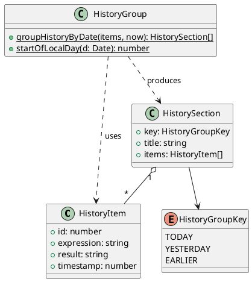

# Delta-Design — 历史日期分组

> AID PLANNING step8 产出 (mod-design) · 增量设计
> 基础设计见 `opencalc/spec/DESIGN.md`,本文档仅描述变更点

## 1. 概述

### 1.1 应用定位
- **项目**：OpenCalc HarmonyOS (Android 3.2.1 移植)
- **变更范围**：历史面板渲染层 (HistoryPanel) + 新增 `HistoryGroup` 纯函数模块
- **变更类型**：requirement-add (新增功能)

### 1.2 核心交互
- 用户打开历史面板 → 看到 "今天" / "昨天" / "更早" 三段聚合的列表
- 每段顶部有中文标题,空段不显示
- 点击条目行为不变 (回填 expression),滑删行为不变

### 1.3 技术栈概览
- 框架: ArkTS 声明式 UI (Stage 模型)
- 状态管理: V1 (`@State`/`@Builder`,与现有代码一致)
- 复用: 现有 `HistoryItem` 模型、PreferencesStore 持久化、主题色 getter

## 2. 功能清单

| 功能名 | 说明 | 入口 | 优先级 |
|--------|------|------|--------|
| 三段分组渲染 | HistoryPanel 按 timestamp 分今天/昨天/更早 | CalculatorPage.showHistory | P0 |
| 段标题显示 | "今天" / "昨天" / "更早" 中文标题 | HistoryPanel.ListItem header | P0 |
| 空段隐藏 | 空段不渲染标题 | groupHistoryByDate 内部判断 | P0 |
| 段内顺序保持 | newest-first 顺序不变 | 纯函数不排序 | P0 |
| 历史交互不变 | 点击/滑删/复制 | 复用现有 | P0 |

## 3. 实现模型

### 3.1 上下文视图
```
[User] 打开历史面板
  ↓
[CalculatorPage] showHistory=true
  ↓
[HistoryPanel @Builder]
  ↓
getHistorySections() = groupHistoryByDate(this.history, Date.now())
  ↓
[HistorySection[]] 渲染为 List
```

### 3.2 总体架构
新增模块 `history/HistoryGroup.ets` 作为纯 ViewModel 工具,被 `CalculatorPage.HistoryPanel` 调用。

### 3.3 模块划分
- 单 HAP (`entry`),无新增 HAR/HSP
- 新增 ets 文件 2 个:
  - `entry/src/main/ets/history/HistoryGroup.ets` (生产代码, ~50 行)
  - `entry/src/test/ets/history/HistoryGroup.test.ets` (测试代码, ~150 行)
- 修改文件 1 个:
  - `entry/src/main/ets/pages/CalculatorPage.ets` (HistoryPanel @Builder + 新增方法)

### 3.4 设计系统规格
**复用现有** (无新增设计 token):
- 标题色: `this.getT2()` (与历史 expression 同色)
- 标题字号: 11 (紧凑型,与列表项 12 区分)
- 标题背景: 透明 + 上下 padding 8
- 段内条目样式完全不变

### 3.5 HistoryGroup 模块实现设计

#### 3.5.1 模块介绍
- **身份**: entry HAP 内部 ets 模块,非 HAR/HSP
- **职责**: 纯函数分组,无副作用,无外部依赖

#### 3.5.2 功能描述
- 输入 `HistoryItem[]` + `now: number`,输出固定长度 3 的 `HistorySection[]`
- 提供 `startOfLocalDay(d: Date): number` 工具 (供内部与测试复用)

#### 3.5.3 目录结构
```
entry/src/main/ets/
├── history/                  ← NEW
│   └── HistoryGroup.ets      ← NEW: 纯函数分组模块
entry/src/test/ets/
├── history/                  ← NEW
│   └── HistoryGroup.test.ets ← NEW: 单元测试
```

#### 3.5.4 架构图谱 (类图)



#### 3.5.5 功能与用例分析

**用例 1: 空数组**
- 前置: `items = []`
- 步骤: 调用 `groupHistoryByDate([], now)`
- 后置: 返回 `[{TODAY, "今天", []}, {YESTERDAY, "昨天", []}, {EARLIER, "更早", []}]`

**用例 2: 跨三天混合**
- 前置: now=今天 10:00, items 含今天 10:00 / 今天 09:00 / 昨天 12:00 / 前天 08:00
- 步骤: 调用 `groupHistoryByDate(items, now)`
- 后置: today=[今天 10:00, 今天 09:00], yesterday=[昨天 12:00], earlier=[前天 08:00]

**用例 3: 边界 00:00:00**
- 前置: now=今天 12:00, items 含今天 00:00:00.000 (实际属于"今天") 和 昨天 23:59:59.999 (属于"昨天")
- 步骤: 调用
- 后置: today 含 00:00:00, yesterday 含 23:59:59

#### 3.5.6 接口设计

```typescript
// HistoryGroup.ets
export enum HistoryGroupKey { TODAY, YESTERDAY, EARLIER }

export interface HistorySection {
  key: HistoryGroupKey
  title: string
  items: HistoryItem[]
}

export function groupHistoryByDate(items: HistoryItem[], now: number): HistorySection[]
export function startOfLocalDay(d: Date): number
```

#### 3.5.7 状态管理设计
- 纯函数,无 @State
- `groupHistoryByDate` 每次 build 时调用,无缓存
- 输入变化 (history 数组变化) 时自然重算

#### 3.5.8 核心算法

```typescript
function groupHistoryByDate(items: HistoryItem[], now: number): HistorySection[] {
  const todayStart = startOfLocalDay(new Date(now))
  const yesterdayStart = todayStart - 86400000  // 24h
  // 注: 用减法而非 Date 运算避免夏令时坑
  
  const sections: HistorySection[] = [
    { key: TODAY, title: '今天', items: [] },
    { key: YESTERDAY, title: '昨天', items: [] },
    { key: EARLIER, title: '更早', items: [] }
  ]
  
  for (const item of items) {
    if (item.timestamp >= todayStart) sections[0].items.push(item)
    else if (item.timestamp >= yesterdayStart) sections[1].items.push(item)
    else sections[2].items.push(item)
  }
  return sections
}
```

**复杂度**: O(n),n ≤ 100

#### 3.5.9 错误处理
- 输入 `items=null/undefined` → 视为空数组 (defensive)
- `now <= 0` → 不检查,沿用上游约定 (PreferencesStore 保证时间戳合法)

#### 3.5.10 依赖关系
- 内部依赖: `model/Models.ets` (HistoryItem)
- 外部依赖: 无 (纯 ArkTS,无 Kit 调用)

### 3.6 HistoryPanel 集成设计

修改 `CalculatorPage.ets:441-479` 的 `@Builder HistoryPanel()`:

**改动 1**: 新增 import
```typescript
import { groupHistoryByDate, HistorySection, HistoryGroupKey } from '../history/HistoryGroup'
```

**改动 2**: 新增方法
```typescript
private getHistorySections(): HistorySection[] {
  return groupHistoryByDate(this.history, Date.now())
}
```

**改动 3**: 渲染逻辑改为遍历 sections
```typescript
List() {
  ForEach(this.getHistorySections(), (section: HistorySection) => {
    if (section.items.length > 0) {  // 空段不渲染
      ListItem() { this.SectionHeader(section.title) }
      ForEach(section.items, (item: HistoryItem) => {
        ListItem() {
          // 现有条目样式完全不变
          Column() {
            Text(item.expression).fontSize(12).fontColor(this.getT2()).maxLines(1)
            Text(item.result).fontSize(15).fontWeight(FontWeight.Bold).fontColor(this.getOp())
          }
          .alignItems(HorizontalAlign.Start).width('100%').padding(this.isLandscape ? 8 : 12)
          .onClick((): void => { this.onHistoryTap(item) })
        }
        .swipeAction({ end: { builder: (): void => { this.DelBtn(item) } } })
      }, (item: HistoryItem): string => item.id.toString())
    }
  }, (section: HistorySection): string => section.key.toString())
}
.layoutWeight(1)
```

**改动 4**: 新增 SectionHeader @Builder
```typescript
@Builder SectionHeader(title: string) {
  Row() {
    Text(title).fontSize(11).fontColor(this.getT2()).padding({ left: 12, top: 8, bottom: 4 })
  }
  .width('100%')
}
```

## 4. 接口设计

无新增内部 API / 后台任务 / Deep Link / IPC。

新增纯函数接口 (已在 §3.5.6 详述):
- `groupHistoryByDate(items, now): HistorySection[]`
- `startOfLocalDay(d: Date): number`

## 5. 数据模型

**无变更**。复用 `HistoryItem.timestamp: number`。

## 6. UI 设计系统

**复用现有** (见 `opencalc/spec/DESIGN.md` §6)。

新增设计 token (仅一处):
- 段标题字号: `11` (与列表条目 `12` 形成层级)
- 段标题上下 padding: `8 / 4`

## 7. 页面清单与导航

**无新增页面**。现有 CalculatorPage.HistoryPanel 增强。

## 8. 用户交互规格

**无新增手势/弹窗**。点击/滑删行为完全保留。

## 9. 平台集成

**无变更**。oh-package.json5、build-profile.json5、权限、Extension 等均不变。

## 10. 偏好设置目录

**无变更**。

---

## 自验证 (mod-design Step 3)

| 检查项 | 结果 |
|--------|------|
| 功能一致性 (proposal ↔ §2) | ✅ 5 个功能点全映射 |
| 页面一致性 (proposal ↔ §7) | ✅ 无新增页面,符合 |
| 数据一致性 (proposal ↔ §5) | ✅ 复用 HistoryItem,符合 |
| 权限一致性 (proposal ↔ §9) | ✅ 无新增权限 |
| Kit 一致性 (proposal ↔ §9) | ✅ 无新增 Kit 依赖 |

---
> 本文档由 mod-design skill 生成。
> 标记 [推断] 的内容为基于设计推断,非确定性事实。
> 生成时间: 2026-06-16
