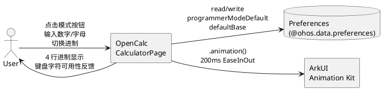
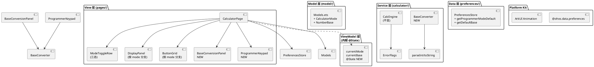
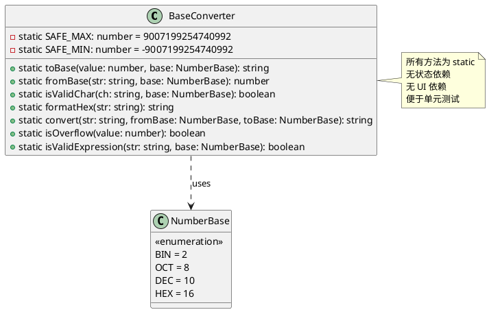
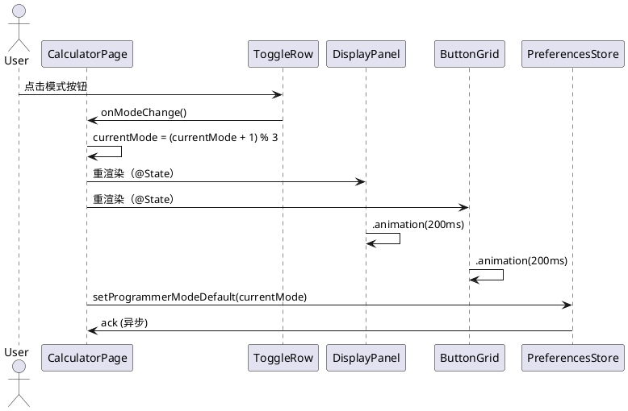
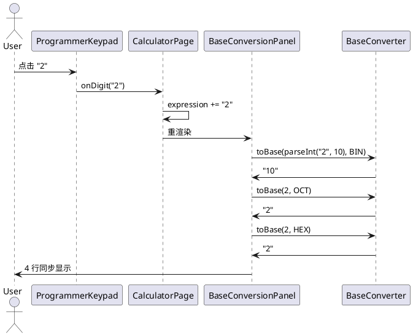

# 程序员模式 + 进制转换 — 增量设计

> **Issue**: #4
> **类型**: 增量变更（delta-design）
> **基线设计**: `opencalc/spec/DESIGN.md`（OpenCalc HarmonyOS 现有架构）
> **生成时间**: 2026-06-10
> **生成者**: dev-01 (mod-design)

---

## D1: 概述

### 1.1 应用定位

OpenCalc HarmonyOS 计算器新增"程序员模式"作为第三种工作模式，与现有"基础模式"和"科学模式"并列，面向程序员、网络工程师、学生等专业用户，提供 DEC/BIN/OCT/HEX 四进制的实时切换、并行显示和相互转换能力。

### 1.2 核心交互

```
用户 → ToggleRow（三态循环）
  ├── BASIC（基础）           → 现有 5×N 键盘 + 单行显示
  ├── SCIENTIFIC（科学）      → 基础 + sin/cos/tan/ln/log 等
  └── PROGRAMMER（程序员）    → 新增 BaseConversionPanel (4行) + ProgrammerKeypad
       └── DEC/BIN/OCT/HEX 切换 → 键盘字符过滤 + 高亮当前行
```

**关键交互路径**：
1. **路径 1（典型）**：基础 → 程序员 → 输入 255 → 看到 4 进制
2. **路径 2（HEX 输入）**：程序员 → HEX 模式 → 输入 FF → 4 行同步更新
3. **路径 3（进制切换）**：DEC 输入 10 → 切到 BIN → 显示 1010
4. **路径 4（退出）**：程序员 → 科学 → 基础（3 次点击回到起点）

### 1.3 技术栈概览

| 维度 | 取值 |
|------|------|
| **框架** | ArkTS（HarmonyOS Stage 模型 + ArkUI 声明式） |
| **状态管理** | **V1**（@State / @Builder / .animation()） — 与现有项目一致 |
| **新增 Kit** | 无（复用现有 @kit.ArkUI / @kit.ArkData / @kit.BasicServicesKit） |
| **Native 模块** | 无 |
| **Hvigor 插件** | 无新增（hvigor 6.0.2 + SDK 12） |
| **持久化** | @ohos.data.preferences（沿用 PreferencesStore） |
| **测试框架** | 单元测试（BaseConverter 纯逻辑） |

---

## D2: 功能清单

| ID | 功能名 | 说明 | 入口 Page | 优先级 | 关联 SR |
|----|--------|------|-----------|:------:|---------|
| FN-PRG-001 | 三模式循环切换 | ToggleRow 二态→三态（基础/科学/程序员） | CalculatorPage | P0 | SR-PRG-001 |
| FN-PRG-002 | 模式切换动画 | 200ms 淡入淡出 + 8dp 垂直位移 | CalculatorPage | P1 | SR-PRG-004 |
| FN-PRG-003 | BaseConversionPanel 组件 | 程序员模式 4 行实时显示 | CalculatorPage | P0 | SR-PRG-002 |
| FN-PRG-004 | DEC 行高亮 | 当前进制行用 getOp() 背景色 | CalculatorPage | P0 | SR-PRG-002 |
| FN-PRG-005 | ProgrammerKeypad 组件 | 程序员模式专属键盘（含 A-F） | CalculatorPage | P0 | SR-PRG-003 |
| FN-PRG-006 | 进制切换按钮 | DEC/BIN/OCT/HEX 切换器 | CalculatorPage | P0 | SR-PRG-003 |
| FN-PRG-007 | BaseConverter 工具类 | toBase / fromBase / isValidChar / formatHex | calculator/BaseConverter.ets | P0 | SR-PRG-005 |
| FN-PRG-008 | 偏好持久化扩展 | programmerModeDefault + defaultBase | PreferencesStore | P0 | SR-PRG-006 |
| FN-PRG-009 | 溢出与非法输入容错 | >2^53 显示 Overflow + 小数 Toast | BaseConverter + UI | P0 | SR-PRG-007 |
| FN-PRG-010 | 横竖屏兼容 | 横屏不开程序员模式 | CalculatorPage | P2 | SR-PRG-008 |

**功能优先级说明**：
- P0：核心功能，缺失则程序员模式不可用
- P1：体验增强，缺失不影响功能
- P2：兼容性需求，缺失可能导致边界场景问题

---

## D3: 实现模型

### 3.1 上下文视图



### 3.2 总体架构

延续现有单页面架构（见 `opencalc/spec/DESIGN.md §1`），本次增量在以下层新增：



**关键架构决策**：
1. **沿用 God Page 反模式**：CalculatorPage 从 415 行增至 ~615 行（+47%），后续 IMPLEMENTING 阶段可考虑拆分 ViewModel
2. **纯逻辑与 UI 分离**：BaseConverter.ets 无 UI 依赖，便于单元测试
3. **状态机扁平化**：currentMode (3 态) × currentBase (4 态) = 12 种组合，无嵌套状态

### 3.3 HAP/HAR/HSP 模块划分

**沿用现有单 HAP 架构**（见 `opencalc/spec/DESIGN.md §1`），本次增量不新增模块：

| 模块 | 身份 | 变化 |
|------|------|------|
| entry HAP | 主入口 | 修改（CalculatorPage 重构 + 新增 BaseConverter.ets） |
| feature HAP | - | 无 |
| HAR | - | 无 |
| HSP | - | 无 |
| OHPM 依赖 | - | 无新增 |

### 3.4 设计系统规格

#### 3.4.1 色彩系统

**沿用现有 3 主题 + 日夜模式**（见 `opencalc/spec/DESIGN.md §3.4`）。

**新增 / 复用颜色**：

| 名称 | Light | Dark | AMOLED | 用途 |
|------|-------|------|--------|------|
| `getOp()` | #B4D2E4 | #0070BC | #0070BC | 当前进制行高亮背景 |
| `getBg()` | #FFFFFF | #121212 | #000000 | 4 行显示区背景 |
| `getT1()` | #000000 | #EFEFEF | #EFEFEF | DEC 行文字（主） |
| `getT2()` | #595959 | #BDBDBD | #BDBDBD | BIN/OCT/HEX 行文字（次） |
| `getBtnBg()` | #EFEFEF | #333333 | #1a1a1a | 数字按钮 |
| `getFuncBg()` | #E8E8E8 | #333333 | #111111 | A-F 字母按钮 |

**DEC 行高亮策略**：当 currentBase === DEC 时，DEC 行背景 = `getOp()`；否则该行背景 = 透明，BIN/OCT/HEX 行同理。

#### 3.4.2 主题系统

**完全沿用**（见 `opencalc/spec/DESIGN.md §4.5` ThemeItem）。

#### 3.4.3 排版系统

| 元素 | 字号 | 字重 | 颜色 | 用途 |
|------|:----:|:----:|------|------|
| DEC 行数值 | 28 | Bold | `getT1()` | 主行（程序员模式） |
| BIN/OCT/HEX 行数值 | 18 | Normal | `getT2()` | 次行 |
| 进制标签（DEC/BIN/OCT/HEX） | 12 | Normal | `getT2()` | 行首 |
| 模式按钮文字 | 12 | Normal | `getOp()` | "基础"/"科学"/"程序员" |
| A-F 字母按钮 | 16 | Bold | `getOp()` | HEX 模式专属 |
| 数字按钮 | 22 | Normal | `getT1()` | 复用现有 |

#### 3.4.4 间距与尺寸系统

**沿用**（见 `opencalc/spec/DESIGN.md §4.4`）。

**新增 / 复用尺寸**：

| 元素 | 高度 | 宽度 | 边距 |
|------|:----:|:----:|------|
| 4 行显示区（程序员模式） | auto | 100% | padding { top: 16, bottom: 8, left: 12, right: 12 } |
| 单行（DEC 行，高亮） | 40 | 100% | padding { top: 4, bottom: 4 } |
| 单行（BIN/OCT/HEX，非高亮） | 32 | 100% | padding { top: 2, bottom: 2 } |
| A-F 字母按钮 | 56 | 17% | margin 4 |
| 进制切换按钮（DEC/BIN/OCT/HEX） | 32 | 23% | margin 2 |

#### 3.4.5 图标与图形资源

**沿用**（见 `opencalc/spec/DESIGN.md §4.6`）。

**新增文字图标**：
- `DEC` / `BIN` / `OCT` / `HEX` — 文字标签（非图像）
- `A` / `B` / `C` / `D` / `E` / `F` — 字母按钮文字

#### 3.4.6 动画规格

| 动画 | 时长 | 曲线 | 触发 | 效果 |
|------|:----:|------|------|------|
| 模式切换 | 200ms | EaseInOut | currentMode 变化 | 透明度 1↔0 + translateY 8dp↔0 |
| 进制切换 | 100ms | EaseInOut | currentBase 变化 | 当前行背景色淡入 |
| 数字按钮按下 | 50ms | Linear | onClick | 透明度 0.7 → 1 |
| 当前进制行高亮 | 150ms | EaseInOut | currentBase 变化 | 背景色平滑过渡 |

#### 3.4.7 响应式断点与栅格

**沿用**（见 `opencalc/spec/DESIGN.md §4.7`）。

**程序员模式专属**：
- **竖屏**：4 行紧凑显示，行高 32~40dp
- **横屏**：4 行等宽，行高 28~32dp（节省垂直空间）

### 3.5 模块实现设计 — calculator/BaseConverter.ets（NEW）

#### 3.5.1 模块介绍

| 维度 | 取值 |
|------|------|
| **模块身份** | calculator/ 目录内的纯逻辑工具类 |
| **installationFree** | N/A（库内部） |
| **UI 依赖** | 无（纯函数） |
| **测试难度** | 低（纯逻辑，单测覆盖率可达 100%） |

#### 3.5.2 功能描述

| ID | 功能 | 说明 |
|----|------|------|
| F-BC-01 | toBase(value, base) | 十进制数 → 任意进制字符串 |
| F-BC-02 | fromBase(str, base) | 任意进制字符串 → 十进制数 |
| F-BC-03 | isValidChar(ch, base) | 判断字符是否合法 |
| F-BC-04 | formatHex(str) | 大写化十六进制字符串 |
| F-BC-05 | convert(str, fromBase, toBase) | 跨进制转换 |
| F-BC-06 | isOverflow(value) | 判断是否超出 2^53 |
| F-BC-07 | isValidExpression(str, base) | 表达式整体合法性校验 |

#### 3.5.3 目录结构

```
calculator/
├── Calculator.ets          (existing, unchanged)
├── Expression.ets          (existing, unchanged)
├── NumberFormatter.ets     (existing, unchanged)
└── BaseConverter.ets       (NEW)
```

#### 3.5.4 架构图谱



#### 3.5.5 功能与用例分析

**用例：BaseConverter.toBase**

```
前置条件：value 为有限 number
步骤：
  1. 判断 value 是否在 [-2^53, 2^53] 范围 → 否返回 "Overflow"
  2. 若 value < 0 → 记录符号，结果为 "-" + toBase(|value|, base)
  3. 若 value === 0 → 返回 "0"
  4. 否则 value.toString(base) + 大写化（HEX）
后置条件：返回 base 对应字符串

边界：
  - value = 2^53 → "Overflow"
  - value = 2^53 - 1 → 4 进制正确转换
  - value = NaN → "Invalid"
  - value = Infinity → "Overflow"
```

#### 3.5.6 接口设计

```typescript
// calculator/BaseConverter.ets

import { NumberBase } from '../model/Models'

export class BaseConverter {
  /** 安全整数上限 */
  private static readonly SAFE_MAX: number = 9007199254740992  // 2^53

  /** 安全整数下限 */
  private static readonly SAFE_MIN: number = -9007199254740992  // -2^53

  /**
   * 十进制数转任意进制字符串
   * @param value 十进制数
   * @param base 目标基数
   * @returns 进制字符串或 "Overflow" / "Invalid"
   */
  static toBase(value: number, base: NumberBase): string

  /**
   * 任意进制字符串转十进制数
   * @param str 源进制字符串
   * @param base 源基数
   * @returns 十进制数（解析失败返回 NaN）
   */
  static fromBase(str: string, base: NumberBase): number

  /**
   * 判断字符是否对当前进制合法
   * @param ch 单字符
   * @param base 当前基数
   * @returns 是否合法
   */
  static isValidChar(ch: string, base: NumberBase): boolean

  /**
   * 十六进制字符串大写化
   * @param str 含 a-f 的字符串
   * @returns 大写化结果
   */
  static formatHex(str: string): string

  /**
   * 跨进制转换（先 toBase 再 fromBase 到目标）
   * @param str 源字符串
   * @param fromBase 源基数
   * @param toBase 目标基数
   * @returns 目标进制字符串
   */
  static convert(str: string, fromBase: NumberBase, toBase: NumberBase): string

  /**
   * 判断数值是否超出安全整数范围
   * @param value 待检测数值
   * @returns true/false
   */
  static isOverflow(value: number): boolean

  /**
   * 表达式整体合法性校验
   * @param str 表达式
   * @param base 当前基数
   * @returns true/false
   */
  static isValidExpression(str: string, base: NumberBase): boolean
}
```

#### 3.5.7 状态管理设计

- **无状态**：所有方法为 static，无实例字段
- **纯函数**：相同输入永远相同输出，便于缓存和测试

#### 3.5.8 核心算法

**toBase 算法**：

```typescript
static toBase(value: number, base: NumberBase): string {
  // 1. 边界检测
  if (Number.isNaN(value)) return 'Invalid'
  if (BaseConverter.isOverflow(value)) return 'Overflow'

  // 2. 符号处理
  const negative: boolean = value < 0
  const absValue: number = Math.abs(value)

  // 3. 零处理
  if (absValue === 0) return '0'

  // 4. 转换
  let result: string = absValue.toString(base)
  if (base === NumberBase.HEX) result = BaseConverter.formatHex(result)

  // 5. 加符号
  return negative ? '-' + result : result
}
```

**复杂度**：O(log_base(value))，对 2^53 量级约 53 步。

#### 3.5.9 错误处理

| 异常 | 处理 |
|------|------|
| `NaN` 输入 | 返回 `"Invalid"`，UI 显示 `Invalid` 行 |
| `Infinity` 输入 | 返回 `"Overflow"`，UI 显示 `Overflow` 行 |
| 超出 2^53 | 返回 `"Overflow"` |
| 非法字符 fromBase | `parseInt` 返回 NaN，fromBase 返回 NaN，UI 显示 `Invalid` |
| 空字符串 | 视为 0，返回 `"0"` |

#### 3.5.10 依赖关系

- **内部依赖**：`model/Models.ets`（NumberBase 枚举）
- **外部依赖**：无（仅用 ArkTS 标准库 `Number.toString(radix)` + `parseInt`）
- **被依赖**：`pages/CalculatorPage.ets`（BaseConversionPanel + ProgrammerKeypad）

### 3.6 模块实现设计 — pages/CalculatorPage.ets（MODIFY）

#### 3.6.1 模块介绍

| 维度 | 取值 |
|------|------|
| **模块身份** | entry HAP 主页面（@Entry / @Component） |
| **行数变化** | 415 → ~615（+200 行） |
| **变更类型** | modify（ToggleRow 三态 + DisplayPanel 分支 + ButtonGrid 分支 + 新增 @Builder） |

#### 3.6.2 功能描述

详见 §D2 FN-PRG-001 ~ FN-PRG-010。

#### 3.6.3 目录结构

```
pages/
├── Index.ets            (existing, unchanged)
└── CalculatorPage.ets   (MODIFY)
    ├── 新增 @State currentMode: CalculatorMode
    ├── 新增 @State currentBase: NumberBase
    ├── ToggleRow()      修改：三态循环
    ├── DisplayPanel()   修改：按 currentMode 分支
    ├── ButtonGrid()     修改：按 currentMode 分支
    ├── BaseConversionPanel()  新增
    ├── ProgrammerKeypad()     新增
    ├── BtnAlpha()       新增：HEX 字母按钮
    └── BaseSwitcher()   新增：DEC/BIN/OCT/HEX 切换器
```

#### 3.6.4 架构图谱（时序图）

**用例：三模式切换**



**用例：程序员模式输入 255**



#### 3.6.5 功能与用例分析

| 用例 | 前置 | 步骤 | 后置 |
|------|------|------|------|
| 三模式切换 | currentMode 任意 | 点击 ToggleRow 按钮 | currentMode 更新 + 动画 + 偏好写入 |
| 程序员模式 4 行显示 | currentMode=PROGRAMMER | 输入任意合法字符 | 4 行实时同步 |
| 进制切换 | currentMode=PROGRAMMER | 点击 DEC/BIN/OCT/HEX | currentBase 更新 + 键盘过滤 + 表达式重解读 |
| 键盘字符过滤 | currentMode=PROGRAMMER | currentBase=BIN 时点击 "2" | 按钮置灰无反应 |
| 模式切换动画 | currentMode 变化 | / | 200ms 淡入淡出 + 上移 |
| 溢出容错 | currentMode=PROGRAMMER | 输入 99999999999999999999 | 该行显示 Overflow，其他行正常 |
| 横竖屏兼容 | isLandscape 变化 | 旋转屏幕 | scientific 切换，currentMode 不变 |

#### 3.6.6 接口设计

**新增 @State 字段**：

```typescript
@State currentMode: CalculatorMode = CalculatorMode.BASIC
@State currentBase: NumberBase = NumberBase.DEC
@State lastModeChangeTime: number = 0  // 节流用
```

**新增方法**：

```typescript
// 模式切换
onModeChange(): void

// 进制切换
onBaseChange(newBase: NumberBase): void

// HEX 字母按钮
onLetter(ch: string): void

// 校验当前字符是否合法（按钮置灰用）
isCharValid(ch: string): boolean

// 4 行显示数据
getDecDisplay(): string
getBinDisplay(): string
getOctDisplay(): string
getHexDisplay(): string

// 当前进制行高亮判断
isCurrentBase(base: NumberBase): boolean

// 主题色：当前进制行高亮
getBaseHighlightBg(): string

// 节流保护
shouldThrottle(): boolean
```

**修改方法**：

```typescript
// 改造 onEquals：程序员模式按 currentBase 解读表达式
onEquals(): void

// 改造 onModeChange：替换原 scientific 切换
// 注：保留 scientific 字段（控制科学模式额外按钮显示）
```

#### 3.6.7 状态管理设计

**状态机**：

```
                    onModeChange
        ┌────────────────────────────────┐
        ↓                                │
    BASIC ─────→ SCIENTIFIC ─────→ PROGRAMMER
        ↑                                │
        └────────────────────────────────┘
```

**currentBase 状态机**（仅在 currentMode=PROGRAMMER 下活跃）：

```
    DEC ⇄ BIN
    ↑       ↓
    HEX ⇄ OCT
```

**@State 字段清单**：

| 字段 | 类型 | 默认 | 触发重渲染 |
|------|------|:----:|------------|
| `currentMode` | CalculatorMode | BASIC | ToggleRow / DisplayPanel / ButtonGrid |
| `currentBase` | NumberBase | DEC | BaseConversionPanel 高亮 / ProgrammerKeypad 字符过滤 |
| `expression` | string | "" | 已有 |
| `result` | string | "" | 已有 |
| `scientific` | boolean | false | 横屏自动 / 科学模式按钮（**保留不变**） |

**数据流图**：

```
用户输入
  ↓
onDigit/onLetter/onOp
  ↓
@State expression 更新
  ↓
┌────────────────────────────┐
│  DisplayPanel (按 mode)     │
├────────────────────────────┤
│ BASIC/SCI: 单行显示          │
│ PROGRAMMER:                 │
│   BaseConversionPanel       │
│     → DEC: expression       │
│     → BIN: parseInt(...).toString(2) │
│     → OCT: ...               │
│     → HEX: ...toUpperCase()  │
└────────────────────────────┘
```

#### 3.6.8 核心算法

**表达式按当前进制解读**：

```typescript
// 程序员模式下，onEquals 改造
onEquals(): void {
  if (this.currentMode === CalculatorMode.PROGRAMMER) {
    // 1. 按 currentBase 解读 expression
    const decValue: number = BaseConverter.fromBase(this.expression, this.currentBase)
    if (Number.isNaN(decValue)) {
      this.errorMsg = '表达式无法解读'
      return
    }
    // 2. 直接使用 decValue 作为 result
    this.result = NumberFormatter.format(decValue.toString(), '.', ',', NumberingSystem.INTERNATIONAL)
    // 3. 添加到历史
    this.addToHistory(decValue)
    return
  }
  // 原有逻辑（基础/科学模式）
  ...
}
```

**节流保护**：

```typescript
onModeChange(): void {
  const now: number = Date.now()
  if (now - this.lastModeChangeTime < 200) return
  this.lastModeChangeTime = now
  this.currentMode = (this.currentMode + 1) % 3
  // ... 动画 + 偏好写入
}
```

#### 3.6.9 错误处理

| 异常场景 | 处理 |
|----------|------|
| 模式切换按钮连续点击 | 200ms 节流，忽略后续 |
| 偏好保存失败 | UI 仍生效，console.warn，静默失败 |
| 表达式含当前进制非法字符 | 不切换 currentBase，Toast 提示 |
| 输入超 2^53 | 该行显示 Overflow，其他行正常 |
| 输入小数点 | Toast "程序员模式仅支持整数"，不追加 |
| 横屏时进入程序员模式 | 正常，但 scientific 字段独立（不影响 currentMode） |

#### 3.6.10 依赖关系

- **内部依赖**：
  - `calculator/BaseConverter.ets`（NEW）
  - `model/Models.ets`（扩展 CalculatorMode + NumberBase）
  - `preferences/PreferencesStore.ets`（扩展 2 个方法）
- **外部依赖**：无新增

### 3.7 模块实现设计 — model/Models.ets（EXTEND）

#### 3.7.1 模块介绍

| 维度 | 取值 |
|------|------|
| **模块身份** | model/ 目录内数据模型 |
| **变更类型** | extend（新增 2 个枚举 + 扩展 1 个接口） |
| **行数变化** | 61 → ~90（+29 行） |

#### 3.7.2 功能描述

新增 `CalculatorMode` 和 `NumberBase` 枚举；扩展 `CalculatorPreferences` 接口。

#### 3.7.3 新增枚举

```typescript
// 计算器工作模式
export enum CalculatorMode {
  BASIC = 0,
  SCIENTIFIC = 1,
  PROGRAMMER = 2
}

// 数字基数
export enum NumberBase {
  BIN = 2,
  OCT = 8,
  DEC = 10,
  HEX = 16
}
```

#### 3.7.4 扩展 CalculatorPreferences

```typescript
export interface CalculatorPreferences {
  theme: number
  forceDayNight: number
  vibrationEnabled: boolean
  preventSleep: boolean
  historySize: number
  scientificModeDefault: number  // ScientificModeType
  radiansDefault: boolean
  numberPrecision: number
  decimalSeparatorSymbol: string
  groupingSeparatorSymbol: string
  // ========== NEW ==========
  programmerModeDefault: number  // CalculatorMode（0/1/2）
  defaultBase: number            // NumberBase（2/8/10/16）
}

export const DEFAULT_PREFERENCES: CalculatorPreferences = {
  // ... existing
  programmerModeDefault: CalculatorMode.BASIC,  // 0
  defaultBase: NumberBase.DEC                    // 10
}
```

### 3.8 模块实现设计 — preferences/PreferencesStore.ets（EXTEND）

#### 3.8.1 模块介绍

| 维度 | 取值 |
|------|------|
| **模块身份** | preferences/ 目录内数据访问层 |
| **变更类型** | extend（新增 4 个方法 + 扩展 getAllPreferences） |
| **行数变化** | 225 → ~280（+55 行） |

#### 3.8.2 新增方法

```typescript
// ==================== 程序员模式 ====================

async getProgrammerModeDefault(): Promise<number> {
  if (!this.store) return DEFAULT_PREFERENCES.programmerModeDefault
  return await this.store.get('programmerModeDefault', DEFAULT_PREFERENCES.programmerModeDefault) as number
}

async setProgrammerModeDefault(value: number): Promise<void> {
  if (!this.store) return
  await this.store.put('programmerModeDefault', value)
  await this.store.flush()
}

async getDefaultBase(): Promise<number> {
  if (!this.store) return DEFAULT_PREFERENCES.defaultBase
  return await this.store.get('defaultBase', DEFAULT_PREFERENCES.defaultBase) as number
}

async setDefaultBase(value: number): Promise<void> {
  if (!this.store) return
  await this.store.put('defaultBase', value)
  await this.store.flush()
}
```

#### 3.8.3 扩展 getAllPreferences

```typescript
async getAllPreferences(): Promise<CalculatorPreferences> {
  return {
    theme: await this.getTheme(),
    forceDayNight: await this.getForceDayNight(),
    vibrationEnabled: await this.getVibrationEnabled(),
    preventSleep: await this.getPreventSleep(),
    historySize: await this.getHistorySize(),
    scientificModeDefault: await this.getScientificModeDefault(),
    radiansDefault: await this.getRadiansDefault(),
    numberPrecision: await this.getNumberPrecision(),
    decimalSeparatorSymbol: await this.getDecimalSeparator(),
    groupingSeparatorSymbol: await this.getGroupingSeparator(),
    // ========== NEW ==========
    programmerModeDefault: await this.getProgrammerModeDefault(),
    defaultBase: await this.getDefaultBase()
  }
}
```

---

## D4: 接口设计

### 4.1 内部数据访问 API

**沿用**（见 `opencalc/spec/DESIGN.md §4.1`）。

**新增**：

| 方法 | 签名 | 键名 | 返回类型 |
|------|------|------|----------|
| `getProgrammerModeDefault()` | `() => Promise<number>` | `programmerModeDefault` | 0/1/2 |
| `setProgrammerModeDefault(v)` | `(v: number) => Promise<void>` | `programmerModeDefault` | - |
| `getDefaultBase()` | `() => Promise<number>` | `defaultBase` | 2/8/10/16 |
| `setDefaultBase(v)` | `(v: number) => Promise<void>` | `defaultBase` | - |

### 4.2 业务抽象接口

**新增**：

```typescript
// calculator/BaseConverter.ets
export class BaseConverter {
  static toBase(value: number, base: NumberBase): string
  static fromBase(str: string, base: NumberBase): number
  static isValidChar(ch: string, base: NumberBase): boolean
  static formatHex(str: string): string
  static convert(str: string, fromBase: NumberBase, toBase: NumberBase): string
  static isOverflow(value: number): boolean
  static isValidExpression(str: string, base: NumberBase): boolean
}
```

### 4.3 后台任务与 ExtensionAbility 接口

无相关实现（沿用 `opencalc/spec/DESIGN.md §4.3`）。

### 4.4 Want / Action 协议

无相关实现（沿用 `opencalc/spec/DESIGN.md §4.4`）。

### 4.5 URI / Deep Link / AppLinking 协议

无相关实现（沿用 `opencalc/spec/DESIGN.md §4.5`）。

### 4.6 IPC 与 RPC 接口

无相关实现（沿用 `opencalc/spec/DESIGN.md §4.6`）。

### 4.7 Native（C/C++）接口

无相关实现（沿用 `opencalc/spec/DESIGN.md §4.7`）。

### 4.8 文件交换接口

无相关实现（沿用 `opencalc/spec/DESIGN.md §4.8`）。

---

## D5: 数据模型

### 5.1 关系型数据库模型

无相关实现（沿用 `opencalc/spec/DESIGN.md §5.1`）。

### 5.2 领域模型

**新增**：

```typescript
// 模型：计算器工作模式
enum CalculatorMode {
  BASIC = 0        // 基础模式
  SCIENTIFIC = 1   // 科学模式
  PROGRAMMER = 2   // 程序员模式
}

// 模型：数字基数
enum NumberBase {
  BIN = 2          // 二进制
  OCT = 8          // 八进制
  DEC = 10         // 十进制（默认）
  HEX = 16         // 十六进制
}
```

### 5.3 Preferences 结构

**新增 2 个键**：

| key | 类型 | 默认值 | 说明 | 行为影响 |
|-----|------|:------:|------|----------|
| `programmerModeDefault` | number | 0 (BASIC) | 启动默认模式 | aboutToAppear 时读取 → 设置 currentMode |
| `defaultBase` | number | 10 (DEC) | 启动默认进制 | aboutToAppear 时读取 → 设置 currentBase |

### 5.4 分布式数据对象模型

无相关实现（沿用 `opencalc/spec/DESIGN.md §5.4`）。

### 5.5 文件格式 Schema

无相关实现（沿用 `opencalc/spec/DESIGN.md §5.5`）。

---

## D6: UI 设计系统

详见 §3.4 设计系统规格。

### 6.7 一多响应式规范

**竖屏（< 600dp 宽）**：

```
┌─────────────────────┐
│ ToggleRow           │
├─────────────────────┤
│ DisplayPanel         │
│  ┌────────────────┐ │
│  │ DEC: 255       │ │ ← 28pt Bold
│  │ BIN: 11111111  │ │ ← 18pt Normal
│  │ OCT: 377       │ │
│  │ HEX: FF        │ │
│  └────────────────┘ │
├─────────────────────┤
│ ProgrammerKeypad     │
│  [DEC][BIN][OCT][HEX]│ ← 进制切换器
│  [A  ][B  ][C  ][D  ]│
│  [E  ][F  ][(  ][)  ]│
│  [7  ][8  ][9  ][÷  ]│
│  [4  ][5  ][6  ][×  ]│
│  [1  ][2  ][3  ][-  ]│
│  [0  ][.  ][⌫][=   ]│
└─────────────────────┘
```

**横屏（≥ 600dp 宽）**：

```
┌─────────────────────┬──────────────┐
│ DisplayPanel        │ (历史按钮)    │
│  ┌────────────────┐ │              │
│  │ DEC: 255       │ │              │
│  │ BIN: 11111111  │ │              │
│  │ OCT: 377       │ │              │
│  │ HEX: FF        │ │              │
│  └────────────────┘ │              │
├─────────────────────┤              │
│ ProgrammerKeypad     │              │
│  [DEC][BIN][OCT][HEX]│              │
│  [A][B][C][D][E][F][÷][×]            │
│  [7][8][9][-]                        │
│  [4][5][6][+]                        │
│  [1][2][3][=]                        │
│  [0][.][⌫]                           │
└─────────────────────┴──────────────┘
```

---

## D7: 页面清单与导航

### 7.1 页面清单总表

| 页面名 | 路径 | 入口 Ability | 传参 | 功能摘要 |
|--------|------|--------------|------|----------|
| **CalculatorPage** | `pages/CalculatorPage` | EntryAbility | - | 主页面（扩展：新增程序员模式） |
| Index | `pages/Index` | EntryAbility | - | 启动页（不变） |
| SettingsPanel | `@Builder` | CalculatorPage.showSettings | - | 设置面板（扩展：新增默认模式/默认进制） |
| AboutPanel | `@Builder` | CalculatorPage.showAbout | - | 关于面板（不变） |
| HistoryPanel | `@Builder` | CalculatorPage.showHistory | - | 历史面板（不变） |
| **BaseConversionPanel** | `@Builder` (NEW) | CalculatorPage.currentMode=PROGRAMMER | - | 4 行进制显示 |
| **ProgrammerKeypad** | `@Builder` (NEW) | CalculatorPage.currentMode=PROGRAMMER | - | 程序员键盘 |

### 7.2 全局导航图

**沿用**（见 `opencalc/spec/DESIGN.md §7.2`）。

### 7.3 Deep Link / AppLinking 处理

无相关实现（沿用 `opencalc/spec/DESIGN.md §7.3`）。

### 7.4 Want 跳转矩阵

无相关实现（沿用 `opencalc/spec/DESIGN.md §7.4`）。

---

## D8: 用户交互规格

### 8.1 手势交互目录

**沿用**（见 `opencalc/spec/DESIGN.md §8.1`）。

**新增**：

| 手势 | 元素 | 行为 |
|------|------|------|
| 单击 | ToggleRow 模式按钮 | 三态循环 |
| 单击 | DEC/BIN/OCT/HEX 切换按钮 | 切换 currentBase |
| 单击 | A-F 字母按钮 | 追加到 expression（仅 HEX 模式） |
| 单击 | 数字按钮（程序员模式） | 按 currentBase 过滤后追加 |

### 8.2 弹窗/Sheet/Menu 目录

**沿用**（见 `opencalc/spec/DESIGN.md §8.2`）。

**新增**：

| 类型 | 触发 | 内容 |
|------|------|------|
| Toast | 程序员模式输入小数点 | "程序员模式仅支持整数" |
| Toast | 切换进制时表达式含非法字符 | "当前进制不支持该表达式" |
| Toast | 程序员模式 = 后结果小数 | "不支持小数" |

### 8.3 剪贴板与反馈行为

**沿用**（见 `opencalc/spec/DESIGN.md §8.3`）。

**新增**：

| 行为 | 触发 | 反馈 |
|------|------|------|
| 复制 DEC 值 | 长按 DisplayPanel | 写入剪贴板 + Toast "已复制" |
| 复制 HEX 值 | 长按 HEX 行（程序员模式） | 写入剪贴板 + Toast "已复制"（**待定**，[推断] V1 不实现） |

### 8.4 卡片交互

无相关实现（沿用 `opencalc/spec/DESIGN.md §8.4`）。

---

## D9: 平台集成

### 9.1 构建配置与依赖

**沿用**（见 `opencalc/spec/DESIGN.md §9.1`）。

**无新增依赖**（oh-package.json5 不变）。

### 9.2 权限与运行时请求

**沿用**（见 `opencalc/spec/DESIGN.md §9.2`）。

**无新增权限**（不涉及网络/文件/相机）。

### 9.3 系统能力（Kits）清单

**沿用**（见 `opencalc/spec/DESIGN.md §9.3`）。

| Kit | 关键 API | 用途 |
|-----|----------|------|
| @kit.ArkUI | `.animation()` | 模式切换动画 |
| @kit.ArkUI | `promptAction.showToast()` | 错误提示 |
| @kit.ArkData | `preferences.put/get/flush` | 偏好持久化 |
| @kit.BasicServicesKit | `pasteboard` | 复制结果 |

### 9.4 后台与 Extension

无相关实现（沿用 `opencalc/spec/DESIGN.md §9.4`）。

### 9.5 备份与恢复

无相关实现（沿用 `opencalc/spec/DESIGN.md §9.5`）。

### 9.6 分布式与跨端

无相关实现（沿用 `opencalc/spec/DESIGN.md §9.6`）。

---

## D10: 偏好设置目录

| key | 类型 | 默认值 | 说明 | 行为影响 |
|-----|------|:------:|------|----------|
| `theme` | number | 0 | 主题（0=默认 1=AMOLED 2=暗色） | 已存在 |
| `forceDayNight` | number | 0 | 强制日夜模式 | 已存在 |
| `vibrationEnabled` | boolean | true | 振动反馈 | 已存在 |
| `preventSleep` | boolean | false | 防休眠 | 已存在 |
| `historySize` | number | 100 | 历史最大条数 | 已存在 |
| `scientificModeDefault` | number | 0 | 默认科学模式 | 已存在 |
| `radiansDefault` | boolean | false | 默认弧度模式 | 已存在 |
| `numberPrecision` | number | 12 | 数字精度 | 已存在 |
| `decimalSeparatorSymbol` | string | "." | 小数点符号 | 已存在 |
| `groupingSeparatorSymbol` | string | "," | 千分位符号 | 已存在 |
| **`programmerModeDefault`** | **number** | **0 (BASIC)** | **默认工作模式** | **aboutToAppear → currentMode** |
| **`defaultBase`** | **number** | **10 (DEC)** | **默认进制** | **aboutToAppear → currentBase** |

---

## 自验证（Step 3）

| 检查项 | 通过 |
|--------|:----:|
| **功能一致性**：proposal.md / delta-spec.md 的功能 ↔ §D2 功能清单（FN-PRG-001 ~ FN-PRG-010 ↔ SR-PRG-001 ~ SR-PRG-008） | ✅ |
| **页面一致性**：proposal.md / delta-spec.md 的页面需求 ↔ §D7.1（含 BaseConversionPanel + ProgrammerKeypad） | ✅ |
| **数据一致性**：proposal.md / delta-spec.md 的数据模型 ↔ §D5.2 + §D5.3（CalculatorMode + NumberBase + 2 个偏好键） | ✅ |
| **权限一致性**：proposal.md / delta-spec.md 的权限需求 ↔ §D9.2（无新增权限） | ✅ |
| **Kit 一致性**：proposal.md / delta-spec.md 声明的 Kit ↔ §D9.3（无新增 Kit） | ✅ |

---

> **文档生成说明**
> 本文档由 mod-design skill 生成（增量设计模式）。
> 基线：`opencalc/spec/DESIGN.md`
> 标记 [推断] 的内容为基于设计推断，非确定性事实。
> 生成时间：2026-06-10
> 下一步：step9 设计审视 → design-review.md