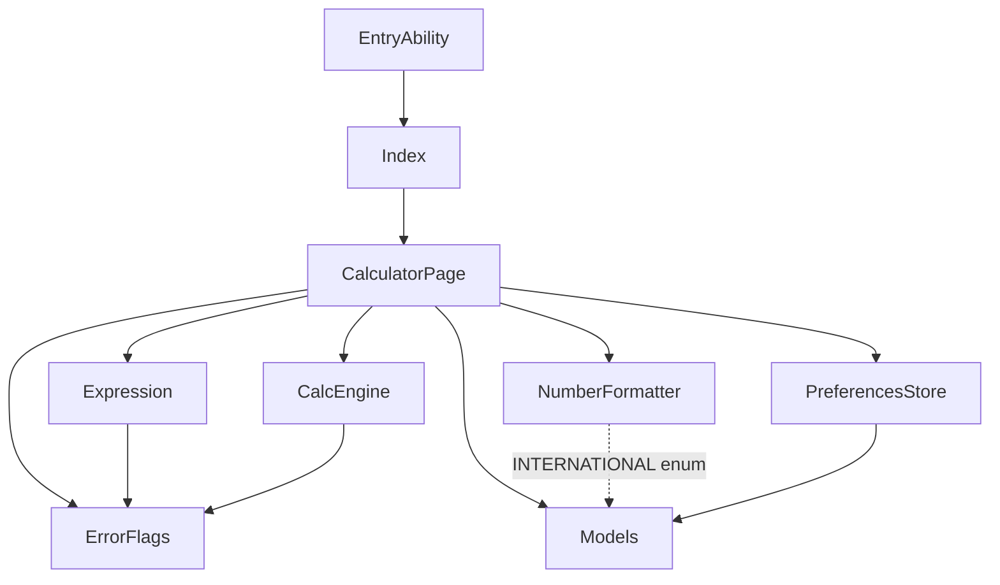

# 程序员模式 + 进制转换 — 代码仓理解

> **Issue**: #4
> **分析时间**: 2026-06-10
> **分析范围**: opencalc/entry/src/main/ets/ 全量（9 个 .ets 文件，~1401 行）
> **分析者**: dev-01 (rq-codebase)

---

## 基本信息

| 字段 | 内容 |
|------|------|
| 需求类别 | 新增功能（type:feature） |
| 需求名称 | 程序员模式 + 进制转换 |
| 关联特性 | feat-calculator |
| 分析范围 | `opencalc/entry/src/main/ets/`（pages/calculator/model/preferences/entryability） |
| 起始分支 | `feat/issue-4-programmer-mode` |
| 工作目录 | `D:/huawei/Demo/worktrees/issue-4` |

---

## 1. 架构分析

### 1.1 整体架构

```
entry/src/main/ets/
├── entryability/
│   └── EntryAbility.ets           ← UIAbility 入口（11行，跳转 Index）
├── pages/
│   ├── Index.ets                  ← 启动页（22行，跳转 CalculatorPage）
│   └── CalculatorPage.ets         ← 主页面（415行，@Entry）
├── calculator/
│   ├── Calculator.ets             ← 递归下降解析器（180行）
│   ├── Expression.ets             ← 输入预处理（298行）
│   └── NumberFormatter.ets        ← 数字格式化（176行）
├── model/
│   ├── Models.ets                 ← 枚举 + 接口（61行）
│   └── ErrorFlags.ets             ← 错误标志（24行）
└── preferences/
    └── PreferencesStore.ets       ← 偏好持久化（225行）
```

**架构特征**：
- **单 HAP 单 Entry**：仅 1 个 `@Entry` 页面（CalculatorPage），所有功能通过 `@Builder` 内嵌子组件实现
- **无 ViewModel 层**：业务逻辑全部内联在 CalculatorPage 的 @State + 私有方法中
- **无显式架构模式**：纯"单页面 + 工具类"模式（与 Android 版 MainActivity 1447 行 God Activity 类似）
- **依赖单向**：pages → calculator → model → （ArkUI/Kit）

### 1.2 模块职责

| 模块 | 文件 | 行数 | 职责 |
|------|------|:----:|------|
| **EntryAbility** | entryability/EntryAbility.ets | 11 | 应用启动 + 加载 Index 页 |
| **Index** | pages/Index.ets | 22 | 启动屏（3s 后跳转 CalculatorPage） |
| **CalculatorPage** | pages/CalculatorPage.ets | 415 | UI 渲染 + 用户交互 + 状态管理 + 历史/设置/关于面板 |
| **CalcEngine** | calculator/Calculator.ets | 180 | 递归下降表达式解析器（移植自 Calculator.kt） |
| **Expression** | calculator/Expression.ets | 298 | 输入预处理（%/√/!/隐式乘/括号补齐） |
| **NumberFormatter** | calculator/NumberFormatter.ets | 176 | 千分位 + 精度 + 印度/国际制 |
| **Models** | model/Models.ets | 61 | CalculatorError/NumberingSystem/ScientificModeType/HistoryItem/CalculatorPreferences 枚举与接口 |
| **ErrorFlags** | model/ErrorFlags.ets | 24 | 全局错误标志（division_by_0/domain_error/syntax_error/is_infinity/require_real_number） |
| **PreferencesStore** | preferences/PreferencesStore.ets | 225 | 封装 @ohos.data.preferences 的键值对读写 |

### 1.3 模块依赖关系



**关键依赖特征**：
- CalculatorPage 是唯一枢纽（God Page 反模式）
- calculator/ 三个类之间无相互依赖（独立工具类）
- model/ 是纯数据层（无业务逻辑）
- preferences/ 是数据访问层（封装 Kit 能力）

### 1.4 扩展点

- **Models.ets**：新增枚举和接口的天然位置（CalculatorMode / NumberBase）
- **PreferencesStore.ets**：新增偏好方法的扩展点（getProgrammerModeDefault / getDefaultBase）
- **CalculatorPage.ets**：新增 @Builder 组件 + @State 字段的扩展点
- **calculator/**：新增工具类（BaseConverter.ets）的扩展点

---

## 2. 接口/契约识别

### 2.1 CalculatorPage 公开方法（用户交互入口）

| 方法 | 签名 | 触发时机 |
|------|------|----------|
| `onDigit(d: string): void` | 接收数字字符 | 数字按钮点击 |
| `onOp(op: string): void` | 接收运算符 | 运算符按钮点击 |
| `onFunc(f: string): void` | 接收函数名 | 科学函数按钮点击 |
| `onConst(c: string): void` | 接收常量 | π/e 按钮点击 |
| `onBS(): void` | 退格 | ⌫ 按钮点击 |
| `onAC(): void` | 全清 | AC 按钮点击 |
| `onEquals(): void` | 计算 | = 按钮点击 |
| `onCopy(): void` | 复制结果 | 长按 DisplayPanel |
| `onHistoryTap(item)` | 历史回填 | 历史条目点击 |
| `onHistoryDelete(item)` | 删除历史 | 滑动删除 |

### 2.2 calculator 模块 API

| 类 | 方法 | 签名 | 备注 |
|----|------|------|------|
| **CalcEngine** | evaluate | `(equation: string, isDegree: boolean) => number` | 主入口，使用 ASCII 字符码解析 |
| **Expression** | getCleanExpression | `(calc, decSep, groupSep) => string` | 输入预处理 |
| **NumberFormatter** | format | `(num, decSep, groupSep, sys) => string` | 数字格式化（千分位/精度） |

### 2.3 Models 接口契约

```typescript
// Models.ets
export enum CalculatorError { ... }
export enum NumberingSystem { INTERNATIONAL=0, INDIAN=1 }
export enum ScientificModeType { NOT_ACTIVE=0, ACTIVE=1, OFF=2 }

export interface HistoryItem {
  id: number
  expression: string
  result: string
  timestamp: number
}

export interface CalculatorPreferences {
  theme: number
  forceDayNight: number
  vibrationEnabled: boolean
  preventSleep: boolean
  historySize: number
  scientificModeDefault: number  // ScientificModeType
  radiansDefault: boolean
  numberPrecision: number
  decimalSeparatorSymbol: string
  groupingSeparatorSymbol: string
}
```

### 2.4 PreferencesStore 契约

| 方法 | 签名 | 键名 |
|------|------|------|
| `getTheme()` / `setTheme(v)` | `() => Promise<number>` | `theme` |
| `getForceDayNight()` / `setForceDayNight(v)` | `() => Promise<number>` | `forceDayNight` |
| `getVibrationEnabled()` / `setVibrationEnabled(v)` | `() => Promise<boolean>` | `vibrationEnabled` |
| `getPreventSleep()` / `setPreventSleep(v)` | `() => Promise<boolean>` | `preventSleep` |
| `getHistorySize()` / `setHistorySize(v)` | `() => Promise<number>` | `historySize` |
| `getHistory()` / `setHistory(items)` | `() => Promise<HistoryItem[]>` | `history`（JSON） |
| `getScientificModeDefault()` / `setScientificModeDefault(v)` | `() => Promise<number>` | `scientificModeDefault` |
| `getRadiansDefault()` / `setRadiansDefault(v)` | `() => Promise<boolean>` | `radiansDefault` |
| `getNumberPrecision()` / `setNumberPrecision(v)` | `() => Promise<number>` | `numberPrecision` |
| `getDecimalSeparator()` / `setDecimalSeparator(v)` | `() => Promise<string>` | `decimalSeparator` |
| `getGroupingSeparator()` / `setGroupingSeparator(v)` | `() => Promise<string>` | `groupingSeparator` |
| `getAllPreferences()` | `() => Promise<CalculatorPreferences>` | 一次性读取 |

**待新增契约**（程序员模式）：
- `getProgrammerModeDefault() / setProgrammerModeDefault(v) → number (0/1/2)` — 键 `programmerModeDefault`
- `getDefaultBase() / setDefaultBase(v) → number (2/8/10/16)` — 键 `defaultBase`

---

## 3. 公共组件或函数识别

### 3.1 可复用 @Builder 组件

| 组件 | 当前用途 | 可复用场景 |
|------|----------|------------|
| `BtnDig(l)` | 数字按钮 | 程序员键盘数字 0-9 |
| `BtnFunc(l)` | 科学函数按钮 | 程序员键盘 A-F（修改样式） |
| `BtnOp(l)` / `BtnOpPct(l)` | 运算符按钮 | 程序员键盘运算符复用 |
| `BtnAct(l)` / `BtnActPct(l)` | 动作按钮（AC/⌫） | 程序员键盘直接复用 |
| `BtnEq()` | 等号按钮 | 程序员键盘直接复用 |
| `ToggleItem(title, val, cb)` | 设置项开关 | 程序员模式默认设置项复用 |
| `ThemeItem()` | 主题选择 | 不复用 |

### 3.2 可复用工具

| 工具 | 来源 | 可复用方式 |
|------|------|------------|
| `ErrorFlags` | model/ErrorFlags.ets | 程序员模式错误检测复用 |
| `NumberFormatter.format()` | calculator/NumberFormatter.ets | DEC 行格式化复用 |
| `promptAction.showToast()` | @kit.ArkUI | 错误提示直接复用 |
| `.animation()` 属性 | ArkUI | 模式切换动画直接复用 |

### 3.3 主题色方法（CalculatorPage.get* 系列）

- `getBg()` / `getBtnBg()` / `getPanelBg()` / `getFuncBg()` — 背景色
- `getOp()` / `getEq()` / `getClr()` — 按钮色
- `getErr()` / `getT1()` / `getT2()` / `getBtnText()` — 文字色

**程序员模式复用建议**：新增 `getBaseHighlightBg()` 方法，复用 `getOp()` 主题色作为当前进制行高亮。

### 3.4 ArkTS 标准库可用能力

| 能力 | API | 用途 |
|------|-----|------|
| 进制转换 | `parseInt(str, radix)` | fromBase（任意 2-36） |
| 进制转换 | `Number.toString(radix)` | toBase（注意 toString(16) 输出小写） |
| 数学 | `Math.floor()` / `Math.abs()` | 溢出检测 |
| 动画 | `.animation({ duration, curve })` | 模式切换动画 |

---

## 4. 影响范围分析

### 4.1 需要修改的文件清单

| # | 文件 | 变更类型 | 变更点 |
|---|------|---------|--------|
| 1 | `model/Models.ets` | **extend** | 新增 `CalculatorMode` 枚举 + `NumberBase` 枚举 + 扩展 `CalculatorPreferences` |
| 2 | `preferences/PreferencesStore.ets` | **extend** | 新增 4 个方法（get/set × 2 个新键）+ `getAllPreferences` 增加 2 个字段 |
| 3 | `pages/CalculatorPage.ets` | **modify** | ToggleRow 三态化 + DisplayPanel 按 mode 分支 + ButtonGrid 引入 ProgrammerKeypad + 新增 @State |
| 4 | `entry/src/main/ets/calculator/BaseConverter.ets` | **new** | 新增工具类（toBase/fromBase/isValidChar/formatHex/convert） |

### 4.2 不需要修改的文件

| 文件 | 不变原因 |
|------|----------|
| `calculator/Calculator.ets` | 计算引擎与进制无关，DEC 内部表示 |
| `calculator/Expression.ets` | 表达式预处理与进制无关 |
| `calculator/NumberFormatter.ets` | 仅格式化 DEC 结果 |
| `model/ErrorFlags.ets` | 现有错误类型已覆盖 |
| `entryability/EntryAbility.ets` | 不涉及 |
| `pages/Index.ets` | 不涉及 |

### 4.3 调用链影响分析

```
用户点击模式按钮
  ↓
onModeChange(newMode)              ← 新增
  ↓
this.currentMode = newMode          ← @State 触发重渲染
  ↓
DisplayPanel 按 currentMode 分支    ← modify
  ├── BASIC/SCIENTIFIC: 单行显示
  └── PROGRAMMER: BaseConversionPanel (4行)
  ↓
ButtonGrid 按 currentMode 分支      ← modify
  ├── BASIC/SCIENTIFIC: 现有 5×N 网格
  └── PROGRAMMER: ProgrammerKeypad  ← new
       ↓
       按 currentBase 过滤字符可用性
  ↓
await savePref('programmerModeDefault', newMode)  ← 新增方法

用户输入数字
  ↓
onDigit(d) / onLetter(c)            ← 新增 onLetter
  ↓
BaseConverter.isValidChar(c, currentBase)  ← new utility
  ↓
this.expression += c                ← 仍以 ASCII 字符存
  ↓
BaseConversionPanel 重渲染          ← new
  ├── DEC: this.expression
  ├── BIN: parseInt(this.expression, currentBase).toString(2)
  ├── OCT: parseInt(this.expression, currentBase).toString(8)
  └── HEX: parseInt(this.expression, currentBase).toString(16).toUpperCase()
```

### 4.4 影响评估

| 维度 | 影响 | 说明 |
|------|------|------|
| **现有功能** | ✅ 不破坏 | BASIC/SCIENTIFIC 模式行为完全不变 |
| **现有 API** | ✅ 向后兼容 | 仅新增方法，不修改现有方法签名 |
| **现有数据** | ✅ 不破坏 | 新增 2 个偏好键，旧用户读不到时使用默认值 |
| **现有 UI** | ⚠️ 局部变化 | ToggleRow 二态 → 三态（视觉新增第 3 个状态） |
| **性能** | ✅ 可控 | 4 行同步转换 < 1ms（parseInt + toString） |
| **内存** | ✅ 增量小 | BaseConverter ~80 行 + 2 个新枚举 |

---

## 5. 现有代码分析

### 5.1 CalculatorPage.ets 关键代码段

#### 5.1.1 当前 ToggleRow（二态）

```typescript
// pages/CalculatorPage.ets:256-269
@Builder ToggleRow() {
  Row() {
    Text(this.scientific ? '科学' : '基础').fontSize(12).fontColor(this.getOp())
      .padding({ left: 12, right: 12, top: 4, bottom: 4 })
      .border({ width: 1, color: this.getOp(), radius: 8 })
      .onClick((): void => { this.scientific = !this.scientific })  // ← 二态
    Blank()
    Text(this.showHistory ? '▲ 历史' : '▼ 历史')...
    Text('⚙')...
  }
}
```

**改造方案**：将 `this.scientific` 替换为 `this.currentMode`，点击时 `(currentMode + 1) % 3` 循环。

#### 5.1.2 当前 DisplayPanel（单行）

```typescript
// pages/CalculatorPage.ets:225-253
@Builder DisplayPanel() {
  Column() {
    if (this.isLandscape) { Row() { ... } }  // 横屏布局
    else { Text(this.expression...) }         // 竖屏布局
    if (this.errorMsg.length > 0) { Text(this.errorMsg)... }
    else { Text(this.result...) }
  }
}
```

**改造方案**：根据 `this.currentMode` 分支：
- `BASIC/SCIENTIFIC`：保留现有单行布局
- `PROGRAMMER`：替换为 BaseConversionPanel（4 行）

#### 5.1.3 当前 ButtonGrid（5×N 通用）

```typescript
// pages/CalculatorPage.ets:272-285
@Builder ButtonGrid() {
  Column() {
    if (this.scientific) {
      Row() { this.BtnFunc('sin'); ... this.BtnFunc('log') }
      Row() { this.BtnFunc('arcsi'); ... this.BtnConst('e') }
    }
    Row() { this.BtnActPct('AC'); this.BtnOpPct('%'); ... }
    Row() { this.BtnDig('7'); ... this.BtnOp('×') }
    ...
  }
}
```

**改造方案**：根据 `this.currentMode` 分支：
- `BASIC/SCIENTIFIC`：保留现有布局
- `PROGRAMMER`：替换为 ProgrammerKeypad（6 行：进制切换 + A-F 字母行 + 数字 0-9 + 运算符 + 等号）

#### 5.1.4 横屏自动开科学模式（不修改程序员模式）

```typescript
// pages/CalculatorPage.ets:218-221
.onAreaChange((_old: Area, newVal: Area): void => {
  const w: number = newVal.width as number
  const h: number = newVal.height as number
  this.isLandscape = w > h
  if (this.isLandscape) this.scientific = true  // ← 仅影响 scientific 字段
})
```

**改造方案**：保留 `this.scientific` 字段（控制科学面板额外显示），新增独立的 `this.currentMode` 字段（控制三模式）。两者解耦：
- 横屏 → `scientific = true`（显示 sin/cos/tan 等额外按钮）
- 但 `currentMode` 不变（仍由用户主动选择）

### 5.2 Models.ets 关键扩展点

```typescript
// 现有：枚举已实现
export enum CalculatorError { ... }
export enum NumberingSystem { ... }
export enum ScientificModeType { NOT_ACTIVE=0, ACTIVE=1, OFF=2 }

// 待新增（程序员模式）
export enum CalculatorMode {
  BASIC = 0,
  SCIENTIFIC = 1,
  PROGRAMMER = 2
}

export enum NumberBase {
  BIN = 2,
  OCT = 8,
  DEC = 10,
  HEX = 16
}
```

### 5.3 PreferencesStore.ets 关键扩展点

```typescript
// 现有模式
async getScientificModeDefault(): Promise<number> {
  if (!this.store) return DEFAULT_PREFERENCES.scientificModeDefault
  return await this.store.get('scientificModeDefault', DEFAULT_PREFERENCES.scientificModeDefault) as number
}

async setScientificModeDefault(value: number): Promise<void> {
  if (!this.store) return
  await this.store.put('scientificModeDefault', value)
  await this.store.flush()
}

// 待新增（程序员模式）—— 遵循相同模式
async getProgrammerModeDefault(): Promise<number> { ... }
async setProgrammerModeDefault(value: number): Promise<void> { ... }
async getDefaultBase(): Promise<number> { ... }
async setDefaultBase(value: number): Promise<void> { ... }
```

### 5.4 边界条件

| 边界 | 当前处理 | 程序员模式处理 |
|------|----------|----------------|
| 空表达式 | 显示 `0` | 4 行均显示 `0` |
| 超长表达式 | 显示省略 | 4 行均省略（最大 16 位） |
| 负数 | `onEquals` 后显示 `-` 前缀 | DEC 行显示 `-`，BIN/OCT/HEX 行显示 `-<digits>` |
| 小数 | `parseFloat` 支持 | 程序员模式不支持（小数点按钮置灰） |
| 表达式错误 | 中文 Toast + errorMsg | 程序员模式同 |
| 横屏 | 自动开 scientific | 横屏不影响 currentMode |
| 主题切换 | 实时切换 get* 色 | 程序员模式所有组件响应主题 |

---

## 6. 风险识别

### 6.1 技术难点

| # | 难点 | 等级 | 缓解策略 |
|---|------|:----:|----------|
| 1 | ArkTS 状态管理：currentMode 切换触发整页重渲染 | 🟡 中 | 使用条件渲染 + .animation() 限定动画范围 |
| 2 | 4 行实时同步的输入延迟 | 🟢 低 | parseInt + toString 性能足够，< 1ms |
| 3 | HEX 字母按钮复用 BtnFunc 但颜色需区分 | 🟢 低 | 新增 BtnAlpha 组件，单独样式 |
| 4 | 横屏 4 行显示宽度自适应 | 🟡 中 | 使用 layoutWeight + maxLines |
| 5 | 模式切换动画在低端设备帧率 | 🟡 中 | duration 可降级为 100ms |
| 6 | 表达式按当前进制解读的边界（输入 0xFF 在 BIN 模式） | 🔴 高 | 切换进制时强制校验 + 必要时清空表达式 |

### 6.2 问题区域

| 区域 | 当前问题 | 程序员模式放大风险 |
|------|----------|--------------------|
| CalculatorPage 已 415 行 | "God Page"反模式 | 新增 ~200 行后达 ~615 行，可维护性下降 |
| `onEquals()` 内联逻辑 | 业务逻辑与 UI 耦合 | 程序员模式计算逻辑（按 currentBase 解读）需新增分支 |
| ErrorFlags 全局变量 | 不利于测试 | 程序员模式溢出错误复用此机制 |
| 横屏自动开 scientific | 与 currentMode 概念重叠 | 需明确两者关系（前者管"是否显示额外按钮"，后者管"工作模式"） |

### 6.3 依赖库安全性

| 依赖 | 用途 | 风险 |
|------|------|------|
| @kit.ArkUI | .animation() / promptAction | 无安全风险 |
| @kit.ArkData (preferences) | 偏好持久化 | 无安全风险 |
| @kit.BasicServicesKit (pasteboard) | 复制结果 | 无安全风险 |
| @kit.AbilityKit (common) | UIAbilityContext | 无安全风险 |
| ArkTS Math 标准库 | parseInt / toString | 无安全风险（number 精度问题已在 spec 中处理） |

### 6.4 兼容性风险

| 场景 | 风险 | 缓解 |
|------|------|------|
| 旧版本用户首次启动 | 偏好读取默认值 | 默认值兜底：currentMode=BASIC, currentBase=DEC |
| 鸿蒙 SDK 版本 < 12 | .animation() API 可能不可用 | 当前项目 SDK 12，满足 |
| 折叠屏/平板 | 4 行显示空间 | layoutWeight 自适应宽度 |

---

## 7. 测试验证策略

### 7.1 单元测试目标（IMPLEMENTING 阶段产出）

| 模块 | 测试用例数 | 覆盖目标 |
|------|:----------:|----------|
| **BaseConverter** | ~30 | toBase/fromBase/isValidChar/formatHex/convert 全覆盖 |
| - toBase | 12 | 4 进制 × 3 输入（正/负/零） |
| - fromBase | 12 | 同上 |
| - isValidChar | 4 | 4 进制各测 1 例 |
| - formatHex | 3 | 大写/小写/混合输入 |
| - 溢出 | 3 | 2^53+1、2^54、-2^54 |
| **CalculatorPage** | ~10 | 状态机切换、键盘过滤、4 行同步 |
| **PreferencesStore** | 4 | 2 个新键的读写 + 默认值 |

### 7.2 集成测试场景

| # | 场景 | 验证方法 |
|---|------|----------|
| 1 | 切换到程序员模式 → 输入 255 → 看到 4 进制 | UI 录屏 + 断言 |
| 2 | BIN 模式点击按钮 "2" | 按钮置灰无反应 |
| 3 | HEX 模式输入 "FF" + 切到 OCT | 自动转换为 377 |
| 4 | 程序员模式按 = | 弹出"小数不支持"或正常计算 |
| 5 | 切换模式动画 | 录屏帧率 ≥55fps |
| 6 | 关闭重开 APP | 模式与进制保持 |

### 7.3 回归测试范围

| 范围 | 必测 | 原因 |
|------|:----:|------|
| 基础模式四则运算 | ✅ | 改造 ToggleRow 影响 |
| 科学模式 sin/cos | ✅ | ToggleRow + ButtonGrid 双重影响 |
| 横屏自动开科学 | ✅ | 涉及横竖屏切换逻辑 |
| 历史记录 | ✅ | DisplayPanel 重构 |
| 设置面板 | ✅ | 新增设置项 |
| 主题切换 | ✅ | 多组件受影响 |

### 7.4 验收标准

- 编译零错误（hvigor assembleHap BUILD SUCCESSFUL）
- 所有状态路径可触发（基础/科学/程序员 三模式，DEC/BIN/OCT/HEX 四进制）
- 中文错误信息可读
- 100 个随机整数 4 进制转换正确率 100%
- 模式切换响应 ≤200ms
- 进制转换响应 ≤50ms
- 动画流畅度 ≥55fps

---

## 8. 监控运维支持

### 8.1 监控指标

| 指标 | 实现方式 | 阈值 |
|------|----------|------|
| 模式切换次数 | console.log + 用户反馈 | - |
| 进制切换次数 | console.log | - |
| 溢出次数 | console.warn | 频率过高需优化 UI 提示 |
| 偏好保存失败次数 | console.error | 0（生产环境不应发生） |
| 动画 FPS | 性能分析器 | ≥55 |

### 8.2 配置项清单

| 配置 | 位置 | 默认值 | 影响 |
|------|------|:------:|------|
| `programmerModeDefault` | PreferencesStore | 0 (BASIC) | 启动模式 |
| `defaultBase` | PreferencesStore | 10 (DEC) | 启动进制 |
| 动画时长 | 代码常量 | 200ms | 视觉体验 |
| 安全整数上限 | 代码常量 | 2^53 | 溢出检测阈值 |
| HEX 大小写 | 代码常量 | 大写 | formatHex |

### 8.3 日志记录点

| 日志点 | 级别 | 内容 |
|--------|------|------|
| 模式切换 | log | `modeChanged: BASIC → PROGRAMMER` |
| 进制切换 | log | `baseChanged: DEC → HEX` |
| 溢出检测 | warn | `Overflow: value=2^54, base=BIN` |
| 偏好保存失败 | error | `prefs.put failed: key=programmerModeDefault` |
| 表达式按进制解读失败 | warn | `invalid expression for base` |

---

## 9. 关键发现

### 9.1 可复用组件或函数

- **复用清单**：
  - `BtnDig` / `BtnFunc` / `BtnOp` / `BtnAct` / `BtnEq` — 程序员键盘基础组件
  - `ToggleItem` — 程序员模式默认设置项
  - `get*` 主题色方法 — 4 行显示背景/文字色
  - `NumberFormatter.format()` — DEC 行格式化
  - `promptAction.showToast()` — 错误提示
  - `ErrorFlags` — 错误检测复用
  - `.animation()` — 模式切换动画
- **复用方式**：直接调用现有 @Builder，无需新增
- **注意事项**：HEX 字母按钮需新建 `BtnAlpha`（不复用 BtnFunc，因色系不同）

### 9.2 风险提示

- **高风险**：表达式按当前进制解读的边界（输入 `FF` 切到 BIN 时强制校验）
- **中风险**：横屏 4 行显示宽度自适应（layoutWeight + maxLines）
- **中风险**：低端设备动画帧率（duration 可降级为 100ms）
- **低风险**：HEX 字母按钮样式（新增 BtnAlpha 即可）

### 9.3 建议事项

1. **优先实现 BaseConverter.ets**：纯逻辑无 UI 依赖，便于单元测试驱动（TDD）
2. **扩展 Models.ets 优先于 PreferencesStore**：枚举定义是契约的基础
3. **CalculatorPage 拆分**：新增 ~200 行后达 ~615 行，建议未来重构为 ViewModel 模式
4. **节流保护**：模式切换按钮加 200ms 节流（防连续点击动画叠加）
5. **横屏策略**：横屏不开程序员模式（避免占用 4 行高度），仅开科学模式（额外按钮）
6. **HEX 字母与 π/e 不冲突**：HEX 模式隐藏 π/e 按钮（A-F 替代）

### 9.4 架构扩展性

本次需求**不触发架构变更**：
- 仍单页面 @Entry
- 仍 CalculatorPage 主导（God Page 反模式延续）
- 无新增模块/包/层
- 无外部依赖新增

---

## 附录 A：现有源码关键引用

### A.1 ToggleRow 实现位置

`pages/CalculatorPage.ets:256-269`

### A.2 DisplayPanel 实现位置

`pages/CalculatorPage.ets:225-253`

### A.3 ButtonGrid 实现位置

`pages/CalculatorPage.ets:272-285`

### A.4 横屏自动开科学模式位置

`pages/CalculatorPage.ets:218-221`

### A.5 主题色方法位置

`pages/CalculatorPage.ets:115-185`

### A.6 Models 枚举位置

`model/Models.ets:5-25`

### A.7 PreferencesStore 模式方法位置

`preferences/PreferencesStore.ets:136-148`（scientificModeDefault 模板）

---

> **文档生成说明**
> 本文档由 AID PLANNING step5 (rq-codebase) 产出。
> 分析对象：`opencalc/entry/src/main/ets/` 全量源码（9 文件 / 1401 行）
> 生成时间：2026-06-10
> 下一步：step6 复杂度评估（已在 proposal.md §6 产出）