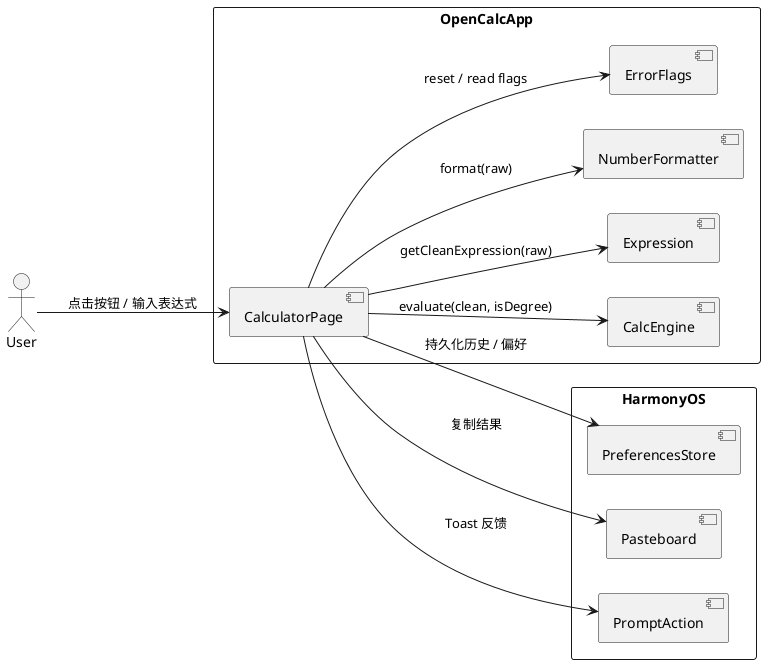
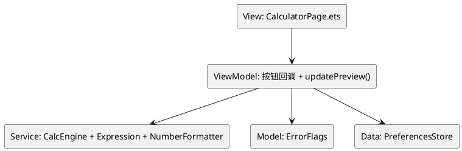
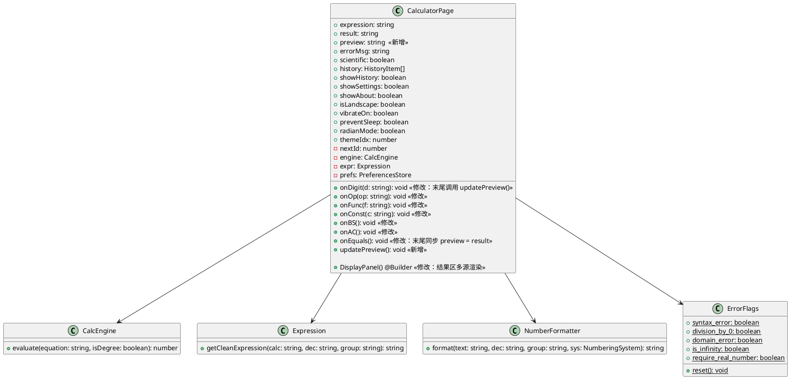
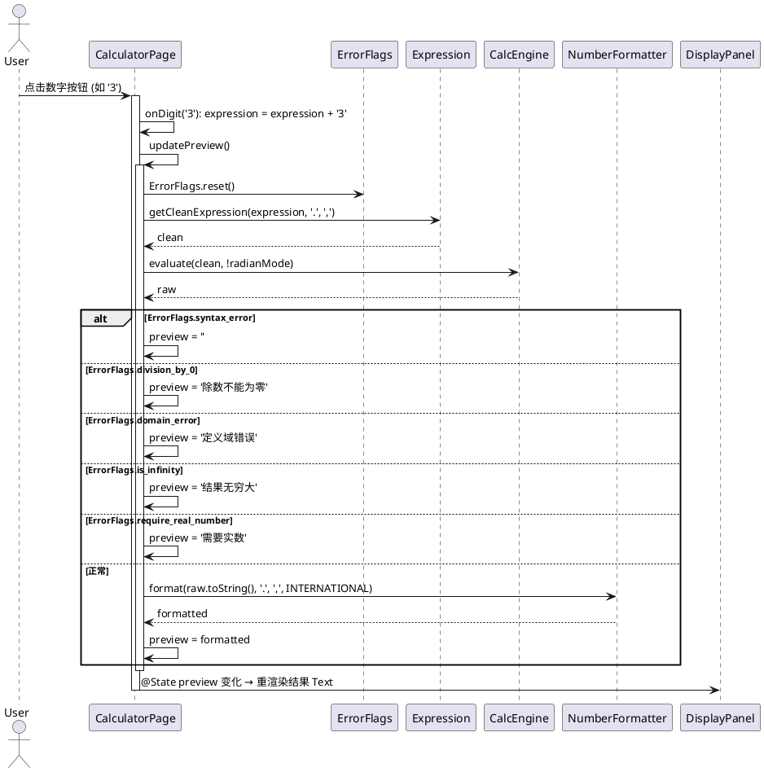
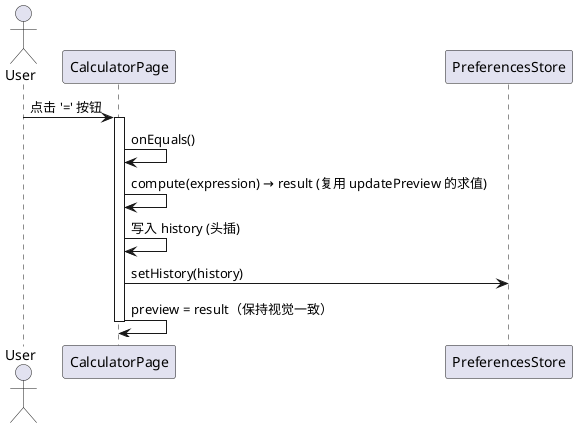

# 实时预览结果 — 增量设计（Delta Design）

> 关联特性：`feat-calculator-core`（OpenCalc HarmonyOS 移植版主计算器）
> 关联设计基线：`opencalc/spec/DESIGN.md`
> 变更日期：2026-06-09
> 文档类型：delta-design（增量变更设计，专注于变更点）

---

## D1: 概述

### 1.1 应用定位

OpenCalc HarmonyOS 移植版主计算器。本次增量在原有"按 `=` 显示结果"基础上，新增"表达式编辑过程中实时联动结果区"的体验。无新增 HAP/HAR/HSP，无新增依赖。

### 1.2 核心交互

```
用户按键 ─→ @State expression 变化
              ↓
        updatePreview()      ← 本次新增
              ↓
        CalcEngine.evaluate  ──→  复用
              ↓
        @State preview 变化
              ↓
        DisplayPanel 结果 Text 自动重渲染
```

`=` 按钮交互链路保持不变（仍走 `onEquals`，写历史）。

### 1.3 技术栈概览

- 框架：ArkTS（Stage 模型，ArkUI 声明式 UI）
- 状态管理：V1（`@State`/`@Builder`）— 与基线一致
- 依赖 Kit：`@kit.ArkUI`（promptAction）、`@kit.BasicServicesKit`（pasteboard）、`@kit.AbilityKit`（common）
- Native C++/Rust 模块：无
- Hvigor 插件配置：与基线一致，不引入新插件
- ArkTS 版本：与基线一致（oh-package.json5 modelVersion 6.0.2）

---

## D2: 功能清单

| 功能名 | 说明 | 入口 Ability/Page | 优先级 |
|--------|------|-------------------|--------|
| F-01 表达式实时预览 | 用户每次按键后结果区显示最新预览值 | CalculatorPage | P0 |
| F-02 预览错误渲染 | 除零/定义域/语法/无穷/复数错误文案渲染 | CalculatorPage | P0 |
| F-03 不完整表达式空态 | 表达式语法不完整时预览区空白 | CalculatorPage | P0 |
| F-04 视觉差异 | 预览态用 getT2() + 24-28pt；result 用 getT1() + 36pt | CalculatorPage | P1 |
| F-05 `=` 行为兼容 | `=` 流程不变（result 固化 + 写历史） | CalculatorPage | P0 |

> 与基线 `opencalc/spec/DESIGN.md §2` 的功能集合相比，本次新增 F-01/F-02/F-03/F-04；F-05 为兼容性约束。

---

## D3: 实现模型

### 3.1 上下文视图



### 3.2 总体架构



> 与基线架构一致；本次新增的是 ViewModel 内部的 `updatePreview()` 方法与 `@State preview` 字段。

### 3.3 HAP/HAR/HSP 模块划分

不涉及。本次仅在 `entry` HAP 内修改 `pages/CalculatorPage.ets`。

### 3.4 设计系统规格

#### 3.4.1 色彩系统

| 名称 | Light 模式 | Dark/AMOLED 模式 | 用途 |
|------|------------|------------------|------|
| 主文字色 (T1) | `#000000` | `#EFEFEF` | result 固化态 |
| 次要文字色 (T2) | `#595959` | `#BDBDBD` | preview 预览态（新增） |
| 错误色 (Err) | `#F44B3F` | `#F44B3F` | 错误文案 |
| 背景色 | `#FFFFFF` / `#000000` / `#121212` | — | 主题 |

#### 3.4.2 主题系统

不涉及新增主题。沿用基线 `themeIdx ∈ {0,1,2}` 三主题。预览态通过 `getT2()` 联动主题色。

#### 3.4.3 排版系统

| 名称 | 字号（竖/横） | 字重 | 颜色 | 用途 |
|------|---------------|------|------|------|
| preview | 28 / 22 | Normal | `getT2()` | 预览态（新增） |
| result | 36 / 28 | Bold | `getT1()` | 固化态（基线） |
| expression | 18 / 14 | Normal | `getT2()` | 表达式行（基线） |
| error | 28 / 22 | Normal | `getErr()` | 错误文案（基线） |

#### 3.4.4 间距与尺寸系统

与基线一致：DisplayPanel 内边距 `{ top: 24, bottom: 8 }`（竖屏）/ `{ top: 8, bottom: 2 }`（横屏），结果 Text 水平内边距 `{ right: 12, left: 12 }`，`maxLines(3)`。

#### 3.4.5 图标与图形资源

不涉及。

#### 3.4.6 动画规格

不涉及（无新增动画；ArkUI 状态变更自动触发重绘）。

#### 3.4.7 响应式断点与栅格

横竖屏断点：宽 > 高 → 横屏。沿用基线 `onAreaChange` 判定，预览态字号与横竖屏联动（`this.isLandscape ? 22 : 28`）。

### 3.5 CalculatorPage 模块实现设计

#### 3.5.1 模块介绍

身份：`entry` HAP 内主页面（`@Entry @Component`）。本次变更仅在其内部文件 `CalculatorPage.ets` 内追加字段、方法和调整渲染分支，不修改模块归属。

#### 3.5.2 功能描述

- 新增 `@State preview: string = ''`
- 新增私有方法 `updatePreview()`
- 调整 6 个按钮回调（`onDigit/onOp/onFunc/onConst/onBS/onAC`）使其调用 `updatePreview()`
- 调整 `DisplayPanel` 中结果 Text 渲染逻辑：`result` 与 `preview` 共用同一 Text，根据 `preview.length > 0` 或 `result.length > 0` 决定显示
- 调整 `onEquals()`：内部计算逻辑不变，仅在末尾同步 `preview = result`（可选）

#### 3.5.3 目录结构

不涉及目录变更。修改单一文件：

```
opencalc/entry/src/main/ets/
└── pages/
    └── CalculatorPage.ets    ← 本次唯一修改文件
```

#### 3.5.4 架构图谱

**类图**（CalculatorPage 内部结构变化）：



**时序图**（按下数字按钮触发预览）：



**时序图**（按下 `=` 按钮 — 兼容性路径）：



#### 3.5.5 功能与用例分析

**用例 1：合法表达式预览**
- 前置：用户进入 CalculatorPage
- 步骤：
  1. 用户按数字/运算符/函数/常量按钮
  2. `expression` 状态变更
  3. 按钮回调调用 `updatePreview()`
  4. `updatePreview()` 内 `getCleanExpression + evaluate + format` 三件套
  5. `preview` 被赋值格式化字符串
  6. DisplayPanel 重渲染结果 Text
- 后置：用户在结果区看到最新预览值

**用例 2：错误态预览**
- 前置：expression 处于引发错误的状态
- 步骤：与用例 1 相同；`evaluate` 后根据 `ErrorFlags.*` 赋错误文案
- 后置：用户看到红色错误文案

**用例 3：不完整表达式**
- 前置：expression 含未消费的操作符
- 步骤：`evaluate` 内部触发 `ErrorFlags.syntax_error = true`
- 后置：preview = ''，结果区空白

**用例 4：`=` 行为兼容**
- 前置：expression 是合法表达式
- 步骤：onEquals() 调用原 result 计算逻辑，写入 history
- 后置：result 区显示，HistoryPanel 顶部新增

#### 3.5.6 接口设计

**新增私有方法 `updatePreview()`**

```typescript
/**
 * 监听 expression 变化后调用，刷新预览结果区。
 * 复用现有 CalcEngine + Expression + NumberFormatter + ErrorFlags 链路。
 * 视觉上以 getT2() + 24-28pt 渲染，与固化 result 区分。
 */
private updatePreview(): void
```

**调用约定**：
- 入口：仅由按钮回调 `onDigit/onOp/onFunc/onConst/onBS/onAC` 调用
- 不写历史
- 异常时 preview = '计算错误'，try/catch 包裹

**重构建议（可选）**：将 `updatePreview` 与 `onEquals` 共享的求值片段提取为 `compute(expr: string): string` 内部方法，避免代码重复。

#### 3.5.7 状态管理设计

| 字段 | 修饰符 | 类型 | 初值 | 变更触发 | 消费方 |
|------|--------|------|------|---------|--------|
| `expression` | `@State` | string | '' | 按钮回调 | updatePreview / onEquals |
| `result` | `@State` | string | '' | onEquals | DisplayPanel |
| `preview`（新增） | `@State` | string | '' | updatePreview | DisplayPanel |
| `errorMsg` | `@State` | string | '' | onEquals（兼容性） | DisplayPanel |
| `isLandscape` | `@State` | boolean | false | onAreaChange | 全部 Builder |

> 沿用基线 V1 状态管理；`@State` 触发响应式刷新。

**数据流**：
```
按键 → expression 变化 → updatePreview → preview 变化 → DisplayPanel 重渲染
```

#### 3.5.8 核心算法

**算法 1：预览判定（不完整表达式识别）**

```
input: expression: string
output: preview: string

1. if expression.length == 0: return ''  # 空态
2. ErrorFlags.reset()
3. clean = expr.getCleanExpression(expression, '.', ',')
4. if ErrorFlags.syntax_error: return ''  # 清洗阶段已失败
5. raw = engine.evaluate(clean, !radianMode)  # try/catch
6. if ErrorFlags.division_by_0: return '除数不能为零'
7. if ErrorFlags.domain_error: return '定义域错误'
8. if ErrorFlags.is_infinity: return '结果无穷大'
9. if ErrorFlags.require_real_number: return '需要实数'
10. if ErrorFlags.syntax_error: return ''  # 不完整或解析失败
11. return NumberFormatter.format(raw.toString(), '.', ',', INTERNATIONAL)
```

**复杂度**：O(n)，n = expression 长度（通常 < 100）。单次执行 < 1ms。

#### 3.5.9 错误处理

| 异常场景 | 处理方式 | 兜底 |
|----------|---------|------|
| `getCleanExpression` 抛异常 | try/catch | preview = '计算错误' |
| `evaluate` 抛异常 | try/catch | preview = '计算错误' |
| `format` 抛异常 | try/catch | preview = '计算错误' |
| `ErrorFlags` 未重置导致读到上一次错误 | `updatePreview` 入口强制 reset | 下次按键恢复 |
| 极长表达式（>1000 字符） | 不限制 | 依赖底层 evaluate 性能；可见卡顿再优化 |

#### 3.5.10 依赖关系

- 内部依赖：复用 `CalcEngine` / `Expression` / `NumberFormatter` / `ErrorFlags` / `PreferencesStore`
- 外部依赖：仅 ArkTS `@State` 响应式机制，无新增 Kit / OHPM / Native so

---

## D4: 接口设计

不涉及新增对外接口（无 ExtensionAbility / Want / IPC / DeepLink / Native 接口变更）。

### 4.1 内部数据访问 API

不涉及新增（沿用基线 `PreferencesStore`）。

### 4.2 业务抽象接口

不涉及。

### 4.3 后台任务与 ExtensionAbility 接口

不涉及。

### 4.4 Want / Action 协议

不涉及。

### 4.5 URI / Deep Link / AppLinking 协议

不涉及。

### 4.6 IPC 与 RPC 接口

不涉及。

### 4.7 Native（C/C++）接口

不涉及。

### 4.8 文件交换接口

不涉及。

---

## D5: 数据模型

### 5.1 关系型数据库模型

不涉及（无 RDB 变更）。

### 5.2 领域模型

新增 1 个字段（`preview: string`），仅存在于 CalculatorPage 的 `@State` 内存中，不持久化、不写入 Preferences。

| 字段名 | 类型 | 必填 | 说明 |
|--------|------|------|------|
| `preview` | string | 否 | 表达式预览结果；仅内存；不写历史 |

### 5.3 Preferences 结构

不涉及新增 key。

| key | 类型 | 默认值 | 说明 |
|-----|------|--------|------|
| — | — | — | 本次无新增 key |

### 5.4 分布式数据对象模型

不涉及。

### 5.5 文件格式 Schema

不涉及。

---

## D6: UI 设计系统

详见 §3.4 设计系统规格。

### 6.1 色彩系统

见 §3.4.1。

### 6.2 主题与暗色模式

见 §3.4.2。

### 6.3 排版系统

见 §3.4.3。

### 6.4 间距与尺寸规范

见 §3.4.4。

### 6.5 图标与图形资源

不涉及新增。

### 6.6 动画规格

不涉及新增。

### 6.7 一多响应式规范

横竖屏断点由 `onAreaChange` 自动判定（基线行为）；preview 字号与 isLandscape 联动。

---

## D7: 页面清单与导航

### 7.1 页面清单总表

| 页面名 | 路径 | 入口 Ability | 传参 | 功能摘要 |
|--------|------|--------------|------|---------|
| CalculatorPage（修改） | `entry/src/main/ets/pages/CalculatorPage.ets` | EntryAbility → Index → CalculatorPage | 无 | 主计算器，本次增加预览联动 |

### 7.2 全局导航图

不涉及新增页面；导航图与基线一致。

### 7.3 Deep Link / AppLinking 处理

不涉及。

### 7.4 Want 跳转矩阵

不涉及。

---

## D8: 用户交互规格

### 8.1 手势交互目录

| 手势 | 触发位置 | 行为 |
|------|---------|------|
| onClick | 数字/运算符/函数/常量/动作/等号按钮 | 触发对应回调，触发 `updatePreview`（除 `=` 外） |
| LongPressGesture | DisplayPanel | 复制结果（基线行为，preview 不参与复制） |

### 8.2 弹窗/Sheet/Menu 目录

不涉及新增。

### 8.3 剪贴板与反馈行为

| 行为 | 触发条件 | 实现 |
|------|---------|------|
| 复制结果 | DisplayPanel 长按 | 复制 `this.result`（基线，preview 不参与） |
| Toast「已复制」 | 复制成功 | promptAction.showToast（基线） |

### 8.4 卡片交互

不涉及。

---

## D9: 平台集成

### 9.1 构建配置与依赖

| 项 | 值 | 说明 |
|----|----|------|
| modelVersion | 6.0.2 | 基线 |
| 新增 OHPM 依赖 | 无 | — |
| 新增 Kit | 无 | 沿用基线 |
| Hvigor 插件 | 无新增 | — |

### 9.2 权限与运行时请求

不涉及新增权限。

### 9.3 系统能力（Kits）清单

| Kit | 关键 API | 用途 |
|-----|---------|------|
| `@kit.ArkUI` | promptAction | Toast 反馈（基线） |
| `@kit.BasicServicesKit` | pasteboard | 复制（基线） |
| `@kit.AbilityKit` | common | UIAbilityContext（基线） |

### 9.4 后台与 Extension

不涉及。

### 9.5 备份与恢复

不涉及。

### 9.6 分布式与跨端

不涉及。

---

## D10: 偏好设置目录

不涉及新增偏好项。

| key | 类型 | 默认值 | 说明 | 行为影响 |
|-----|------|--------|------|---------|
| — | — | — | 本次无新增 | — |

---

## D11: 变更摘要（delta 专用）

| 类别 | 内容 |
|------|------|
| 新增 @State 字段 | `preview: string = ''` |
| 新增私有方法 | `updatePreview(): void` |
| 修改回调方法 | `onDigit` / `onOp` / `onFunc` / `onConst` / `onBS` / `onAC` 末尾追加 `this.updatePreview()` |
| 修改 Builder | `DisplayPanel` 结果 Text 多源渲染 |
| 修改 `onEquals` | 末尾同步 `preview = result`（或保持 preview 不动，二选一，推荐后者） |
| 新增依赖 | 无 |
| 新增文件 | 无 |
| 修改文件 | 1 个：`opencalc/entry/src/main/ets/pages/CalculatorPage.ets` |

## D12: 实施检查清单

- [ ] 在 CalculatorPage 新增 `@State preview: string = ''`
- [ ] 实现 `updatePreview()`（含 ErrorFlags.reset + try/catch + 5 种错误分支 + format）
- [ ] 6 个按钮回调追加 `this.updatePreview()`
- [ ] DisplayPanel 结果 Text 改为优先渲染 `preview`，无 preview 时回退 `result`，最后回退 `0`
- [ ] preview 字号 `isLandscape ? 22 : 28`，颜色 `getT2()`
- [ ] 验证 5 种 ErrorFlags 均能正确渲染
- [ ] 验证退格/AC 后预览立即清空
- [ ] 验证 `=` 行为完全不变
- [ ] 验证横竖屏、3 种主题下视觉一致

---
> 本文档由 mod-design skill 生成。
> 标记 [推断] 的内容为基于设计推断，非确定性事实。
> 生成时间: 2026-06-09