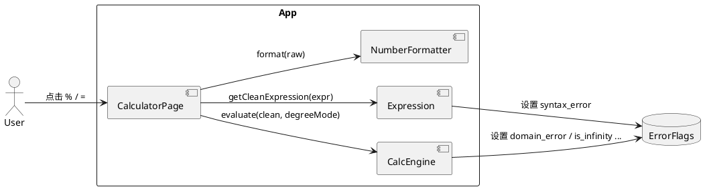
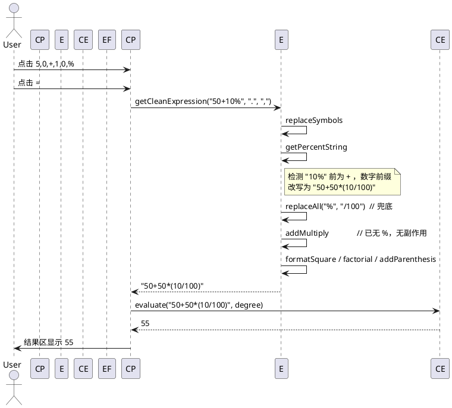
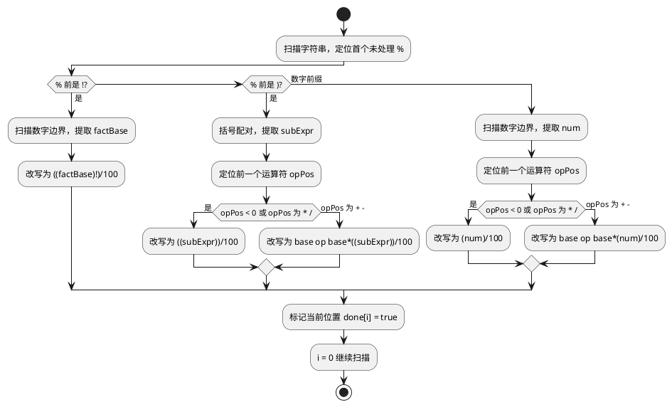

# Delta Design — 增加%按钮

> 基础设计: `opencalc/spec/DESIGN.md`  
> 增量设计: 本文件  
> 变更日期: 2026-06-09  
> 关联: Issue #1, proposal.md, delta-spec.md, info.md

---

## 1. 概述

### 1.1 应用定位
OpenCalc 鸿蒙端口的计算器新增百分号（%）按钮及配套工程语义计算能力，使用户能通过 `A ± B%` 表达"基于 A 的 B 百分比"语义（如 `50+10%=55`）。本变更仅触及表达式预处理与按钮排布，不涉及架构调整与新数据模型。

### 1.2 核心交互
- **KEP-01**: 终端用户在 CalculatorPage 主键盘点击 `5` `0` `+` `1` `0` `%` `=` → 结果区显示 `55`。
- 流程：`onOp('%')` → 字符串追加 → `onEquals` → `Expression.getCleanExpression` → `getPercentString` 改写 → `addMultiply` → `CalcEngine.evaluate` → `NumberFormatter.format` → UI 更新。

### 1.3 技术栈概览
- 框架: ArkTS 严格模式（HarmonyOS 5.0）
- 状态管理: V1（`@State`）
- Kit: `@kit.ArkUI`、`@kit.BasicServicesKit`、`@kit.AbilityKit`
- 无 Native、无 OHPM 依赖变更

---

## 2. 功能清单

| 功能名 | 说明 | 入口 Ability/Page | 优先级 |
|--------|------|-------------------|--------|
| % 按钮追加字符 | `onOp('%')` 将 `%` 拼接到当前表达式 | CalculatorPage | P0 |
| 工程语义百分比（数字前缀） | `A+B%`、`A-B%` 按 `A±A*(B/100)` 计算 | Expression.getPercentString | P0 |
| 工程语义百分比（括号前缀） | `(expr)+B%` 按 `(expr)+(expr)*(B/100)` 计算 | Expression.getPercentString | P1 |
| 数学语义百分比 | `n%`、`A*B%`、`A/B%` 按 `n/100` 解释 | Expression.getPercentString | P1 |
| 阶乘+百分比 | `n!%`、`(expr)!%` 按 `(n!)/100` | Expression.getPercentString | P2 |
| 处理顺序约束 | `%` 处理早于 `addMultiply` | Expression.getCleanExpression | P0 |
| 错误反馈 | 非法 `%` 触发 `syntax_error` → UI `Error` | ErrorFlags + onEquals | P1 |

---

## 3. 实现模型

### 3.1 上下文视图



### 3.2 总体架构
无架构变更。沿用 V1 状态管理与 View → CalcEngine → ErrorFlags 单向数据流。

### 3.3 HAP/HAR/HSP 模块划分
- entry HAP：主入口，本变更全部代码均位于此 HAP。
- 无新增 HAR/HSP。
- 无 OHPM 依赖变更。

### 3.4 设计系统规格
无设计系统变更（按钮样式、配色、尺寸保持现状）。

### 3.5 calculator/Expression 模块实现设计

#### 3.5.1 模块介绍
- 模块身份: entry HAP 内部模块（路径 `entry/src/main/ets/calculator/`）
- 模块职责: 字符串级表达式预处理（符号替换、`%` 改写、补 `*`、补括号、阶乘/开方格式化）

#### 3.5.2 功能描述
详见 §2 与 delta-spec.md §SR-01~SR-08。

#### 3.5.3 目录结构
```
opencalc/entry/src/main/ets/calculator/
├── Calculator.ets            ← 不变
├── Expression.ets            ← 顺序调整 + 三分支验证
└── NumberFormatter.ets       ← 不变
```

#### 3.5.4 架构图谱

**时序图（用户输入 `50+10%`）**：


**流程图（`getPercentString` 三分支决策）**：


#### 3.5.5 功能与用例分析

**用例：% 按钮点击**
- 前置条件：CalculatorPage 已挂载
- 步骤：
  1. 用户点击 `%` 按钮
  2. `onOp('%')` 将 `%` 追加到 `this.expression`
  3. UI 自动重渲表达式行
- 后置条件：表达式字符串末尾出现 `%`

**用例：等号触发工程语义计算**
- 前置条件：表达式非空且含 `%`
- 步骤：见 §3.5.4 时序图
- 后置条件：结果区显示正确数值，或 `errorMsg` 显示"表达式错误"

#### 3.5.6 接口设计

无新公开接口。涉及的关键函数签名（已存在，无签名变更）：

```typescript
// Expression.ets
class Expression {
  getCleanExpression(calculation: string, decimalSeparatorSymbol: string, groupingSeparatorSymbol: string): string
  private getPercentString(calculation: string): string
  private addMultiply(calculation: string): string
  private addParenthesis(calculation: string): string
}
```

#### 3.5.7 状态管理设计
- CalculatorPage 中 `expression`、`result`、`errorMsg` 均为 `@State`，本变更不新增状态。
- 静态错误状态 `ErrorFlags.syntax_error` 已存在，本变更继续使用。

#### 3.5.8 核心算法
**`getPercentString` 三分支**（参见 Expression.ets:170-256）：

1. 维护 `parenthesisLevel`（当前括号层级）与 `subStart`（当前子表达式起点）
2. 遇到 `(`：层级 +1，记录起点
3. 遇到 `)`：层级 -1，若降回 0 且子表达式含 `%`，递归处理后重置扫描
4. 遇到 `%`：
   - 跳过 `done[i]` 标记
   - 分支 A：`!` 前缀（`n!%`）→ `((n!)/100)`
   - 分支 B：`)` 前缀（`(expr)%`）→ 按前一运算符类型改写
   - 分支 C：数字前缀（`n%`）→ 按前一运算符类型改写
5. 改写后 `i = 0` 重扫，`done[]` 重置

**关键工程语义改写规则**：
| 上下文 | 改写后 |
|---|---|
| `base + B%` | `base + base*(B/100)` |
| `base - B%` | `base - base*(B/100)` |
| `base * B%` | `base *(B/100)` |
| `base / B%` | `base /(B/100)` |
| `B%`（无前缀） | `(B/100)` |
| `(expr)+B%` | `(expr)+(expr)*(B/100)` |
| `n!%` | `(n!)/100` |
| `(expr)!%` | `((expr)!)/100` |

**`getCleanExpression` 处理顺序**：
```
replaceSymbols
  → getPercentString           // 关键：% 必须在此处理
  → replaceAll('%', '/100')    // 兜底
  → addMultiply                // 受顺序约束：在 % 之后
  → formatSquare
  → formatFactorial
  → addParenthesis
```

#### 3.5.9 错误处理
| 错误场景 | 处理 | UI 反馈 |
|---|---|---|
| `%` 前无数字（连续运算符 `+%`、`+%5`） | `getPercentString` 设置 `ErrorFlags.syntax_error` | onEquals 读 flag → "表达式错误" |
| 括号未闭合 | `parenthesisLevel < 0` 时设置 `syntax_error` | 同上 |
| `%` 出现在 `sin(...)` 实参 | 当前不支持 → 解析为语法错误 | 同上 |
| `lvl !== 0` 括号配对失败 | 设置 `syntax_error` | 同上 |

#### 3.5.10 依赖关系
- 内部依赖: `model/ErrorFlags.ets`
- 外部依赖: 无新增 Kit 或 OHPM 包
- 被依赖: `pages/CalculatorPage.ets`（通过 `Expression.getCleanExpression`）

---

### 3.6 pages/CalculatorPage 模块实现设计

#### 3.6.1 模块介绍
- 模块身份: entry HAP 内部页面
- 模块职责: UI 渲染、按钮事件、结果展示、历史记录

#### 3.6.2 功能描述
- `%` 按钮在主屏首行（`AC % ( ) ÷`）已存在，本变更无需新增。
- 复用 `BtnOpPct('%')` builder（CalculatorPage.ets:306）。
- `onOp('%')`（行 71）已是通用运算符处理函数。

#### 3.6.3 目录结构
无目录变更。

#### 3.6.4 架构图谱
无时序图变更（沿用现有 `onOp → onEquals` 流程）。

#### 3.6.5 功能与用例分析
无新增用例。沿用 `onOp` 通用流程。

#### 3.6.6 接口设计
无接口变更。

#### 3.6.7 状态管理设计
无状态变更。

#### 3.6.8 核心算法
无新增算法。

#### 3.6.9 错误处理
沿用 `onEquals` 中的 `ErrorFlags` 统一错误展示（行 83-87）。

#### 3.6.10 依赖关系
- 内部依赖: `calculator/Expression.ets`、`calculator/Calculator.ets`、`model/ErrorFlags.ets`
- 外部依赖: 无新增

---

## 4. 接口设计

### 4.1 内部数据访问 API
无变更。

### 4.2 业务抽象接口
无变更（`Expression`/`CalcEngine` 抽象保持）。

### 4.3 后台任务与 ExtensionAbility 接口
不涉及。

### 4.4 Want / Action 协议
不涉及。

### 4.5 URI / Deep Link / AppLinking 协议
不涉及。

### 4.6 IPC 与 RPC 接口
不涉及。

### 4.7 Native（C/C++）接口
不涉及。

### 4.8 文件交换接口
不涉及。

---

## 5. 数据模型

### 5.1 关系型数据库模型
无变更。

### 5.2 领域模型
无新增领域模型。

### 5.3 Preferences 结构
无变更。

### 5.4 分布式数据对象模型
不涉及。

### 5.5 文件格式 Schema
不涉及。

---

## 6. UI 设计系统

沿用 `opencalc/spec/DESIGN.md` §3.4 与 CalculatorPage 已实现的 `getBg()` / `getBtnBg()` / `getOp()` / `getEq()` / `getClr()` / `getT1()` / `getT2()` / `getFuncBg()` 主题方法。

### 6.1 - 6.7
无变更。% 按钮已使用现有 `getOp()` 主题色（浅蓝 #B4D2E4 / 暗 #0070BC）。

---

## 7. 页面清单与导航

### 7.1 页面清单总表
无新增页面。

### 7.2 全局导航图
无变更。

### 7.3 Deep Link / AppLinking 处理
不涉及。

### 7.4 Want 跳转矩阵
不涉及。

---

## 8. 用户交互规格

### 8.1 手势交互目录
无新增手势。% 按钮复用 `onClick` → `onOp('%')`。

### 8.2 弹窗/Sheet/Menu 目录
无新增。

### 8.3 剪贴板与反馈行为
无变更。

### 8.4 卡片交互
不涉及。

---

## 9. 平台集成

### 9.1 构建配置与依赖
无变更（`oh-package.json5` 不变）。

### 9.2 权限与运行时请求
无新增权限。

### 9.3 系统能力（Kits）清单
无新增 Kit。

### 9.4 后台与 Extension
不涉及。

### 9.5 备份与恢复
不涉及。

### 9.6 分布式与跨端
不涉及。

---

## 10. 偏好设置目录

无新增偏好。

---

## 自验证

| 检查项 | 结果 |
|---|---|
| 功能一致性 (proposal.md SR ↔ design.md §2) | ✅ |
| 页面一致性 (proposal.md ↔ §7.1) | ✅ 无新增 |
| 数据一致性 (proposal.md ↔ §5) | ✅ 无新增 |
| 权限一致性 (proposal.md ↔ §9.2) | ✅ 无新增 |
| Kit 一致性 (proposal.md ↔ §9.3) | ✅ 无新增 |
| 跨制品可追溯 (proposal.md §9.1 D1-D5 → delta-spec.md SR-01~SR-08 → design.md §3.5/§3.6) | ✅ |

---

> 本文档由 mod-design skill 生成。  
> 标记 [推断] 的内容为基于设计推断，非确定性事实。  
> 生成时间: 2026-06-09
