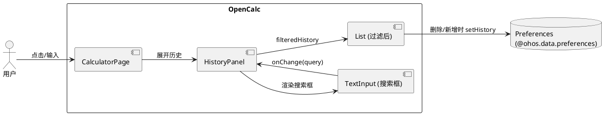
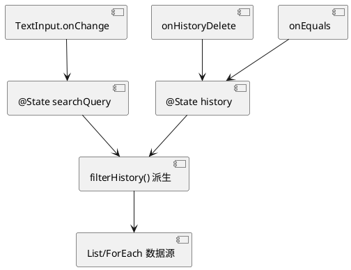
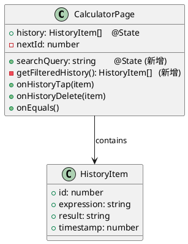
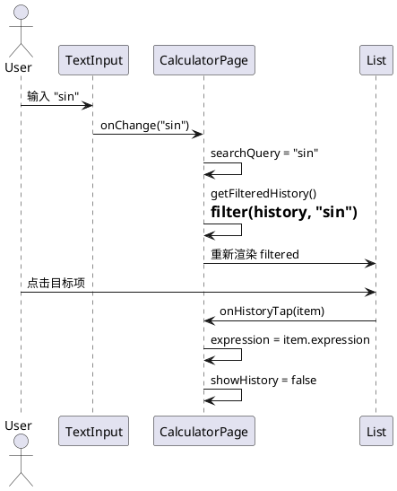
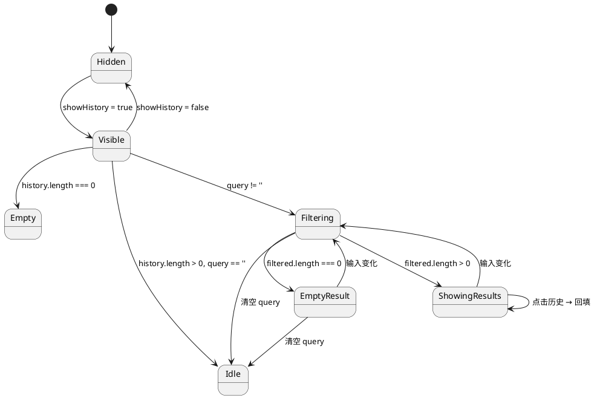
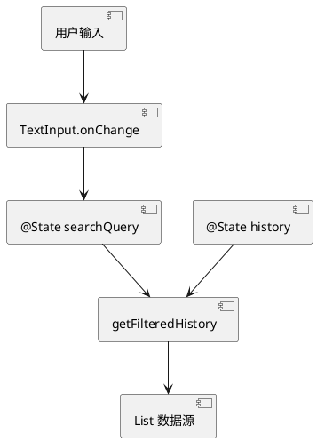

# Delta Design — Issue #5 计算历史搜索

> 版本：v1.0
> 日期：2026-06-11
> 类型：增量变更（delta-design）
> 基础设计：`opencalc/spec/DESIGN.md`
> 关联 issue：GitHub Issue #5
> 关联文档：
> - proposal：`./proposal.md`
> - delta-spec：`./delta-spec.md`
> - info：`./info.md`

---

## 1. 概述

### 1.1 应用定位（增量部分）

在 OpenCalc HarmonyOS 计算器的「历史记录面板」中新增关键字搜索能力，让用户在历史记录较多时可通过子串匹配快速定位历史算式并回填到计算输入区。

### 1.2 核心交互（增量部分）

```
用户展开历史面板
   ↓
面板顶部出现搜索框
   ↓
用户输入关键字
   ↓
列表实时过滤（子串 + 大小写不敏感，命中 expression 或 result）
   ↓
用户点击目标历史项
   ↓
算式回填到主计算区，面板关闭
```

### 1.3 技术栈概览（增量部分）

| 维度 | 当前 | 增量后 |
| ---- | ---- | ------ |
| 框架 | ArkTS + ArkUI 声明式 | 不变 |
| 状态管理 | V1（@State / @Prop / @Link） | V1，不变（仅新增 @State） |
| 使用的 Kit | @kit.ArkUI / @kit.AbilityKit / @kit.BasicServicesKit / @kit.ArkData | 不变 |
| 第三方依赖 | 0 | 不新增 |
| Native | 无 | 不变 |

---

## 2. 功能清单（增量）

| 功能名 | 说明 | 入口 | 优先级 |
| ------ | ---- | ---- | ------ |
| F-001 | 空历史时不显示搜索框 | HistoryPanel 渲染分支 | P0 |
| F-002 | 搜索框输入实时过滤 | HistoryPanel TextInput.onChange | P0 |
| F-003 | 右侧 X 清空搜索 | TextInput.cancelIcon | P0 |
| F-004 | 无匹配结果显示占位 | HistoryPanel 渲染分支 | P0 |
| F-005 | 删除/新增历史自动重新过滤 | onHistoryDelete / onEquals | P1 |
| F-006 | 横屏布局兼容 | HistoryPanel 共享 | P1 |
| F-007 | 过滤纯函数（便于单元测试） | filterHistory() private 方法 | P1 |

---

## 3. 实现模型

### 3.1 上下文视图



### 3.2 总体架构

本次变更不改变总体架构，仍遵循 `opencalc/spec/DESIGN.md §1` 的单 HAP 单页面 + 内联 @Builder 模式。增量部分的数据流：



### 3.3 HAP/HAR/HSP 模块划分

不涉及。仍为单 entry HAP（见 `opencalc/spec/DESIGN.md §1`）。

### 3.4 设计系统规格

复用 `opencalc/spec/DESIGN.md §2.1`（颜色 + 主题），新增元素沿用同套体系：

#### 3.4.1 色彩系统（增量部分）

| 元素 | 浅色 | 暗色 | AMOLED | 主题 getter |
| ---- | ---- | ---- | ------ | ----------- |
| 搜索框背景 | #EFEFEF | #333333 | #1a1a1a | `getBtnBg()` |
| 搜索框占位符 | #595959 | #BDBDBD | #BDBDBD | `getT2()` |
| 搜索框文字 | #000000 | #EFEFEF | #EFEFEF | `getT1()` |
| 取消按钮 (cancelIcon) | 系统默认 | 系统默认 | 系统默认 | 平台组件自带 |
| 无匹配占位文字 | #595959 | #BDBDBD | #BDBDBD | `getT2()` |

#### 3.4.2 主题系统

不新增主题，沿用现有 themeIdx（0=浅 / 1=AMOLED / 2=暗色）三态。

#### 3.4.3 排版系统

| 元素 | 字号 | 字重 | 颜色 |
| ---- | ---- | ---- | ---- |
| 搜索框占位符 | 14 | Regular | getT2() |
| 搜索框输入文字 | 14 | Regular | getT1() |
| 无匹配占位 | 13 | Regular | getT2() |

#### 3.4.4 间距与尺寸

| 元素 | 值 |
| ---- | -- |
| 搜索框高度 | 40 vp |
| 搜索框横向内边距 | 12 vp |
| 搜索框与手柄间距 | 4 vp |
| 搜索框与列表间距 | 4 vp |

#### 3.4.5 图标

| 图标 | 来源 | 用途 |
| ---- | ---- | ---- |
| cancelIcon | ArkUI TextInput 内置 | 右侧 X 清空 |

#### 3.4.6 动画规格

无新增动画。`@State` 驱动 List 重新渲染即视为「即时反馈」，不引入转场动画（保持与现有 HistoryPanel 行为一致）。

#### 3.4.7 响应式断点

| 模式 | 搜索框宽度 | 位置 |
| ---- | ---------- | ---- |
| 竖屏 | '100%' | HistoryPanel 顶部，宽度 = 面板宽 |
| 横屏 | '100%' | HistoryPanel 顶部，宽度 = 右侧面板宽 |

### 3.5 CalculatorPage 模块实现设计（增量）

#### 3.5.1 模块介绍

仅修改 `opencalc/entry/src/main/ets/pages/CalculatorPage.ets` 的 `@Component struct CalculatorPage`。模块身份不变（entry HAP 主页面）。

#### 3.5.2 功能描述

- 新增 @State `searchQuery`
- 新增 private 方法 `getFilteredHistory()`（派生计算）
- 修改 `@Builder HistoryPanel()` 内部结构（增加搜索框 + 替换 List 数据源）

#### 3.5.3 目录结构（增量部分）

```
pages/CalculatorPage.ets
  ├── + @State searchQuery: string = ''     ← 新增
  ├── + private getFilteredHistory(): HistoryItem[]   ← 新增（派生）
  ├── @Builder HistoryPanel()
  │   ├── Row() 手柄/折叠                          ← 保留
  │   ├── + TextInput 搜索框                       ← 新增（条件：history.length > 0）
  │   ├── if history.length === 0: 暂无记录         ← 保留
  │   ├── elif filtered.length === 0 && query: 无匹配   ← 新增
  │   └── else: List(filtered)                     ← 修改数据源
```

#### 3.5.4 架构图谱

**类图（增量部分）：**



**时序图：搜索 + 回填：**



**状态图（搜索面板）：**



#### 3.5.5 功能与用例分析

| 用例 | 前置条件 | 步骤 | 后置条件 |
| ---- | -------- | ---- | -------- |
| 输入过滤 | history.length > 0, searchQuery.length > 0 | 1. 用户输入 2. onChange 触发 3. 重算 filtered | List 显示 filtered |
| 清空 | searchQuery 非空 | 1. 点击 X 2. onCancel 触发 | searchQuery = ''，filtered = history |
| 点击回填 | ShowingResults 状态 | 1. 点击项 2. onHistoryTap | expression 回填，面板关闭 |
| 滑删 | ShowingResults 状态 | 1. 左滑 2. 点击删除 | history 减少，filtered 重算 |

#### 3.5.6 接口设计（增量）

**新增 private 方法签名：**

```typescript
/**
 * 根据 searchQuery 过滤历史列表
 * - 大小写不敏感
 * - expression 与 result 任一字段子串命中即保留
 * - query 经 trim() 后为空时返回全量 history
 * - query 超过 200 字符时截断
 */
private filterHistory(items: HistoryItem[], query: string): HistoryItem[]

/** 派生：当前过滤后列表（HistoryPanel 数据源） */
private getFilteredHistory(): HistoryItem[]
```

**对外接口（ArkUI 框架调用）：**

| 入口 | 触发 | 处理 |
| ---- | ---- | ---- |
| TextInput.onChange | value: string | this.searchQuery = value |
| TextInput.cancelIcon callback | — | this.searchQuery = '' |

#### 3.5.7 状态管理设计（增量）

- 状态管理版本：**V1**（沿用现有 `@State` 装饰器）
- 新增状态：
  - `searchQuery: string` — `@State`，仅 UI 内存态，**不**用 `@StorageLink`/`AppStorage`/`PersistentStorage`
- 派生计算：`getFilteredHistory()` 是 private getter，依赖 `history` 与 `searchQuery`，两者变化自动重算
- 数据流：



#### 3.5.8 核心算法（过滤）

```typescript
// filterHistory 伪代码
function filterHistory(items: HistoryItem[], query: string): HistoryItem[] {
  const q = query.trim().slice(0, 200)         // trim + 截断
  if (q.length === 0) return items              // 空查询返回全量
  const needle = q.toLowerCase()                // 大小写归一
  return items.filter(item =>
    item.expression.toLowerCase().includes(needle) ||
    item.result.toLowerCase().includes(needle)
  )
}
```

- **时间复杂度**：O(n × m)，n = history 条数（≤100），m = 平均字符串长度（≤20）
- **空间复杂度**：O(k)，k = 命中条数
- **关键不变量**：不修改 `items` 本身，返回新数组

#### 3.5.9 错误处理

| 异常 | 处理 |
| ---- | ---- |
| 极长 query（>200 字符） | `.slice(0, 200)` 截断 |
| 含正则元字符 `(`, `*`, `?` | 使用 `String.includes()` 而非 `RegExp`，不会抛错 |
| 纯空白 query `"   "` | `trim()` 后视为空，返回全量 |
| `history` 为空 | 渲染"暂无计算记录"占位，不渲染搜索框 |

#### 3.5.10 依赖关系（增量）

- 内部：依赖 `HistoryItem`（model/Models.ets，已存在）
- 外部：无新增 Kit / 第三方依赖
- 不依赖 `PreferencesStore`（搜索是纯内存计算）

---

## 4. 接口设计

### 4.1 内部数据访问 API

**不修改** `PreferencesStore`。新增方法 `filterHistory` 是 private 内部使用，不暴露。

### 4.2 业务抽象接口

无新增。

### 4.3 - 4.8 后台任务 / Want / Deep Link / IPC / Native / 文件交换

无相关实现（沿用 `opencalc/spec/DESIGN.md §5` 已声明「无相关实现」）。

---

## 5. 数据模型

### 5.1 - 5.4 数据模型

**不修改** `HistoryItem` 接口（见 `opencalc/entry/src/main/ets/model/Models.ets:28-33`）。本次变更不新增字段、不修改持久化格式。

### 5.5 文件格式 Schema

`history` key 在 `Preferences` 中存储为 `JSON.stringify(HistoryItem[])`，**保持不变**。

---

## 6. UI 设计系统

见 §3.4（设计系统规格）— 已包含颜色、主题、排版、间距、图标、动画、响应式。沿用现有体系，无新增视觉资源。

---

## 7. 页面清单与导航

### 7.1 页面清单

| 页面名 | 路径 | 入口 | 传参 | 功能摘要 |
| ------ | ---- | ---- | ---- | -------- |
| CalculatorPage | pages/CalculatorPage.ets | @Entry（不变） | 无 | 主页（含 HistoryPanel 增量） |

不新增页面，不新增路由。

### 7.2 全局导航图

不涉及（无新增导航跳转）。

### 7.3 - 7.4 Deep Link / Want

无相关实现。

---

## 8. 用户交互规格

### 8.1 手势交互目录（增量部分）

| 手势 | 元素 | 行为 |
| ---- | ---- | ---- |
| onClick | TextInput.cancelIcon | 清空 searchQuery |
| onChange | TextInput | 实时更新 searchQuery |
| onClick | ListItem | 回填算式（保留原有） |
| swipeAction (end) | ListItem | 删除历史（保留原有） |

### 8.2 弹窗/Sheet/Menu

无新增。沿用现有 SettingsPanel / AboutPanel 弹层。

### 8.3 剪贴板与反馈

无新增。复制反馈由主显示屏 `LongPressGesture` 触发（保留原有）。

### 8.4 卡片交互

无相关实现。

---

## 9. 平台集成

### 9.1 构建配置与依赖

`oh-package.json5` 不变（无新增依赖）。

### 9.2 权限与运行时请求

无新增权限。

### 9.3 系统能力（Kits）清单

无新增 Kit。

| Kit | 用途（增量部分） |
| --- | ---------------- |
| @kit.ArkUI | TextInput 组件 |

### 9.4 - 9.6 后台 / 备份 / 分布式

无相关实现（沿用 `opencalc/spec/DESIGN.md §5`）。

---

## 10. 偏好设置目录

无新增偏好项。`searchQuery` 是 UI 内存态，**不写入** `Preferences`。

---

## 11. 变更点摘要（用于 code review）

| 序号 | 位置 | 类型 | 说明 |
| ---- | ---- | ---- | ---- |
| C-01 | CalculatorPage.ets `class` 顶部 | 新增 | `@State searchQuery: string = ''` |
| C-02 | CalculatorPage.ets class 内部 | 新增 | `private filterHistory(items, query)` |
| C-03 | CalculatorPage.ets class 内部 | 新增 | `private getFilteredHistory()` |
| C-04 | CalculatorPage.ets `@Builder HistoryPanel()` | 修改 | 在手柄之后插入 TextInput |
| C-05 | CalculatorPage.ets `@Builder HistoryPanel()` | 修改 | List 数据源 `this.history` → `this.getFilteredHistory()` |
| C-06 | CalculatorPage.ets `@Builder HistoryPanel()` | 新增 | 无匹配占位分支 |

预计代码增量 +40~60 行（含空行、注释、测试桩）。

---

## 12. 自验证

- [x] **功能一致性**：proposal.md 的 IR-01~07 ↔ §2 F-001~007 全部覆盖
- [x] **页面一致性**：delta-spec.md 的页面需求 ↔ §7.1 不新增页面（单页内修改）
- [x] **数据一致性**：delta-spec.md 的 HistoryItem 需求 ↔ §5 「不修改」一致
- [x] **权限一致性**：delta-spec.md 无权限需求 ↔ §9.2 无新增
- [x] **Kit 一致性**：proposal.md 声明用 ArkUI TextInput ↔ §9.3 已列

---
> 本文档由 mod-design skill 生成。
> 标记 [推断] 的内容为基于设计推断，非确定性事实。
> 生成时间: 2026-06-11
