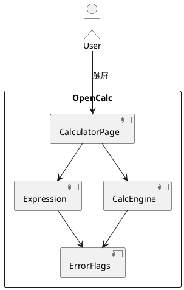
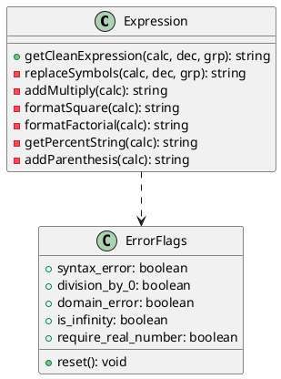
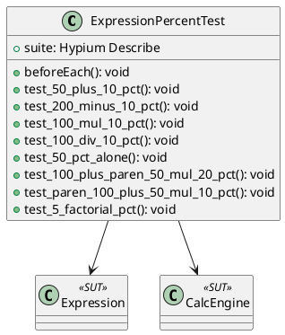

# Delta Design — 百分号按钮

> 对应变更: 20260611-requirement-add-percentage-btn
> 关联需求: REQ-7-01 ~ REQ-7-08 (见 `delta-spec.md`)

---

## D1. 概述

### 1.1 应用定位 [无变更]

OpenCalc HarmonyOS 端口的**百分号按钮**显化与语义修正。

### 1.2 核心交互

```
用户在按键面板点 %  →  expression 追加 '%'  →  按 = 触发 onEquals
                                              →  Expression.getCleanExpression
                                                  含 getPercentString 解析
                                              →  CalcEngine.evaluate
                                              →  显示结果
```

### 1.3 技术栈概览 [无变更]

- ArkTS / ArkUI 声明式（V1 状态管理）
- Hypium 1.0.15（新增：单元测试）
- 状态管理：@State / @Builder

---

## D2. 功能清单

| 功能名 | 说明 | 入口 | 优先级 | 关联需求 |
|--------|------|------|--------|----------|
| `%` 按钮显化 | 在基础模式按键网格第二行第二槽显化 `%` | CalculatorPage.ButtonGrid | P0 | REQ-7-01 |
| 加/减基数相乘语义 | `A+B%` ≡ `A + A*B/100` | Expression.getPercentString | P0 | REQ-7-02, REQ-7-03 |
| 乘/除后置除 100 | `A*B%` ≡ `A*B/100` / `A/B%` ≡ `A/(B/100)` | Expression.getPercentString | P0 | REQ-7-04, REQ-7-05 |
| 裸百分比 | `B%` ≡ `B/100` | Expression.getPercentString | P0 | REQ-7-06 |
| bug 修复 | `50+10%=55` 而非 5 | Expression.getPercentString 默认分支 | P0 | REQ-7-07 |
| 单元测试 | Hypium 用例覆盖 8 种 | ExpressionPercentTest | P0 | REQ-7-08 |

---

## D3. 实现模型

### 3.1 上下文视图 [无变更]



### 3.2 总体架构 [无变更]

View → ViewModel（@State）→ Service（Expression/CalcEngine）→ Model（ErrorFlags）

### 3.3 模块划分 [无变更]

仅修改 entry HAP 内文件，新增 `entry/src/test/ets/calculator/ExpressionPercentTest.ets` 单元测试。

### 3.4 设计系统规格 [无变更]

颜色与 `× ÷ - +` 一致：调用 `CalculatorPage.getOp()`，覆盖默认/暗色/AMOLED。

### 3.5 表达式预处理模块（Expression）

#### 3.5.1 模块介绍
- 模块身份：entry HAP
- 范围：`opencalc/entry/src/main/ets/calculator/Expression.ets`

#### 3.5.2 功能描述
- 修复 `getPercentString` "默认（数字前置 %）"分支
- 维持其他分支不变

#### 3.5.3 目录结构 [无变更]

#### 3.5.4 架构图谱



#### 3.5.5 功能与用例分析

##### 用例：% 加法基数
- 前置：expression = "50+10%"
- 步骤：
  1. getCleanExpression 调用 getPercentString
  2. 默认分支处理
  3. 替换 '%' 为 '/100'
  4. addMultiply 添加隐式乘
- 后置：clean = "50+(50*(10/100))"，engine.evaluate 返回 55

##### 用例：% 减法基数
- 前置：expression = "200-10%"
- 后置：clean = "200-(200*(10/100))"，result = 180

##### 用例：% 乘后置除
- 前置：expression = "100*10%"
- 后置：clean = "100*(10/100)"，result = 10

##### 用例：% 除后置除
- 前置：expression = "100/10%"
- 后置：clean = "100/(10/100)"，result = 1000

##### 用例：裸 %
- 前置：expression = "50%"
- 后置：clean = "(50/100)"，result = 0.5

#### 3.5.6 接口设计 [无变更]

`getPercentString(calculation: string): string` — 私有方法，仅入口 `getCleanExpression` 调用。

#### 3.5.7 状态管理 [无变更]

#### 3.5.8 核心算法

##### 算法：默认分支 % 展开（修复版）

输入：result 字符串，i 指向 `%` 位置

```
1. start = i - 1
2. while start >= 0 and (isDigit(result[start]) or result[start] == '.'):
     start = start - 1
3. opPos = lastIndexOfAny(result.substring(0, i), ['+', '-', '*', '/'])
                                              // ↑ 修复点: 用 i 而非 start+1
4. if opPos < 0:
     num = result.substring(start + 1, i)
     if num.length == 0: syntax_error; return
     result = result.substring(0, start + 1) + '(' + num + '/100)' + result.substring(i + 1)
5. else if result[opPos] in ['*', '/']:
     num = result.substring(opPos + 1, i)
     if num.length == 0: syntax_error; return
     result = result.substring(0, opPos + 1) + '(' + num + '/100)' + result.substring(i + 1)
6. else:  // opPos 指向 + 或 -
     base = result.substring(0, opPos).trim()
     num = result.substring(opPos + 1, i)
     if num.length == 0: syntax_error; return
     result = base + result[opPos] + base + '*(' + num + '/100)' + result.substring(i + 1)
7. i = 0; continue
```

**修复前 vs 修复后对比（"50+10%"）：**

| 步骤 | 修复前 | 修复后 |
|------|--------|--------|
| start | 1 | 1 |
| opPos 范围 | [0, 2)="50" | [0, 4)="50+1" |
| opPos | -1 | 2（'+'） |
| num | "10" | "10" |
| result 重组 | "50(10/100)" | "50+(50*(10/100))" |
| 最终 | 50 × 0.1 = 5 ❌ | 50 + 5 = 55 ✅ |

#### 3.5.9 错误处理 [无变更]

- `num.length === 0` → `ErrorFlags.syntax_error = true`
- 括号不匹配 → `ErrorFlags.syntax_error = true`

#### 3.5.10 依赖关系 [无变更]

仅依赖 `model/ErrorFlags`。

### 3.6 UI 页面模块（CalculatorPage）

#### 3.6.1 模块介绍
- 范围：`opencalc/entry/src/main/ets/pages/CalculatorPage.ets`
- 范围：第二行 5 列布局（line 278）— `%` 已在 `BtnOpPct('%')`

#### 3.6.2 功能描述
- 确认 `%` 按钮已就位，颜色与运算符一致
- 如视觉与 REQ-7-01 不符，做最小微调

#### 3.6.3 目录结构 [无变更]

#### 3.6.4 架构图谱 [无变更]

#### 3.6.5 功能与用例分析 [无变更]

#### 3.6.6 接口设计

```typescript
// 既有 BtnOpPct 模板（line 306）
@Builder BtnOpPct(l: string): void
```

`l === '%'` 已注册（line 278）；无需新增接口。

#### 3.6.7 状态管理 [无变更]

#### 3.6.8 核心算法 [无变更]

#### 3.6.9 错误处理 [无变更]

#### 3.6.10 依赖关系 [无变更]

### 3.7 测试模块（ExpressionPercentTest）

#### 3.7.1 模块介绍
- 模块身份：entry HAP 测试 sourceSet
- 范围：`opencalc/entry/src/test/ets/calculator/ExpressionPercentTest.ets`
- 工具：Hypium 1.0.15

#### 3.7.2 功能描述

| TC ID | 输入表达式 | 期望 clean | 期望 evaluate | 备注 |
| ----- | ---------- | ---------- | ------------- | ---- |
| TC-01 | `50+10%` | `50+(50*(10/100))` | 55 | REQ-7-02, REQ-7-07 |
| TC-02 | `200-10%` | `200-(200*(10/100))` | 180 | REQ-7-03 |
| TC-03 | `100*10%` | `100*(10/100)` | 10 | REQ-7-04 |
| TC-04 | `100/10%` | `100/(10/100)` | 1000 | REQ-7-05 |
| TC-05 | `50%` | `(50/100)` | 0.5 | REQ-7-06 |
| TC-06 | `100+(50*20%)` | `100+(50*(20/100))` | 110 | 复合 |
| TC-07 | `(100+50)*10%` | `((100+50))*(10/100)` | 15 | 括号+后置% |
| TC-08 | `5!%` | `((5!)/100)` | 1.2 | 阶乘后% |

#### 3.7.3 目录结构

```
entry/
└── src/
    ├── main/ets/        # 既有
    └── test/ets/        # 新增
        ├── Ability.test.ets   # Hypium 入口（按官方模板）
        └── calculator/
            └── ExpressionPercentTest.ets
```

#### 3.7.4 架构图谱



#### 3.7.5 功能与用例分析

##### 用例：执行百分号测试套件
- 前置：Hypium 初始化完成，ErrorFlags 静态状态被 `beforeEach` 重置
- 步骤：
  1. 实例化 `Expression` 与 `CalcEngine`
  2. 对每个 TC 调 `getCleanExpression`
  3. 调 `engine.evaluate(clean, true)`
  4. `expect(result).assertClose(actual, 1e-9)`
- 后置：所有 TC 通过

#### 3.7.6 接口设计

测试入口 `Ability.test.ets`：

```typescript
import { abilityDelegatorRegistry, Hypium } from '@kit.TestKit';
import { describe, beforeAll, beforeEach, afterEach, afterAll, it, expect } from '@ohos/hypium';
import { ExpressionPercentTest } from './calculator/ExpressionPercentTest';

export default function abilityInit() {
  Hypium.hypiumTest(abilityDelegatorRegistry.getAbilityDelegator(), (): void => {
    ExpressionPercentTest();
  });
}
```

被测文件 `ExpressionPercentTest.ets`：

```typescript
import { describe, beforeEach, it, expect } from '@ohos/hypium';
import { Expression } from '../../main/ets/calculator/Expression';
import { CalcEngine } from '../../main/ets/calculator/Calculator';
import { ErrorFlags } from '../../main/ets/model/ErrorFlags';

export function ExpressionPercentTest(): void {
  describe('ExpressionPercent', (): void => {
    const expr: Expression = new Expression();
    const engine: CalcEngine = new CalcEngine();
    beforeEach((): void => { ErrorFlags.reset() });
    const run = (s: string): number => {
      const clean: string = expr.getCleanExpression(s, '.', ',');
      return engine.evaluate(clean, true);
    };
    it('50+10%=55', (): void => { expect(run('50+10%')).assertEqual(55) });
    // ... 其余 TC
  });
}
```

#### 3.7.7 状态管理 [N/A]

#### 3.7.8 核心算法 [N/A]

#### 3.7.9 错误处理

- 浮点容差：使用 `assertClose(value, 1e-9)`，避免 `0.1 + 0.2` 类问题
- `ErrorFlags.reset()` 在 `beforeEach` 防止静态状态污染

#### 3.7.10 依赖关系

- 内部：被测 SUT（Expression, CalcEngine, ErrorFlags）
- 外部：@ohos/hypium（已在 `opencalc/oh-package.json5` devDependencies）

---

## D4. 接口设计

无新增/修改对外接口。

---

## D5. 数据模型

无变更。

---

## D6. UI 设计系统

无变更。

---

## D7. 页面清单与导航

无变更。

---

## D8. 用户交互规格

无变更。

---

## D9. 平台集成

### 9.1 构建配置与依赖

需在 `opencalc/entry/build-profile.json5` 注册 test sourceSet：

```json5
{
  "apiType": "stageMode",
  "buildOption": {},
  "targets": [
    { "name": "default", "runtimeOS": "HarmonyOS" }
  ],
  "sourceSet": [
    // 既有 main（隐式）
    { "name": "test", "srcPath": "src/test/ets" }
  ]
}
```

oh-package.json5 已有 devDependencies：`@ohos/hypium@1.0.15`、`@ohos/hamock@1.0.0`。

### 9.2 权限 [N/A]

### 9.3 Kits 清单 [N/A]

### 9.4 后台与 Extension [N/A]

### 9.5 备份与恢复 [N/A]

### 9.6 分布式与跨端 [N/A]

---

## D10. 偏好设置目录

无变更。

---
> 本文档由 mod-design skill 生成。
> 标记 [推断] 的内容为基于设计推断，非确定性事实。
> 生成时间: 2026-06-11 18:30
