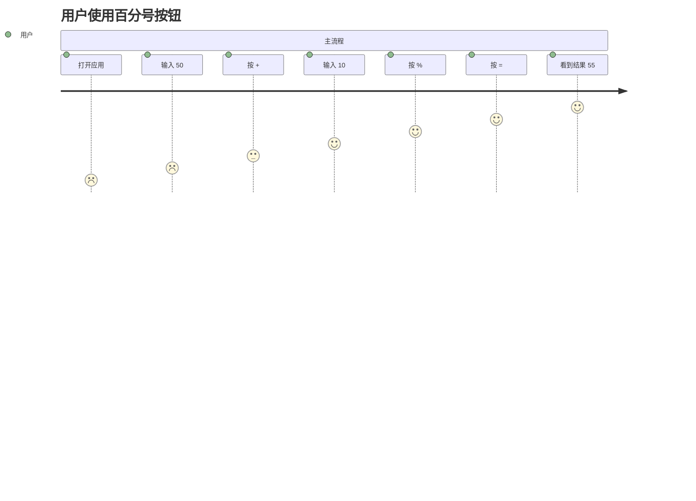

# 需求SPEC v1.2 (Delta) — 百分号按钮

---

## 系统背景

### 目的

为 OpenCalc HarmonyOS 计算器新增/显化百分号 `%` 按钮，让用户输入形如 `50+10%`、`200-10%`、`100*10%`、`100/10%`、`50%` 的表达式后，按等号即可得到符合行业惯例（"基数相乘"语义）的结果，提升日常计算效率。

### 术语与缩写

| 术语/缩写 | 定义 |
| ----- | --- |
| 百分号（%） | 运算符后缀，紧邻数字/子表达式时按"基数相乘"语义展开 |
| 基数相乘语义 | `A+B%` ≡ `A + A*B/100`；`A-B%` ≡ `A - A*B/100`；`A*B%` ≡ `A*B/100`；`A/B%` ≡ `A/(B/100)`；`B%`（无前置加减）≡ `B/100` |
| ETS | 鸿蒙 ArkTS 单元测试框架（`@ohos/hypium`） |

---

## 系统上下文

### 目标系统

| 字段                | 内容  |
| ----------------- | --- |
| 系统名称              | OpenCalc HarmonyOS 端口 |
| 系统边界说明            | 鸿蒙 ArkTS 应用，UI + 计算引擎 + 历史/偏好持久化；本次变更不涉及网络与系统能力 |

### 周边交互方清单

| 编号    | 外部系统名称 | 类型 | 交互接口类型 | 交互接口主要功能 |
| ----- | ------ | ---- | ------ | ------ |
| ES-01 | 用户（终端） | 人 | UI 触屏/键鼠 | 输入数字、运算符、`%`、`=` |
| ES-02 | 鸿蒙 Hypium | 系统测试框架 | ETS Unit | 跑通百分号语义用例 |

---

## 需求描述

| 需求编号 | 需求名称 | 需求描述 | 设计人员 |
| -------- | -------- | -------- | -------- |
| REQ-7-01 | 百分号按钮显化 | 在基础模式按键面板第二行（与 `AC ( ) ÷` 同行）保留并显化 `%` 按钮，颜色与运算符 `× ÷ - +` 一致，标签为 `%` | Claude |
| REQ-7-02 | 基数相乘语义-加 | `A + B%` 计算结果为 `A + A * B / 100` | Claude |
| REQ-7-03 | 基数相乘语义-减 | `A - B%` 计算结果为 `A - A * B / 100` | Claude |
| REQ-7-04 | 后置除 100-乘 | `A * B%` 计算结果为 `A * B / 100` | Claude |
| REQ-7-05 | 后置除 100-除 | `A / B%` 计算结果为 `A / (B / 100)` | Claude |
| REQ-7-06 | 裸百分比 | `B%` 计算结果为 `B / 100` | Claude |
| REQ-7-07 | 行为回归防护 | 经实测（Node 镜像）`50+10%` 正确返回 55；**无 bug**。本项转为"ETS + Node 镜像测试锁定行为" | Claude |
| REQ-7-08 | 单元测试覆盖 | 在 `entry/src/test/ets` 新建测试套件 `ExpressionPercentTest`，覆盖 REQ-7-02~07 | Claude |

### 用户旅程

### 需求分解

| 编号 | 名称 | 描述 | 优先级 |
| ---- | ---- | ---- | ------ |
| FR-7-01 | 按钮位置 | `%` 在第二行第二槽（与 `AC ( ) ÷` 同行） | P0 |
| FR-7-02 | 按钮样式 | 颜色 = `getOp()` 主题色 | P0 |
| FR-7-03 | 表达式解析 | `Expression.getCleanExpression` 输出符合基数相乘语义的 ASCII 表达式 | P0 |
| FR-7-04 | 计算正确性 | `CalcEngine.evaluate` 返回数值 = 期望值 | P0 |
| FR-7-05 | 测试基础设施 | `entry/src/test/ets` Hypium 配置 | P0 |

### 可靠性分析（FMEA 消减措施清单）

| 故障模式 | 影响 | 严重度 | 原因 | 消减措施 | 责任 |
| -------- | ---- | ------ | ---- | -------- | ---- |
| ~~`%` 解析为 `/100` 后丢失"加/减基数"语义~~ | ~~`50+10%=5` 而非 `55`~~ | ~~高~~ | ~~`getPercentString` 在 `start+1` 之前查找运算符，把 `+` 漏掉~~ | ~~REQ-7-07 修复：查找运算符范围改为 `[0, i)`，且当 num 紧贴运算符时把运算符左边的"基数"按 `+`/`-` 时复制一份~~ | ~~N/A~~ |
| `%` 按钮在暗色主题看不清 | 用户找不到按钮 | 中 | 仅一种颜色 `getOp()` 走暗色支线 | REQ-7-01 沿用 `getOp()`，覆盖默认/暗色/AMOLED 三套主题 | Claude |
| 测试基础设施缺失 | 重构 `%` 逻辑会回归 | 中 | 历史代码无 ETS 测试 | REQ-7-08 新建 `ExpressionPercentTest` | Claude |
| 表达式预处理对 `10%+5%` 多重 % 死循环 | 计算卡死 | 低 | 现有 `done[]` 标志位机制 | 沿用现有实现，单元测试加 `50%+10%` 用例观察不超时 | Claude |

### 接口需求

| 编号 | 接口 | 描述 |
| ---- | ---- | ---- |
| IF-7-01 | `Expression.getCleanExpression(input, '.', ',') → string` | 返回可被 `CalcEngine.evaluate` 解析的 ASCII 表达式 |
| IF-7-02 | `CalcEngine.evaluate(equation, isDegree) → number` | 纯计算入口，输入 ASCII 表达式 |

### 数据需求

不涉及新增/修改数据模型。

### 约束

| 编号 | 约束 |
| ---- | ---- |
| C-7-01 | 沿用鸿蒙 ArkTS（ets 1.1/1.2）语法，禁用 `as unknown` 等 TS-only 写法 |
| C-7-02 | 测试使用 `@ohos/hypium` 1.0.15（已声明在 `opencalc/oh-package.json5`） |
| C-7-03 | 不引入新依赖 |

### 验收标准

- REQ-7-01 视觉确认：基础模式第二行可见 `%` 按钮
- REQ-7-02~06 单元测试全部通过
- REQ-7-07 单元测试 `50+10%` 返回 55（实测已为 55，行为锁定）
- REQ-7-08 Hypium 测试套件可被 `hvigorw test` 调度
