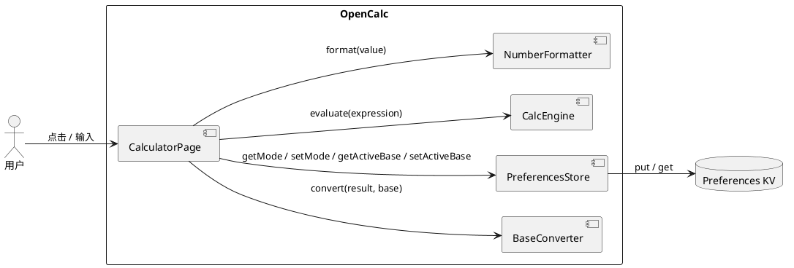
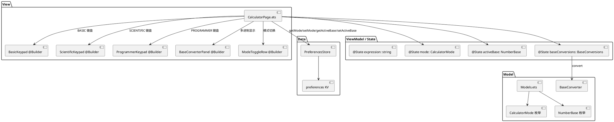
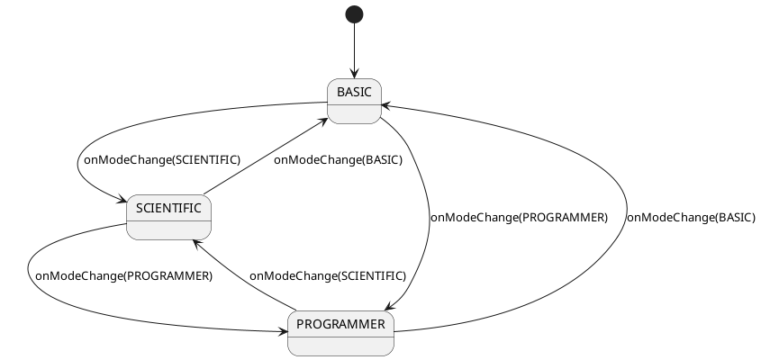

# Issue #12 程序员模式 - 增量设计 (delta-design.md)

## D1 概述

### 1.1 应用定位 [扩展]
OpenCalc HarmonyOS 移植版，在现有基础 / 科学模式基础上新增"程序员模式（PROGRAMMER）"，提供 DEC/BIN/OCT/HEX 四进制实时显示与切换，覆盖开发者的进制转换需求。

### 1.2 核心交互 [新增]
- 用户通过顶部 SegmentedControl 三选一选择 BASIC / SCIENTIFIC / PROGRAMMER
- PROGRAMMER 模式下：
  - 键盘切换为 BIN(0/1) + HEX(A-F) + 数字(2-9) + 运算符
  - 主结果下方固定显示 4 行 DEC/HEX/OCT/BIN 实时值
  - 主结果"主进制"四选一切换按钮（DEC/BIN/OCT/HEX）
- 模式切换时键盘区域 fade + slide 过渡动画（200ms）

### 1.3 技术栈概览 [无变化]
- 框架：ArkTS + ArkUI 声明式（Stage 模型）
- 状态管理：V1（@State / @Prop / @Watch）
- 状态管理说明：本项目沿用 V1，不引入 @ObservedV2
- Kit：无新增
- Native 模块：无

## D2 功能清单 [增量]

| 功能名 | 说明 | 入口 | 优先级 | 关联需求 |
|--------|------|------|--------|---------|
| 模式切换 | 顶部三选一切换 BASIC/SCIENTIFIC/PROGRAMMER | CalculatorPage 顶部 | P0 | FR-1 |
| 程序员键盘 | PROGRAMMER 模式下的键盘布局 | CalculatorPage.ButtonGrid | P0 | FR-2 |
| 多进制实时显示 | 主结果下方 4 行 DEC/HEX/OCT/BIN | CalculatorPage.BaseConverterPanel | P0 | FR-3 |
| 主进制切换 | PROGRAMMER 模式下 DEC/BIN/OCT/HEX 四选一 | CalculatorPage.ActiveBaseToggle | P0 | FR-4 |
| 模式切换动画 | 键盘区域 fade + slide 200ms | CalculatorPage.KeypadContainer | P1 | FR-5 |
| 偏好持久化 | mode + activeBase 写入 PreferencesStore | PreferencesStore | P1 | FR-1, FR-4 |
| BaseConverter 工具类 | DEC ↔ BIN/OCT/HEX 转换 + 边界处理 | calculator/BaseConverter.ets | P0 | 数据契约 §3.3 |

## D3 实现模型

### 3.1 上下文视图



### 3.2 总体架构 [扩展]
沿用现有 MVVM 单页面分层，无架构变更：



### 3.3 模块划分 [无变化]
单 HAP（entry），无 HAR/HSP 拆分。

### 3.4 设计系统规格

#### 3.4.1 色彩系统 [无变化]
沿用现有色板（黑/白/灰/强调色）。

#### 3.4.6 动画规格 [新增]

| 名称 | 时长 | 曲线 | 触发条件 |
|------|------|------|---------|
| 模式切换 enter | 200ms | Curve.EaseInOut | mode 变化时键盘区域 enter |
| 模式切换 exit | 200ms | Curve.EaseInOut | mode 变化时键盘区域 exit |
| 透明度 | 0 → 1 | linear | enter 子动画 |
| 位移 | x: 8 → 0 | linear | enter 子动画 |

#### 3.4.7 响应式断点 [无变化]
sm/md/lg 沿用项目现有规则。

### 3.5 CalculatorPage 模块实现设计 [重构]

#### 3.5.1 模块介绍
CalculatorPage.ets 是 entry 唯一的 @Entry 页面组件，本次重构从二选一模式升级为三选一模式，新增程序员键盘和多进制显示。

#### 3.5.2 功能描述
- 模式状态机：BASIC ↔ SCIENTIFIC ↔ PROGRAMMER
- 键盘渲染分发：mode 决定 BasicKeypad / ScientificKeypad / ProgrammerKeypad
- 主结果与多进制行同步刷新
- 顶部 SegmentedControl 三选一按钮
- 主进制切换按钮（仅 PROGRAMMER 模式显示）

#### 3.5.3 目录结构 [无变化]
```
ets/
  pages/
    CalculatorPage.ets   ← 本次重构
    Index.ets            ← 不变
```

#### 3.5.4 架构图谱（状态机）



#### 3.5.5 功能与用例分析

**用例：切换到程序员模式并输入 255**
- 前置：CalculatorPage 已挂载，mode=BASIC
- 步骤：
  1. 用户点击顶部"程序员"按钮
  2. onModeChange(2) 触发
  3. mode 状态更新，@Watch 触发持久化
  4. ButtonGrid 渲染 ProgrammerKeypad（fade + slide 200ms）
  5. BaseConverterPanel 显示（4 行空白）
  6. 用户依次点击 2、5、5
  7. 用户点击 =
  8. onEquals 触发：evaluate → 255 → NumberFormatter.format → BaseConverter.convert
  9. 主结果 = "255"（activeBase=DEC），多进制行更新 DEC=255, HEX=0xFF, OCT=0o377, BIN=0b11111111
- 后置：mode=PROGRAMMER 写入偏好

#### 3.5.6 接口设计 [新增]

```typescript
// CalculatorPage.ets 新增/修改
@State mode: CalculatorMode = CalculatorMode.BASIC
@State activeBase: NumberBase = NumberBase.DEC
@State baseConversions: BaseConversions = { dec: '', hex: '', oct: '', bin: '' }

@Builder ModeToggleRow(): void    // 替换原 ToggleRow
@Builder BasicKeypad(): void
@Builder ScientificKeypad(): void
@Builder ProgrammerKeypad(): void
@Builder BaseConverterPanel(): void
@Builder ActiveBaseToggle(): void

async onModeChange(newMode: CalculatorMode): Promise<void>
async onActiveBaseChange(newBase: NumberBase): Promise<void>
private refreshBaseConversions(value: number): void
```

#### 3.5.7 状态管理设计

- `@State mode: CalculatorMode` — 当前模式，触发键盘重渲染 + 偏好写入
- `@State activeBase: NumberBase` — 主结果进制，触发主结果 + 多进制行刷新
- `@State baseConversions: BaseConversions` — 多进制行缓存，避免重复计算
- `@Watch('onModeChange')` — mode 变化时持久化
- `@Watch('onActiveBaseChange')` — activeBase 变化时持久化
- `@Watch('onExpressionChange')` — 程序员模式下实时刷新多进制行

#### 3.5.8 核心算法

**BaseConverter 转换算法**：
```
输入 value: number, base: NumberBase
1. if !Number.isFinite(value) || Number.isNaN(value) → return "-"
2. if value === 0 → return "0"
3. sign = value < 0 ? "-" : ""
4. intPart = Math.trunc(Math.abs(value))
5. result = intPart.toString(base.toRadix())
6. return sign + result
```

#### 3.5.9 错误处理

| 错误 | 处理 |
|------|------|
| NaN 输入 | BaseConverter 返回 `"-"` |
| Infinity 输入 | BaseConverter 返回 `"-"` |
| preferences 写入失败 | try-catch，错误不外抛 |
| 表达式错误 | ErrorFlags.snapshot 非空 → 多进制行显示 `-` |

#### 3.5.10 依赖关系

```typescript
import { BaseConverter } from '../calculator/BaseConverter'
import { CalculatorMode, NumberBase, BaseConversions } from '../model/Models'
```

### 3.6 BaseConverter 模块实现设计 [新建]

#### 3.6.1 模块介绍
纯函数工具类，无 ArkUI 依赖，可在测试环境中独立运行。

#### 3.6.2 功能描述
DEC ↔ BIN/OCT/HEX 字符串转换，处理 NaN/Infinity/小数/负数边界。

#### 3.6.3 目录结构
```
ets/
  calculator/
    BaseConverter.ets          ← 新建
test/
  ets/
    calculator/
      BaseConverter.test.ets   ← 新建（hypium+hamock）
```

#### 3.6.6 接口设计

```typescript
// calculator/BaseConverter.ets
export class BaseConverter {
  /**
   * Convert a number to its string representation in the given base.
   * Truncates fractional part for non-DEC bases.
   * Returns "-" for NaN/Infinity.
   */
  static convert(value: number, base: NumberBase): string {
    if (!Number.isFinite(value) || Number.isNaN(value)) {
      return '-'
    }
    if (value === 0) {
      return '0'
    }
    const negative: boolean = value < 0
    const intPart: number = Math.trunc(Math.abs(value))
    if (base === NumberBase.DEC) {
      // DEC 保留原始值（含小数）
      const formatted: string = value.toString()
      return negative && intPart > 0 ? '-' + formatted : formatted
    }
    const radix: number = base === NumberBase.BIN ? 2
      : base === NumberBase.OCT ? 8
      : 16
    const str: string = intPart.toString(radix).toUpperCase()
    return negative ? '-' + str : str
  }

  /**
   * Wrap a converted value with its base prefix for display.
   * DEC: "255"
   * BIN: "0b11111111"
   * OCT: "0o377"
   * HEX: "0xFF"
   */
  static withPrefix(value: number, base: NumberBase): string {
    if (base === NumberBase.DEC) {
      return BaseConverter.convert(value, base)
    }
    const prefix: string = base === NumberBase.BIN ? '0b'
      : base === NumberBase.OCT ? '0o'
      : '0x'
    return prefix + BaseConverter.convert(value, base)
  }
}
```

#### 3.6.8 核心算法
详见 §3.5.8。

#### 3.6.9 错误处理
所有 API 不抛异常，NaN/Infinity 返回 `"-"`。

#### 3.6.10 依赖关系
无外部依赖。

### 3.7 Models 模块实现设计 [扩展]

#### 3.7.1 模块介绍
model/Models.ets 增加 CalculatorMode / NumberBase 枚举。

#### 3.7.6 接口设计

```typescript
// model/Models.ets 新增
export enum CalculatorMode {
  BASIC = 0,
  SCIENTIFIC = 1,
  PROGRAMMER = 2
}

export enum NumberBase {
  DEC = 0,
  BIN = 1,
  OCT = 2,
  HEX = 3
}

export interface BaseConversions {
  dec: string
  hex: string
  oct: string
  bin: string
}

export interface CalculatorPreferences {
  // 现有字段保持
  scientificModeDefault: number
  // 新增
  mode: CalculatorMode
  activeBase: NumberBase
}

export const DEFAULT_PREFERENCES: CalculatorPreferences = {
  scientificModeDefault: 0,
  mode: CalculatorMode.BASIC,
  activeBase: NumberBase.DEC
}
```

### 3.8 PreferencesStore 模块实现设计 [扩展]

#### 3.8.1 模块介绍
preferences/PreferencesStore.ets 增加 mode / activeBase 读写方法。

#### 3.8.6 接口设计

```typescript
// preferences/PreferencesStore.ets 新增
async getMode(): Promise<CalculatorMode> {
  try {
    const v: number = await this.store.getValue('mode', DEFAULT_PREFERENCES.mode) as number
    return v as CalculatorMode
  } catch {
    return DEFAULT_PREFERENCES.mode
  }
}

async setMode(mode: CalculatorMode): Promise<void> {
  try {
    await this.store.putValue('mode', mode)
    await this.store.flush()
  } catch {
    // 写入失败静默忽略
  }
}

async getActiveBase(): Promise<NumberBase> {
  try {
    const v: number = await this.store.getValue('activeBase', DEFAULT_PREFERENCES.activeBase) as number
    return v as NumberBase
  } catch {
    return DEFAULT_PREFERENCES.activeBase
  }
}

async setActiveBase(base: NumberBase): Promise<void> {
  try {
    await this.store.putValue('activeBase', base)
    await this.store.flush()
  } catch {
    // 写入失败静默忽略
  }
}
```

#### 3.8.9 兼容性
- 保留 `getScientificModeDefault()` / `setScientificModeDefault()` 旧接口
- 旧数据迁移：loadPrefs 优先读 mode 字段；无 mode 字段时回退 scientificModeDefault=1 → SCIENTIFIC，=0 → BASIC

## D4 接口设计

### 4.1 内部数据访问 API [扩展]

```typescript
// PreferencesStore 新增
getMode(): Promise<CalculatorMode>
setMode(mode: CalculatorMode): Promise<void>
getActiveBase(): Promise<NumberBase>
setActiveBase(base: NumberBase): Promise<void>
```

### 4.2 业务抽象接口

```typescript
// calculator/BaseConverter.ets
BaseConverter.convert(value: number, base: NumberBase): string
BaseConverter.withPrefix(value: number, base: NumberBase): string
```

## D5 数据模型

### 5.3 Preferences 结构 [扩展]

| key | 类型 | 默认值 | 说明 |
|-----|------|--------|------|
| scientificModeDefault | number | 0 | 旧字段，保留兼容 |
| mode | number (CalculatorMode) | 0 | 新字段，CalculatorMode 枚举 int 值 |
| activeBase | number (NumberBase) | 0 | 新字段，NumberBase 枚举 int 值 |

## D6 UI 设计系统 [扩展]

### 6.1 色彩系统
沿用现有色板，新增 programmer 模式强调色（蓝灰 `#5A6B7C`），用于 BIN/HEX 标签。

### 6.6 动画规格
- 模式切换 enter：fade-in + slide-from-right 200ms Curve.EaseInOut

### 6.7 一多响应式规范
- sm：ModeToggleRow 文字 + 图标
- md/lg：仅图标（节省空间）

## D7 页面清单与导航 [扩展]

### 7.1 页面清单总表

| 页面 | 路径 | 入口 | 传参 | 功能 |
|------|------|------|------|------|
| CalculatorPage | pages/CalculatorPage.ets | EntryAbility | - | 主页面，新增 PROGRAMMER 模式 |
| Index | pages/Index.ets | - | - | 不变 |

## D8 用户交互规格 [扩展]

### 8.1 手势交互

| 组件 | 事件 | 行为 |
|------|------|------|
| ModeToggleRow 按钮 | onClick | onModeChange(targetMode) |
| ActiveBaseToggle 按钮 | onClick | onActiveBaseChange(targetBase) |
| ProgrammerKeypad BIN/HEX/数字键 | onClick | appendToExpression(key) |
| ProgrammerKeypad 运算符 | onClick | onOperator(key) |

## D9 平台集成

### 9.1 构建配置与依赖
无新增依赖，无新增权限。

### 9.2 权限与运行时请求
无新增权限。

### 9.3 Kits 清单
| Kit | 关键 API | 用途 |
|-----|---------|------|
| @ohos.data.preferences | preferences.getPreferences / put / get | 偏好读写（已存在） |

## D10 偏好设置目录 [扩展]

| key | 类型 | 默认值 | 说明 | 行为影响 |
|-----|------|--------|------|---------|
| mode | number | 0 (BASIC) | CalculatorMode 枚举 int 值 | 启动时决定默认 mode |
| activeBase | number | 0 (DEC) | NumberBase 枚举 int 值 | 启动时决定主结果进制 |
| scientificModeDefault | number | 0 | 旧字段 | 兼容旧版本数据 |

## 设计验证（与 delta-spec 交叉校验）

| 项 | delta-spec | delta-design | 一致 |
|----|-----------|-------------|------|
| FR-1 模式切换 | §2.1 FR-1 | D3.5.5 用例 | ✅ |
| FR-2 程序员键盘 | §2.2 FR-2 | D3.5.6 接口 | ✅ |
| FR-3 多进制显示 | §2.3 FR-3 | D3.5.6 BaseConverterPanel | ✅ |
| FR-4 主进制切换 | §2.4 FR-4 | D3.5.6 ActiveBaseToggle | ✅ |
| FR-5 切换动画 | §2.5 FR-5 | D3.4.6 动画规格 | ✅ |
| BaseConverter 契约 | §3.3 | D3.6.6 | ✅ |
| Preferences 扩展 | §3.2 | D3.8.6 | ✅ |
| FMEA 可靠性 | §5 | D3.5.9 错误处理 | ✅ |

---
> 本文档由 mod-design skill 生成。
> 标记 [推断] 的内容为基于设计推断，非确定性事实。
> 生成时间: 2026-06-15