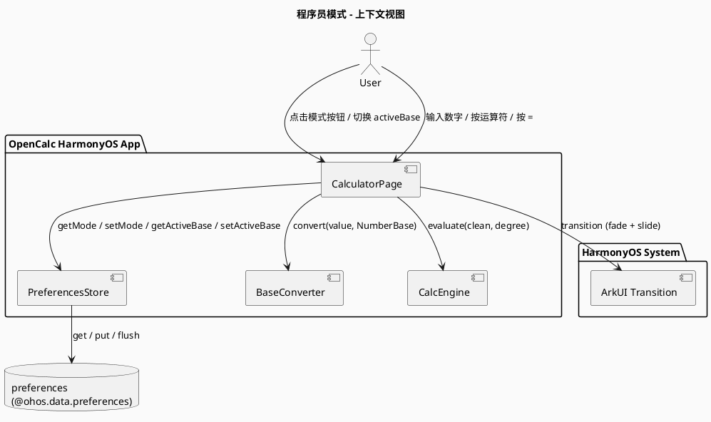
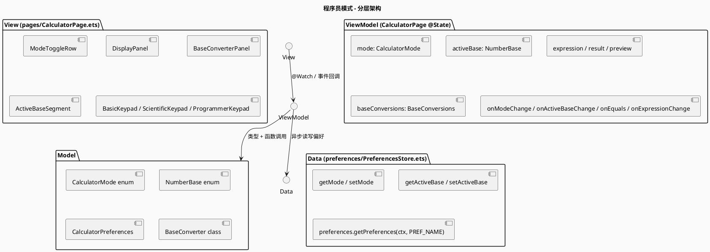
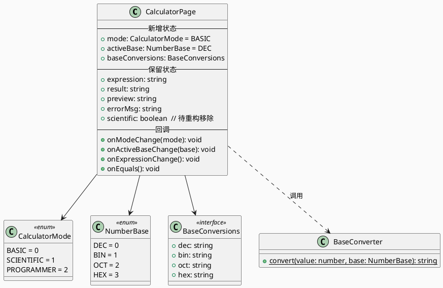
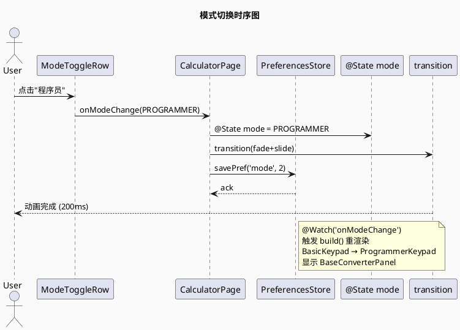
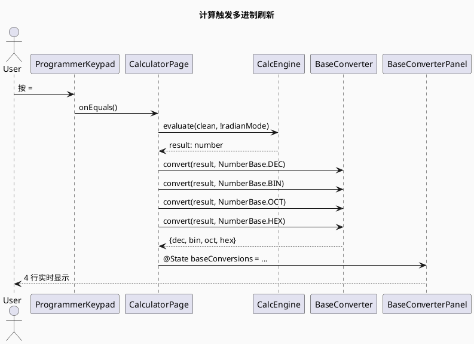

# Issue #12 程序员模式 - 增量设计 (delta-design)

> 关联文档：[proposal.md](./proposal.md) · [delta-spec.md](./delta-spec.md) · [info.md](./info.md)
> 基线设计：[opencalc/spec/DESIGN.md](../../../opencalc/spec/DESIGN.md)

## 0. 元信息
- 变更类型：requirement-add
- 关联特性：feat-programmer-mode
- 基线特性：feat-core-calculator
- 适用版本：OpenCalc HarmonyOS v0.x

---

## D1: 概述

### 1.1 应用定位
在现有 OpenCalc HarmonyOS 计算器基础上，新增"程序员模式"（PROGRAMMER Mode），提供 DEC/BIN/OCT/HEX 四种进制实时显示与切换，覆盖开发者日常进制转换需求。

### 1.2 核心交互

```
用户操作：
  1. 顶部模式切换：BASIC ↔ SCIENTIFIC ↔ PROGRAMMER
  2. PROGRAMMER 模式下键盘切换为 BIN/HEX + 数字 + 运算符
  3. 输入 DEC 表达式 → 按 = → 主结果显示 + 4 行多进制行实时刷新
  4. 主进制按钮 DEC/BIN/OCT/HEX 切换主结果标签

系统响应：
  → 键盘区域 fade + slide 200ms 转场
  → 主结果按 activeBase 格式化显示
  → 4 行多进制行（DEC/HEX/OCT/BIN）实时刷新
  → mode + activeBase 写入 PreferencesStore
```

### 1.3 技术栈概览
| 项 | 值 |
|----|----|
| 框架 | ArkTS + ArkUI 声明式 V1 |
| 状态管理 | @State / @Watch / @Component |
| 持久化 | @ohos.data.preferences |
| 动画 | ArkUI 内置 transition (TransitionType.Insert) |
| 第三方依赖 | 无新增 |
| API 级别 | API 9+ |

---

## D2: 功能清单

| 功能 ID | 功能名 | 说明 | 入口 | 优先级 |
|---------|--------|------|------|--------|
| F-PRG-01 | 模式切换 | 顶部 SegmentedControl 三选一 | CalculatorPage.ModeToggleRow | P0 |
| F-PRG-02 | 程序员键盘 | BIN 0/1 + HEX A-F + 数字 + 运算符 | CalculatorPage.ProgrammerKeypad | P0 |
| F-PRG-03 | 多进制实时显示 | 4 行 DEC/HEX/OCT/BIN | CalculatorPage.BaseConverterPanel | P0 |
| F-PRG-04 | 主进制切换 | 主结果 DEC/BIN/OCT/HEX 切换 | CalculatorPage.ActiveBaseSegment | P1 |
| F-PRG-05 | 模式切换动画 | fade-in 200ms + slide-from-right 8px | CalculatorPage.ButtonGrid.transition | P1 |
| F-PRG-06 | 偏好持久化 | mode + activeBase 持久化 | PreferencesStore | P1 |
| F-PRG-07 | BaseConverter 工具 | DEC→BIN/OCT/HEX 纯函数 | BaseConverter.ets | P0 |

---

## D3: 实现模型

### 3.1 上下文视图



### 3.2 总体架构

沿用现有 MVVM 分层（无架构变更）：



### 3.3 模块划分
沿用现有单 HAP 模块（entry）结构，无新增 HAP/HAR/HSP。

### 3.4 设计系统规格

#### 3.4.1 色彩系统（沿用 CalculatorPage 现有 getOp/getEq/getClr/getBtnBg 等）

#### 3.4.2 主题系统
沿用 `themeIdx` (0=浅色/1=AMOLED/2=暗色)。

#### 3.4.3 排版系统
| 元素 | 字号 (竖/横) | 用途 |
|------|------|------|
| 主结果 | 36 / 28 | bold |
| 表达式 | 18 / 14 | regular |
| 预览 | 14 / 12 | regular |
| **多进制行（新）** | **14 / 11** | regular |
| **主进制按钮（新）** | **12 / 10** | regular |
| 按钮 | 22 / 16 | regular |

#### 3.4.4 间距与尺寸
- 多进制行高：28px
- 主进制按钮高：32px
- 模式切换按钮宽：80px

#### 3.4.5 图标与图形资源
- 模式按钮文本："基础" / "科学" / "程序员"
- 多进制标签：`DEC` / `HEX` / `OCT` / `BIN`（缩写）

#### 3.4.6 动画规格
| 属性 | 值 |
|------|----|
| 动画类型 | TransitionType.Insert / Delete |
| opacity | 0 → 1 (fade-in) |
| translate.x | 8 → 0 (slide-from-right) |
| duration | 200ms |
| curve | Curve.EaseInOut |
| 作用范围 | 仅键盘区域（ButtonGrid） |

#### 3.4.7 响应式断点
横屏 (`isLandscape = true`)：
- 多进制行字号减小（11）
- 主进制按钮隐藏标签仅显示 DEC/BIN/OCT/HEX 缩写
- 模式切换按钮隐藏标签仅显示图标

---

## D3.5: CalculatorPage 模块扩展设计

#### 3.5.1 模块介绍
CalculatorPage 是 OpenCalc 主页面（@Entry @Component），本次扩展其状态机、键盘拆分为三种模式、新增多进制显示面板。

#### 3.5.2 功能描述
- 顶部模式切换器（三选一）
- 多进制实时显示面板（仅 PROGRAMMER 模式）
- 主进制切换 Segment（仅 PROGRAMMER 模式）
- 三种键盘布局：BasicKeypad / ScientificKeypad / ProgrammerKeypad
- 模式切换 fade + slide 动画
- 偏好读写（mode + activeBase）

#### 3.5.3 目录结构
```
opencalc/entry/src/main/ets/
├── pages/
│   └── CalculatorPage.ets           # 主页面（重构）
├── calculator/
│   ├── Calculator.ets               # 不变
│   ├── Expression.ets               # 不变
│   ├── NumberFormatter.ets          # 不变
│   └── BaseConverter.ets            # 新建（纯函数工具类）
├── model/
│   ├── Models.ets                   # 扩展（新增 CalculatorMode/NumberBase 枚举）
│   └── ErrorFlags.ets               # 不变
└── preferences/
    └── PreferencesStore.ets         # 扩展（新增 mode/activeBase 读写）

opencalc/entry/src/test/ets/calculator/
└── BaseConverter.test.ets           # 新建（单元测试）
```

#### 3.5.4 架构图谱

**类图（@State 状态扩展）：**



**时序图（模式切换）：**



**时序图（计算触发多进制刷新）：**



#### 3.5.5 功能与用例分析

**用例：模式切换**
- 前置：App 已启动，CalculatorPage 已挂载
- 步骤：
  1. 用户点击 ModeToggleRow 中的"程序员"
  2. CalculatorPage.onModeChange(PROGRAMMER)
  3. @State mode = PROGRAMMER 触发 build() 重渲染
  4. ButtonGrid 渲染为 ProgrammerKeypad
  5. BaseConverterPanel 显示
  6. savePref('mode', 2) 异步写入
  7. transition(fade+slide) 动画 200ms
- 后置：mode = PROGRAMMER；PreferencesStore.mode = 2

**用例：多进制刷新**
- 前置：mode = PROGRAMMER；当前有 result
- 步骤：
  1. 用户按 =
  2. onEquals() 调用 CalcEngine.evaluate()
  3. 循环调用 BaseConverter.convert(result, base)
  4. @State baseConversions 更新
  5. BaseConverterPanel 重渲染

**用例：主进制切换**
- 前置：mode = PROGRAMMER
- 步骤：
  1. 用户点击 ActiveBaseSegment 中的 "HEX"
  2. onActiveBaseChange(HEX)
  3. @State activeBase = HEX 触发 build()
  4. 主结果按 activeBase 重新格式化（HEX 时显示 `0xFF`）
  5. savePref('activeBase', 3) 异步写入

#### 3.5.6 接口设计

**CalculatorPage 新增方法：**
```typescript
onModeChange(mode: CalculatorMode): void
onActiveBaseChange(base: NumberBase): void
private refreshBaseConversions(value: number, hasError: boolean): void
private formatMainResult(value: number, base: NumberBase): string
```

**CalculatorPage 新增 @State：**
```typescript
@State mode: CalculatorMode = CalculatorMode.BASIC
@State @Watch('onActiveBaseChange') activeBase: NumberBase = NumberBase.DEC
@State baseConversions: BaseConversions = { dec: '0', bin: '0', oct: '0', hex: '0' }
```

**CalculatorPage 新增 @Builder：**
```typescript
@Builder ModeToggleRow()
@Builder BasicKeypad()
@Builder ScientificKeypad()
@Builder ProgrammerKeypad()
@Builder BaseConverterPanel()
@Builder ActiveBaseSegment()
@Builder BtnBin(label: string)        // BIN 0/1 按钮
@Builder BtnHexLetter(label: string)  // A-F 字母按钮
```

#### 3.5.7 状态管理设计

沿用 ArkTS V1 状态管理：
- `@State` 修饰组件内部状态
- `@Watch('onModeChange')` 修饰 mode 触发 build() 与偏好写入
- `@Watch('onActiveBaseChange')` 修饰 activeBase 触发主结果重格式化
- 偏好持久化：PreferencesStore（异步）

数据流图：
```
用户操作 → 事件回调 → @State 变更 → build() 重渲染 → UI 更新
                                       ↓
                                  savePref (异步)
                                       ↓
                                  PreferencesStore.flush()
```

#### 3.5.8 核心算法

**BaseConverter.convert(value: number, base: NumberBase): string**

```typescript
static convert(value: number, base: NumberBase): string {
  // 1. NaN / Infinity 防御
  if (Number.isNaN(value) || !Number.isFinite(value)) return '-'

  // 2. 0 特殊处理
  if (value === 0) return '0'

  // 3. 负数前缀
  const sign = value < 0 ? '-' : ''
  const absVal = Math.abs(value)

  // 4. BIN/OCT/HEX 截断小数（Math.trunc）
  let intPart: number
  if (base === NumberBase.DEC) {
    intPart = absVal
  } else {
    intPart = Math.trunc(absVal)
  }

  // 5. toString(base)
  let result: string
  if (base === NumberBase.DEC) {
    result = intPart.toString()
  } else if (base === NumberBase.BIN) {
    result = intPart.toString(2)
  } else if (base === NumberBase.OCT) {
    result = intPart.toString(8)
  } else {
    result = intPart.toString(16).toUpperCase()
  }

  return sign + result
}
```

**主结果格式化（formatMainResult）：**

```typescript
private formatMainResult(value: number, base: NumberBase): string {
  if (base === NumberBase.DEC) {
    return NumberFormatter.format(value.toString(), '.', ',', NumberingSystem.INTERNATIONAL)
  } else {
    const converted = BaseConverter.convert(value, base)
    // 加进制前缀
    if (base === NumberBase.BIN) return '0b' + converted
    if (base === NumberBase.OCT) return '0o' + converted
    if (base === NumberBase.HEX) return '0x' + converted
    return converted
  }
}
```

**复杂度：**
- BaseConverter.convert: O(log₂(n)) for BIN, O(log₁₆(n)) for HEX（toString 内部实现）
- 单次调用 < 1ms

#### 3.5.9 错误处理

| 错误场景 | 检测 | 处理 |
|---------|------|------|
| NaN 输入 | Number.isNaN(value) | convert 返回 '-' |
| Infinity 输入 | !Number.isFinite(value) | convert 返回 '-' |
| 偏好写入失败 | try-catch | 静默忽略，不阻塞 UI |
| 大整数 (> 2^53) 精度损失 | toString(base) 自动截断 | UI 显示截断后的值 |
| 模式切换中快速点击 | @State mode 单值 | 仅最后一次生效 |

#### 3.5.10 依赖关系

**内部依赖：**
- `../model/Models.ets` — CalculatorMode / NumberBase 枚举
- `../model/ErrorFlags.ets` — 错误标志
- `../calculator/BaseConverter.ets` — 转换工具
- `../calculator/Calculator.ets` — CalcEngine
- `../calculator/NumberFormatter.ets` — DEC 格式化
- `../preferences/PreferencesStore.ets` — 偏好读写

**外部依赖：**
- `@ohos.data.preferences`（已有）
- `@kit.ArkUI`（已有，promptAction）
- 无新增 Kit

---

## D3.6: BaseConverter 模块设计（新）

#### 3.6.1 模块介绍
纯函数工具类，无状态、无副作用，提供 DEC→BIN/OCT/HEX 转换。

#### 3.6.2 功能描述
- `convert(value: number, base: NumberBase): string`
- 支持正/负整数、小数（截断）、0、NaN/Infinity 防御

#### 3.6.3 接口设计
```typescript
export class BaseConverter {
  static convert(value: number, base: NumberBase): string
}
```

#### 3.6.4 依赖关系
- 依赖 `../model/Models.ets` 的 `NumberBase` 枚举
- 无其他依赖

---

## D3.7: PreferencesStore 模块扩展设计

#### 3.7.1 扩展点
新增 4 个方法：
```typescript
async getMode(): Promise<CalculatorMode>
async setMode(mode: CalculatorMode): Promise<void>
async getActiveBase(): Promise<NumberBase>
async setActiveBase(base: NumberBase): Promise<void>
```

#### 3.7.2 向后兼容
- 保留 `getScientificModeDefault()` / `setScientificModeDefault()` 旧接口（不删除）
- 旧数据迁移：scientificModeDefault=1 → mode=SCIENTIFIC（仅在 mode 字段未设置时）
- getAllPreferences() 扩展包含 mode/activeBase

---

## D4: 接口设计

### 4.1 内部数据访问 API（PreferencesStore 扩展）

| 方法 | 签名 | 持久化键 | 默认值 |
|------|------|---------|--------|
| getMode | `(): Promise<CalculatorMode>` | `mode` | CalculatorMode.BASIC |
| setMode | `(mode: CalculatorMode): Promise<void>` | `mode` | - |
| getActiveBase | `(): Promise<NumberBase>` | `activeBase` | NumberBase.DEC |
| setActiveBase | `(base: NumberBase): Promise<void>` | `activeBase` | - |

### 4.2 业务抽象接口

```typescript
// Models.ets 新增
export enum CalculatorMode { BASIC = 0, SCIENTIFIC = 1, PROGRAMMER = 2 }
export enum NumberBase { DEC = 0, BIN = 1, OCT = 2, HEX = 3 }

export interface BaseConversions {
  dec: string
  bin: string
  oct: string
  hex: string
}
```

### 4.3-4.8
无相关实现（无 ExtensionAbility、Want、URI、IPC、Native、文件交换）。

---

## D5: 数据模型

### 5.1-5.2 RDB 模型 / 领域模型
无相关实现（使用 preferences，不使用 RDB）。

### 5.3 Preferences 结构

| key | 类型 | 默认值 | 说明 |
|-----|------|--------|------|
| `mode` | number (CalculatorMode int) | 0 (BASIC) | 当前模式 |
| `activeBase` | number (NumberBase int) | 0 (DEC) | 主结果进制 |
| `scientificModeDefault` (旧) | number | 0 | 旧字段，向后兼容 |
| (其他 8 类偏好) | - | - | 见 PreferencesStore |

### 5.4-5.5 分布式数据 / 文件格式
无相关实现。

---

## D6: UI 设计系统

见 §3.4 设计系统规格。

### 6.7 一多响应式规范
- 横屏 (`isLandscape = true`)：多进制行字号 11、按钮高 36
- 竖屏：多进制行字号 14、按钮高 32

---

## D7: 页面清单与导航

### 7.1 页面清单

| 页面名 | 路径 | 入口 | 传参 | 功能摘要 |
|--------|------|------|------|---------|
| CalculatorPage | pages/CalculatorPage.ets | EntryAbility | - | 主页面（含三种模式键盘） |

### 7.2 全局导航
无新增页面。

### 7.3-7.4 Deep Link / Want
无相关实现。

---

## D8: 用户交互规格

### 8.1 手势交互
- 模式按钮：onClick
- 主进制按钮：onClick
- 键盘按钮：onClick（沿用现有 onDigit/onOp/onFunc/onConst）

### 8.2 弹窗/Sheet/Menu
无新增弹窗。

### 8.3 剪贴板与反馈
- 长按 DisplayPanel 复制：沿用现有 `onCopy()`（复制主结果）
- 模式切换：无 toast（视觉变化足够）

### 8.4 卡片交互
无相关实现。

---

## D9: 平台集成

### 9.1 构建配置与依赖
无新增 oh-package 依赖。

### 9.2 权限与运行时请求
无新增权限。

### 9.3 系统能力（Kits）清单
| Kit | 关键 API | 用途 |
|-----|---------|------|
| @ohos.data.preferences (已有) | getPreferences / put / flush | mode/activeBase 持久化 |
| @kit.ArkUI (已有) | transition | 模式切换动画 |

### 9.4-9.6 后台 / 备份 / 分布式
无相关实现。

---

## D10: 偏好设置目录

| key | 类型 | 默认值 | 说明 | 行为影响 |
|-----|------|--------|------|---------|
| `mode` | number | 0 (BASIC) | 当前模式 | 启动时恢复 mode |
| `activeBase` | number | 0 (DEC) | 主结果进制 | 启动时恢复 activeBase；主结果按此格式化 |
| `scientificModeDefault` (旧) | number | 0 | 旧字段 | 向后兼容；mode 字段优先 |

---

## D11: 测试设计

### 11.1 单元测试（hypium）

**BaseConverter.test.ets 测试用例：**

| # | 输入 | 期望输出 | 场景 |
|---|------|---------|------|
| 1 | convert(255, DEC) | "255" | DEC 正整数 |
| 2 | convert(255, BIN) | "11111111" | BIN 正整数 |
| 3 | convert(255, OCT) | "377" | OCT 正整数 |
| 4 | convert(255, HEX) | "FF" | HEX 正整数 |
| 5 | convert(-1, BIN) | "-1" | BIN 负数 |
| 6 | convert(-255, HEX) | "-FF" | HEX 负数 |
| 7 | convert(0, BIN) | "0" | BIN 零 |
| 8 | convert(3.14, BIN) | "11" | BIN 小数截断 |
| 9 | convert(3.99, OCT) | "3" | OCT 小数截断 |
| 10 | convert(NaN, BIN) | "-" | NaN 防御 |
| 11 | convert(Infinity, HEX) | "-" | Infinity 防御 |
| 12 | convert(-Infinity, BIN) | "-" | -Infinity 防御 |
| 13 | convert(16, HEX) | "10" | HEX 进位 |

### 11.2 UI 自动化测试

使用 harmonyos-ui-test skill + hdc + 127.0.0.1:5555：

| # | 场景 | 验证 |
|---|------|------|
| UI-1 | 点击模式按钮 → 切换为 PROGRAMMER | ModeToggleRow 三选一切换 |
| UI-2 | PROGRAMMER 模式下输入 255 + = | 主结果 255；4 行多进制显示 |
| UI-3 | 点击主进制 HEX | 主结果显示 0xFF |
| UI-4 | 重启 App | 恢复上次 mode 和 activeBase |

### 11.3 视觉验证

模式切换 fade + slide 200ms 动画：人工录屏验证。

---

## 自验证

| 检查项 | 状态 |
|--------|------|
| proposal.md 功能 ↔ §D2 功能清单 | ✅ 一致 |
| delta-spec.md FR-1..FR-5 ↔ §D2 | ✅ 一致（F-PRG-01..F-PRG-05） |
| delta-spec.md 数据需求 ↔ §D5.3 | ✅ 一致（mode/activeBase 键） |
| delta-spec.md 接口需求 ↔ §D4.1 | ✅ 一致（PreferencesStore 4 个方法） |
| delta-spec.md 可靠性需求 ↔ §3.5.9 | ✅ 一致（NaN/Infinity/写入失败） |
| delta-spec.md 性能需求 ↔ §D3.5.8 | ✅ 一致（< 1ms / < 16ms） |

---
> 本文档由 mod-design skill 生成。
> 标记 [推断] 的内容为基于设计推断，非确定性事实。
> 生成时间: 2026-06-15