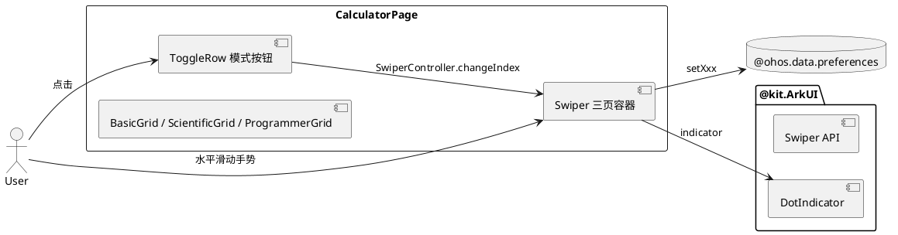
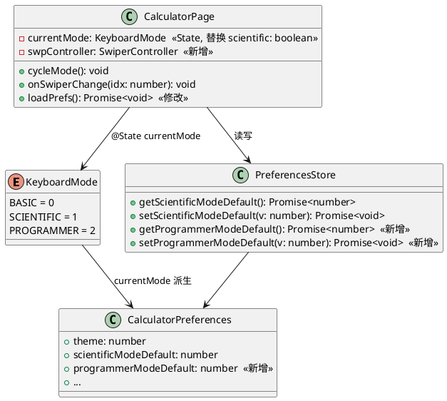
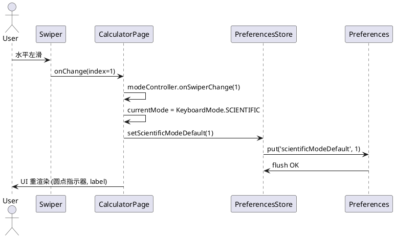
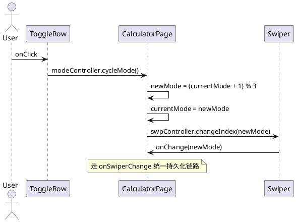
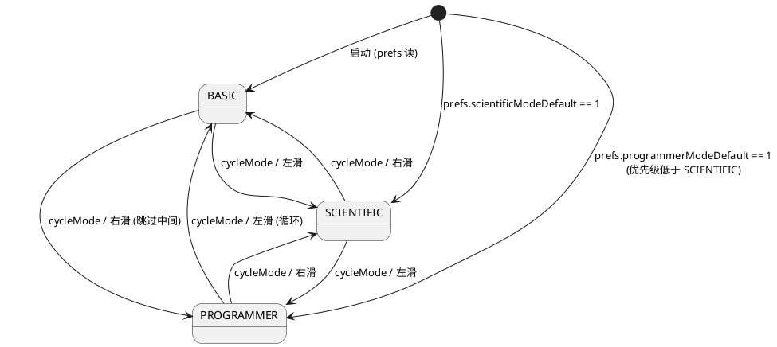

# Delta Design — Issue #29: 竖屏手势滑动切换三种键盘模式

> 增量设计,聚焦变更点。已有设计参考 `specs/features/feat-calculator/design.md`(如存在),否则引用代码仓现状。

---

## D1: 概述

### 1.1 应用定位

OpenCalc (com.darkempire78.opencalculator) 是 HarmonyOS NEXT 上的科学计算器。本增量在 CalculatorPage 引入**水平滑动手势** + Swiper 组件,实现"基础 / 科学 / 程序员"三页键盘的桌面式页面切换,并补全缺失的"程序员"键盘。

### 1.2 核心交互

```
用户 (竖屏)
  │
  ├─ 路径A: 手指在键盘区水平滑动
  │    → Swiper.onChange(index)
  │    → modeController.onSwiperChange(idx)
  │    → currentMode = KeyboardMode[idx]
  │    → prefs.setScientificModeDefault / setProgrammerModeDefault
  │    → UI 圆点指示器同步
  │
  └─ 路径B: 点击模式按钮 (基础/科学/程序员)
       → modeController.cycleMode()
       → SwiperController.changeIndex(newIdx)
       → Swiper.onChange → 走路径A 同样链路
```

### 1.3 技术栈概览

- 框架: ArkTS 声明式 UI (V1 状态管理: @State / @Watch)
- 状态管理: V1 (保持现有风格,避免引入 V2 风险)
- 主要 Kit: `@ohos.arkui.advanced.Swiper` (内置) / `@ohos.data.preferences`
- 编译器: hvigorw 6.24.2, API 12+
- 测试框架: hypium + hamock (单元测试) / hdc + uitest (UI 自动化)

---

## D2: 功能清单

| 功能名 | 说明 | 入口 Page | 优先级 |
|--------|------|-----------|--------|
| F-01 竖屏三页 Swiper | 竖屏键盘区用 Swiper 包裹三页 | CalculatorPage | P0 |
| F-02 模式状态机 | `currentMode: KeyboardMode` 三态 | CalculatorPage | P0 |
| F-03 程序员键盘 | HEX/DEC/OCT/BIN + 位运算键 | CalculatorPage | P1 |
| F-04 模式按钮循环 | 点击 button 在三模式间循环 | CalculatorPage | P0 |
| F-05 圆点指示器 | Swiper 底部 DotIndicator | CalculatorPage | P1 |
| F-06 preferences 新字段 | `programmerModeDefault` 持久化 | PreferencesStore | P1 |

---

## D3: 实现模型

### 3.1 上下文视图



### 3.2 总体架构

```
View 层 (CalculatorPage.ets)
  ├── Swiper {
  │   ├── BasicGrid      @Builder (现有)
  │   ├── ScientificGrid @Builder (现有 scientific=true 的两行)
  │   └── ProgrammerGrid @Builder (新增 HEX/DEC/OCT/BIN + 位运算)
  │ }
  ├── ToggleRow          @Builder (label 跟随 currentMode)
  └── DotIndicator       (Swiper 内置)
        ↓ currentMode @State
        ↓ onSwiperChange / cycleMode
ViewModel (CalculatorPage 内部 method)
  ├── modeController.onSwiperChange(idx)  : 修改 currentMode + 持久化
  └── modeController.cycleMode()          : 0→1→2→0
        ↓
Service (PreferencesStore)
  ├── getProgrammerModeDefault()
  └── setProgrammerModeDefault(v)
        ↓
Data (@ohos.data.preferences)
  └── opencalc_preferences: programmerModeDefault (NEW)
```

### 3.3 HAP/HAR/HSP 模块划分

- 本次修改均在 `entry` HAP 内,无新增 HAP/HAR/HSP。

### 3.4 设计系统规格

#### 3.4.1 色彩系统

沿用 CalculatorPage 已有的 `getOp/getBtnBg/getFuncBg/getT1/getT2` 等颜色方法,程序员键盘复用 ScientificGrid 配色 (Func 灰色背景)。

#### 3.4.6 动画规格

- Swiper 切换动画: 使用 HarmonyOS 默认 (duration ≈ 200-300ms, ease-in-out)
- 圆点指示器: 默认渐变过渡

#### 3.4.7 响应式断点

| 断点 | 行为 |
|------|------|
| 竖屏 | Swiper 三页可滑动 |
| 横屏 (`isLandscape=true`) | **不渲染 Swiper**, 沿用原 ButtonGrid 单页科学模式 |

### 3.5 CalculatorPage 模块实现设计

#### 3.5.1 模块介绍

- 唯一修改页: `pages/CalculatorPage.ets`
- 身份: entry HAP 主页

#### 3.5.2 功能描述

- 三页 Swiper 切换
- 模式按钮三态循环
- 程序员键盘 UI 入口
- 模式持久化

#### 3.5.3 目录结构 (本次新增/修改)

```
pages/
├── CalculatorPage.ets           # ★ 修改 (Swiper 包裹 + 状态机)
└── (no new file)
model/
└── Models.ets                   # ★ 修改 (KeyboardMode 枚举 + preferences 字段)
preferences/
└── PreferencesStore.ets         # ★ 修改 (getProgrammerModeDefault / setProgrammerModeDefault)
resources/base/element/
└── string.json                  # ★ 修改 (新增 "程序员"/"HEX"/"DEC"/"OCT"/"BIN" 等字符串)
```

#### 3.5.4 架构图谱

##### 类图



##### 时序图: 滑动切换模式



##### 时序图: 按钮循环切换



##### 状态图: 模式状态机



#### 3.5.5 功能与用例分析

用例 UC-001-01: Swiper 滑动切到下一模式
- 前置条件: 竖屏, currentMode = BASIC
- 步骤:
  1. 用户左滑
  2. Swiper.onChange(index=1) 触发
  3. modeController.onSwiperChange(1) 处理
  4. currentMode = SCIENTIFIC
  5. prefs.setScientificModeDefault(1)
- 后置条件: UI 显示科学模式页, 圆点指示器高亮第 2 个

用例 UC-003-01: 模式按钮循环
- 前置条件: currentMode = 任意
- 步骤:
  1. 点击 ToggleRow 中的模式按钮
  2. modeController.cycleMode()
  3. newMode = (currentMode + 1) % 3
  4. SwiperController.changeIndex(newMode)
- 后置条件: Swiper 同步切换到 newMode

#### 3.5.6 接口设计

##### 新增枚举 (Models.ets)

```typescript
export enum KeyboardMode {
  BASIC = 0,
  SCIENTIFIC = 1,
  PROGRAMMER = 2
}
```

##### 新增 preferences 字段 (Models.ets)

```typescript
export interface CalculatorPreferences {
  // ... existing fields ...
  programmerModeDefault: number  // NEW: 默认程序员模式状态 (0=关闭 1=开启 2=强制关闭)
}

export const DEFAULT_PREFERENCES: CalculatorPreferences = {
  // ... existing defaults ...
  programmerModeDefault: ScientificModeType.NOT_ACTIVE  // NEW
}
```

##### PreferencesStore 新增方法

```typescript
async getProgrammerModeDefault(): Promise<number>
async setProgrammerModeDefault(value: number): Promise<void>
```

##### CalculatorPage 新增方法

```typescript
@State currentMode: KeyboardMode = KeyboardMode.BASIC
private swpController: SwiperController = new SwiperController()

modeController_cycleMode(): void {
  const nextIdx: number = (this.currentMode + 1) % 3
  this.swpController.changeIndex(nextIdx, false)
  // 实际状态更新由 onChange 触发, 保证单向数据流
}

modeController_onSwiperChange(idx: number): void {
  if (idx < 0 || idx > 2) { console.warn('invalid swiper index=' + idx); return }
  this.currentMode = idx as KeyboardMode
  this.scientific = (idx === KeyboardMode.SCIENTIFIC)
  void this.savePref('scientific', idx === KeyboardMode.SCIENTIFIC ? 1 : 0)
  void this.savePref('programmer', idx === KeyboardMode.PROGRAMMER ? 1 : 0)
}
```

#### 3.5.7 状态管理设计

- `@State currentMode: KeyboardMode` — 单一可信源
- `@State scientific: boolean` — 派生字段, 仅为兼容旧逻辑保留
- `@State swpController: SwiperController` — Swiper 控制器, 用于按钮触发滚动

**单向数据流**:
```
外部输入 → modeController (cycleMode / onSwiperChange)
         → currentMode @State 更新
         → UI 重渲染 (含 Swiper.index 同步)
         → 持久化 (prefs.setXxx)
```

#### 3.5.8 核心算法

##### 模式循环 (cycleMode)

```
newIdx = (currentIdx + 1) % 3
swpController.changeIndex(newIdx)
// 等待 onChange 触发, 完成 currentMode 更新
```

复杂度 O(1),无 IO。

##### 启动优先级

```
if scientificModeDefault == 1: initial = SCIENTIFIC
else if programmerModeDefault == 1: initial = PROGRAMMER
else: initial = BASIC
```

复杂度 O(1)。

#### 3.5.9 错误处理

| 错误 | 处理 |
|------|------|
| onSwiperChange 传入非法 index (负数/越界) | console.warn, 兜底 BASIC |
| preferences 写入失败 | try-catch 包装 savePref, console.error, UI 不受影响 |
| SwiperController.changeIndex 失败 | console.warn, 不更新 currentMode |

#### 3.5.10 依赖关系

- 内部依赖: Models / PreferencesStore (无新增)
- 外部依赖: `@ohos.arkui.advanced.Swiper` (HarmonyOS 内置)
- 无新增 Kit

---

## D4: 接口设计

### 4.1 内部数据访问 API

新增 PreferencesStore 方法, 见 §3.5.6。

### 4.5 URI / Deep Link

无相关实现。

### 4.8 文件交换接口

无相关实现。

---

## D5: 数据模型

### 5.1 关系型数据库

无相关实现。

### 5.2 领域模型

#### KeyboardMode (枚举, NEW)

| 字段 | 类型 | 必填 | 说明 |
|------|------|------|------|
| BASIC | number | - | 基础键盘 (数字 + 基础运算) |
| SCIENTIFIC | number | - | 科学键盘 (+ sin/cos/tan/ln/log 等) |
| PROGRAMMER | number | - | 程序员键盘 (+ HEX/DEC/OCT/BIN/位运算) |

#### CalculatorPreferences (interface, extend)

新增字段 `programmerModeDefault: number`。

### 5.3 Preferences 结构

| key | 类型 | 默认值 | 说明 |
|-----|------|--------|------|
| scientificModeDefault | number | 0 (NOT_ACTIVE) | 旧字段, 保留 |
| programmerModeDefault | number | 0 (NOT_ACTIVE) | **新增** |

### 5.4-5.5 分布式数据 / 文件格式

无相关实现。

---

## D6: UI 设计系统

见 §3.4。

---

## D7: 页面清单与导航

### 7.1 页面清单总表

| 页面名 | 路径 | 入口 Ability | 传参 | 功能摘要 |
|--------|------|--------------|------|----------|
| CalculatorPage | pages/CalculatorPage | EntryAbility | 无 | 主页, 含 Swiper 三页键盘 |

### 7.2 全局导航图

无变化 (CalculatorPage 是单页应用入口, Swiper 是页面内的子组件, 不算新页面)。

### 7.3-7.4 Deep Link / Want

无相关实现。

---

## D8: 用户交互规格

### 8.1 手势交互目录

| 手势 | 触发条件 | 处理 |
|------|----------|------|
| 水平左滑 | 竖屏键盘区 Swiper 内 | onChange(index+1) |
| 水平右滑 | 竖屏键盘区 Swiper 内 | onChange(index-1), 越界循环到 PROGRAMMER |
| 点击模式按钮 | ToggleRow 内 Text | cycleMode |
| LongPress 科学键 | 科学键 onAction (issue #16 已存在) | 长按弹菜单 (无变化) |

### 8.2 弹窗目录

无新增弹窗。

### 8.3 剪贴板与反馈

无新增。

---

## D9: 平台集成

### 9.1 构建配置

无变化 (无新增 oh-package.json5 依赖)。

### 9.2 权限与运行时请求

无新增权限 (Swiper / Preferences 不需要新权限)。

### 9.3 Kits 清单

| Kit | 关键 API | 用途 |
|-----|----------|------|
| @ohos.arkui.advanced (内置) | Swiper, SwiperController, DotIndicator | 三页切换 |
| @ohos.data.preferences (已有) | getPreferences / put / get / flush | 模式持久化 |

### 9.4-9.6 后台 / 备份 / 分布式

无相关实现。

---

## D10: 偏好设置目录

### 10.1 模式偏好 (extend)

| key | 类型 | 默认值 | 说明 | 行为影响 |
|-----|------|--------|------|----------|
| scientificModeDefault | number | 0 | 旧字段, 保留 | 启动时若为 1, 进入 SCIENTIFIC |
| programmerModeDefault | number | 0 | **新增** | 启动时若为 1 (且 scientific=0), 进入 PROGRAMMER |

---

## 设计自验证

- [x] F-01~F-06 功能与 proposal.md / delta-spec.md 一致
- [x] KeyboardMode 枚举在 Models.ets 中定义
- [x] preferences 字段 programmerModeDefault 在 Models.ets + PreferencesStore 同步
- [x] 手势交互 (左/右滑 + 按钮) 在 D8 列出
- [x] 单向数据流在 D3.5.7 描述
- [x] FMEA 措施 (FM-01~FM-05) 在 delta-spec.md 列出, 本设计通过 cycleMode + onSwiperChange 单点入口落实

---

> 本文档由 mod-design skill 生成。
> 标记 [推断] 的内容为基于设计推断, 非确定性事实。
> 生成时间: 2026-06-17