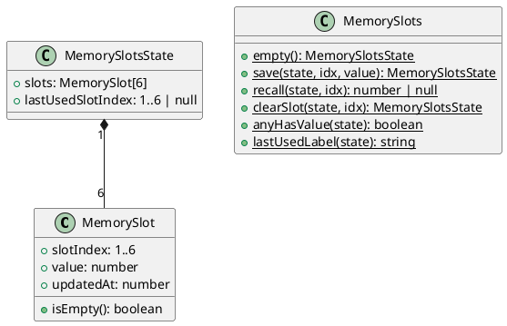
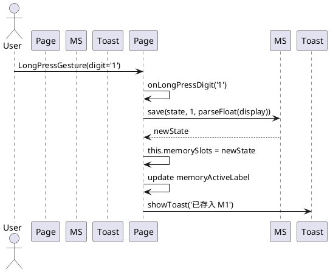
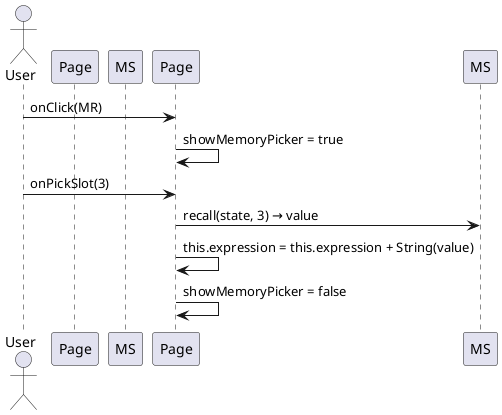
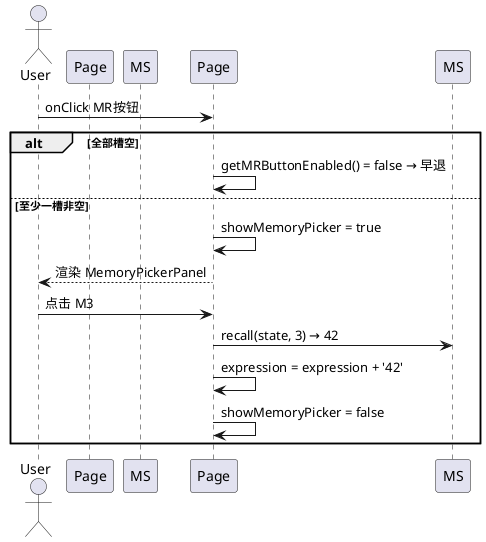

# delta-design — Issue #28 记忆槽 (M1-M6 + MR)

> 增量设计文档。本特性在既有 CalculatorPage 上叠加"6 槽记忆 + MR 调出"能力。无架构级变更，仅扩展 V1 @State 与新增一个纯逻辑类。

---

## D1: 概述

### 1.1 应用定位

opencalc 计算器是一个 HarmonyOS ArkTS 单 HAP 应用（package `com.darkempire78.opencalculator`）。本特性为计算器新增经典 6 槽记忆（M1-M6）功能：长按数字键 1-6 ≥500ms 将当前 display 值存入对应槽位并 toast 提示；点击 MR 弹出 6 槽选择菜单，调出后值进入输入流；空槽禁用、空态 MR 整体禁用。

### 1.2 核心交互

- **存**: 长按数字键 N (1≤N≤6) → 存 display 到 M(N) → toast "已存入 Mx"
- **取**: 点击 MR → 弹 6 槽选择菜单 → 点击非空 M(N) → 值进入 `expression` 输入流
- **指示**: 顶部指示区显示 "M" 或 "M{lastUsedSlotIndex}"

### 1.3 技术栈概览

- 框架：ArkTS 6.0.2（HarmonyOS API 12 / modelVersion 6.0.2），stageMode
- 状态管理：**V1**（@State / @Watch / @Builder）；项目无 @Observed/@ObservedV2
- 使用的 Kit：
  - `@kit.ArkUI`（promptAction.showToast 已 import）
  - `@kit.ArkData`（preferences；本特性不写）
- 第三方依赖：@ohos/hypium 1.0.15 + @ohos/hamock 1.0.0（仅测试）
- 既有 Native：none
- 既有 Hvigor 插件：none

---

## D2: 功能清单

| 功能名 | 说明 | 入口 | 优先级 |
| --- | --- | --- | --- |
| 长按数字键存槽 | 数字键 1-6 LongPressGesture 触发 saveToSlot(N, display) | CalculatorPage.onLongPressDigit | P0 |
| MR 弹出 6 槽选择 | 点击 MR 按钮 → MemoryPickerPanel 显示 6 槽值 | CalculatorPage.onMRClick | P0 |
| 调出到输入流 | MemoryPickerPanel 点击 M(N) → expression += value | CalculatorPage.onPickSlot | P0 |
| 记忆激活指示 | 顶部指示区派生显示 "M" 或 "M{N}" | CalculatorPage.getMemoryActiveLabel | P1 |
| 空态禁用 | 全部槽空时 MR 按钮 disabled + 灰显 | CalculatorPage.getMRButtonEnabled | P1 |
| 单元测试 | MemorySlots 7 个核心方法 + 边界 | `entry/src/test/ets/calculator/MemorySlots.test.ets` | P0 |
| UI 自动化 | 长按 1 存 → MR 调出 → display 验证 | harmonyos-ui-test | P1 |

---

## D3: 实现模型

### 3.1 上下文视图

```
+------------------+        +------------------------+        +-------------------+
|      用户         |  --->  |  CalculatorPage         |  --->  |  promptAction      |
| (手:点击/长按)    |        |  (pages/CalculatorPage) |        |  .showToast()      |
+------------------+        |                        |        +-------------------+
                            |  +------------------+  |        +-------------------+
                            |  | MemorySlots      |  |  --->  | hypium unit test   |
                            |  | (logic class)    |  |        | (MemorySlots.test) |
                            |  +------------------+  |        +-------------------+
                            +------------------------+
```

无网络、无远端、无 Native、无云。

### 3.2 总体架构

延续项目现有 V1 单层架构（无 viewmodel）：

```
View (@Entry CalculatorPage @State) ──reads──► Display / Buttons
   │                                                  ▲
   ├──@State memorySlots: MemorySlotsState ────► set on save/recall
   ├──@State showMemoryPicker: boolean ───► toggle MemoryPickerPanel
   └── reads memorySlots → derive memoryActiveLabel / anySlotHasValue
       │
       ▼
Logic (calculator/MemorySlots.ets)
   ├── class MemorySlot { slotIndex, value, updatedAt }
   ├── class MemorySlotsState { slots[6], lastUsedSlotIndex }
   ├── save(state, idx, value) → MemorySlotsState
   ├── recall(state, idx) → number | null
   ├── anyHasValue(state) → boolean
   └── lastUsedLabel(state) → string
```

### 3.3 HAP/HAR/HSP 模块划分

不变。仅 `entry` HAP 内新增一个 `.ets` 文件 + 一个 `.test.ets` 文件。

### 3.4 设计系统规格

完全复用既有系统（themeIdx 0..3 + DayNight），不引入新主题色。新增的指示标签使用现有 `fontSize` 12 + `fontColor` 跟随 `getOpFg()` 风格。

#### 3.4.1 色彩系统
不新增色板；MR 按钮背景沿用 `getBtnBg()`，禁用态沿用既有 disabledColor（Theme 提供）。

#### 3.4.2 主题系统
完全跟随现有 themeIdx；不新增 theme/styles。

#### 3.4.3 排版系统
| 名称 | 字号 | 用途 |
| --- | --- | --- |
| 记忆指示 label | 14 | "M3" 标签，置于结果区上方 |
| MR 按钮 label | 28 | "MR" 按钮（与数字键一致） |
| MemoryPickerPanel item | 18 | 单槽 item 文本 |

#### 3.4.4 间距与尺寸系统
完全沿用 `pages/LongPressMenu.ets:18-26` 的 `MENU_*` 常量（MENU_WIDTH_RATIO / MENU_MAX_WIDTH / MENU_ITEM_HEIGHT / MENU_FONT_SIZE / MENU_BORDER_RADIUS / MENU_MASK_COLOR / MENU_MASK_OPACITY / MENU_PADDING）。

#### 3.4.5 图标与图形资源
不新增图标资源。"MR" 用纯文本。

#### 3.4.6 动画规格
不引入新动画。toast 动画由 `promptAction.showToast` 内部处理。

#### 3.4.7 响应式断点与栅格
不涉及。本应用是 portrait + landscape 自适应，ButtonGrid 已有 onAreaChange 派生 isLandscape。

### 3.5 MemorySlots 逻辑类实现设计

#### 3.5.1 模块介绍

`calculator/MemorySlots.ets`：纯逻辑类，不继承 `@Observed`，不挂任何装饰器。实例由 CalculatorPage 作为 `@State memorySlots` 持有（值类型，不可变更新模式：操作函数返回新对象）。

#### 3.5.2 功能描述

- 维护 6 个固定槽位 M1..M6
- save / recall / clear / anyHasValue / lastUsedLabel

#### 3.5.3 目录结构

```
entry/src/main/ets/calculator/
   ├── Calculator.ets         (既有)
   ├── Expression.ets          (既有)
   ├── NumberFormatter.ets     (既有)
   ├── BaseConverter.ets       (既有)
   ├── HistoryFilter.ets       (既有)
   └── MemorySlots.ets         ← 新增
```

#### 3.5.4 架构图谱（类图 + 时序图）

类图：


时序图（长按存槽）：


时序图（MR 调出）：


#### 3.5.5 功能与用例分析

**用例: saveToSlot (UC-001-01)**
- 前置: 数字键 N (1≤N≤6) 长按 ≥500ms
- 步骤: onLongPressDigit → MemorySlots.save → 更新 @State → toast → 刷新指示
- 后置: M(N) 的 value 更新；lastUsedSlotIndex = N

**用例: recallFromSlot (UC-002-01)**
- 前置: MR 按钮 enabled（任一槽非空）
- 步骤: 点击 MR → 菜单弹出 → 用户点非空 M(N) → onPickSlot(N) → MemorySlots.recall → expression += value
- 后置: 输入流含 value

#### 3.5.6 接口设计

```ts
// calculator/MemorySlots.ets

export interface MemorySlot {
  slotIndex: 1 | 2 | 3 | 4 | 5 | 6
  value: number
  updatedAt: number
}

export interface MemorySlotsState {
  slots: MemorySlot[]   // length = 6, slotIndex = i+1
  lastUsedSlotIndex: 1 | 2 | 3 | 4 | 5 | 6 | null
}

export class MemorySlots {
  /** 返回一个 6 槽全空的初始状态 */
  static empty(): MemorySlotsState

  /**
   * 写入第 idx 个槽（1..6），返回新 state。
   * 若 value 非有限（NaN/Infinity）则拒绝写入，返回旧 state。
   * 若 idx 越界则抛 Error。
   */
  static save(state: MemorySlotsState, idx: number, value: number): MemorySlotsState

  /**
   * 读取第 idx 个槽（1..6）的 value。
   * 越界或空槽返回 null。
   */
  static recall(state: MemorySlotsState, idx: number): number | null

  /** 清空第 idx 个槽 */
  static clearSlot(state: MemorySlotsState, idx: number): MemorySlotsState

  /** 是否存在任一非空槽 */
  static anyHasValue(state: MemorySlotsState): boolean

  /** "M" / "M3" / "" 派生字符串，供指示 UI 使用 */
  static lastUsedLabel(state: MemorySlotsState): string
}
```

无 async、无 callback、无外部 IO（首版不持久化）。

#### 3.5.7 状态管理设计

- V1：仅 `@State memorySlots: MemorySlotsState = MemorySlots.empty()` 挂在 CalculatorPage 上
- 每次 save 后整体赋值新对象（immutable update pattern），触发 @State 失效与 UI 重渲
- 派生值（`memoryActiveLabel`, `mrEnabled`）用 `@Builder` 或计算函数实时读取 state

#### 3.5.8 核心算法

无复杂算法。槽位结构是固定长度 6 的数组，操作是 O(1) 索引。

#### 3.5.9 错误处理

- `save` 拒绝非有限值：`!Number.isFinite(value)` → 返回旧 state，调用方选择 toast 提示
- `recall` 越界/空槽返回 null（不抛）
- `save` 越界抛 Error（程序员错误，应在调用前过滤）
- `parseFloat(this.result)` 在 display='Error' 时返回 NaN，由 save 自然拒绝（FMEA-FM-01）

#### 3.5.10 依赖关系

- 内部依赖：none（纯函数式逻辑类）
- 外部 Kit：none
- 测试依赖：@ohos/hypium + @ohos/hamock

---

### 3.6 CalculatorPage 扩展实现设计

#### 3.6.1 模块介绍

`pages/CalculatorPage.ets`：在既有 796 行结构上叠加 3 个 @State + 1 个 @Builder + 4 个方法。

#### 3.6.2 功能描述

- 在数字键 builder (line 646) 末尾为 '1'..'6' 追加 `.gesture(LongPressGesture().onAction(...))`
- 在 ButtonGrid 顶部新增一行含 MR 按钮 + 记忆指示
- 新增 `@Builder MemoryPickerPanel()`（Column-mask 风格，复用 LongPressMenu 样式）
- 新增 `@State memorySlots` / `showMemoryPicker`

#### 3.6.3 改动点定位

| 改动 | 位置（基于既有 line） | 类型 |
| --- | --- | --- |
| 新增 `@State memorySlots` | 在 line 47 后插入 | new |
| 新增 `@State showMemoryPicker` | 同上 | new |
| 数字键 builder 增加 gesture | line 646 末尾（仅 1-6） | extend |
| 新增 `MR` 按钮行 | 在 ButtonGrid `Row` 内（line 630-643 之前）插入一个 Row | extend |
| 新增 `@Builder MemoryPickerPanel` | 在 LongPressMenuPanel 后（line 486 后）插入 | new |
| 新增 MemoryPickerPanel 渲染守卫 | 在 line 516 后 `if (this.showMemoryPicker) this.MemoryPickerPanel()` | extend |
| 新增方法 `onLongPressDigit / onMRClick / onPickSlot / onMemoryMaskClick` | 在 onPaste 之后（line 380 后）插入 | new |

#### 3.6.4 时序图（MR 弹窗全流程）



#### 3.6.5 接口设计（CalculatorPage 新增方法）

```ts
/** 数字键 N (1..6) 长按触发：存 display 到 M(N) */
private onLongPressDigit(d: string): void

/** MR 按钮点击：打开/关闭弹菜单（空态时按钮已禁用） */
private onMRClick(): void

/** MemoryPickerPanel 项点击：调出 idx 并写入输入流 */
private onPickSlot(idx: 1|2|3|4|5|6): void

/** MemoryPickerPanel 遮罩点击：关闭弹窗 */
private onMemoryMaskClick(): void

/** 派生：MR 按钮是否可用 */
private getMRButtonEnabled(): boolean

/** 派生：记忆激活指示文案 */
private getMemoryActiveLabel(): string
```

#### 3.6.6 状态管理设计

新增 `@State`：
```ts
@State memorySlots: MemorySlotsState = MemorySlots.empty()
@State showMemoryPicker: boolean = false
```

无需 @Watch（save/recall 都显式 set）。

#### 3.6.7 核心算法

- `parseFloat(this.result.replace(/,/g, ''))`：剥离千分位逗号
- `Number.isFinite(value)` 校验
- 槽位索引推导：`idx = Number(d)`（d ∈ {'1'..'6'}）

#### 3.6.8 错误处理

- display='Error' → parseFloat 返回 NaN → save 拒绝 → toast "无法存入"
- 长按 0/7/8/9 → builder 内 l<'1' || l>'6' 直接不挂 gesture（不进入路径）
- 弹窗已开 → 再次按 MR → 关闭弹窗（toggle 语义，避免重复弹窗）

#### 3.6.9 依赖关系

- 内部依赖：`calculator/MemorySlots.ets`、`pages/LongPressMenu.ets`（复用 MENU_* 常量）
- 外部 Kit：`@kit.ArkUI`（promptAction.showToast）

#### 3.6.10 UI 渲染（MemoryPickerPanel）

```ts
@Builder MemoryPickerPanel() {
  Stack() {
    // 遮罩
    Column()
      .width('100%').height('100%')
      .backgroundColor(LongPressMenu.MENU_MASK_COLOR)
      .opacity(LongPressMenu.MENU_MASK_OPACITY)
      .onClick((): void => { this.onMemoryMaskClick() })

    // 居中浮层
    Column() {
      ForEach(this.memorySlots.slots, (slot: MemorySlot) => {
        Row() {
          Text(`M${slot.slotIndex}`)
            .fontSize(LongPressMenu.MENU_FONT_SIZE)
            .width(50)
          Text(slot.isEmpty() ? '—' : String(slot.value))
            .fontSize(LongPressMenu.MENU_FONT_SIZE)
            .fontColor(slot.isEmpty() ? Color.Gray : Color.Black)
        }
        .width('100%')
        .height(LongPressMenu.MENU_ITEM_HEIGHT)
        .opacity(slot.isEmpty() ? 0.4 : 1.0)
        .enabled(!slot.isEmpty())
        .onClick((): void => { this.onPickSlot(slot.slotIndex) })
      }, (slot: MemorySlot) => String(slot.slotIndex))
    }
    .width(LongPressMenu.MENU_WIDTH_RATIO * 100 + '%')
    .constraintSize({ maxWidth: LongPressMenu.MENU_MAX_WIDTH })
    .padding(LongPressMenu.MENU_PADDING)
    .backgroundColor(Color.White)
    .borderRadius(LongPressMenu.MENU_BORDER_RADIUS)
  }
  .width('100%').height('100%')
}
```

渲染守卫：
```ts
// 在 CalculatorPage 顶层 Column 内追加
if (this.showMemoryPicker) this.MemoryPickerPanel()
```

---

## D4: 接口设计

### 4.1 内部数据访问 API
不涉及（首版无持久化）。`PreferencesStore` 不扩展。

### 4.2 业务抽象接口
MemorySlots 静态方法集（见 §3.5.6）。

### 4.3-4.8
不涉及。无 ExtensionAbility、Want、URI、IPC、Native、文件交换。

---

## D5: 数据模型

### 5.1 关系型数据库模型
不涉及（无 RDB）。

### 5.2 领域模型

| 字段 | 类型 | 必填 | 说明 |
| --- | --- | --- | --- |
| MemorySlot.slotIndex | 1\|2\|3\|4\|5\|6 | 是 | 槽位唯一标识 |
| MemorySlot.value | number | 是 | 当前存值；空槽时 = NaN（isEmpty 判定） |
| MemorySlot.updatedAt | number | 是 | ms 时间戳；空槽时 = 0 |
| MemorySlotsState.slots | MemorySlot[6] | 是 | 长度固定 6 |
| MemorySlotsState.lastUsedSlotIndex | 1..6 \| null | 是 | null = 从未存过 |

### 5.3 Preferences 结构
不涉及。

### 5.4 分布式数据对象模型
不涉及。

### 5.5 文件格式 Schema
不涉及。

---

## D6: UI 设计系统

见 §3.4。MemoryPickerPanel 沿用 `pages/LongPressMenu.ets` 的样式常量。

---

## D7: 页面清单与导航

### 7.1 页面清单总表

| 页面 | 路径 | 入口 | 传参 | 摘要 |
| --- | --- | --- | --- | --- |
| CalculatorPage | `pages/CalculatorPage.ets` | EntryAbility | none | 计算器主页面（叠加 MR + 数字键长按 + MemoryPickerPanel） |

不新增页面。

### 7.2 全局导航图

不涉及新导航。MemoryPickerPanel 是 CalculatorPage 内的 Stack overlay。

### 7.3 Deep Link / AppLinking
不涉及。

### 7.4 Want 跳转矩阵
不涉及。

---

## D8: 用户交互规格

### 8.1 手势交互目录

| 手势 | 绑定对象 | 触发 | 实现位置 |
| --- | --- | --- | --- |
| LongPressGesture | 数字键 '1'..'6' | ≥500ms | CalculatorPage 数字键 builder (line 646) |
| LongPressGesture（既有） | DisplayPanel | ≥500ms | CalculatorPage line 565 |
| LongPressGesture（既有） | BtnFunc (sin/cos/tan/ln/log) | ≥500ms | CalculatorPage line 656 |
| onClick | MR 按钮 | tap | CalculatorPage 新增 |
| onClick | MemoryPickerPanel item | tap | CalculatorPage 新增 |
| onClick | MemoryPickerPanel mask | tap | CalculatorPage 新增 |

### 8.2 弹窗/Sheet/Menu 目录

| 类型 | 触发 | 内容 | 实现 |
| --- | --- | --- | --- |
| promptAction.showToast | onLongPressDigit 成功 | "已存入 Mx" | 已 import |
| promptAction.showToast | save 拒绝（非有限值） | "无法存入" | 同上 |
| Custom Dialog (手写 @Builder + Stack mask) | onMRClick | 6 槽选择 | 新增 MemoryPickerPanel |

不引入 `bindSheet` / `ActionSheet`（与项目当前架构一致）。

### 8.3 剪贴板与反馈
- Toast: `promptAction.showToast({ message: '已存入 Mx', duration: 1500 })`（沿用 line 355 的 1500ms 时长）

### 8.4 卡片交互
不涉及。

---

## D9: 平台集成

### 9.1 构建配置与依赖

无新增 oh-package 依赖。MemorySlots 是项目内纯代码。

### 9.2 权限与运行时请求

| 权限 | 类型 | 原因 | 场景 | 降级 |
| --- | --- | --- | --- | --- |
| 无新增 | - | - | - | - |

（`ohos.permission.VIBRATE` 既有，本特性不使用振动）

### 9.3 系统能力（Kits）清单

| Kit | API | 用途 |
| --- | --- | --- |
| @kit.ArkUI | promptAction.showToast | 反馈 |

### 9.4 后台与 Extension
不涉及。

### 9.5 备份与恢复
不涉及。

### 9.6 分布式与跨端
不涉及。

---

## D10: 偏好设置目录

首版无新增偏好设置。MemorySlots 槽位仅运行时内存态，不持久化。

---

## 自验证表

| 维度 | 结果 |
| --- | --- |
| 功能一致性（proposal.md ↔ §2） | ✅ 5 个 P0/P1 功能对应 IR-MEM-01..05 |
| 页面一致性（delta-spec.md ↔ §7） | ✅ 不新增页面；扩展 CalculatorPage |
| 数据一致性（delta-spec.md SR ↔ §5） | ✅ MemorySlot / MemorySlotsState 完整 |
| 权限一致性（delta-spec.md ↔ §9.2） | ✅ 无新增权限 |
| Kit 一致性（delta-spec.md ↔ §9.3） | ✅ 仅 @kit.ArkUI |

---
> 本文档由 mod-design skill 生成。
> 标记 [推断] 的内容为基于设计推断，非确定性事实。
> 生成时间: 2026-06-17
