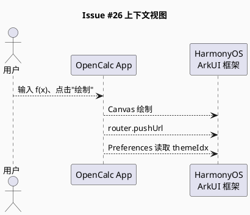
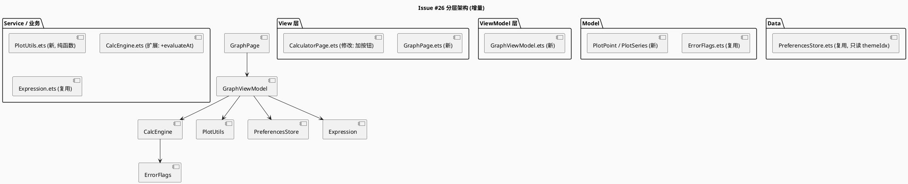
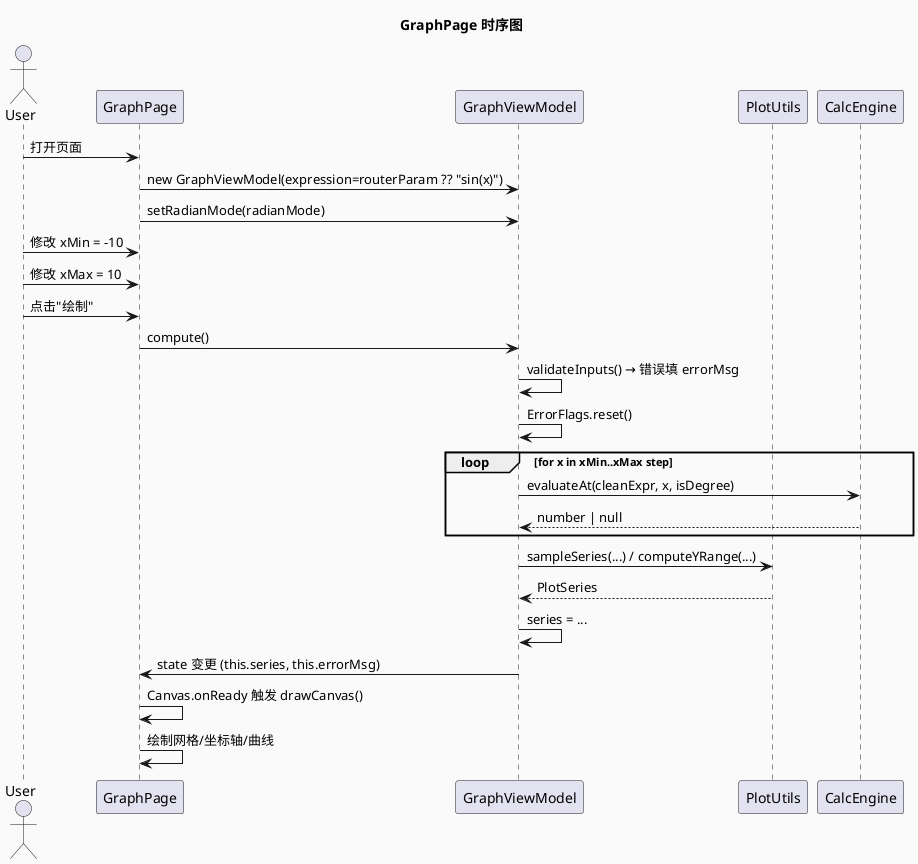
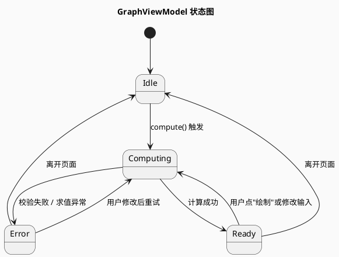
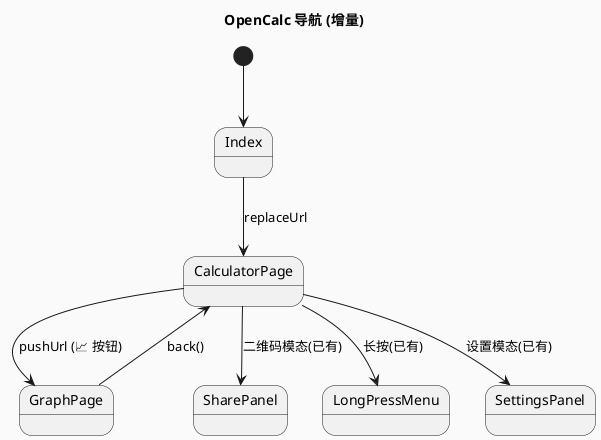

# Issue #26 增量设计 (delta-design)

> 增量设计文档,仅描述相对现有实现的变更点。
> 现有架构/页面/数据模型等未变章节不再重复,以引用 `info.md` 与已有代码为准。

## D1 概述

### 1.1 应用定位
在 OpenCalc 计算器(纯客户端 HarmonyOS App)上新增**函数图像绘制**模式。让用户输入 `f(x)` 表达式,应用在指定 x 区间采样求值后,绘制函数曲线,使计算器从"算数字"升级为"看函数"。

### 1.2 核心交互
```
主计算器页 (CalculatorPage)
  └─ 顶部工具栏新增"📈 绘图"按钮
       └─ 点击 → router.pushUrl 到 GraphPage (传参 expression 可选)
            └─ GraphPage:
                 顶部: 返回按钮 + 标题"函数图像"
                 中部: Canvas 画布(网格 + 坐标轴 + 曲线)
                 底部: 表达式输入 + xMin/xMax/samples 输入 + "绘制"按钮
                 错误条: 语法错误 / 无 x 变量 / xMax ≤ xMin 等提示
```

### 1.3 技术栈概览
- **语言**: ArkTS
- **状态管理**: V1(`@State` / `@Observed` / `@Watch` + `@ObjectLink`)
- **框架**: ArkUI 声明式,Stage 模型
- **画布**: ArkUI `Canvas` + `CanvasRenderingContext2D`
- **路由**: `@ohos.arkui.advancedAPI.router` (已有依赖)
- **新增 Kit**: 无
- **依赖**: 复用现有 `CalcEngine` / `Expression` / `ErrorFlags` / `PreferencesStore`
- **HVigor**: 现有配置,无新增插件

## D2 功能清单

| 功能名 | 说明 | 入口 | 优先级 |
|--------|------|------|--------|
| 入口按钮 | CalculatorPage ToggleRow 新增"📈 绘图"按钮 | CalculatorPage | P0 |
| 路由跳转 | pushUrl 到 GraphPage(可选传 expression) | CalculatorPage | P0 |
| GraphPage UI | 工具栏 + Canvas + 输入栏 + 错误条 | GraphPage | P0 |
| 表达式输入 | 用户编辑表达式(默认 sin(x)) | GraphPage | P0 |
| 范围与采样 | xMin / xMax / samples 输入与校验 | GraphPage | P0 |
| 单点求值 | CalcEngine.evaluateAt(expr, x, isDegree) → number \| null | CalcEngine | P0 |
| 系列采样 | PlotUtils.sampleSeries 批量采样 | PlotUtils | P0 |
| 坐标变换 | PlotUtils.mapToCanvas 数学→像素映射 | PlotUtils | P0 |
| Y 轴范围 | PlotUtils.computeYRange 自动计算 | PlotUtils | P0 |
| 常量解析 | PlotUtils.parseRange 支持 pi/e | PlotUtils | P1 |
| Canvas 绘制 | GraphPage onReady 内调用绘制流程 | GraphPage | P0 |
| 错误处理 | 语法/无 x/范围/全失败 4 类错误 | GraphPage + PlotUtils | P0 |
| 主题色 | 曲线颜色跟随 themeIdx | GraphPage | P1 |
| 单元测试 | PlotUtils 100% + evaluateAt 关键场景 | test/ | P0 |
| UI 自动化 | harmonyos-ui-test 覆盖 AC-1/2/3/4 | ui-tests/ | P1 |

## D3 实现模型

### 3.1 上下文视图



### 3.2 总体架构



### 3.3 HAP/HAR/HSP 模块划分
无变化。仍为单 HAP `entry` 包。详见 `info.md` §架构分析。

### 3.4 设计系统规格

#### 3.4.1 色彩系统
复用 CalculatorPage 主题映射。曲线主色 = `getOp()` (随 themeIdx 变化),默认 `#B4D2E4`。
绘图页新增:
- 网格线: `#33000000` (半透明黑,跟随暗色)
- 坐标轴: `#FF000000` (深色模式 `#FFFFFFFF`)
- 曲线: 主题 `getOp()` 色
- 错误提示: `getErr()` (与现有错误显示一致)

#### 3.4.2 主题系统
无变化,复用 themeIdx 0/1/2 (DEFAULT/AMOLED/Material)。

#### 3.4.3 排版系统
| 名称 | 字号 | 用途 |
|------|------|------|
| 标题 | 18 | "函数图像" |
| 输入框 | 14 | 表达式、范围 |
| 错误提示 | 12 | 红色错误条 |
| 坐标轴标签 | 10 | 刻度数字 |
| 按钮 | 14 | "绘制"、"返回" |

#### 3.4.4 间距与尺寸系统
| 名称 | 值 | 用途 |
|------|----|------|
| Canvas 内边距 | 40/16/24/16 (L/T/R/B) | 给坐标轴标签留位 |
| 输入栏高度 | 56 | 触屏友好 |
| 按钮高度 | 36 | 与 ToggleRow 风格一致 |
| 网格间隔 | 1 单位 (数学) | 1px 线宽 |

#### 3.4.5 图标与图形资源
- 入口按钮: `📈` 文字 emoji (与现有 `📋` `⚙` 风格一致)
- 返回按钮: `←` 文字
- 不新增 image 资源

#### 3.4.6 动画规格
- 无动画 (MVP,绘制完成直接展示)

#### 3.4.7 响应式断点与栅格
- 竖屏: 单列布局(工具栏 / Canvas / 输入栏)
- 横屏: 工具栏 / 输入栏 在底部,Canvas 居中占满
- 不做多设备分屏差异(以手机为主)

### 3.5 GraphPage 模块实现设计

#### 3.5.1 模块介绍
新建页面,负责函数图像的 UI 渲染、用户交互编排。不持有计算逻辑,只调用 ViewModel。

#### 3.5.2 功能描述
- 渲染 Canvas(网格 + 坐标轴 + 曲线 + 标签)
- 接收用户输入(表达式、xMin、xMax、samples)
- 触发 ViewModel 重算
- 显示错误条
- 提供"绘制"按钮和"返回"按钮

#### 3.5.3 目录结构
```
opencalc/entry/src/main/ets/pages/
├── CalculatorPage.ets    (修改)
├── Index.ets             (无变化)
├── LongPressMenu.ets     (无变化)
└── GraphPage.ets         (新增)
```

#### 3.5.4 架构图谱





#### 3.5.5 功能与用例分析

**用例: 打开绘图页 (AC-1)**
- 前置: 用户在主计算器页
- 步骤: 1. 用户点 "📈 绘图" 按钮
  2. CalculatorPage 调 `router.pushUrl({ url: 'pages/GraphPage' })`
  3. GraphPage aboutToAppear 读取 params,初始化 ViewModel
  4. ViewModel 设置默认值 sin(x), xMin=-2π, xMax=2π, samples=200
  5. aboutToAppear 末尾自动调 compute() 一次
  6. Canvas onReady 触发,绘制默认 sin(x) 曲线
- 后置: 画布显示正弦曲线 + 网格 + 坐标轴

**用例: 修改表达式 (AC-2)**
- 前置: 绘图页打开
- 步骤: 1. 用户点击表达式输入框
  2. 清空为 `x^2`
  3. 点"绘制"按钮
  4. ViewModel.compute() 重算
- 后置: 画布显示抛物线

**用例: 错误处理 (AC-4/AC-5/AC-8)**
- 前置: 绘图页打开
- 步骤: 1. 用户输入 `sin(x`(语法错误)
  2. 点"绘制"
  3. ViewModel.compute() 中 Expression.getCleanExpression 后 evaluate 失败
  4. errorMsg = "表达式语法错误"
  5. Canvas 不绘制曲线
- 后置: 错误条显示红色文字

#### 3.5.6 接口设计

```typescript
// pages/GraphPage.ets (核心入口)
@Entry
@Component
struct GraphPage {
  @State vm: GraphViewModel = new GraphViewModel()
  private canvasCtx: CanvasRenderingContext2D = new CanvasRenderingContext2D(new RenderingContextSettings(true))
  private canvasWidth: number = 0
  private canvasHeight: number = 0

  aboutToAppear(): void { ... }
  build() { ... }
  onPageShow(): void { ... }
  onBackPress(): boolean { router.back(); return true }
  onPageHide(): void { ... }
}
```

#### 3.5.7 状态管理设计
- V1: `@State` 装饰 ViewModel 引用
- ViewModel 内部使用 `@Observed` 装饰类,字段变 → 触发 build
- Canvas 内部状态(`canvasWidth/Height`)普通字段
- 不使用 `@Provide/@Consume`(单页面,不需要跨层级)

#### 3.5.8 核心算法
详见 `PlotUtils` 模块设计。

#### 3.5.9 错误处理
| 错误 | 来源 | 提示 | UI |
|------|------|------|-----|
| 语法错误 | Expression/CalcEngine | "表达式语法错误" | 错误条 + 画布空白 |
| 无 x 变量 | 自检 | "请输入含 x 的函数表达式,如 sin(x)" | 错误条 |
| xMax ≤ xMin | 输入校验 | "xMax 必须大于 xMin" | 错误条 |
| samples 越界 | 输入校验 | "samples 需在 50-1000" | 错误条 |
| 路由参数超长 | aboutToAppear | 截断 + 不报错 | 静默使用截断后 |
| 全部点定义域外 | 求值后 | "该函数在选定范围内无有效值" | 画布提示 |
| Canvas 渲染异常 | onReady catch | 不影响主流程 | 错误占位 |

#### 3.5.10 依赖关系
- 内部: `GraphViewModel`, `PlotUtils`, `CalcEngine`, `Expression`, `PreferencesStore`, `ErrorFlags`
- 外部 Kit: `@ohos.arkui.advancedAPI.router`
- 无新依赖

### 3.6 GraphViewModel 模块实现设计

#### 3.6.1 模块介绍
绘图页状态管理类,负责:
- 持有表达式/范围/采样数等用户输入
- 编排 CalcEngine 与 PlotUtils 完成"表达式 → PlotSeries"流水线
- 暴露 `series` 与 `errorMessage` 供 View 订阅

#### 3.6.2 功能描述
- 字段: `expression`, `xMin`, `xMax`, `samples`, `series`, `errorMessage`, `isComputing`, `isDegree`
- 方法: `compute()`, `setRadianMode()`, `validateInputs()`, `clearError()`

#### 3.6.3 目录结构
```
opencalc/entry/src/main/ets/viewmodels/
└── GraphViewModel.ets   (新增)
```

#### 3.6.4 架构图谱
无 UML(纯数据类)。

#### 3.6.5 功能与用例分析
**用例: compute()**
- 前置: 用户点"绘制"或首次进入页面
- 步骤: 1. `validateInputs()` 检查 xMax > xMin, samples 范围, expression 含 x
  2. 错误 → errorMessage 赋值, return
  3. `isComputing = true`
  4. `cleanExpr = Expression.getCleanExpression(expression, '.', ',')`
  5. 循环 samples 次:
     - x = xMin + (xMax - xMin) * i / (samples - 1)
     - y = CalcEngine.evaluateAt(cleanExpr, x, isDegree)
     - point = { x, y: y === null ? null : y }
  6. `series = PlotUtils.sampleSeries(...)`  ← 实际把 5/6 合并
  7. yMin/yMax 从 series.points 计算
  8. `isComputing = false`
- 后置: `series` 与 `errorMessage` 触发 UI 更新

#### 3.6.6 接口设计

```typescript
// viewmodels/GraphViewModel.ets
import { PlotSeries, PlotPoint } from '../common/PlotUtils'

@Observed
export class GraphViewModel {
  expression: string = 'sin(x)'
  xMin: number = -2 * Math.PI
  xMax: number = 2 * Math.PI
  samples: number = 200
  series: PlotSeries | null = null
  errorMessage: string = ''
  isComputing: boolean = false
  isDegree: boolean = false  // 默认弧度,跟随 PreferencesStore.radianMode

  setRadianMode(isDeg: boolean): void  // false=弧度, true=角度 (与 PreferencesStore 语义一致)
  compute(): void
  private validateInputs(): boolean
  private hasVariable(expr: string): boolean
}
```

> **注**: `isDegree` 字段语义对齐 `CalcEngine.evaluate(equation, isDegree)`: true=角度, false=弧度。但 `PreferencesStore.getRadiansDefault()` 返回 `radianMode`(true=弧度, false=角度)。在 ViewModel 初始化时需要 `this.isDegree = !radianMode`。

#### 3.6.7 状态管理设计
- `@Observed` 装饰类
- `@ObjectLink` 或 `vm: GraphViewModel = new GraphViewModel()`(单层引用,@State 即可)
- 字段变 → 自动触发 build

#### 3.6.8 核心算法
- 采样步长: `(xMax - xMin) / (samples - 1)`
- 避免浮点累加误差: 使用 `xMin + i * step` 步进式计算

#### 3.6.9 错误处理
- `validateInputs()` 返回 true 表示通过,false 表示有错
- 任一错误 → `errorMessage = ...` + `series = null`
- `ErrorFlags.reset()` 在 `compute()` 入口调用,避免污染

#### 3.6.10 依赖关系
- 内部: `PlotUtils`, `CalcEngine`, `Expression`, `ErrorFlags`, `PreferencesStore`(只读)
- 外部 Kit: 无

### 3.7 PlotUtils 模块实现设计

#### 3.7.1 模块介绍
纯函数工具模块,无状态、无 UI 依赖。提供采样、坐标变换、Y 轴范围计算、常量解析 4 个函数。
**完全可单元测试**。

#### 3.7.2 功能描述
- `sampleSeries`: 给定表达式 + 区间 + 采样数 + 求值回调 → 返回 `PlotSeries`
- `mapToCanvas`: 数学坐标 → 画布像素坐标(含 padding 处理)
- `computeYRange`: 从 `PlotPoint[]` 计算 Y 轴范围(忽略 null,加 10% 边距,限幅 [-1e10, 1e10])
- `parseRange`: 解析带 `pi` / `e` 常量的数字字符串 → number

#### 3.7.3 目录结构
```
opencalc/entry/src/main/ets/common/
├── NaturalLanguageParser.ets
├── UnitConverter.ets
└── PlotUtils.ets    (新增)
```

#### 3.7.4 架构图谱
无 UML(纯函数)。

#### 3.7.5 功能与用例分析
**用例: sampleSeries**
- 输入: `sampleSeries('sin(x)', -2π, 2π, 200, evaluator)`
- 输出: `{ points: [{x:-6.28, y:~0}, ...], xMin, xMax, yMin, yMax }`
- 边界: samples=2 → 仅两端点; samples=1 → 单点; xMin=xMax → 抛错(由调用方校验)

**用例: mapToCanvas**
- 输入: `mapToCanvas({x:0, y:0}, bounds, -2π, 2π, -1, 1, 360, 720)`
- 输出: `{ px: 180, py: 360 }`(画布中心,正中心)

**用例: computeYRange**
- 输入: `computeYRange([{x:0, y:0}, {x:1, y:1}, {x:2, y:null}])`
- 输出: `{ yMin: -0.1, yMax: 1.1 }`(加 10% 边距)

**用例: parseRange**
- 输入: `parseRange('-2*pi')` → `-2 * Math.PI`
- 输入: `parseRange('e')` → `Math.E`
- 输入: `parseRange('1.5')` → `1.5`
- 输入: `parseRange('abc')` → `null`

#### 3.7.6 接口设计

```typescript
// common/PlotUtils.ets
export interface PlotPoint {
  x: number
  y: number | null
}

export interface PlotSeries {
  points: PlotPoint[]
  xMin: number
  xMax: number
  yMin: number
  yMax: number
}

export interface PlotBounds {
  width: number      // 画布宽(含 padding)
  height: number
  paddingLeft: number
  paddingRight: number
  paddingTop: number
  paddingBottom: number
}

export type Evaluator = (expr: string, x: number) => number | null

export class PlotUtils {
  static sampleSeries(
    expression: string,
    xMin: number,
    xMax: number,
    samples: number,
    evaluator: Evaluator
  ): PlotSeries

  static mapToCanvas(
    p: PlotPoint,
    bounds: PlotBounds,
    xMin: number,
    xMax: number,
    yMin: number,
    yMax: number
  ): { px: number; py: number } | null

  static computeYRange(points: PlotPoint[]): { yMin: number; yMax: number }

  static parseRange(input: string): number | null
}
```

#### 3.7.7 状态管理设计
无状态(纯函数 + interface)。

#### 3.7.8 核心算法

**sampleSeries**
```typescript
static sampleSeries(expr, xMin, xMax, samples, evaluator): PlotSeries {
  if (samples < 2) samples = 2
  const points: PlotPoint[] = []
  const step: number = (xMax - xMin) / (samples - 1)
  for (let i = 0; i < samples; i++) {
    const x: number = xMin + i * step
    const y: number | null = evaluator(expr, x)
    points.push({ x, y })
  }
  const range = PlotUtils.computeYRange(points)
  return { points, xMin, xMax, yMin: range.yMin, yMax: range.yMax }
}
```

**mapToCanvas** (线性映射, Y 轴翻转)
```typescript
static mapToCanvas(p, bounds, xMin, xMax, yMin, yMax): { px, py } | null {
  if (p.y === null) return null
  const innerW = bounds.width - bounds.paddingLeft - bounds.paddingRight
  const innerH = bounds.height - bounds.paddingTop - bounds.paddingBottom
  if (xMax === xMin || yMax === yMin) return null
  const px = bounds.paddingLeft + ((p.x - xMin) / (xMax - xMin)) * innerW
  const py = bounds.paddingTop + (1 - (p.y - yMin) / (yMax - yMin)) * innerH
  return { px, py }
}
```

**computeYRange** (过滤 null, 加边距, 限幅)
```typescript
static computeYRange(points): { yMin, yMax } {
  let min = Infinity, max = -Infinity
  for (const p of points) {
    if (p.y === null) continue
    if (!isFinite(p.y)) continue  // 过滤 NaN/Inf
    if (p.y < min) min = p.y
    if (p.y > max) max = p.y
  }
  if (!isFinite(min) || !isFinite(max)) {
    return { yMin: -1, yMax: 1 }  // 全失败兜底
  }
  if (min === max) { min -= 1; max += 1 }  // 退化情况
  const pad = (max - min) * 0.1
  let yMin = min - pad
  let yMax = max + pad
  // 限幅防 Canvas 溢出
  if (yMin < -1e10) yMin = -1e10
  if (yMax > 1e10) yMax = 1e10
  return { yMin, yMax }
}
```

**parseRange** (识别 pi/e)
```typescript
static parseRange(input: string): number | null {
  const s = input.trim()
  if (s.length === 0) return null
  // 替换 pi 和 e
  const replaced = s.replace(/pi/gi, 'Math.PI').replace(/\be\b/g, 'Math.E')
  // 仅允许数字、运算符、Math 常量、空白
  if (!/^[\d+\-*/().,\sMathEPI.]+$/.test(replaced)) return null
  try {
    // 沙箱执行:用 (function(){ return ... })()
    const fn = new Function('Math', `return (${replaced});`)
    const v = fn(Math)
    if (typeof v !== 'number' || !isFinite(v)) return null
    return v
  } catch {
    return null
  }
}
```

> **注**: `new Function` 是 ArkTS 支持的全局 API,但需确认运行时是否被允许(参考 issue #18 NL 解析器对 `eval` 的处理)。[推断] ArkUI 提供 `new Function` 能力,否则降级为手动解析(支持 `pi` `e` 字面量 + `*/+-`)。

#### 3.7.9 错误处理
- `sampleSeries`: samples < 2 时提升为 2(不抛错)
- `mapToCanvas`: y === null 或除零 → 返回 null(由调用方跳过)
- `computeYRange`: 全 null → 默认 `[-1, 1]`
- `parseRange`: 解析失败 → 返回 null

#### 3.7.10 依赖关系
- 内部: 无
- 外部 Kit: 无(纯 JS)
- 依赖模式: 0 依赖,纯函数

### 3.8 CalcEngine 扩展(evaluateAt + x 变量)

#### 3.8.1 变更范围
文件 `calculator/Calculator.ets`

#### 3.8.2 接口设计

**新增字段**:
```typescript
class CalcEngine {
  private xValue: number = 0  // x 变量当前值
}
```

**修改方法** `parseFactor`: 在字母分支开头特判 `x`(ASCII 120)

**新增方法**:
```typescript
class CalcEngine {
  /**
   * 在 x 取某值时计算表达式
   * @param cleanExpr 预处理后的 ASCII 表达式
   * @param x x 变量值
   * @param isDegree true=角度, false=弧度
   * @returns 计算结果;失败(NaN/Inf/语法错误)返回 null
   */
  evaluateAt(cleanExpr: string, x: number, isDegree: boolean): number | null {
    ErrorFlags.reset()
    this.xValue = x
    this.deg = isDegree
    try {
      const v = this.evaluate(cleanExpr, isDegree)
      if (!isFinite(v) || ErrorFlags.syntax_error || ErrorFlags.domain_error
          || ErrorFlags.division_by_0 || ErrorFlags.is_infinity
          || ErrorFlags.require_real_number) {
        return null
      }
      return v
    } catch {
      return null
    }
  }
}
```

**parseFactor 改动** (在 line 102 前插入):
```typescript
// 单字母变量 x (绘图用)
else if (this.c === 120) {  // 'x'
  this.nx()
  x = this.xValue
}
```

#### 3.8.3 回归保护
- 现有 `evaluate(equation, isDegree)` 行为不变(测试覆盖)
- `x` 解析仅在 `parseFactor` 中添加分支,不影响 `sin/cos/tan` 等函数
- 旧表达式不含 `x`,无影响

#### 3.8.4 与 Expression 配合
```typescript
// GraphViewModel.compute() 中:
ErrorFlags.reset()
const cleanExpr = this.expr.getCleanExpression(this.expression, '.', ',')
if (ErrorFlags.syntax_error) {
  this.errorMessage = '表达式语法错误'
  return
}
for (let i = 0; i < this.samples; i++) {
  const x = this.xMin + i * (this.xMax - this.xMin) / (this.samples - 1)
  const y = this.engine.evaluateAt(cleanExpr, x, this.isDegree)
  // ...
}
```

## D4 接口设计

### 4.1 内部数据访问 API
复用 `PreferencesStore.getTheme()` 与 `getRadiansDefault()`(只读)。
不新增写操作。

### 4.2 业务抽象接口

```typescript
// 新增
interface Evaluator { (expr: string, x: number): number | null }
interface PlotPoint { x: number; y: number | null }
interface PlotSeries { points: PlotPoint[]; xMin; xMax; yMin; yMax }
interface PlotBounds { width; height; paddingLeft; paddingRight; paddingTop; paddingBottom }
class PlotUtils {
  static sampleSeries(...): PlotSeries
  static mapToCanvas(...): { px; py } | null
  static computeYRange(...): { yMin; yMax }
  static parseRange(input: string): number | null
}
class GraphViewModel {
  expression: string
  xMin: number
  xMax: number
  samples: number
  series: PlotSeries | null
  errorMessage: string
  isComputing: boolean
  isDegree: boolean
  setRadianMode(isDeg: boolean): void
  compute(): void
}

// 扩展
class CalcEngine {
  evaluateAt(cleanExpr: string, x: number, isDegree: boolean): number | null
}
```

### 4.3 后台任务与 ExtensionAbility 接口
无。

### 4.4 Want / Action 协议
无变化。

### 4.5 URI / Deep Link / AppLinking 协议
无变化。

### 4.6 IPC 与 RPC 接口
无。

### 4.7 Native (C/C++) 接口
无。

### 4.8 文件交换接口
无。

## D5 数据模型

### 5.1 关系型数据库模型
无变化(本次不持久化绘图结果)。

### 5.2 领域模型(新增)

```typescript
// common/PlotUtils.ets
export interface PlotPoint {
  x: number         // 数学 x 坐标
  y: number | null  // y 值, null = 定义域外/求值失败
}

export interface PlotSeries {
  points: PlotPoint[]
  xMin: number
  xMax: number
  yMin: number
  yMax: number
}

export interface PlotBounds {
  width: number
  height: number
  paddingLeft: number
  paddingRight: number
  paddingTop: number
  paddingBottom: number
}
```

### 5.3 Preferences 结构(只读扩展)

| key | 类型 | 默认值 | 说明 | 行为影响 |
|-----|------|-------|------|---------|
| `theme` | number | 0 | 主题索引(已有) | 绘图曲线颜色 |

> 已有 key 复用,无新增。

### 5.4 分布式数据对象模型
无。

### 5.5 文件格式 Schema
无。

## D6 UI 设计系统

见 §3.4。本节不重复。

## D7 页面清单与导航

### 7.1 页面清单总表(增量)

| 页面名 | 路径 | 入口 Ability | 传参 | 功能摘要 |
|--------|------|-------------|------|---------|
| CalculatorPage | pages/CalculatorPage | EntryAbility | - | 主计算器(扩展) |
| **GraphPage** | **pages/GraphPage** | EntryAbility | `expression?: string` | **函数图像绘制(新)** |

### 7.2 全局导航图(增量)



### 7.3 Deep Link / AppLinking 处理
无变化(不接收深链接)。

### 7.4 Want 跳转矩阵

| 起点 | 终点 | 路由方式 | 参数 |
|------|------|---------|------|
| CalculatorPage | GraphPage | `router.pushUrl` | `{ expression: string }`(可选) |
| GraphPage | CalculatorPage | `router.back()` | - |

## D8 用户交互规格

### 8.1 手势交互目录

| 控件 | 事件 | 行为 |
|------|------|------|
| 📈 按钮 | onClick | pushUrl GraphPage |
| ← 返回 | onClick | router.back() |
| 表达式输入 | onChange | 更新 vm.expression(不立即重算) |
| xMin/xMax/samples | onChange | 更新 vm 字段 |
| 绘制按钮 | onClick | vm.compute() |
| **Canvas** | **无手势** | **MVP 不支持缩放/平移** |

### 8.2 弹窗/Sheet/Menu 目录
无新弹窗(错误用 Text 提示,不用 Dialog)。

### 8.3 剪贴板与反馈行为
无。

### 8.4 卡片交互
无。

## D9 平台集成

### 9.1 构建配置与依赖

`oh-package.json5`: 无变化(无新依赖)。
`build-profile.json5`: 无变化。
`main_pages.json`: **新增** `pages/GraphPage` 注册。

```json
// resources/base/profile/main_pages.json
{
  "src": [
    "pages/Index",
    "pages/CalculatorPage",
    "pages/GraphPage"
  ]
}
```

### 9.2 权限与运行时请求
无变化(无新权限)。绘图模块不申请任何权限。

### 9.3 系统能力（Kits）清单
无新 Kit。复用 `@ohos.arkui.advancedAPI.router`。

### 9.4 后台与 Extension
无。

### 9.5 备份与恢复
无。

### 9.6 分布式与跨端
无。

## D10 偏好设置目录

无新增偏好。复用:
- `theme` (已有) — 决定曲线颜色
- `radiansDefault` (已有) — 决定 evaluateAt 的 isDegree

---

## 自验证(mod-design Step 3 交叉校验)

| 校验项 | 结果 |
|--------|------|
| 功能一致性: proposal.md F1-F6 ↔ §2 功能清单 | ✅ |
| 页面一致性: delta-spec.md F1 ↔ §7.1 | ✅ |
| 数据一致性: delta-spec.md 数据模型 ↔ §5.2 | ✅ |
| 权限一致性: delta-spec.md "无新权限" ↔ §9.2 | ✅ |
| Kit 一致性: delta-spec.md "复用 router" ↔ §9.3 | ✅ |
| FMEA 覆盖: delta-spec.md 7 条 ↔ §3.5.9 + §3.7.9 | ✅ |
| 单元测试目标: PlotUtils 100% ↔ §3.7 + tasks 待办 | ✅ |
| evaluateAt 错误隔离 ↔ §3.8.2 ErrorFlags.reset | ✅ |

---
> 本文档由 mod-design skill 生成。
> 标记 [推断] 的内容为基于设计推断,非确定性事实(parseRange 中 `new Function` 可用性需在实现阶段验证,如不可用则降级为手动解析)。
> 生成时间: 2026-06-17
