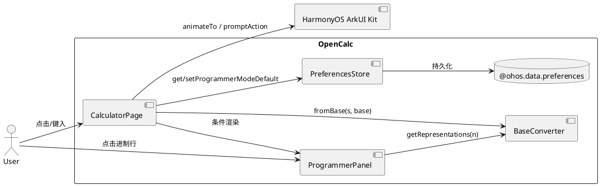
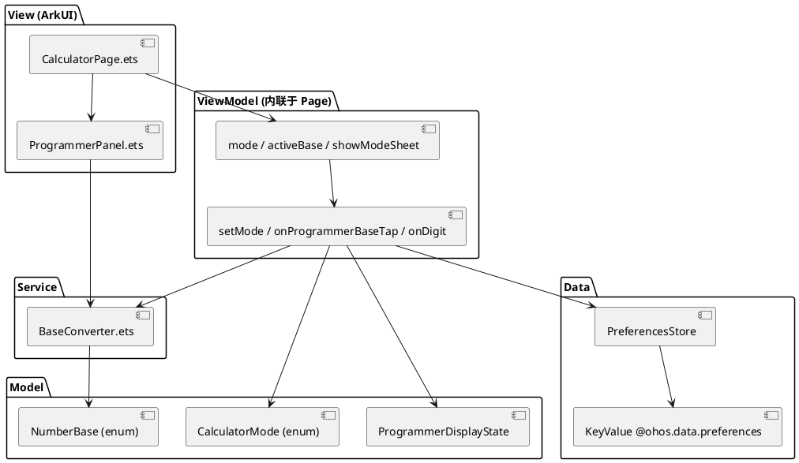
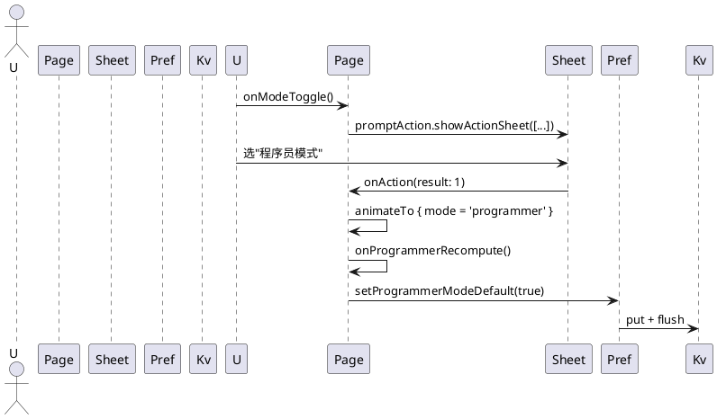
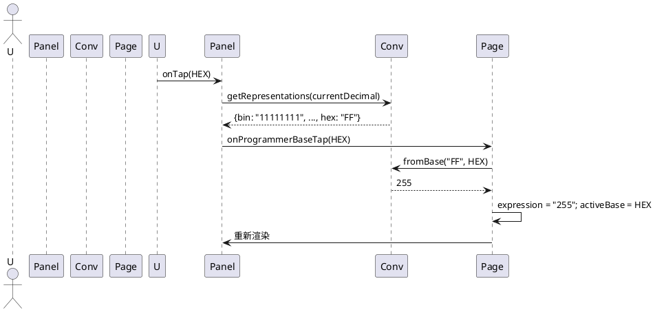
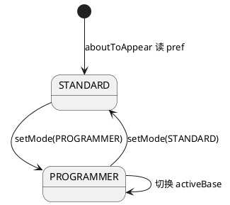

# Δ-Design — Issue #22 程序员模式 (组件级增量设计)

> 本文档是 mod-design skill 基于 proposal.md / delta-spec.md / info.md 生成的增量设计。
> 标记 [推断] 的内容为基于设计推断，非确定性事实。
> 生成时间: 2026-06-17

---

## D1: 概述

### 1.1 应用定位
OpenCalc 是 Android 开源计算器 `clementwzk/OpenCalc` 的 HarmonyOS 移植版。本次增量在原有"基础/科学"二分模式基础上，新增**程序员模式**（Programmer Mode），为开发者/学生/硬件工程师提供 BIN/OCT/DEC/HEX 实时多进制转换与跨进制接续编辑能力，配套平滑模式切换动画，使产品在程序员垂直场景下与 iOS/Android 主流产品（macOS Calculator、Calc.exe）对标。

### 1.2 核心交互
```
用户 → ToggleRow 头部"模式"按钮 → ActionSheet 选 STANDARD/PROGRAMMER
                                              │
                                              ▼
                              setMode(mode) + animateTo(220ms)
                                              │
                          ┌───────────────────┴───────────────────┐
                          ▼                                       ▼
                STANDARD 模式（原样）                PROGRAMMER 模式
                - 显示屏/键盘/历史不变              - 4 行进制展示区
                                                   - 0-9 + A-F 键盘
                                                   - activeBase 高亮
                                                   - 点击某行 = 接管输入
```

子交互：
- **跨进制接续**：用户在程序员模式下点击 BIN/OCT/HEX 行 → `BaseConverter.fromBase()` 把该行字符串解析为 number → 设为新 expression，并切换 activeBase 高亮。
- **非法字符过滤**：activeBase=BIN 时按 '2' → Toast 提示 "BIN 不支持字符 2"。

### 1.3 技术栈概览
- **框架**：ArkTS 声明式 UI（Stage 模型）
- **状态管理**：V1（@State / @Watch / @Builder），与项目现有风格保持一致
- **Kit 列表**：
  - `@kit.ArkUI` — 组件、animateTo、promptAction、ActionSheet
  - `@ohos.data.preferences`（@kit.ArkData）— 模式偏好持久化
- **第三方依赖**：无新增（不引入 bigint.js 等）
- **Native C++/Rust 模块**：无
- **Hvigor 插件配置**：无需变更

---

## D2: 功能清单

| 功能名 | 说明 | 入口 Ability/Page | 优先级 |
|--------|------|-------------------|--------|
| F-001 模式切换 | ToggleRow 头部"模式"按钮 + ActionSheet + animateTo | CalculatorPage | P0 |
| F-002 模式持久化 | 启动读取 + 切换时写 preferences | CalculatorPage.aboutToAppear | P0 |
| F-003 四进制展示区 | ProgrammerPanel 4 行 BIN/OCT/DEC/HEX | CalculatorPage (PROGRAMMER 分支) | P0 |
| F-004 跨进制接续 | 点击行反解析 + activeBase 切换 | ProgrammerPanel / CalculatorPage | P0 |
| F-005 程序员键盘 | 0-9 + A-F + 运算符 | CalculatorPage (PROGRAMMER 分支) | P0 |
| F-006 非法字符 Toast | 主动 base 校验 + Toast 反馈 | CalculatorPage.onDigit | P1 |
| F-007 模式切换动画 | opacity 0↔1 + translateY 8px 过渡 220ms | CalculatorPage build() | P1 |
| F-008 BaseConverter 工具 | 纯函数 toBase/fromBase/getRepresentations | 工具类（无 UI） | P0 |
| F-009 NumberBase/CalculatorMode 枚举 | 类型系统 | model/ | P0 |
| F-010 单元测试 | BaseConverter 12 个 AC | test/ets/calculator/ | P0 |
| F-011 UI 自动化 | hdc 跑核心 8 个 AC | harmonyos-ui-test | P1 |

---

## D3: 实现模型

### 3.1 上下文视图



### 3.2 总体架构



**数据流**：`expression` 变化 → `@Watch('onExpressionChange')` → `onProgrammerRecompute()` → 调 `BaseConverter.getRepresentations(decimalValue)` → 4 行显示。

### 3.3 HAP/HAR/HSP 模块划分
- 不变。所有代码均在 `entry` HAP 内。
- 不引入 HAR/HSP。
- 不新增 OHPM 依赖。

### 3.4 设计系统规格

#### 3.4.1 色彩系统
完全复用 CalculatorPage 现有主题 getters（`getBg / getBtnBg / getPanelBg / getFuncBg / getOp / getEq / getClr / getErr / getT1 / getT2 / getBtnText`）。程序员面板继承同一套，不新增颜色。

| 元素 | 取值 |
|------|------|
| 进制行背景 | `getBtnBg()` |
| 进制行文字 | `getT1()` |
| activeBase 边框 | `getOp()` |
| 错误提示 | `getErr()` |

#### 3.4.2 主题系统
沿用 `themeIdx`（0=浅色 / 1=AMOLED / 2=暗色），程序员面板主题由 `getXxx()` getters 派生。

#### 3.4.3 排版系统
| 名称 | 字号 | 用途 |
|------|------|------|
| display-result | 36 (竖屏) / 28 (横屏) | DEC 结果（复用现有） |
| programmer-base-label | 11 | BIN/OCT/HEX 标签 |
| programmer-base-value | 16 (DEC) / 13 (BIN/OCT/HEX) | 进制值（BIN 行字号小以容纳长字符串） |
| toast-msg | 12 | 非法字符提示 |

#### 3.4.4 间距与尺寸系统
| 名称 | 值 | 用途 |
|------|-----|------|
| 进制行高度 | 36vp | BIN/OCT/HEX 4 行 |
| 进制行水平 padding | 12vp | 与 DisplayPanel 对齐 |
| 进制行圆角 | 8vp | 视觉一致 |
| activeBase 边框宽度 | 2vp | 突出当前编辑基数 |
| 程序员键盘按钮 | 高度 46vp（同科学函数键） | 一致性 |

#### 3.4.5 图标与图形资源
- 不新增图标。复用现有 `✕` 关闭、`📋` 粘贴、`⚙` 设置。

#### 3.4.6 动画规格
| 名称 | 时长 | 曲线 | 触发 | 属性 |
|------|------|------|------|------|
| 模式切换 | 220ms | EaseInOut | setMode() | opacity 0↔1 + translateY 8px↔0 |
| activeBase 高亮 | 150ms | EaseOut | onProgrammerBaseTap() | borderColor 透明度 |
| 行按下反馈 | 100ms | Linear | onClick | backgroundColor |

#### 3.4.7 响应式断点与栅格
| 断点 | 判定 | 布局 |
|------|------|------|
| 竖屏 | width ≤ height | 单列：DisplayPanel + 模式指示 + 4 行 + 键盘 |
| 横屏 | width > height | 同竖屏但右侧可显示历史 |

---

### 3.5 CalculatorPage 模块（修改）

#### 3.5.1 模块介绍
主页面（`@Entry`），本次修改使其在原有"基础/科学"模式基础上支持"程序员模式"分支。

#### 3.5.2 功能描述
- 新增 `mode: CalculatorMode` 状态
- 新增 `activeBase: NumberBase` 状态（仅在 PROGRAMMER 模式有意义）
- 新增 `setMode()` / `onProgrammerBaseTap()` / 改造 `onDigit()` / `onEquals()` / `onAC()`
- `build()` 条件渲染：mode=STANDARD → 现状；mode=PROGRAMMER → 程序员面板 + 键盘

#### 3.5.3 目录结构（变更点）
```
opencalc/entry/src/main/ets/
├── pages/
│   ├── CalculatorPage.ets   [修改] +12 ~ +18 个 @State，+1 个 Builder，+1 个模式入口
│   └── ProgrammerPanel.ets  [新增] 4 行进制展示组件
├── calculator/
│   └── BaseConverter.ets    [新增] 纯静态工具类
├── model/
│   └── ModeModel.ets        [新增] NumberBase / CalculatorMode / ProgrammerDisplayState
└── preferences/
    └── PreferencesStore.ets [修改] +2 个 getX/setX 方法
```

#### 3.5.4 架构图谱

**类图（状态与接口）**
```plantuml
@startuml
class CalculatorPage {
  + mode: CalculatorMode
  + activeBase: NumberBase
  + showModeSheet: boolean
  + onModeToggle() : void
  + setMode(m: CalculatorMode) : void
  + onProgrammerBaseTap(b: NumberBase) : void
  + onDigit(d: string) : void   [修改：模式分支]
  + onEquals() : void           [修改：模式分支]
  + onAC() : void               [修改：模式分支]
}
class ProgrammerPanel {
  + decimalValue: number
  + activeBase: NumberBase
  + representations: ProgrammerDisplayState
  + onTap: (b: NumberBase) => void
}
class BaseConverter {
  + {static} toBase(n: number, b: NumberBase) : string
  + {static} fromBase(s: string, b: NumberBase) : number
  + {static} getRepresentations(n: number) : ProgrammerDisplayState
  + {static} isValidChar(ch: string, b: NumberBase) : boolean
}
class PreferencesStore {
  + getProgrammerModeDefault() : Promise<boolean>
  + setProgrammerModeDefault(v: boolean) : Promise<void>
}
enum NumberBase { BIN; OCT; DEC; HEX }
enum CalculatorMode { STANDARD; PROGRAMMER }
class ProgrammerDisplayState {
  + bin: string
  + oct: string
  + dec: string
  + hex: string
  + hasOverflow: boolean
}

CalculatorPage --> CalculatorMode
CalculatorPage --> NumberBase
CalculatorPage --> ProgrammerPanel
CalculatorPage --> BaseConverter
CalculatorPage --> PreferencesStore
BaseConverter --> NumberBase
BaseConverter --> ProgrammerDisplayState
@enduml
```

**时序图：模式切换**


**时序图：跨进制接续**


**状态图：mode 切换**


#### 3.5.5 功能与用例分析

**用例：切换模式**
- 前置：App 启动完成
- 步骤：1. 点模式按钮 → 2. ActionSheet 选 → 3. 动画播放 → 4. UI 重渲染
- 后置：mode 切换，偏好落盘

**用例：跨进制接续**
- 前置：mode=PROGRAMMER，4 行显示中
- 步骤：1. 点 HEX 行 → 2. 解析为 number → 3. 设为 expression → 4. activeBase=HEX
- 后置：键盘 A-F 键高亮可用

**用例：非法字符拦截**
- 前置：mode=PROGRAMMER，activeBase=BIN
- 步骤：用户按 '2'
- 后置：Toast 提示，不修改 expression

#### 3.5.6 接口设计

| 方法 | 签名 | 说明 |
|------|------|------|
| `setMode(m)` | `(m: CalculatorMode) => void` | 切换 + 持久化 + 触发 animateTo |
| `onModeToggle()` | `() => void` | 弹出 ActionSheet |
| `onProgrammerBaseTap(b)` | `(b: NumberBase) => void` | 跨进制接续 |
| `onProgrammerRecompute()` | `() => void` | 4 行刷新（被 @Watch 触发） |
| `getModeSheetItems()` | `() => ActionSheetItem[]` | 构造 ActionSheet 数据 |

#### 3.5.7 状态管理设计
- 状态字段（新增 @State）：
  - `mode: CalculatorMode = STANDARD`（默认从 pref 读）
  - `activeBase: NumberBase = DEC`
  - `showModeSheet: boolean = false`（用于遮罩态，**不与 ActionSheet 强绑定**，便于动画态控制）
  - `programmerDisplay: ProgrammerDisplayState`（@Watch 触发更新）
- 触发链：
  - `expression` 变化 → `@Watch('onExpressionChange')` → 同时触发 NL 解析、preview、programmerDisplay 重算
  - `mode` 变化 → `@Watch('onModeChange')` → 重新调用 `onProgrammerRecompute()`
- 持久化：
  - 启动：`aboutToAppear` 读 `getProgrammerModeDefault()`，赋给 `mode`
  - 切换：`setMode()` 异步 `setProgrammerModeDefault()`

#### 3.5.8 核心算法

**BaseConverter.toBase(n, base)**
```
input: number n, NumberBase base (2/8/10/16)
output: string, 0 边界 / 负数带 '-' / 超过 MAX_SAFE_INTEGER 标记 overflow
1. if n === 0 return "0"
2. isNeg = n < 0; n = abs(n)
3. if n > Number.MAX_SAFE_INTEGER: overflow = true; n = floor(n)
4. intPart = floor(n)
5. 循环: intPart > 0: 字符 = 数字 % base → 字符表[余数]; intPart = floor(intPart / base)
6. 反转拼接
7. if isNeg: preprend "-"
8. return result
```

**BaseConverter.fromBase(s, base)**
```
input: string s, NumberBase base
output: number (NaN 表示非法)
1. trim s
2. 处理负号
3. 逐字符按 base 字符表映射数字，累加: result = result * base + digit
4. 越界字符 → NaN
5. return (neg ? -result : result)
```

**字符表**：BIN = '0','1'；OCT = '0'-'7'；DEC = '0'-'9'；HEX = '0'-'9','A'-'F'（不区分大小写，解析时小写转大写）。

**复杂度**：toBase O(log_base(n))，fromBase O(len(s))。

#### 3.5.9 错误处理
- `toBase` 数值溢出 → 设 `hasOverflow=true`，显示"数值过大"
- `fromBase` 非法字符 → 返回 NaN，UI Toast
- `setProgrammerModeDefault` 写失败 → console.warn，不影响 UI
- `getProgrammerModeDefault` 读失败 → 用 default false

#### 3.5.10 依赖关系
- 内部依赖：calculator/BaseConverter.ets（新增）、model/ModeModel.ets（新增）、preferences/PreferencesStore.ets（修改）
- 外部依赖：@kit.ArkUI（animateTo、promptAction）
- 无新增 OHPM

---

### 3.6 ProgrammerPanel 组件（新增）

#### 3.6.1 模块介绍
`@Component` 自定义组件，承载 4 行进制展示 + activeBase 高亮 + 点击事件。轻量级，无状态业务逻辑。

#### 3.6.2 功能描述
- 接收 `decimalValue: number`、`activeBase: NumberBase`、`onBaseTap: (b) => void`
- 内部按 `BaseConverter.getRepresentations(decimalValue)` 计算 4 行字符串
- activeBase 行加 2vp 边框

#### 3.6.3 目录结构
```
opencalc/entry/src/main/ets/pages/
└── ProgrammerPanel.ets   [新增] ~60 行
```

#### 3.6.4 接口设计
```typescript
@Component
export struct ProgrammerPanel {
  @Prop decimalValue: number
  @Prop activeBase: NumberBase
  onBaseTap: (base: NumberBase) => void = () => {}
  @BuilderParam overrideRow?: (base: NumberBase, value: string) => void   // 可选扩展
  build() { ... }
}
```

#### 3.6.5 状态管理
无内部 @State（值由父组件驱动）。activeBase 高亮用 borderColor 实现，不引入状态变量。

#### 3.6.6 核心算法
无（直接委托 BaseConverter）。

#### 3.6.7 错误处理
`decimalValue` 为 NaN/Infinity → 4 行显示 "—"。

#### 3.6.8 依赖关系
- 内部：calculator/BaseConverter.ets、model/ModeModel.ets
- 外部：无

---

### 3.7 BaseConverter 工具（新增）

#### 3.7.1 模块介绍
纯静态方法集合，无 ArkUI 依赖，便于 hypium 单测。

#### 3.7.2 接口设计
```typescript
export class BaseConverter {
  static toBase(n: number, base: NumberBase): string;
  static fromBase(s: string, base: NumberBase): number;
  static getRepresentations(n: number): ProgrammerDisplayState;
  static isValidChar(ch: string, base: NumberBase): boolean;
  static maxCharsFor(base: NumberBase): number;  // 用于 UI 截断判断
}
```

#### 3.7.3 状态管理
无（纯函数）。

#### 3.7.4 核心算法
见 §3.5.8。

#### 3.7.5 错误处理
- 输入校验：负数、零、NaN、Infinity 分别处理
- 输出 `hasOverflow` 标志供 UI 提示

#### 3.7.6 依赖关系
- 内部：model/ModeModel.ets
- 外部：无（仅 Math.floor / Math.abs）

---

### 3.8 ModeModel 数据模型（新增）

#### 3.8.1 接口设计
```typescript
export enum NumberBase { BIN = 2, OCT = 8, DEC = 10, HEX = 16 }
export enum CalculatorMode { STANDARD = 0, PROGRAMMER = 1 }
export class ProgrammerDisplayState {
  bin: string = ''
  oct: string = ''
  dec: string = ''
  hex: string = ''
  hasOverflow: boolean = false
  static fromValue(n: number): ProgrammerDisplayState  // 委托 BaseConverter
}
```

---

### 3.9 PreferencesStore 扩展（修改）

#### 3.9.1 新增接口
```typescript
async getProgrammerModeDefault(): Promise<boolean>
async setProgrammerModeDefault(value: boolean): Promise<void>
```

#### 3.9.2 持久化 key
- key: `programmerModeDefault`
- 类型: boolean
- 默认: `false`

#### 3.9.3 兼容性
老版本无此 key → `getPreferences(...).get(key, false)` 返回默认值，向后兼容。

---

## D4: 接口设计

### 4.1 内部数据访问 API
- `PreferencesStore.getProgrammerModeDefault() / setProgrammerModeDefault(v)`（新增，见 §3.9）

### 4.2 业务抽象接口
- `BaseConverter` 静态方法集合（见 §3.7.2）
- `ProgrammerDisplayState.fromValue(n)`（见 §3.8.1）

### 4.3 - 4.8
无相关实现（不涉及后台任务 / Want / URI / IPC / Native / 文件交换）。

---

## D5: 数据模型

### 5.1 关系型数据库模型
无相关实现。

### 5.2 领域模型

| 字段名 | 类型 | 必填 | 说明 |
|--------|------|------|------|
| `mode` | `CalculatorMode` | 是 | 当前 UI 模式 |
| `activeBase` | `NumberBase` | 是（仅 PROGRAMMER） | 正在编辑的基数 |
| `bin/oct/dec/hex` | `string` | 是 | 各进制字符串 |
| `hasOverflow` | `boolean` | 否 | 数值溢出标志 |

### 5.3 Preferences 结构

| key | 类型 | 默认值 | 说明 |
|-----|------|--------|------|
| `programmerModeDefault` | boolean | `false` | 启动默认模式 |

（不修改 `CalculatorPreferences` 接口字段，保持字段集合稳定 — 增量需求，新增 key 通过独立方法暴露。）

### 5.4 - 5.5
无相关实现。

---

## D6: UI 设计系统

见 §3.4。补充要点：
- **一多响应式**：
  - 竖屏：DisplayPanel 上方插入"模式指示条"（4 行紧凑 36vp 行高），下方接 5×4 程序员键盘
  - 横屏：右侧历史面板不变，左侧按钮区按 mode 分支渲染程序员键盘
  - 折叠屏：跟随主断点切换

---

## D7: 页面清单与导航

### 7.1 页面清单总表

| 页面名 | 路径 | 入口 Ability | 传参 | 功能摘要 |
|--------|------|--------------|------|----------|
| CalculatorPage | `pages/CalculatorPage` | EntryAbility | - | 主计算页（修改） |
| ProgrammerPanel | `pages/ProgrammerPanel` | - | - | 4 行进制子组件（嵌入 Page） |

### 7.2 全局导航图
不新增页面，仍在 CalculatorPage 内分支。

### 7.3 - 7.4
无相关实现。

---

## D8: 用户交互规格

### 8.1 手势交互目录

| 元素 | 手势 | 行为 |
|------|------|------|
| ToggleRow 模式按钮 | onClick | 弹 ActionSheet |
| BIN/OCT/HEX 行 | onClick | onProgrammerBaseTap |
| 数字键 0-9 | onClick | onDigit（按 activeBase 校验） |
| A-F 键 | onClick | onDigit（HEX 模式专属） |
| 模式入口 | onClick | promptAction.showActionSheet |

### 8.2 弹窗/Sheet/Menu 目录

| 类型 | 用途 | 触发 |
|------|------|------|
| `promptAction.showActionSheet` | 模式选择 | onModeToggle |
| `promptAction.showToast` | 非法字符提示 | onDigit 校验失败 |

### 8.3 剪贴板与反馈行为
- 复制行为：程序员模式下复制当前 DEC 值（复用现有 `onCopy`）
- Toast：复用现有 promptAction

### 8.4 卡片交互
无相关实现。

---

## D9: 平台集成

### 9.1 构建配置与依赖
- oh-package.json5：无需新增
- build-profile.json5：无需变更
- 复用现有 hvigorw 6.24.2

### 9.2 权限与运行时请求
无新增权限。

### 9.3 系统能力（Kits）清单

| Kit | 关键 API | 用途 | API 最低版本 |
|-----|----------|------|--------------|
| @kit.ArkUI | `animateTo` | 模式切换动画 | 9 |
| @kit.ArkUI | `promptAction.showActionSheet` | 模式选择 | 9 |
| @kit.ArkUI | `promptAction.showToast` | 反馈 | 9 |
| @kit.ArkData | `preferences.getPreferences` | 持久化 | 9 |

### 9.4 - 9.6
无相关实现。

---

## D10: 偏好设置目录

| key | 类型 | 默认值 | 说明 | 行为影响 |
|-----|------|--------|------|----------|
| `programmerModeDefault` | boolean | `false` | 启动默认模式 | 启动时决定 mode 初始值 |

---

## Step 3: 自验证结果

| 维度 | 验证结果 | 备注 |
|------|---------|------|
| 功能一致性 | ✅ | proposal/delta-spec 中 IR-22-01..07 全部映射到 §2 / §3.5 / §3.6 |
| 页面一致性 | ✅ | §7.1 列出 CalculatorPage（修改）+ ProgrammerPanel（新增） |
| 数据一致性 | ✅ | §3.8 / §5.2 完整覆盖 NumberBase / CalculatorMode / ProgrammerDisplayState |
| 权限一致性 | ✅ | 无新增权限 |
| Kit 一致性 | ✅ | §9.3 与 §3.5.10 一致 |

---
> 本文档由 mod-design skill 生成。
> 标记 [推断] 的内容为基于设计推断，非确定性事实。
> 生成时间: 2026-06-17
