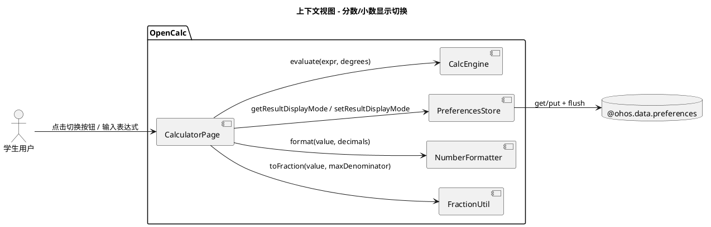
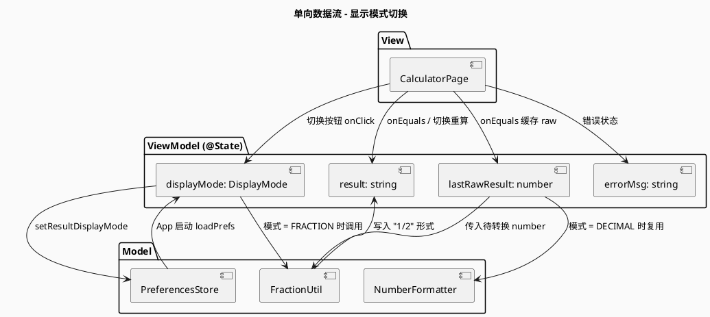
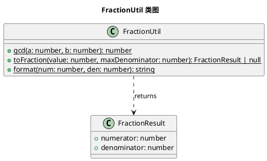
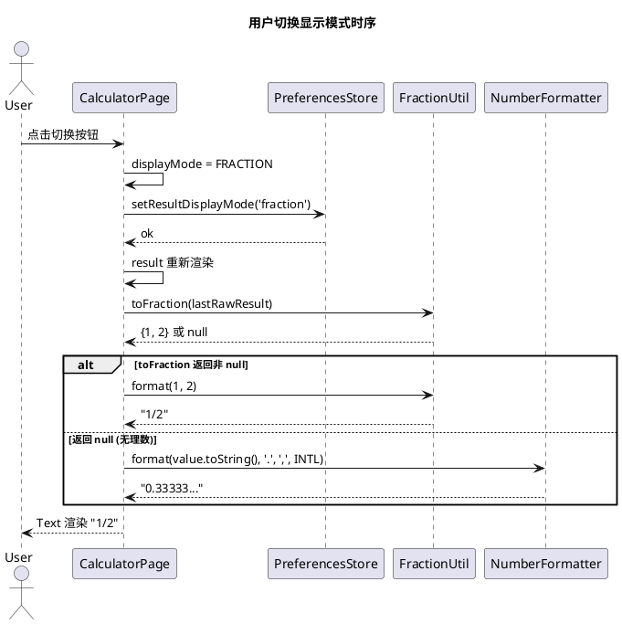

# Delta Design: 计算结果支持小数和分数两种显示，自由切换

> 关联特性: feat-calculator-result-display
> 关联 Issue: #27
> 文档类型: 增量设计 (delta-design)
> 生成时间: 2026-06-17

## 1. 概述

### 1.1 应用定位
在现有 OpenCalc（com.darkempire78.opencalculator）的基础上，为计算结果新增"分数显示"模式，让学生在做分数运算时能直接看到 `1/2`、`3/4` 而非 `0.5`、`0.75`，并支持两种模式间自由切换。

### 1.2 核心交互
- 用户完成一次计算（点 `=`）→ 主结果显示区显示结果（默认小数模式，如 `0.5`）
- 点击结果显示区右上角的"模式切换"按钮 → 主结果在小数（`0.5`）和分数（`1/2`）之间切换
- 用户的模式选择被持久化（`PreferencesStore`），下次启动保留

### 1.3 技术栈概览
- 框架：ArkTS（Stage 模型，ArkUI 声明式 V1 状态管理）
- 状态管理：V1（@State）
- 使用的 Kit：@kit.ArkData（preferences）、@kit.ArkUI（promptAction）、@kit.AbilityKit（common.UIAbilityContext）
- 模块：entry HAP（单模块项目，无 HAR/HSP）
- Native C++/Rust：无
- Hvigor 插件：标准 HarmonyOS 构建

## 2. 功能清单

| 功能名 | 说明 | 入口 | 优先级 |
|--------|------|------|--------|
| 显示模式切换按钮 | 结果显示区右上角 toggle 按钮，点击切换 DECIMAL/FRACTION | CalculatorPage | P0 |
| 分数格式化 | number → 化简分数 a/b | FractionUtil | P0 |
| 切换持久化 | 用户偏好写入 PreferencesStore | PreferencesStore | P0 |
| 错误状态禁用 | errorMsg 非空时按钮 disabled | CalculatorPage | P1 |
| 启动恢复 | App 启动时读取上次模式 | CalculatorPage | P1 |
| 历史记录保持小数 | 历史列表项不跟随模式切换 | CalculatorPage | P2 |

## 3. 实现模型

### 3.1 上下文视图



### 3.2 总体架构



### 3.3 HAP/HAR/HSP 模块划分
单模块 entry HAP 项目，不涉及模块拆分。

### 3.4 设计系统规格

#### 3.4.5 图标与图形资源
新增图标资源（基础模式沿用 `Text` 字符，避免增加 media 资源）：

| 名称 | 类型 | 用途 |
|------|------|------|
| `1/2` / `0.5` 文本 | Text 组件 | 切换按钮的视觉标识（`1/2` 字符） |

[推断] 不新增图片资源，沿用 CalculatorPage 既有 emoji/字符模式（如 `📋`、`⚙`）保持一致。

#### 3.4.6 动画规格
- 切换无显式动画（与现有结果更新一致），瞬时切换 < 100ms
- 按钮 active 态沿用现有 `border` 风格

### 3.5 FractionUtil 模块实现设计

#### 3.5.1 模块介绍
纯逻辑工具模块，不依赖任何 UI/系统能力。`common/FractionUtil.ets`（新增）。

#### 3.5.2 功能描述
- `gcd(a, b)`：欧几里得算法求最大公约数
- `toFraction(value, maxDenominator)`：将 number 转换为最简分数（含负数与零处理）
- `format(numerator, denominator)`：输出 `a/b` 字符串（整数输出 `n`，负数输出 `-a/b`）

#### 3.5.3 目录结构
```
common/
├── NaturalLanguageParser.ets  (已有)
├── UnitConverter.ets          (已有)
└── FractionUtil.ets           (新增)
```

#### 3.5.4 架构图谱


#### 3.5.5 功能与用例分析

```
用例: toFraction(0.5)
前置: value = 0.5, maxDenominator = 9999
步骤: 1. Math.abs(0.5) > EPSILON → 非零路径
     2. sign = -1 (value < 0 → 负, 此例为正)
     3. 0.5.toString() = "0.5" → 1 位小数 → 分子 5, 分母 10
     4. gcd(5, 10) = 5
     5. numerator = 5/5 = 1, denominator = 10/5 = 2
后置: { numerator: 1, denominator: 2 }

用例: toFraction(0.3333) [0.3333 是 1/3 近似]
前置: value = 0.3333, maxDenominator = 9999
步骤: 1. "0.3333" → 4 位小数 → 3333/10000
     2. gcd(3333, 10000) = 1
     3. denominator = 10000 > 9999 → null (回退小数)
后置: null

用例: toFraction(0)
前置: value = 0
步骤: 1. |0| < EPSILON → 短路返回 { numerator: 0, denominator: 1 }
后置: { numerator: 0, denominator: 1 }
```

#### 3.5.6 接口设计

```ts
// common/FractionUtil.ets (新文件)
export interface FractionResult {
  numerator: number
  denominator: number
}

export class FractionUtil {
  /**
   * 欧几里得算法求最大公约数（最大公因数）
   * @param a 整数
   * @param b 整数
   * @returns gcd(|a|, |b|)
   */
  static gcd(a: number, b: number): number

  /**
   * 将有限精度浮点数转换为最简分数
   * @param value 浮点数
   * @param maxDenominator 允许的最大分母，默认 9999
   * @returns 化简后的 FractionResult；不满足精度时返回 null
   */
  static toFraction(value: number, maxDenominator?: number): FractionResult | null

  /**
   * 分数转字符串
   * 整数: "5"; 假分数: "3/2"; 真分数: "1/2"; 负数: "-1/2"; 零: "0"
   */
  static format(numerator: number, denominator: number): string
}
```

#### 3.5.7 状态管理设计
无（纯函数模块）。

#### 3.5.8 核心算法

**gcd（欧几里得算法）**
```
function gcd(a, b):
  a = abs(a); b = abs(b)
  while b != 0:
    (a, b) = (b, a mod b)
  return a
```
复杂度 O(log(min(a, b)))。

**toFraction（有限小数 → 化简分数）**
```
function toFraction(value, maxDen = 9999):
  if |value| < EPSILON: return {0, 1}
  if isnan(value) or isinf(value): return null

  sign = value < 0 ? -1 : 1
  abs = |value|
  str = abs.toString()

  if str contains ".":
    decimals = str after "."
    denom = 10^decimals.length
    numer = round(abs * denom)
  else:
    numer = round(abs); denom = 1

  g = gcd(numer, denom)
  numer /= g; denom /= g

  if denom > maxDen: return null
  return { sign * numer, denom }
```

**format**
```
function format(numer, denom):
  if denom == 0: return "0"     # 防御
  if numer == 0: return "0"
  if numer == numer / denom 整数: return String(numer/denom)  # 整数简化
  if denom < 0: numer = -numer; denom = -denom
  return `${numer}/${denom}`
```

#### 3.5.9 错误处理
- `NaN` / `Infinity` → `toFraction` 返回 `null`，调用方走小数回退
- `0` → 返回 `{0, 1}`，format 输出 `"0"`
- 分母超过 `maxDenominator` → 返回 `null`（不强制化简，避免大分子）
- 负数 → sign 存储在 numerator，denominator 永远为正

#### 3.5.10 依赖关系
- 内部依赖：无
- 外部依赖：无（纯算法）

### 3.6 DisplayMode 枚举模块

#### 3.6.1 接口设计
```ts
// model/Models.ets (新增枚举)
export enum DisplayMode {
  DECIMAL = 'decimal',
  FRACTION = 'fraction'
}
```

### 3.7 PreferencesStore 扩展

#### 3.7.1 接口设计
```ts
// preferences/PreferencesStore.ets (扩展)
class PreferencesStore {
  // 新增
  async getResultDisplayMode(): Promise<DisplayMode>
  async setResultDisplayMode(mode: DisplayMode): Promise<void>
  // 修改 getAllPreferences 增加 resultDisplayMode 字段
}
```

key: `'resultDisplayMode'`，value: `'decimal'` | `'fraction'`

### 3.8 CalculatorPage 改造

#### 3.8.1 模块介绍
主计算器页（已有 796 行），增加显示模式切换能力。

#### 3.8.2 状态变更

新增/修改 @State 字段：
```ts
// 新增
@State displayMode: DisplayMode = DisplayMode.DECIMAL  // aid-workflow 20260617 Issue #27
@State lastRawResult: number = 0                       // aid-workflow 20260617 Issue #27: 用于分数模式重格式化

// 修改 onEquals: 在 result = fmt 后增加 this.lastRawResult = raw
// 修改 loadPrefs: 加载 this.displayMode = await this.prefs.getResultDisplayMode()
// 修改 onAC: 清空 this.lastRawResult
```

#### 3.8.3 结果区 UI 改造

**核心布局**：用 `Stack` 包裹结果 Text + 切换按钮，按钮定位右上角。

```ts
Stack({ alignContent: Alignment.TopEnd }) {
  Text(this.errorMsg.length > 0 ? this.errorMsg
    : (this.result.length > 0 ? this.formatResultForDisplay() : '0'))
    .fontSize(this.isLandscape ? 28 : 36)
    .fontWeight(FontWeight.Bold)
    .fontColor(this.getT1())
    .width('100%').textAlign(TextAlign.End)
    .padding({ right: 12, left: 12 })

  if (this.errorMsg.length === 0) {
    Text(this.displayMode === DisplayMode.FRACTION ? '0.5' : '1/2')  // 按钮
      .fontSize(11).fontColor(this.getT2())
      .padding({ left: 6, right: 6, top: 2, bottom: 2 })
      .border({ width: 1, color: this.getT2(), radius: 4 })
      .margin({ right: 12, top: 4 })
      .onClick((): void => { this.onToggleDisplayMode() })
  }
}
```

**按钮视觉规则**：
- 当前 `DECIMAL` → 显示 `1/2`（提示可切到分数）
- 当前 `FRACTION` → 显示 `0.5`（提示可切到小数）
- 横屏模式（`isLandscape=true`）→ 隐藏按钮（节省空间，仿 ToggleRow 竖屏策略）
- `errorMsg.length > 0` → 不渲染按钮（错误态禁用）

#### 3.8.4 切换事件

```ts
onToggleDisplayMode(): void {
  this.displayMode = this.displayMode === DisplayMode.DECIMAL
    ? DisplayMode.FRACTION
    : DisplayMode.DECIMAL
  this.savePref('resultDisplayMode', this.displayMode)
}
```

`savePref` 增加 case：
```ts
else if (key === 'resultDisplayMode') await this.prefs.setResultDisplayMode(value as string)
```

#### 3.8.5 辅助方法

```ts
/**
 * aid-workflow 20260617 Issue #27: 根据 displayMode 重新格式化结果
 * 不修改历史记录；不修改 this.lastRawResult
 */
private formatResultForDisplay(): string {
  if (this.displayMode === DisplayMode.FRACTION) {
    const frac = FractionUtil.toFraction(this.lastRawResult)
    if (frac !== null) {
      return FractionUtil.format(frac.numerator, frac.denominator)
    }
  }
  // 小数模式或回退
  return NumberFormatter.format(
    this.lastRawResult.toString(), '.', ',', NumberingSystem.INTERNATIONAL
  )
}
```

#### 3.8.6 onEquals 改造

修改点：
```ts
} else {
  const fmt: string = NumberFormatter.format(raw.toString(), '.', ',', NumberingSystem.INTERNATIONAL)
  this.result = fmt
  this.lastRawResult = raw  // aid-workflow 20260617 Issue #27: 缓存用于分数重格式化
  this.errorMsg = ''
  // ... 历史记录逻辑保持不变
}
```

#### 3.8.7 时序图



## 4. 接口设计

### 4.1 内部数据访问 API
`PreferencesStore.getResultDisplayMode(): Promise<DisplayMode>` / `setResultDisplayMode(mode): Promise<void>` —— 见 §3.7。

### 4.2 业务抽象接口
无新增抽象接口（沿用现有 `NumberFormatter.format` + 新增 `FractionUtil` 纯函数）。

### 4.3 - 4.8
无相关实现（不涉及后台任务、Want/Action、Deep Link、IPC、Native、文件交换）。

## 5. 数据模型

### 5.1 - 5.2 关系型/领域模型
无 RDB。领域模型新增：

```ts
// model/Models.ets
export enum DisplayMode {
  DECIMAL = 'decimal',
  FRACTION = 'fraction'
}

export interface FractionResult {
  numerator: number
  denominator: number
}
```

### 5.3 Preferences 结构
现有 `CalculatorPreferences` 扩展：

| key | 类型 | 默认值 | 说明 |
|-----|------|--------|------|
| resultDisplayMode | 'decimal' \| 'fraction' | 'decimal' | 新增 |

`DEFAULT_PREFERENCES.resultDisplayMode = 'decimal'`。

## 6. UI 设计系统

见 §3.4。沿用现有 CalculatorPage 的字符+border 按钮风格。

## 7. 页面清单与导航

### 7.1 页面清单
| 页面 | 路径 | 入口 | 变更 |
|------|------|------|------|
| CalculatorPage | pages/CalculatorPage.ets | @Entry | 修改（加按钮 + 状态） |

不新增页面。

### 7.2 - 7.4 导航
无相关实现（单页面应用）。

## 8. 用户交互规格

### 8.1 手势交互
新增 `onClick` onClick 切换按钮（无 gesture，不影响现有 LongPress 复制手势）。

### 8.2 弹窗目录
无新增。

### 8.3 剪贴板与反馈
无新增（沿用 `promptAction.showToast`）。

### 8.4 卡片交互
无相关实现。

## 9. 平台集成

### 9.1 - 9.6
无新增依赖/权限/ExtensionAbility。

## 10. 偏好设置目录

### 10.1 显示偏好

| key | 类型 | 默认值 | 说明 | 行为影响 |
|-----|------|--------|------|----------|
| resultDisplayMode | 'decimal' \| 'fraction' | 'decimal' | 新增 | CalculatorPage 启动时读取，影响结果显示格式 |

---

## 附：修改文件清单

| 文件 | 类型 | 关键变更 |
|------|------|----------|
| `common/FractionUtil.ets` | new | GCD/toFraction/format |
| `model/Models.ets` | modify | +DisplayMode enum, +resultDisplayMode 字段 |
| `preferences/PreferencesStore.ets` | modify | +getResultDisplayMode/setResultDisplayMode, +getAllPreferences 字段 |
| `pages/CalculatorPage.ets` | modify | +@State displayMode/lastRawResult, +Stack 布局, +onToggleDisplayMode, +formatResultForDisplay |
| `opencalc/entry/src/test/common/FractionUtil.test.ets` | new | 单元测试覆盖 |
| `opencalc/entry/src/test/preferences/PreferencesStore.test.ets` | modify | (如存在) +resultDisplayMode 读写测试 |

---
> 本文档由 mod-design skill 生成。
> 标记 [推断] 的内容为基于设计推断，非确定性事实。
> 生成时间: 2026-06-17
