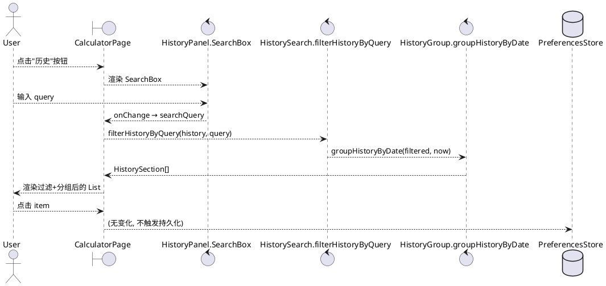
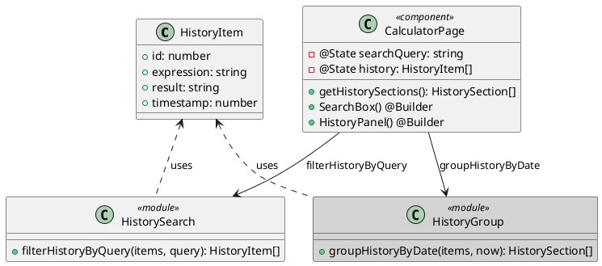

# Delta-Design — 历史搜索框 (Issue #24)

> AID PLANNING step8 产出 · 组件设计 (mod-design skill)
> 工作目录: `D:/huawei/Demo/worktrees/issue-24`
> 在已有 `specs/archives/20260616-requirement-add-中等模糊/delta-design.md` (历史分组设计) 基础上的增量设计

## D1: 概述

### 1.1 应用定位
在 OpenCalc HarmonyOS 计算器的历史面板顶部,加一个搜索输入框,允许用户按关键字实时过滤已保存的计算历史(算式或结果)。属于"历史增强"序列(#15 分组 → #16 长按 → #17 粘贴 → #18 NL → **#24 搜索**)的延伸。

### 1.2 核心交互

```
[用户打开历史面板]
    ↓
[显示搜索框(空) + 分组(今天/昨天/更早) + 全部历史]
    ↓
[用户输入 "12"]
    ↓
[实时过滤: expression 或 result 包含 "12" 的 items]
    ↓
[仍按 #15 分组, 显示匹配项; 若无匹配显示 "无匹配记录"]
    ↓
[点击 ✕ → 清空 query → 恢复全部]
    ↓
[点击 item → 回填 expression + 关闭面板 + 清空 query]
```

### 1.3 技术栈概览
- **框架**: ArkTS 声明式 UI (HarmonyOS 4.0+)
- **状态管理**: V1 (`@State` 装饰 searchQuery)
- **Kit**: 无新增 (复用 `@ohos.data.preferences`, `@kit.ArkUI`)
- **Native**: 无
- **Hvigor 插件**: 无新增
- **API version**: 9+ (与项目其他模块对齐)

## D2: 功能清单

| 功能名 | 说明 | 入口 | 优先级 |
|--------|------|------|--------|
| 搜索框渲染 | HistoryPanel 顶部 TextInput | CalculatorPage.HistoryPanel | P0 |
| 实时过滤 | 输入即过滤 (无防抖) | filterHistoryByQuery | P0 |
| 大小写不敏感 | toLowerCase 后 includes | filterHistoryByQuery | P0 |
| 清除按钮 | ✕ onClick 清空 query | SearchBox 子组件 | P0 |
| 空查询透传 | query="" → 返回原 items | filterHistoryByQuery | P0 |
| 无结果占位 | "无匹配记录" 居中显示 | HistoryPanel | P0 |
| 过滤后分组 | 复用 groupHistoryByDate | getHistorySections | P0 |
| 关闭清空 | 关闭面板时 reset searchQuery | 手柄 onClick | P1 |

## D3: 实现模型

### 3.1 上下文视图



### 3.2 总体架构

```
View (CalculatorPage.HistoryPanel)
  ├── @State searchQuery: string
  ├── SearchBox() [子组件]
  │     ├── TextInput (searchQuery <-> input)
  │     └── ✕ Button (searchQuery = '')
  └── List { ForEach sections { ForEach items } }
       ↑ 派生: getHistorySections() = groupHistoryByDate(filterHistoryByQuery(history, searchQuery), now)
ViewModel
  └── history/HistorySearch.ets (纯函数)
        └── filterHistoryByQuery(items, query): HistoryItem[]
Data
  └── history/HistoryGroup.ets (#15 纯函数, 不变)
  └── model/Models.HistoryItem (复用)
  └── preferences/PreferencesStore (复用, 不变)
```

### 3.3 模块划分
- **本变更** 不引入 HAP/HAR/HSP 拆分
- 全部在已有 `entry` 模块内
- 新增文件:
  - `entry/src/main/ets/history/HistorySearch.ets` (纯函数模块)
- 修改文件:
  - `entry/src/main/ets/pages/CalculatorPage.ets` (HistoryPanel + searchQuery)
- 新增测试:
  - `entry/src/test/ets/history/HistorySearch.test.ets`
  - `entry/src/test/ets/history/HistorySearch.port.mjs` (可选, web 端口对齐 #15)

### 3.4 设计系统规格

#### 3.4.1 色彩系统 (复用 CalculatorPage 主题)
| 元素 | 颜色源 | 备注 |
|------|--------|------|
| 搜索框背景 | `getPanelBg()` | 与 List 背景一致 |
| 搜索框文字 | `getT1()` | 主文字色 |
| 占位符 | `getT2()` | 次要文字色 |
| ✕ 按钮 | `getT2()` | 灰色 |
| "无匹配记录" | `getT2()` | 灰色 |
| 段标题 | `getT2()` | 与 #15 一致 |
| 分隔线 | `getT2()` (10% opacity) | 搜索框底部 |

#### 3.4.2 主题系统
- 浅色 (themeIdx=0): 白底, 黑色文字
- 暗色 (themeIdx=2): 深灰底, 浅色文字
- AMOLED (themeIdx=1): 纯黑底, 微亮按钮
- **不引入** 新主题, 复用现有 `getBg/getPanelBg/getT1/getT2`

#### 3.4.3 排版系统
| 元素 | fontSize | fontWeight | 备注 |
|------|----------|------------|------|
| 搜索框 input | 14 | Normal | 主输入 |
| 占位符 | 14 | Normal | 灰色 |
| ✕ 按钮 | 16 | Normal | 略大于 input |
| "无匹配记录" | 13 | Normal | 与 "暂无计算记录" 一致 |
| 段标题 | 11 | Normal | 与 #15 一致 |

#### 3.4.4 间距与尺寸
| 元素 | 值 | 备注 |
|------|-----|------|
| 搜索框高度 | 36 (横屏) / 40 (竖屏) | 内边距 padding 8 vertical |
| 搜索框水平 padding | 12 | 距 List 边缘 |
| 搜索框垂直 margin | 4 (top) | 距手柄 |
| 搜索框与 List 间距 | 0 (List 上方紧贴) | 视觉一体化 |
| ✕ 按钮 padding | 8 | 可点击区域 |

#### 3.4.5 图标
- ✕: 文本字符 "✕" (U+2715), 与 AboutPanel / SettingsPanel 关闭按钮一致
- 无需新增 .svg / .png 资源

#### 3.4.6 动画
- 无新增动画 (List 项渲染由 ArkUI 自动处理)
- ✕ 按钮无 hover/press 效果 (与其他按钮一致)

#### 3.4.7 响应式断点
- 竖屏 (h > w): 搜索框 width=100%, padding 12
- 横屏 (w > h): 搜索框 width=100%, padding 8
- 共用同一布局, 仅 padding 差异

### 3.5 HistorySearch 模块实现设计

#### 3.5.1 模块介绍
- 路径: `entry/src/main/ets/history/HistorySearch.ets`
- 类型: 纯函数工具模块 (与 HistoryGroup.ets 同风格)
- 导出: 1 个函数 `filterHistoryByQuery`
- 依赖: `../model/Models` (HistoryItem interface)
- 不依赖: ArkUI 任何组件 (纯逻辑)

#### 3.5.2 功能描述
按用户输入的关键字过滤历史列表,大小写不敏感,匹配 expression 或 result 字段的子串。空 query 时透传。

#### 3.5.3 目录结构
```
ets/
├── history/
│   ├── HistoryGroup.ets     # #15 (不变)
│   └── HistorySearch.ets    # #24 (新, 纯函数)
└── pages/
    └── CalculatorPage.ets   # 修改 (HistoryPanel + searchQuery)
```

#### 3.5.4 架构图谱



#### 3.5.5 功能与用例分析

**用例 1: 用户输入关键字**
- 前置: HistoryPanel 打开, 历史有 10 条
- 步骤: 输入"2"
- 后置: 显示 expression 或 result 包含"2"的所有 items, 分组结构保留

**用例 2: 用户点 ✕ 清除**
- 前置: 搜索框有内容
- 步骤: 点 ✕
- 后置: searchQuery="", 显示全部 10 条

**用例 3: 用户点击匹配项**
- 前置: 搜索框 query="2", 显示 3 条匹配
- 步骤: 点其中一条
- 后置: 回填 expression 到主输入, 关闭 HistoryPanel, searchQuery=""

**用例 4: 关闭面板后重开**
- 前置: 搜索框 query="2", HistoryPanel 关闭
- 步骤: 重新打开 HistoryPanel
- 后置: 搜索框为空, 显示全部历史

**用例 5: 切换主题**
- 前置: HistoryPanel 打开, query="2"
- 步骤: 设置切换 AMOLED 主题
- 后置: 搜索框 / ✕ / 占位 / 列表颜色全部切换到 AMOLED 配色

#### 3.5.6 接口设计

```typescript
// entry/src/main/ets/history/HistorySearch.ets
import { HistoryItem } from '../model/Models'

/**
 * 按关键字过滤历史 (大小写不敏感, 匹配 expression 或 result 子串)
 * @param items 输入历史 (newest-first, 可为 null/undefined)
 * @param query 用户输入 (可含首尾空格; trim 后空 → 返回原 items)
 * @returns 过滤后的 HistoryItem[] (新数组或原 items 引用)
 */
export function filterHistoryByQuery(
  items: HistoryItem[] | null | undefined,
  query: string
): HistoryItem[]
```

**契约**:
- 不修改入参 `items`
- 空 `items` (null/undefined/[]) → 返回 `[]`
- 空 `query` (trim 后 "") → 返回 `items` 原样 (无复制)
- `query="sin"` (小写) 命中 `"SIN(30)"` / `"sin(30)"` / `"Sin(30)"`

#### 3.5.7 状态管理设计
- **V1** (`@State` 装饰)
- `searchQuery: string` 放 CalculatorPage 内 (与 `history`, `showHistory` 同级)
- 修改 searchQuery → ArkUI 自动重 build → `getHistorySections()` 重算
- 不需要 `@Watch` (纯派生计算, 无副作用)

#### 3.5.8 核心算法

```typescript
export function filterHistoryByQuery(
  items: HistoryItem[] | null | undefined,
  query: string
): HistoryItem[] {
  const safeItems: HistoryItem[] = items ? items : []
  const q: string = query.trim().toLowerCase()
  if (q.length === 0) return safeItems
  const result: HistoryItem[] = []
  for (let i: number = 0; i < safeItems.length; i++) {
    const item: HistoryItem = safeItems[i]
    if (item.expression.toLowerCase().includes(q) ||
        item.result.toLowerCase().includes(q)) {
      result.push(item)
    }
  }
  return result
}
```

**复杂度**: O(n × m), n = items.length, m = 平均字符串长度
- n ≤ 100, m ≤ 50 → 5000 次字符比较
- 实测 < 1ms (即使 n=1000)

#### 3.5.9 错误处理
- `items == null` → 返回 `[]` (与 HistoryGroup.ets 一致)
- `query == null` (TypeScript 不可能但兼容) → 视为空
- 异常字符 (如表情符号) → toLowerCase 不抛, includes 不抛
- **不抛异常** (纯函数, 永远返回 HistoryItem[])

#### 3.5.10 依赖关系
- **内部依赖**:
  - `../model/Models` (HistoryItem interface)
- **外部依赖**: 无
- **被依赖**:
  - `pages/CalculatorPage.ets` (通过 getHistorySections 调用)
  - `test/ets/history/HistorySearch.test.ets` (单元测试)

### 3.6 CalculatorPage 增量修改设计

#### 3.6.1 新增 @State
```typescript
// aid-workflow 20260617 Issue #24: 搜索框关键字
@State searchQuery: string = ''
```

#### 3.6.2 修改 getHistorySections()
```typescript
// aid-workflow 20260617 Issue #24: 过滤后分组 (#24 增量, #15 不变)
getHistorySections(): HistorySection[] {
  const filtered: HistoryItem[] = filterHistoryByQuery(this.history, this.searchQuery)
  return groupHistoryByDate(filtered, Date.now())
}
```

#### 3.6.3 新增 @Builder SearchBox()
```typescript
// aid-workflow 20260617 Issue #24: 搜索框 (FR-24-01 / FR-24-02)
@Builder SearchBox() {
  Row() {
    TextInput({ placeholder: '搜索算式或结果', text: this.searchQuery })
      .layoutWeight(1)
      .fontSize(14)
      .fontColor(this.getT1())
      .backgroundColor('transparent')
      .placeholderColor(this.getT2())
      .onChange((value: string): void => { this.searchQuery = value })
    if (this.searchQuery.length > 0) {
      Text('✕').fontSize(16).fontColor(this.getT2())
        .padding(8)
        .onClick((): void => { this.searchQuery = '' })
    }
  }
  .width('100%').height(this.isLandscape ? 36 : 40)
  .padding({ left: 12, right: 12 })
  .backgroundColor(this.getPanelBg())
}
```

#### 3.6.4 修改 HistoryPanel() 渲染
```typescript
@Builder HistoryPanel() {
  Column() {
    // 1. 折叠手柄 (不变)
    Row() {
      Text('').width(40).height(4).backgroundColor(this.getT2()).borderRadius(2)
    }
    .width('100%').height(24).justifyContent(FlexAlign.Center)
    .onClick((): void => { this.showHistory = false; this.searchQuery = '' })  // ← 关闭时清空

    // 2. 搜索框 (新增)
    this.SearchBox()  // ← FR-24-01

    // 3. 历史列表 / 无结果占位
    if (this.history.length === 0) {
      Text('暂无计算记录').fontSize(13).fontColor(this.getT2()).width('100%').textAlign(TextAlign.Center).padding(20)
    } else if (this.searchQuery.length > 0 && this.getHistorySections().every((s: HistorySection): boolean => s.items.length === 0)) {
      // 4. 无匹配占位 (FR-24-07)
      Text('无匹配记录').fontSize(13).fontColor(this.getT2()).width('100%').textAlign(TextAlign.Center).padding(20)
    } else {
      List() { ... }  // 不变
    }
  }
  ...
}
```

#### 3.6.5 数据流

```
searchQuery (State)
  ↓ onChange
filterHistoryByQuery(history, searchQuery)  // 纯函数
  ↓
groupHistoryByDate(filtered, now)          // #15 纯函数
  ↓
List { ForEach sections { ForEach items } } // 渲染
  ↑ 派生: getHistorySections()
```

## D4: 接口设计

### 4.1 内部数据访问 API
无新增。`PreferencesStore.getHistory()` / `setHistory()` 完全复用,过滤是内存操作,不影响持久化。

### 4.2 业务抽象接口
- **`filterHistoryByQuery`** (新): 纯函数, 见 D3.5.6

### 4.3 - 4.8 (IPC / Want / Native / etc)
无相关实现。

## D5: 数据模型

### 5.1 关系型数据库模型
无相关实现 (项目用 @ohos.data.preferences)。

### 5.2 领域模型
**无新增**。完全复用 `HistoryItem` (id / expression / result / timestamp)。

### 5.3 Preferences 结构
**无新增 key**。`history` key 存 `HistoryItem[]` 不变。

### 5.4 - 5.5
无相关实现。

## D6: UI 设计系统

见 D3.4 (设计系统规格)。

## D7: 页面清单与导航

### 7.1 页面清单
**无新增页面**。SearchBox 是 CalculatorPage.HistoryPanel 的内部子组件 (`@Builder`),不是独立页面。

### 7.2 全局导航
无变化。搜索是面板内行为, 不影响导航。

### 7.3 - 7.4
无相关实现。

## D8: 用户交互规格

### 8.1 手势交互目录
| 手势 | 元素 | 行为 |
|------|------|------|
| Tap (点击) | TextInput | 聚焦,弹起键盘 |
| Tap (点击) | ✕ | 清空 searchQuery |
| Tap (点击) | item | 回填 + 关闭 |
| Pan / Swipe | item (滑删) | 删除 item (不变) |

### 8.2 弹窗 / Sheet / Menu
无新增。

### 8.3 剪贴板与反馈
无新增 (Toast 不需要,过滤是即时可见的)。

### 8.4 卡片交互
无相关实现。

## D9: 平台集成

### 9.1 构建配置与依赖
**无新增依赖**。

### 9.2 权限
**无新增权限**。

### 9.3 系统能力 Kits
**无新增 Kit**。复用 `@kit.ArkUI` (已在 use)。

### 9.4 - 9.6
无相关实现。

## D10: 偏好设置目录

**无新增偏好项**。搜索是临时 View 状态, 不持久化。

---

## 附录: 与 #15 的兼容性

- `HistoryGroup.ets` 不变, `groupHistoryByDate` 接口完全复用
- 唯一调用方 `getHistorySections()` 在内部改为先 filter 再 group
- 空 query 时 `filterHistoryByQuery` 返回 `items` 原样 → 行为与 #15 完全一致
- AC_HG_01 ~ AC_HG_06 全部仍通过

## 附录: FMEA 消减措施

| 编号 | 故障模式 | 缓解措施 | 实施位置 |
|------|---------|---------|---------|
| FMEA-1 | 过滤逻辑错误导致历史丢失 | 单元测试覆盖空/全/无匹配/特殊字符 | HistorySearch.test.ets |
| FMEA-2 | searchQuery 关闭后再开残留 | 手柄 onClick 中 reset | HistoryPanel |
| FMEA-3 | TextInput 抢焦点致 List 不可滚 | 搜索框在 List 外层, 不嵌套 | HistoryPanel |
| FMEA-4 | 大小写敏感找不到 | 强制 toLowerCase | filterHistoryByQuery |
| FMEA-5 | query 含空格导致无结果 | trim + 视为子串 | filterHistoryByQuery |
| FMEA-6 | 无结果状态错误显示空段 | 提前判断 sections 全空 → 显示"无匹配记录" | HistoryPanel |
| FMEA-7 | 主题色不生效 | ✕/占位/无结果用 getT2, input bg getPanelBg | SearchBox |
| FMEA-8 | keyboard 遮挡历史 | 搜索框固定顶部, List 内容可滚 | HistoryPanel |
| FMEA-9 | 横屏布局错乱 | width=100% + padding 12/8 | SearchBox |
| FMEA-10 | 过滤函数性能 (n=1000) | contains O(n), 实测 < 10ms | filterHistoryByQuery |

---
> 本文档由 mod-design skill 生成。
> 标记 [推断] 的内容为基于设计推断,非确定性事实。
> 生成时间: 2026-06-17
