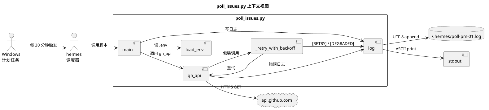
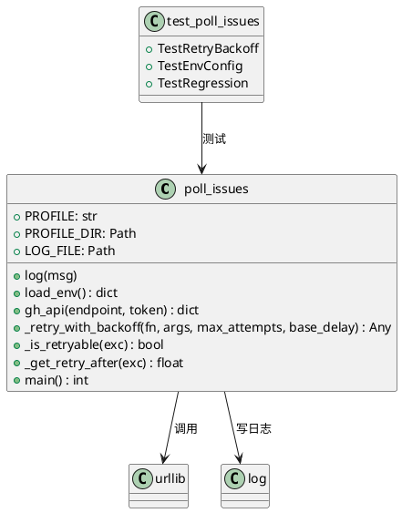
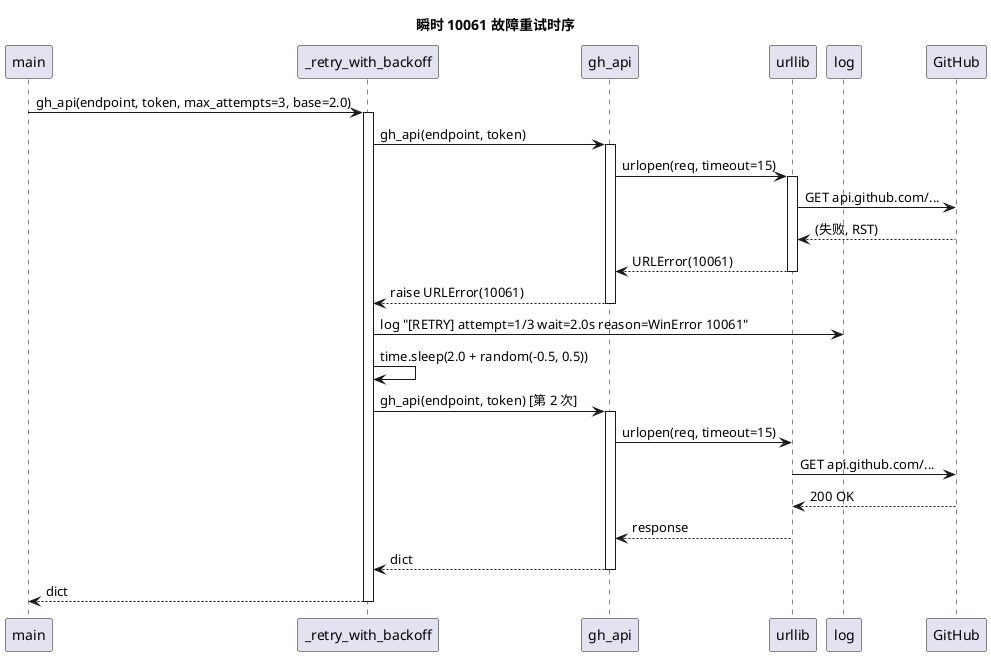
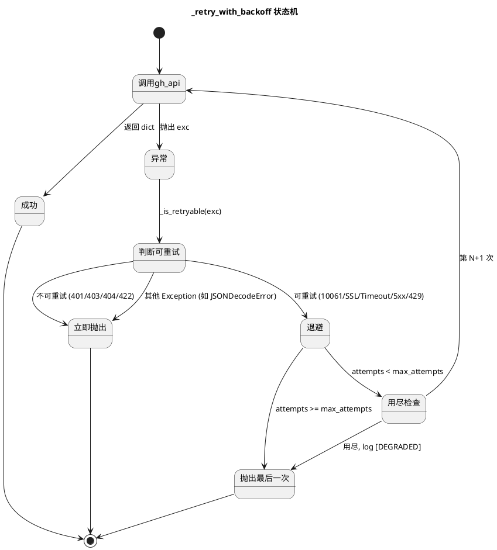

# Delta Design: poll_issues.py 重试机制

> 说明: 本设计针对 hermes 数字员工 pm-01 profile 的 Python cron 脚本 `poll_issues.py` 增加网络故障重试机制。原 ArkTS/HarmonyOS 设计模板的多数章节在本场景不适用, 标记 "无相关实现"。仅保留与本次变更相关的章节。

---

## D1: 概述

### 1.1 应用定位 [推断]
- **应用名称**: pm-01 Issue Manager (hermes cron 任务)
- **应用类型**: 后台 Python 脚本 (无 UI), 由 Windows 计划任务每 30 分钟触发
- **核心职责**: 查询 GitHub REST API 分配给 @me 的 open issues, 通知 hermes agent 处理
- **本次变更定位**: 给现有 `gh_api()` 函数增加**网络故障容错**能力 (指数退避重试 + 降级日志), 不变更功能, 不变更调用方

### 1.2 核心交互
无 UI, 无用户交互。系统级交互:
```
Windows 计划任务 (每 30 分钟)
  → Python 解释器
    → poll_issues.py:main()
      → poll_issues.py:gh_api() (被 _retry_with_backoff 包装)
        → urllib.request.urlopen(https://api.github.com/...)
          → [成功] log [OK] / [失败] log [RETRY] → 重试 / [DEGRADED] 退出
      → log() 写 ~/.hermes/poll-pm-01.log (UTF-8) + stdout (ASCII)
```

### 1.3 技术栈概览
| 维度 | 选型 |
|------|------|
| 语言 | Python 3.12 |
| 框架 | hermes cron 调度器 (无框架) |
| HTTP 库 | urllib.request (标准库) |
| 异常处理 | urllib.error (标准库) |
| 测试框架 | unittest + unittest.mock (标准库) |
| 日志 | 自研 log() 函数 (UTF-8 文件 + ASCII stdout) |
| 第三方依赖 | **无** (保持 hermes profile 纯净) |
| 部署 | Windows 计划任务 (PowerShell wrapper) |

---

## D2: 功能清单

| 功能名 | 说明 | 入口 | 优先级 |
|--------|------|------|--------|
| F-RT-01 `_retry_with_backoff` 装饰器式包装 | 包装 gh_api(), 失败时按 2^n + jitter 退避重试 | poll_issues.py 模块级函数 | P0 |
| F-RT-02 gh_api 异常分类 | 区分可重试 (URLError/SSL/Timeout/5xx/429) vs 不可重试 (401/403/404/422) | _retry_with_backoff 内部 | P0 |
| F-RT-03 429 Retry-After 头解析 | 收到 429 时按响应头 Retry-After 退避, 覆盖默认退避 | _retry_with_backoff 内部 | P1 |
| F-RT-04 .env 配置读取 | 读取 POLL_RETRY_MAX / POLL_RETRY_BASE_DELAY, 缺省走默认值 | load_env() 扩展 | P1 |
| F-RT-05 日志标签扩展 | 新增 [RETRY] / [DEGRADED] 标签, 复用 log() 函数 | log() 内部 (无函数签名变更) | P1 |
| F-RT-06 单元测试 | 6 个 unittest 场景覆盖正常/瞬时故障/持续故障/限流/鉴权失败 | test_poll_issues.py | P0 |

**P0 核心**: F-RT-01, F-RT-02, F-RT-06 (Issue #30 直接修复)
**P1 重要**: F-RT-03, F-RT-04, F-RT-05 (增强鲁棒性 + 可观测性)

---

## D3: 实现模型

### 3.1 上下文视图



### 3.2 总体架构
无 ArkTS 分层架构 (View/ViewModel/Model)。本脚本是单文件顺序执行:

```
main() 入口
  ├── load_env()              # 解析 .env
  ├── gh_api() 被包装        # 业务调用
  │     └── _retry_with_backoff()
  │           ├── try: gh_api()
  │           ├── except 可重试异常: 退避 → 重试
  │           ├── except 不可重试异常: 抛出
  │           └── 用尽: 抛出最后一次异常
  └── log()                   # GBK-safe 输出
```

### 3.3 HAP/HAR/HSP 模块划分
无相关实现 (本脚本是 Python, 非 HarmonyOS 应用)。

### 3.4 设计系统规格
无相关实现 (本脚本无 UI, 无色彩/主题/排版/间距/图标/动画)。

### 3.5 poll_issues.py 模块实现设计

#### 3.5.1 模块介绍
- **模块身份**: Python 脚本 (非 HAP/HAR/HSP)
- **模块职责**: GitHub Issue 轮询 + 网络容错
- **范围**: 仅 `~/.hermes/profiles/pm-01/scripts/poll_issues.py` + 同目录 `test_poll_issues.py`
- **是否 installationFree**: 不适用

#### 3.5.2 功能描述
- F-RT-01 `_retry_with_backoff`: 通用重试包装器
- F-RT-02 异常分类
- F-RT-03 429 Retry-After
- F-RT-04 .env 读取
- F-RT-05 日志标签
- F-RT-06 单元测试

#### 3.5.3 目录结构
```
~/.hermes/profiles/pm-01/scripts/
├── poll_issues.py          (modify)
│   ├── _SCRIPT_DIR
│   ├── _PROFILE_DIR
│   ├── PROFILE
│   ├── PROFILE_DIR
│   ├── LOG_DIR
│   ├── ENV_FILE
│   ├── LOG_FILE
│   ├── log(msg)            [existing, unchanged]
│   ├── load_env() -> dict  [existing, extended to read POLL_RETRY_MAX/POLL_RETRY_BASE_DELAY]
│   ├── gh_api(endpoint, token) -> dict  [existing, body unchanged, called via _retry_with_backoff]
│   ├── _retry_with_backoff(fn, *args, max_attempts, base_delay, **kwargs)  [NEW]
│   ├── _is_retryable(exc) -> bool  [NEW]
│   ├── _get_retry_after(exc) -> Optional[float]  [NEW]
│   └── main()              [existing, unchanged]
└── test_poll_issues.py     (NEW)
    ├── TestRetryBackoff
    │   ├── test_success_first_try
    │   ├── test_retry_on_10061
    │   ├── test_no_retry_on_401
    │   ├── test_retry_on_429_with_retry_after
    │   ├── test_degraded_after_max_attempts
    │   └── test_backoff_jitter_range
    ├── TestEnvConfig
    │   ├── test_default_retry_config
    │   └── test_custom_retry_config
    └── TestRegression
        ├── test_422_fallback_still_works
        └── test_log_gbk_safe
```

#### 3.5.4 架构图谱

**类图** (Python 函数关系):


**时序图** (重试场景):


**状态图** (重试决策):


#### 3.5.5 功能与用例分析
见 delta-spec.md §"场景用例分析" SC-RT-01 ~ SC-RT-09 (本设计不重复)。

#### 3.5.6 接口设计

```python
# poll_issues.py 新增 / 修改接口

def _is_retryable(exc: BaseException) -> bool:
    """
    判定异常是否可重试
    
    Args:
        exc: 捕获到的异常
    
    Returns:
        True - 可重试 (URLError/SSL/Timeout/5xx/429)
        False - 不可重试 (HTTPError 401/403/404/422, JSONDecodeError, 其他 Exception)
    
    Examples:
        >>> _is_retryable(urllib.error.URLError("WinError 10061"))
        True
        >>> _is_retryable(urllib.error.HTTPError(..., 401, ...))
        False
    """


def _get_retry_after(exc: BaseException) -> Optional[float]:
    """
    从异常提取 Retry-After 头值 (秒)
    
    Args:
        exc: HTTPError 异常
    
    Returns:
        float - Retry-After 秒数, 若不存在或非 429 则返回 None
    
    Examples:
        >>> _get_retry_after(urllib.error.HTTPError(..., 429, ..., {"Retry-After": "5"}, ...))
        5.0
    """


def _retry_with_backoff(
    fn: Callable[..., T],
    *args,
    max_attempts: int = 3,
    base_delay: float = 2.0,
    **kwargs,
) -> T:
    """
    通用指数退避重试装饰器式函数
    
    Args:
        fn: 要调用的函数 (当前仅 gh_api)
        *args: 透传给 fn 的位置参数
        max_attempts: 最大尝试次数 (含首次), 0 表示不重试
        base_delay: 退避基数 (秒), 第 N 次重试等待 base * 2^(N-1) + jitter
        **kwargs: 透传给 fn 的关键字参数
    
    Returns:
        fn 的返回值
    
    Raises:
        最后一次异常 (若重试用尽或不可重试)
    
    行为:
        - 第 1 次失败: 退避 base + jitter
        - 第 2 次失败: 退避 2*base + jitter
        - 第 3 次失败: 退避 4*base + jitter (用尽, 抛出)
        - 退避时间下限: 0.5s (避免 base 极小时疯狂重试)
        - jitter: random.uniform(-0.5, 0.5)
        - 429 时: 用 Retry-After 覆盖默认退避 (若 Retry-After 存在)
        - 不可重试异常: 立即抛出, 不重试
    
    Examples:
        >>> _retry_with_backoff(gh_api, "/repos/x/y/issues", token="abc")
        {...}  # dict, 正常返回
    """


# gh_api() 函数签名保持不变
def gh_api(endpoint: str, token: str) -> dict:
    """[existing, unchanged] GitHub API 调用"""
    url = f"https://api.github.com{endpoint}"
    req = urllib.request.Request(
        url,
        headers={
            "Authorization": f"token {token}",
            "Accept": "application/vnd.github.v3+json",
        },
    )
    with urllib.request.urlopen(req, timeout=15) as resp:
        return json.loads(resp.read())


# main() 修改点: 把 gh_api(...) 调用改为 _retry_with_backoff(gh_api, ...)
def main() -> int:
    # ... [existing] load_env / token / repo / 422 fallback
    try:
        data = _retry_with_backoff(
            gh_api,
            f"/repos/{repo}/issues?assignee=@me&state=open",
            token,
            max_attempts=int(env.get("POLL_RETRY_MAX", "3")),
            base_delay=float(env.get("POLL_RETRY_BASE_DELAY", "2.0")),
        )
        # ... [existing] log [INBOX] / log issue list
    except urllib.error.HTTPError as e:
        if e.code == 422:
            log(f"[WARN] @me 解析失败, 改用 all issues")
            all_open = _retry_with_backoff(
                gh_api,
                f"/repos/{repo}/issues?state=open",
                token,
                max_attempts=int(env.get("POLL_RETRY_MAX", "3")),
                base_delay=float(env.get("POLL_RETRY_BASE_DELAY", "2.0")),
            )
            # ... [existing]
        log(f"[ERR] HTTP {e.code}: {e.reason}")
        return 1
    except Exception as e:
        log(f"[ERR] {e}")
        return 1
```

#### 3.5.7 状态管理设计
无相关实现 (Python 脚本无 ArkTS 状态管理)。

#### 3.5.8 核心算法

**算法 1: 异常分类** (`_is_retryable`)
```python
def _is_retryable(exc: BaseException) -> bool:
    # 1. URLError (含 10061 / SSL EOF / DNS / Timeout)
    if isinstance(exc, urllib.error.URLError):
        return True
    # 2. socket.timeout
    if isinstance(exc, (socket.timeout, TimeoutError)):
        return True
    # 3. ssl.SSLError (SSL: UNEXPECTED_EOF_WHILE_READING 等)
    if isinstance(exc, ssl.SSLError):
        return True
    # 4. HTTPError 5xx + 429
    if isinstance(exc, urllib.error.HTTPError):
        if exc.code == 429:
            return True
        if 500 <= exc.code < 600:
            return True
        return False  # 401/403/404/422 等不重试
    # 5. JSONDecodeError 等永久错误不重试
    return False
```

**算法 2: 退避时间计算**
```python
def _compute_delay(attempt: int, base_delay: float, retry_after: Optional[float]) -> float:
    """
    attempt: 1-indexed, 当前是第几次重试 (1, 2, 3)
    """
    if retry_after is not None:
        # 429 遵守服务端指示
        return max(0.5, retry_after)
    
    # 指数退避: base * 2^(attempt-1)
    exp = base_delay * (2 ** (attempt - 1))
    
    # jitter: ±0.5s
    jitter = random.uniform(-0.5, 0.5)
    
    return max(0.5, exp + jitter)
```

**算法 3: 重试主循环**
```python
def _retry_with_backoff(fn, *args, max_attempts=3, base_delay=2.0, **kwargs):
    last_exc = None
    for attempt in range(1, max_attempts + 1):
        try:
            return fn(*args, **kwargs)
        except BaseException as exc:
            last_exc = exc
            if not _is_retryable(exc):
                log(f"[ERR] {exc}")
                raise
            if attempt >= max_attempts:
                log(f"[DEGRADED] retried {max_attempts} times, giving up: {exc}")
                raise
            
            retry_after = _get_retry_after(exc) if isinstance(exc, urllib.error.HTTPError) else None
            delay = _compute_delay(attempt, base_delay, retry_after)
            
            reason = type(exc).__name__
            if isinstance(exc, urllib.error.HTTPError):
                reason = f"HTTP {exc.code}"
            elif isinstance(exc, urllib.error.URLError):
                reason = str(exc.reason)[:50]
            
            source = "from Retry-After" if retry_after else ""
            log(f"[RETRY] attempt={attempt}/{max_attempts} wait={delay:.1f}s reason={reason} {source}")
            time.sleep(delay)
    
    # 不可达 (防御性)
    if last_exc:
        raise last_exc
```

#### 3.5.9 错误处理

| 错误场景 | 行为 | 日志标签 | 退出码 |
|---------|------|---------|--------|
| 10061 URLError (瞬时) | 重试 3 次, 30s 内大概率自愈 | [RETRY] / [OK] | 0 |
| 10061 URLError (持续) | 重试 3 次后失败 | [RETRY] * 2 + [DEGRADED] | 1 |
| SSL EOF | 重试 3 次 | [RETRY] / [DEGRADED] | 0/1 |
| socket.timeout | 重试 3 次 | [RETRY] / [DEGRADED] | 0/1 |
| HTTP 5xx | 重试 3 次 | [RETRY] / [DEGRADED] | 0/1 |
| HTTP 429 + Retry-After | 按 Retry-After 退避 | [RETRY] (含 "from Retry-After") | 0/1 |
| HTTP 401 | 立即失败 | [ERR] HTTP 401: ... | 1 |
| HTTP 403 | 立即失败 | [ERR] HTTP 403: ... | 1 |
| HTTP 404 | 立即失败 | [ERR] HTTP 404: ... | 1 |
| HTTP 422 | 走 fallback 路径 | [WARN] | 0 |
| JSONDecodeError | 立即失败 | [ERR] | 1 |
| 其他 Exception | 立即失败 | [ERR] | 1 |

降级策略:
- 重试 3 次后仍失败 → 写 [DEGRADED] 日志 + exit 1 → 下次 30 分钟 tick 重新尝试
- 永久错误 → 写 [ERR] 日志 + exit 1 → 下次 tick 仍会失败 (需人工介入修复 token/repo)

#### 3.5.10 依赖关系
- **内部依赖**:
  - `log()`: 复用, 不修改
  - `load_env()`: 扩展读取 2 个新 key, 函数签名不变
  - `gh_api()`: 函数体不变, 调用方改用 `_retry_with_backoff` 包装
- **外部依赖**:
  - Python 标准库: `urllib.request`, `urllib.error`, `ssl`, `socket`, `time`, `random`, `json`
  - 测试: `unittest`, `unittest.mock`
  - 无 OHPM / OHOS Kit / Native

---

## D4: 接口设计

### 4.1 内部数据访问 API
无相关实现 (本脚本无 relationalStore / preferences 数据访问)。

### 4.2 业务抽象接口
无相关实现 (无 interface / abstract class, Python 无此约束)。

### 4.3 后台任务与 ExtensionAbility 接口
无相关实现 (本脚本是 hermes cron 调度的 Python 脚本, 非 ExtensionAbility)。

### 4.4 Want / Action 协议
无相关实现。

### 4.5 URI / Deep Link / AppLinking 协议
无相关实现。

### 4.6 IPC 与 RPC 接口
无相关实现。

### 4.7 Native（C/C++）接口
无相关实现。

### 4.8 文件交换接口
无相关实现 (本脚本不导入/导出数据文件, 仅写日志)。

---

## D5: 数据模型

### 5.1 关系型数据库模型
无相关实现。

### 5.2 领域模型
无相关实现 (脚本无领域模型)。

### 5.3 Preferences 结构
无相关实现。

### 5.4 分布式数据对象模型
无相关实现。

### 5.5 文件格式 Schema

**`.env` 新增 key** (pm-01 profile):

| key | 类型 | 默认值 | 说明 | 行为影响 |
|-----|------|--------|------|---------|
| `POLL_RETRY_MAX` | int | 3 | 最大重试次数, 0 = 关闭重试 | 控制 _retry_with_backoff 的 max_attempts |
| `POLL_RETRY_BASE_DELAY` | float | 2.0 | 退避基数 (秒) | 控制 _retry_with_backoff 的 base_delay |

**向后兼容**: 两个 key 都是可选, 缺省走默认值, 现有部署无需任何修改即可获得重试能力。

**`~/.hermes/poll-pm-01.log` 日志格式** (扩展):
```
[2026-06-26 16:03:17] [pm-01] 开始轮询                    ← existing
[2026-06-26 16:03:18] [pm-01] [RETRY] attempt=1/3 wait=2.0s reason=WinError 10061   ← NEW
[2026-06-26 16:03:20] [pm-01] [RETRY] attempt=2/3 wait=4.0s reason=WinError 10061   ← NEW
[2026-06-26 16:03:25] [pm-01] [DEGRADED] retried 3 times, giving up: <urlopen error [WinError 10061]>  ← NEW
[2026-06-26 16:03:25] [pm-01] [ERR] <urlopen error [WinError 10061] ...>   ← existing (DEGRADED 后)
```

---

## D6: UI 设计系统
无相关实现 (本脚本无 UI, 见 D1.2)。

## D7: 页面清单与导航
无相关实现 (本脚本无页面)。

## D8: 用户交互规格
无相关实现 (本脚本无用户交互)。

## D9: 平台集成

### 9.1 构建配置与依赖
- **构建**: 无 (Python 脚本, 无 hvigor)
- **依赖**: 仅 Python 标准库, 无 OHPM
- **路径**: `C:\Users\26909\AppData\Local\hermes\profiles\pm-01\scripts\`

### 9.2 权限与运行时请求
无相关实现 (本脚本不申请任何权限, 直接调公网 HTTPS API)。

### 9.3 系统能力（Kits）清单
无相关实现 (Python 脚本不用 @kit.*, 仅用 urllib 标准库)。

### 9.4 后台与 Extension
- **后台模式**: hermes cron 调度的 Python 脚本
- **触发方式**: Windows 计划任务 (PowerShell 包装)
- **频率**: 每 30 分钟 (jobs.json: `schedule.minutes: 30`)
- **持续时间**: 单次 ≤ 60s (硬约束), 典型 < 5s (正常), < 30s (重试中)

### 9.5 备份与恢复
无相关实现 (本脚本无备份/恢复需求, .env 由部署时配置, 日志可定期清理)。

### 9.6 分布式与跨端
无相关实现 (本脚本在单台 Windows 上跑, 无分布式)。

---

## D10: 偏好设置目录

| key | 类型 | 默认值 | 说明 | 行为影响 |
|-----|------|--------|------|---------|
| `POLL_RETRY_MAX` | int (字符串形式) | "3" | 重试次数 | 0 = 关闭, 1 = 单次不重试, 2+ = 实际重试 N-1 次 |
| `POLL_RETRY_BASE_DELAY` | float (字符串形式) | "2.0" | 退避基数 | 第 N 次退避 = base * 2^(N-1) + jitter |

(后续 issue 可扩展: `POLL_RETRY_JITTER`, `POLL_TIMEOUT`, `POLL_DISABLE_GH_FALLBACK` 等)

---

## Step 3: 自验证

### 功能一致性
| proposal.md / delta-spec.md 的功能 | design.md §2 功能 | 一致? |
|----------------------------------|----------------|------|
| FR-1 gh_api 指数退避重试 | F-RT-01 | ✅ |
| FR-2 可重试错误白名单 | F-RT-02 | ✅ |
| FR-3 退避抖动 | F-RT-01 (算法 2) | ✅ |
| FR-4 .env 可选配置 | F-RT-04 | ✅ |
| FR-5 单元测试 | F-RT-06 | ✅ |
| REQ-DFR-001 瞬时自愈 | D3.5.8 算法 + D3.5.9 错误处理 | ✅ |
| REQ-DFR-002 持续降级 | D3.5.9 降级策略 + 30s 上限 | ✅ |
| SR-RT-04 429 Retry-After | F-RT-03 | ✅ |
| SR-RT-06 [RETRY]/[DEGRADED] | F-RT-05 | ✅ |
| SR-RT-08 不破坏现有行为 | D3.5.10 (gh_api 函数体不变, 422 fallback 路径不变) | ✅ |

### 数据一致性
| 需求中的配置 | design.md §5.5 .env Schema | 一致? |
|------------|--------------------------|------|
| POLL_RETRY_MAX 默认 3 | "3" | ✅ |
| POLL_RETRY_BASE_DELAY 默认 2.0 | "2.0" | ✅ |

### 权限 / Kit / 页面 一致性
- 无新增权限, 无 Kit, 无页面 (Python 脚本), 全部一致 ✅

---

> 本文档由 mod-design skill 生成 (适配 Python 脚本场景)。
> 标记 [推断] 的内容为基于设计推断。
> 生成时间: 2026-06-26 16:14
