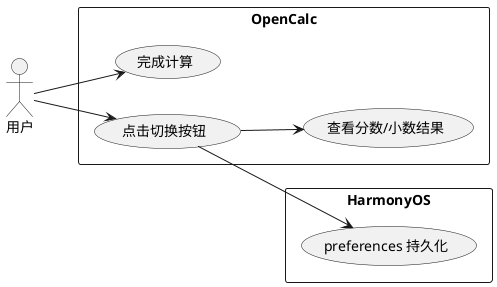
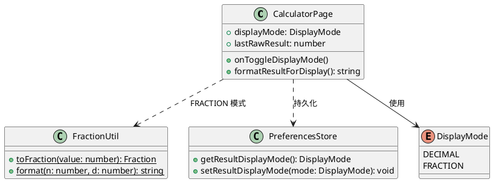
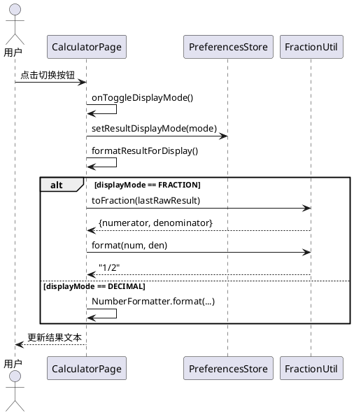

# delta-design.md — Issue #27 分数/小数结果显示切换

## 1. 概述

### 1.1 应用定位

在 OpenCalc 计算器现有计算能力基础上，增强结果展示模块，支持用户在小数（Decimal）与分数（Fraction）两种显示模式间自由切换，并持久化用户偏好。

### 1.2 核心交互

```
用户完成计算
  → 结果区默认显示小数格式
  → 用户点击结果区右上角切换按钮
    → 模式在 DECIMAL ↔ FRACTION 间切换
    → 结果区立即重新格式化并更新显示
    → 偏好写入 HarmonyOS preferences 持久化
```

### 1.3 技术栈概览

- 框架：ArkTS、Stage 模型、ArkUI 声明式
- 状态管理：V1（`@State` / `@Watch`）
- 使用的 Kit：`@ohos.data.preferences`
- 无 Native C++/Rust 模块
- 无新增 HAP/HAR/HSP

---

## 2. 功能清单

| 功能名 | 说明 | 入口 Ability/Page | 优先级 |
|--------|------|-------------------|--------|
| 分数转换 | 将浮点结果转为最简分数字符串 | CalculatorPage | P0 |
| 显示模式切换 | 用户点击按钮切换小数/分数 | CalculatorPage | P0 |
| 模式持久化 | 记住用户上次选择的显示模式 | CalculatorPage | P1 |

---

## 3. 实现模型

### 3.1 上下文视图



### 3.2 总体架构

见 design.md §3.2。本次变更在现有 MVVM 架构内扩展，无架构变更。

数据流：
```
View（CalculatorPage）
  → @State displayMode
    → onToggleDisplayMode()
      → PreferencesStore.setResultDisplayMode()
      → formatResultForDisplay()
        → FractionUtil.toFraction() [FRACTION]
        → NumberFormatter.format() [DECIMAL]
```

### 3.3 HAP/HAR/HSP 模块划分

无变更。仅 entry HAP 内部文件修改。

### 3.4 设计系统规格

无新增设计系统规格。复用现有计算器配色与排版。

### 3.5 CalculatorPage 模块实现设计（增量）

#### 3.5.1 模块介绍

entry HAP 主页面，负责计算器全部 UI 与交互状态。

#### 3.5.2 功能描述

- 管理 `displayMode` 状态（DECIMAL / FRACTION）
- 提供切换按钮交互入口
- 根据当前模式路由结果格式化逻辑

#### 3.5.3 目录结构

```
entry/src/main/ets/pages/
└── CalculatorPage.ets          [修改] 新增状态、方法、UI 按钮
```

```
entry/src/main/ets/common/
└── FractionUtil.ets            [新增] 分数转换工具
```

```
entry/src/main/ets/model/
└── Models.ets                  [修改] 新增 DisplayMode 枚举
```

```
entry/src/main/ets/preferences/
└── PreferencesStore.ets        [修改] 新增显示模式读写
```

#### 3.5.4 架构图谱

**类图（增量）**


**时序图（模式切换）**


#### 3.5.5 功能与用例分析

**用例：切换结果展示模式**
- 前置条件：CalculatorPage 已加载，存在有效计算结果（或 lastRawResult 已记录）
- 步骤：
  1. 用户点击结果区右上角切换按钮
  2. 系统切换 `displayMode` 状态
  3. 系统将新模式写入 PreferencesStore
  4. 系统调用 `formatResultForDisplay()` 重新格式化
  5. 结果区 UI 更新
- 后置条件：结果区显示对应模式文本，用户偏好已持久化

#### 3.5.6 接口设计

**CalculatorPage 新增/修改接口**

```ts
// 状态
@State displayMode: DisplayMode = DisplayMode.DECIMAL
@State lastRawResult: number = 0

// 方法
onToggleDisplayMode(): void
formatResultForDisplay(): string
```

**FractionUtil 接口**

```ts
interface Fraction {
  numerator: number
  denominator: number
}

class FractionUtil {
  static toFraction(value: number, maxDenominator?: number): Fraction
  static format(numerator: number, denominator: number): string
}
```

**PreferencesStore 新增接口**

```ts
getResultDisplayMode(): DisplayMode
setResultDisplayMode(mode: DisplayMode): Promise<void>
```

#### 3.5.7 状态管理设计

- **V1 状态管理**：使用 `@State` 管理 `displayMode` 与 `lastRawResult`
- **数据流**：单向，从用户交互 → 状态变更 → UI 重新渲染
- **持久化**：通过 PreferencesStore 将 `DisplayMode` 写入 HarmonyOS preferences，App 启动时读取恢复

```
用户点击
  → @State displayMode 变更
    → 触发 build() 中结果区重新渲染
      → formatResultForDisplay() 读取 displayMode + lastRawResult
        → 返回格式化字符串
```

#### 3.5.8 核心算法

**浮点转最简分数算法（FractionUtil.toFraction）**

```
输入: value (number), maxDenominator (default 1e15)
输出: {numerator, denominator}

1. sign = value < 0 ? -1 : 1
2. absValue = Math.abs(value)
3. 若 absValue 为整数: return { numerator: sign * absValue, denominator: 1 }
4. scale = 1e15
5. numerator = Math.round(absValue * scale)
6. denominator = scale
7. gcd = 计算 numerator 与 denominator 的最大公约数（欧几里得算法）
8. numerator /= gcd
9. denominator /= gcd
10. return { numerator: sign * numerator, denominator }
```

**复杂度**：O(log(max(scale, value)))，由 GCD 算法决定。

#### 3.5.9 错误处理

| 异常场景 | 处理策略 | 降级行为 |
| -------- | -------- | -------- |
| 分数转换分母溢出/过大 | 检测 denominator > MAX_DENOMINATOR | 回退到 NumberFormatter 小数显示 |
| GCD 计算异常 | try/catch 包围 | 回退到小数显示 |
| preferences 读写失败 | try/catch 包围，日志记录 | 仅本次会话生效，下次启动使用默认值 |

#### 3.5.10 依赖关系

- 内部依赖：model/Models.ets、calculator/NumberFormatter.ets、preferences/PreferencesStore.ets
- 外部依赖：`@ohos.data.preferences`

---

## 4. 接口设计

### 4.1 内部数据访问 API

**PreferencesStore 扩展**

```ts
// 读取显示模式
getResultDisplayMode(): DisplayMode {
  const raw = this.preferences.getSync('result_display_mode', 'DECIMAL') as string
  return raw === 'FRACTION' ? DisplayMode.FRACTION : DisplayMode.DECIMAL
}

// 写入显示模式
async setResultDisplayMode(mode: DisplayMode): Promise<void> {
  this.preferences.putSync('result_display_mode', mode.toString())
  await this.preferences.flush()
}
```

### 4.2 业务抽象接口

新增 `FractionUtil` 纯工具类，无实例状态，全静态方法。

---

## 5. 数据模型

### 5.1 关系型数据库模型

无变更。

### 5.2 领域模型

见 design.md §5.2。本次新增/扩展以下模型：

**DisplayMode 枚举**

| 字段名 | 类型 | 说明 |
| ------ | ---- | ---- |
| DECIMAL | enum member | 小数显示模式 |
| FRACTION | enum member | 分数显示模式 |

**Fraction 接口**

| 字段名 | 类型 | 必填 | 说明 |
| ------ | ---- | ---- | ---- |
| numerator | number | 是 | 分子 |
| denominator | number | 是 | 分母（> 0） |

### 5.3 Preferences 结构

| key | 类型 | 默认值 | 说明 |
| --- | ---- | ------ | ---- |
| result_display_mode | string | 'DECIMAL' | 用户选择的结果显示模式 |

---

## 6. UI设计系统

无新增设计系统规格。复用现有计算器结果区样式。
切换按钮规格：
- 位置：结果文本右上角（竖屏）
- 尺寸：24dp × 24dp
- 图标：动态显示 '1/2' 或 '0.5' 文本
- 颜色：非激活时使用次要文本色，激活时使用 operatorColor

---

## 7. 页面清单与导航

无新增页面。仅在 CalculatorPage 结果展示区新增交互元素。

---

## 8. 用户交互规格

### 8.1 手势交互目录

| 交互元素 | 手势 | 触发行为 | 备注 |
| -------- | ---- | -------- | ---- |
| 结果区切换按钮 | onClick | 调用 onToggleDisplayMode() | 竖屏可见，横屏隐藏 |

### 8.2 弹窗/Sheet/Menu 目录

无新增弹窗。

### 8.3 剪贴板与反馈行为

无变更。

---

## 9. 平台集成

### 9.1 构建配置与依赖

无新增依赖。

### 9.2 权限与运行时请求

无需新增权限。

### 9.3 系统能力（Kits）清单

| Kit | 关键 API | 用途 |
| --- | -------- | ---- |
| @ohos.data.preferences | preferences.getPreferences | 持久化显示模式 |

---

## 10. 偏好设置目录

### 10.1 计算结果显示偏好

| key | 类型 | 默认值 | 说明 | 行为影响 |
| --- | ---- | ------ | ---- | -------- |
| result_display_mode | string | 'DECIMAL' | 计算结果展示模式 | 影响 CalculatorPage 结果区格式化方式 |

---

> 本文档由 mod-design skill 生成。
> 标记 [推断] 的内容为基于设计推断，非确定性事实。
> 生成时间: 2026-06-27
