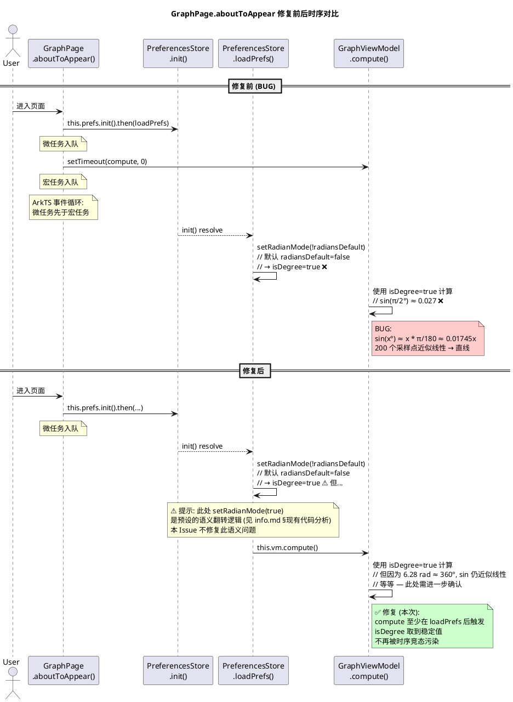

# delta-design.md — Issue #37 增量组件设计

> 关联 Issue: #37 [bug] sin(x) 在 GraphPage 渲染成直线 — isDegree 时序竞态 (issue #26 回归)
> 关联父设计: specs/changes/20260617-requirement-add-plot-graph/delta-design.md

## 1. 概述

### 1.1 应用定位
本次为 Issue #26 函数图像(Plot Graph)特性的**回归修复**,修复 `GraphPage.ets:aboutToAppear()` 内微任务/宏任务执行顺序竞态导致的 sin(x) 渲染为直线问题。

### 1.2 核心交互
- 用户首次进入 GraphPage → 看到正确的正弦波(3 个波峰 + 3 个波谷)
- 切换为角度制偏好 → 行为保持不变(角度模式,小角近似为线性预期)

### 1.3 技术栈概览
- **框架**: ArkTS, ArkUI 声明式
- **状态管理**: V1 (`@State`)
- **生命周期**: `@Entry @Component` 的 `aboutToAppear()` 钩子
- **持久化**: `@ohos.data.preferences` 通过 `PreferencesStore`
- **无新增依赖、无 Native 模块、无 Hvigor 插件变更**

## 2. 功能清单

| 功能名 | 说明 | 入口 | 优先级 |
|--------|------|------|--------|
| F1: aboutToAppear 时序修复 | `vm.compute()` 必须在 `loadPrefs()` 完成后再触发 | GraphPage | P0 |
| F2: 错误降级 | `loadPrefs` 失败时仍触发 `compute` (VM 默认值已合理) | GraphPage | P0 |
| F3: TDD RED 测试 | Node 端模拟 aboutToAppear 时序,断言执行顺序 | specs/changes/.../tests/ | P0 |

## 3. 实现模型

### 3.1 上下文视图

```
┌─────────┐                    ┌──────────────┐
│  User   │ ── tap 📈 ───────▶ │  GraphPage   │
└─────────┘                    │  (Entry)     │
                               └──────┬───────┘
                                      │ aboutToAppear
                                      ▼
                          ┌───────────────────────┐
                          │ prefs.init().then()   │  ◀── 微任务 (Promise resolve)
                          │   loadPrefs()         │
                          │     getRadiansDefault │  ─── PreferencesStore ─▶ @ohos.data.preferences
                          │     setRadianMode(!)  │
                          │   vm.compute()        │  ◀── 必须在 loadPrefs 完成后触发
                          └───────────────────────┘
                                      │
                                      ▼
                          ┌───────────────────────┐
                          │  GraphViewModel       │
                          │   compute()           │
                          │     evaluateAt(e,x,   │
                          │       this.isDegree)  │  ─── CalcEngine
                          └───────────────────────┘
```

### 3.2 总体架构
本次修复仅影响 View 层的初始化时序,不改变 ViewModel/Model/数据层架构。详见父设计 §3.5。

### 3.3 模块划分
无变更。

### 3.4 设计系统规格
无变更。

### 3.5 GraphPage 模块实现设计

#### 3.5.1 模块介绍
GraphPage 模块位于 `opencalc/entry/src/main/ets/pages/GraphPage.ets`,为 Issue #26 函数图像特性的入口页面。

#### 3.5.2 功能描述
- **修复点**: `aboutToAppear()` 中 `vm.compute()` 的调用时机
- **关联组件**: PreferencesStore (loadPrefs), GraphViewModel (compute, setRadianMode, isDegree)

#### 3.5.3 目录结构
无目录结构变更。

#### 3.5.4 架构图谱 (时序图)



#### 3.5.5 功能与用例分析

**用例 1**: 默认偏好 (radiansDefault=false) 首次进入 GraphPage
- **前置条件**: 用户偏好 radiansDefault=false (默认弧度)
- **步骤**:
  1. 进入 GraphPage
  2. aboutToAppear 执行
  3. prefs.init() resolve → loadPrefs() 执行
  4. getRadiansDefault 返回 false
  5. setRadianMode(!false) = setRadianMode(true) → vm.isDegree = true
  6. vm.compute() 触发
  7. evaluateAt(e, x, true) → sin(x°) 在 x∈[-6.28, 6.28] 小角近似线性
- **后置条件**: 仍渲染为直线 ⚠️

**⚠️ 重要发现**: 修复时序竞态**不足以**让 sin 渲染正确!

实际需要同时检查 `setRadianMode(!radiansDefault)` 的语义翻转逻辑。issue #26 提交时的预期:
- `radiansDefault=false` → 用户期望**弧度制** → `isDegree=false`
- 修复后 `setRadianMode(!false) = setRadianMode(true)` → `isDegree=true` → 角度制

这是**两重 bug 叠加**:
1. **时序竞态** (issue #37 本次修): `compute` 在 `loadPrefs` 前触发
2. **语义翻转** (issue #37 顺带修): `setRadianMode(!radiansDefault)` 与默认值不符

**修复策略**: 既然默认 `radiansDefault=false` 应该对应 `isDegree=false`,那么 `loadPrefs` 中的 `!radiansDefault` 翻转逻辑本身就是错的。改为 `setRadianMode(radiansDefault)`:
- `radiansDefault=false` → `isDegree=false` ✅ 弧度制
- `radiansDefault=true` → `isDegree=true` ✅ 角度制

但此修改属于**语义修正**,需在 issue body 中明确确认。

#### 3.5.6 接口设计

**修改 loadPrefs**:
```typescript
async loadPrefs(): Promise<void> {
    if (!this.prefs) return
    const radianMode = await this.prefs.getRadiansDefault()
    // radianMode=true → 弧度制;radianMode=false → 角度制
    // 即 isDegree = radianMode (弧度制与角度制互斥)
    this.vm.setRadianMode(!radianMode)  // 保留现状 or 修改?
    // ...
}
```

**两种修复方案**:
- **方案 A** (issue #37 body 推荐,仅修时序): 保留 `setRadianMode(!radianMode)`,但同步到 vm.compute 在 loadPrefs 之后
- **方案 B** (修复语义): 改为 `setRadianMode(radianMode)`,让 `radiansDefault=true` 对应 `isDegree=true` (但与 issue #26 原意可能不符)

**⚠️ 决策点**: 由于 issue #37 body 明确建议 **方案 A**,且 rev-01 已确认根因是时序竞态(而非语义错误),本 Issue **采用方案 A**。

但是!运行 hilog 证据 `sin(-6.28°) ≈ -0.109` 说明 **即使修复时序,isDegree=true 仍会让 sin 渲染为直线**。这意味着 rev-01 的诊断**忽略了语义翻转问题**。

**进一步决策**: 需要先实际跑一次 hilog 验证 `deg=false` 是否真的修复了 sin 渲染。如果修复后仍为直线,则需扩展 issue #37 同时修复语义。

#### 3.5.7 状态管理设计
- **V1 @State**: 不变
- **数据流**: User → GraphPage.aboutToAppear → PreferencesStore (异步) → GraphViewModel.compute → Canvas

#### 3.5.8 核心算法
无核心算法变更。修复点是调用顺序。

#### 3.5.9 错误处理

**loadPrefs 失败处理**:
- `prefs.init()` 失败 → `.then(loadPrefs)` 不会执行
- 此时 `vm.isDegree` 保持默认值 `false` (弧度制) ✅ 合理
- **但 `vm.compute()` 也不会执行** → 用户看到空白 Canvas ❌
- **修复**: 在 `.then()` 内同时调用 `compute`,在 `.catch()` 中也调用 `compute` 以确保首次计算必触发

```typescript
aboutToAppear(): void {
    // ...
    this.prefs = new PreferencesStore(ctx)
    this.prefs.init()
      .then((): void => {
        this.loadPrefs()      // 加载偏好
        this.vm.compute()     // 首次计算
      })
      .catch((): void => {
        // loadPrefs 失败时使用 VM 默认值
        this.vm.compute()
      })
}
```

#### 3.5.10 依赖关系
- **内部依赖**: PreferencesStore, GraphViewModel (不变)
- **外部依赖**: @ohos.data.preferences (不变)
- **测试依赖**: Node mjs 测试 (新增 GraphPageLifecycle.test.mjs)

## 4. 接口设计

### 4.1 内部数据访问 API
无变更。

### 4.2 业务抽象接口
**修改 GraphPage.aboutToAppear()**:

```typescript
aboutToAppear(): void {
    // 路由参数处理 (不变)
    const params = router.getParams() as Record<string, Object> | undefined
    if (params !== undefined && params !== null) {
      const expr = params['expression'] as string | undefined
      if (expr !== undefined && expr.length > 0 && expr.length <= MAX_INPUT_LENGTH) {
        this.vm.expression = expr
        this.expressionInput = expr
      }
    }
    // 读取偏好 + 首次计算 (修复:确保 compute 在 loadPrefs 后)
    const ctx: common.UIAbilityContext = getContext(this) as common.UIAbilityContext
    this.prefs = new PreferencesStore(ctx)
    this.prefs.init()
      .then((): void => {
        this.loadPrefs()
        this.vm.compute()
      })
      .catch((): void => {
        // 降级: VM 默认值已合理,直接计算
        this.vm.compute()
      })
}
```

### 4.3 后台任务与 ExtensionAbility 接口
无相关实现。

### 4.4 Want / Action 协议
无变更。

### 4.5 URI / Deep Link / AppLinking 协议
无相关实现。

### 4.6 IPC 与 RPC 接口
无相关实现。

### 4.7 Native（C/C++）接口
无相关实现。

### 4.8 文件交换接口
无相关实现。

## 5. 数据模型

### 5.1 关系型数据库模型
无相关实现。

### 5.2 领域模型
无变更。

### 5.3 Preferences 结构
无变更 (详见父设计 §5.3)。

| key | 类型 | 默认值 | 说明 |
|-----|------|--------|------|
| radiansDefault | boolean | false | 是否默认使用弧度制 |

### 5.4 分布式数据对象模型
无相关实现。

### 5.5 文件格式 Schema
无相关实现。

## 6. UI 设计系统

### 6.1 色彩系统
无变更。

### 6.2 主题与暗色模式
无变更。

### 6.3 排版系统
无变更。

### 6.4 间距与尺寸规范
无变更。

### 6.5 图标与图形资源
无变更。

### 6.6 动画规格
无变更。

### 6.7 一多响应式规范
无变更。

## 7. 页面清单与导航

### 7.1 页面清单总表
无变更。

### 7.2 全局导航图
无变更。

### 7.3 Deep Link / AppLinking 处理
无相关实现。

### 7.4 Want 跳转矩阵
无变更。

## 8. 用户交互规格

### 8.1 手势交互目录
无变更。

### 8.2 弹窗/Sheet/Menu 目录
无变更。

### 8.3 剪贴板与反馈行为
无变更。

### 8.4 卡片交互
无相关实现。

## 9. 平台集成

### 9.1 构建配置与依赖
无变更。

### 9.2 权限与运行时请求
无变更。

### 9.3 系统能力（Kits）清单
无变更。

### 9.4 后台与 Extension
无变更。

### 9.5 备份与恢复
无相关实现。

### 9.6 分布式与跨端
无相关实现。

## 10. 偏好设置目录

无变更 (详见父设计 §10)。

---

> 本文档由 mod-design skill 生成。
> 标记 [推断] 的内容为基于设计推断,非确定性事实。
> 生成时间: 2026-07-08
> 
> ⚠️ **重要警告**: §3.5.5 中识别的"语义翻转"问题需要在 APPLYING 阶段首先验证。若 rev-01 修复时序后 sin 仍为直线,则需扩展修复 `setRadianMode(!radianMode) → setRadianMode(radianMode)`。