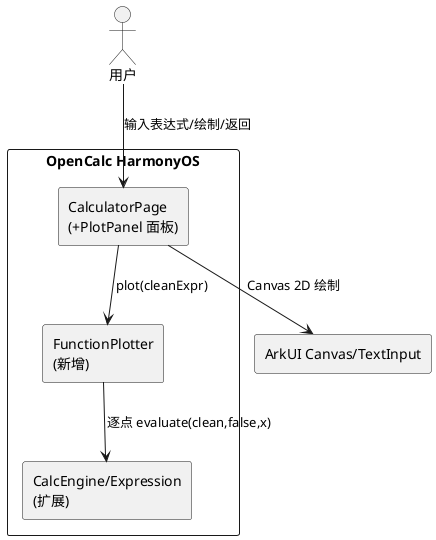
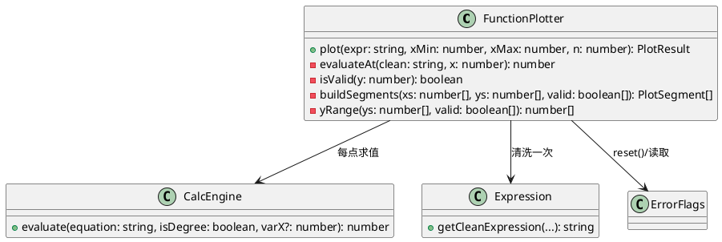
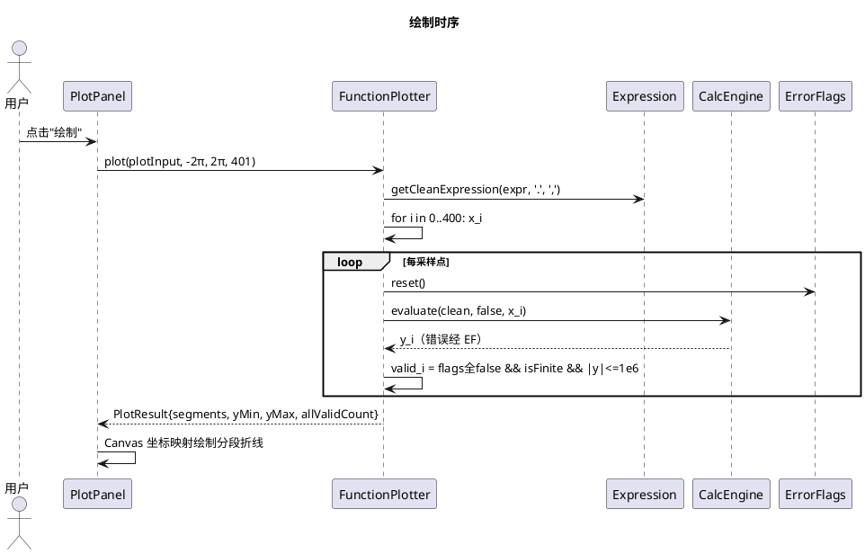
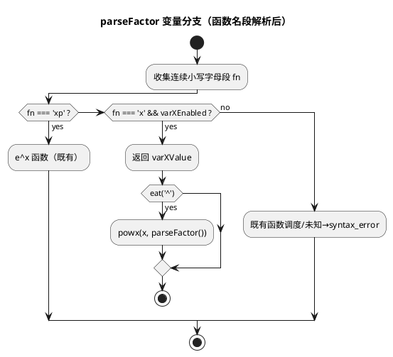
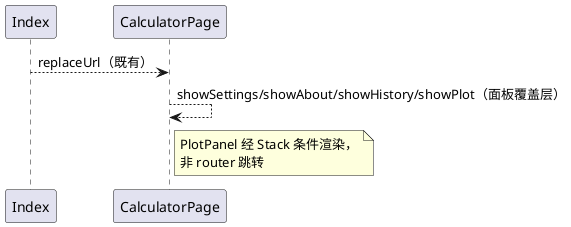

# 函数图像绘制（Issue #40） 增量设计（delta-design）

> 增量设计：专注变更点。基线架构见全局 specs/design.md（当前为骨架）与 opencalc/README.md §架构。
> 需求追溯：delta-spec.md §8 SR-00/01/02；代码事实来源：info.md。

---

## 1. 概述

### 1.1 应用定位
OpenCalc HarmonyOS 科学计算器新增函数绘图能力：输入含变量 `x` 的表达式（`sin(x)`、`x^2`），在独立全屏面板绘制 `[-2π,2π]` 曲线，可返回计算器且既有功能零退化。

### 1.2 核心交互
用户 → ToggleRow"绘图" → PlotPanel（预填表达式/TextInput 编辑/x 插入）→ "绘制" → Canvas 坐标轴+分段曲线 → "返回" → 主界面（状态保留）。

### 1.3 技术栈概览
- 框架：ArkTS + Stage 模型 + ArkUI 声明式（与基线一致）
- 状态管理：**V1**（@State，与基线 CalculatorPage 一致，不引入 V2）
- Kit：@kit.ArkUI（Canvas/CanvasRenderingContext2D、promptAction 既有）；无新增 Kit
- Native：无；Hvigor：无新增插件；依赖：无新增 OHPM 包

---

## 2. 功能清单

| 功能名 | 说明 | 入口 Ability/Page | 优先级 |
|--------|------|-------------------|--------|
| 变量 x 求值 | CalcEngine 可选绑定求值 + Expression x 隐式乘法（SR-00） | CalculatorPage（经 PlotPanel 间接触发；引擎级能力） | P0 |
| 函数采样分段 | [-2π,2π] 401 点弧度采样、无效点断段（SR-01） | PlotPanel"绘制" | P0 |
| 绘图面板 | 全屏 PlotPanel：输入/坐标轴/曲线/返回/错误提示/主题适配（SR-02） | ToggleRow"绘图" | P0 |
| x 按钮插入 | 科学区新增 'x' 按钮（onConst('x') 复用） | ButtonGrid 科学区 | P1 |
| 缩放/平移/自定义范围 | 不做（增强项） | - | P2（不做） |

---

## 3. 实现模型

### 3.1 上下文视图



### 3.2 总体架构

```
View（CalculatorPage/PlotPanel @State）
  → Service（FunctionPlotter 采样分段）
    → Engine（CalcEngine.evaluate + Expression 清洗 + ErrorFlags）
      → Platform-Kit（Canvas 2D；无数据层变更）
```
单向数据流：UI 事件 → 计算产生 PlotResult @State → Canvas 按 state 渲染。

### 3.3 HAP/HAR/HSP 模块划分

不变更：仅 entry HAP。新增源码目录 `entry/src/main/ets/plot/`；新增测试目录 `entry/src/test/`。见 info.md §4。

### 3.4 设计系统规格

复用基线（见 design.md §3.4 占位/CalculatorPage 取色函数）。本次新增色彩：

#### 3.4.1 色彩系统（新增部分）

| 名称 | Light | Dark(AMOLED/暗色) | 用途 |
|------|-------|-------------------|------|
| 曲线色 | '#4684E3'（getOp 强调蓝） | 同左（暗色下自动取 getOp()='#0070BC'） | 函数曲线 |
| 坐标轴色 | getT2() | getT2() | 轴线（浅灰/深灰） |
| 网格刻度 | getT2() | getT2() | 刻度短线与标签 |
| 面板底色 | getPanelBg() | getPanelBg() | Canvas 背景与面板 |

#### 3.4.2 主题系统
沿用 themeIdx 0/1/2 + 既有取色函数；PlotPanel 不自持配色，全部经 CalculatorPage 方法取色。

#### 3.4.3 排版系统
轴标签 fontSize 10（getT2()）；错误提示 fontSize 14（getErr()）；标题"函数绘图" fontSize 18 Bold（getT1()）。

#### 3.4.4 间距与尺寸系统
面板内边距 16；Canvas 高度 layoutWeight(1)；按钮行高 40；与既有面板 padding 惯例一致。

#### 3.4.5 图标与图形资源
无新增资源文件（入口用文本"绘图"）。

#### 3.4.6 动画规格
无新增动画（面板瞬显，与 Settings/About 一致）。

#### 3.4.7 响应式断点与栅格
PlotPanel 全屏自适应；横竖屏均可用（无专用横屏布局，增强项）。

### 3.5 FunctionPlotter 模块实现设计

#### 3.5.1 模块介绍
entry 模块内纯逻辑类（无 @Component/@Entry 依赖），可被 hypium 本地单测直接构造。新增文件 `entry/src/main/ets/plot/FunctionPlotter.ets`。

#### 3.5.2 功能描述
- 表达式清洗（一次）→ 等距采样 N 点 → 逐点弧度制求值 → 有效性判定 → 分段构建 → y 轴范围估算

#### 3.5.3 目录结构

```
entry/src/main/ets/plot/
└── FunctionPlotter.ets        # PlotPoint/PlotSegment/PlotResult 接口 + FunctionPlotter 类
entry/src/test/
├── List.test.ets              # hypium 测试入口（聚合）
└── PlotFunction.test.ets      # SR-00/SR-01 单测套件
```

#### 3.5.4 架构图谱





#### 3.5.5 功能与用例分析

```
用例：sin(x) 采样（SC001-UC001/SC002-UC001 数据层）
前置：clean 表达式 "sin(x)" 可求值
步骤：1. 清洗 2. 401 点求值 3. 全有效 → 单段
后置：PlotResult.segments.length === 1

用例：1/x 分段（SC002-UC001）
前置：clean "1/x"
步骤：1. 采样 2. x=0 点 division_by_0 → 无效 3. 两侧各自成段
后置：segments.length === 2，断点在 x=0
```

#### 3.5.6 接口设计

```typescript
// 接口（含于 FunctionPlotter.ets 导出）
interface PlotPoint { x: number; y: number; valid: boolean }
interface PlotSegment { points: PlotPoint[] }        // points 全部 valid，x 递增
interface PlotResult {
  segments: PlotSegment[]   // 连续有效段（长度≥1 点）
  yMin: number; yMax: number // 有限样本范围（min==max → ±1，含 10% padding）
  totalValid: number
}
class FunctionPlotter {
  plot(expr: string, xMin: number, xMax: number, n: number): PlotResult  // 同步，无异常抛出（错误→空 segments）
}
```
无 async；调用约束：n ≥ 2、xMin < xMax，表达式先经 Expression 清洗（plot 内部执行清洗）。

#### 3.5.7 状态管理设计
纯逻辑无状态（每次 plot 独立）；不使用 @State。UI 侧：CalculatorPage 新增 @State showPlot: boolean、plotInput: string、plotError: string、plotSegments: PlotSegment[]、plotYMin/plotYMax: number。

```
plotInput --"绘制"--> FunctionPlotter.plot --> plotSegments/plotYMin/plotYMax/plotError --渲染--> Canvas
```

#### 3.5.8 核心算法

- **等距采样**：`x_i = xMin + i*(xMax-xMin)/(n-1)`，i∈[0,n)；n=401、[-2π,2π] 时步长 π/100
- **有效性判定**：`valid = (!syntax_error && !division_by_0 && !domain_error && !is_infinity && !require_real_number) && isFinite(y) && Math.abs(y) <= 1e6`
  - 1e6 夹持：tan 在 ±π/2 为 ~1.6e16 有限大数，仅 isFinite 不足
- **分段**：单遍扫描，valid[i] && valid[i-1] 同段；段内 ≥1 点即成段（孤立有效点画短段/点）
- **y 范围**：仅统计 valid 且 finite 的 y；min==max → ±1；再 +10% 对称 padding
- 复杂度：O(n·L)（L=表达式长度），n=401 → 单次绘制 <10ms 量级（不阻塞 UI 线程可接受；不做异步）

#### 3.5.9 错误处理
- plot 不抛异常：内部 try/catch，异常 → 空 segments
- 全无效（totalValid===0）→ segments 空，UI 显示"无可绘制的有效数据点"
- 空表达式由 UI 层前置拦截（"请输入表达式"）
- 错误文案中文，风格与既有一致

#### 3.5.10 依赖关系
内部：calculator/Calculator、calculator/Expression、model/ErrorFlags；外部：无。

### 3.6 CalcEngine/Expression 扩展实现设计

#### 3.6.1 模块介绍
既有文件修改：calculator/Calculator.ets、calculator/Expression.ets。SR-00 载体。

#### 3.6.2 功能描述
- CalcEngine：evaluate(equation, isDegree, varX?) —— varX 提供时启用变量绑定
- Expression：addMultiply 识别变量字符 'x'（'xp' 保护）

#### 3.6.3 目录结构
不变（修改既有文件）。

#### 3.6.4 架构图谱



#### 3.6.5 功能与用例分析

```
用例：SC001-UC002
前置：new CalcEngine()/new Expression()
步骤：1. clean = getCleanExpression("2x+1",".",",")  // → "2*x+1"
      2. evaluate(clean, false, 2)
后置：= 5；ErrorFlags 全 false
```

#### 3.6.6 接口设计

| 方法 | 签名 | 变更 | 兼容性 |
|------|------|------|--------|
| evaluate | (equation: string, isDegree: boolean, varX?: number): number | 追加可选参 | 两参调用行为逐位不变 |
| getCleanExpression | 签名不变 | 对含 'x' 输入插入 '*' | 不含 'x' 输出与基线逐字符一致 |

#### 3.6.7 状态管理设计
CalcEngine 新增私有实例字段 `varXEnabled: boolean = false`、`varXValue: number = 0`，evaluate 入口设置——与既有 eq/p/c/deg 字段同模式；Expression 保持无状态。

#### 3.6.8 核心算法（addMultiply 'x' 规则）

扫描到字符 'x'（非 'xp' 前缀）时：
```
后邻规则：next ∈ "0123456789π(ex" → 在 x 后插 '*'
  例：x2→x*2, xπ→x*π, x(→x*(, xx→x*x, xln→x*ln(函数首字母)
  例外：substring(i,i+2)==='xp' → 跳过（e^x 函数名）
前邻规则：i≥1 且 prev ∈ "0123456789)πex" → 在 x 前插 '*'
  例：2x→2*x, )x→)*x, πx→π*x, ex→e*x, xx→x*x（由后邻规则覆盖）
```
顺序保障：replaceSymbols 已把 'exp'→'xp'、'E'→'*10^'，正文中小写 'xp' 仅源于 e^x 函数。

#### 3.6.9 错误处理
未启用绑定时 fn==='x' 走既有 ErrorFlags.syntax_error 路径（错误文案"表达式错误"不变）。

#### 3.6.10 依赖关系
不变更（ErrorFlags 既有依赖）。

### 3.7 PlotPanel 面板实现设计

#### 3.7.1 模块介绍
CalculatorPage 内新增 @Builder PlotPanel()（与 SettingsPanel/AboutPanel 同模式），Stack 条件渲染 `if (this.showPlot)`；不新增路由页。

#### 3.7.2 功能描述
布局（全屏 Column，backgroundColor getPanelBg()）：
```
Row: Text('函数绘图')+Blank()+Text('✕ 返回')  ← onClick: showPlot=false（始终可点）
TextInput({ text: plotInput })  ← onChange 更新 plotInput；预填主表达式
Row: [插入 x] [AC] [绘制]      ← 插入x: plotInput+='x'；AC: plotInput=''; 绘制: onPlot()
Text(plotError)                 ← plotError 非空时显示（getErr 色）
Canvas                          ← layoutWeight(1)；onReady/onAreaChange 记录宽高
```

#### 3.7.3 目录结构
无新文件（Builder 位于 CalculatorPage.ets）。

#### 3.7.4 架构图谱
见 §3.5.4 时序图（PlotPanel 角色）。

#### 3.7.5 功能与用例分析

```
用例：SC003-UC001 进出与回归
前置：主界面正常
步骤：1. ToggleRow"绘图"→ showPlot=true，plotInput 预填 this.expression
      2. "✕ 返回" → showPlot=false
      3. 主界面表达式/历史/设置可用
后置：主界面状态保留
```

#### 3.7.6 接口设计
新增 CalculatorPage 私有方法：

| 方法 | 签名 | 职责 |
|------|------|------|
| onOpenPlot | (): void | showPlot=true；plotInput=expression；清 plotError |
| onPlot | (): void | 空值拦截 → plot(expr,'.',',') → FunctionPlotter.plot → 更新状态/错误（try/catch 包裹） |
| drawAxes | (ctx, w, h): void | 坐标映射：xAxisY=h/2（按 y 范围比例）、yAxisX=w/2；x 轴刻度 -2π/-π/0/π/2π（文字标签）|
| drawCurve | (ctx, w, h): void | 遍历 plotSegments，moveTo/lineTo 逐段绘制（无效点已在段构建时断开） |
| mathToPx | (x,y,w,h): 坐标 | x∈[xMin,xMax]→[0,w]，y∈[plotYMin,plotYMax]→[h,0] |

#### 3.7.7 状态管理设计
新增 @State：showPlot、plotInput、plotError、plotSegments、plotYMin、plotYMax、canvasW、canvasH。V1 装饰器；数据流单向（§3.5.7）。

#### 3.7.8 核心算法
坐标映射 + 分段折线绘制（无插值/平滑——忠实采样数据，避免视觉造假）。

#### 3.7.9 错误处理
onPlot 整体 try/catch → plotError='计算错误'；空表达式 → '请输入表达式'；全无效 → '无可绘制的有效数据点'。Canvas 未就绪（canvasW===0）时仅更新数据不绘制。

#### 3.7.10 依赖关系
依赖 plot/FunctionPlotter（新增单向依赖）、既有主题取色函数、promptAction（不新增）。

---

## 4. 接口设计

### 4.1 内部数据访问 API
无相关实现（无持久化）。

### 4.2 业务抽象接口
PlotPoint/PlotSegment/PlotResult（§3.5.6）——纯数据接口，ArkTS interface 导出。

### 4.3 后台任务与 ExtensionAbility 接口
无相关实现。

### 4.4 Want / Action 协议
无相关实现。

### 4.5 URI / Deep Link / AppLinking 协议
无相关实现。

### 4.6 IPC 与 RPC 接口
无相关实现。

### 4.7 Native（C/C++）接口
无相关实现。

### 4.8 文件交换接口
无相关实现。

---

## 5. 数据模型

### 5.1 关系型数据库模型
无相关实现。

### 5.2 领域模型

| 字段名 | 类型 | 必填 | 说明 |
|--------|------|------|------|
| PlotPoint.x | number | 是 | 采样自变量 |
| PlotPoint.y | number | 是 | 函数值（无效点为 NaN 哨兵，不参与绘制） |
| PlotPoint.valid | boolean | 是 | 有效性（§3.5.8 判定） |
| PlotSegment.points | PlotPoint[] | 是 | 连续有效点，x 严格递增 |
| PlotResult.segments | PlotSegment[] | 是 | 分段集合（可为空数组） |
| PlotResult.yMin/yMax | number | 是 | 渲染 y 范围（有限值） |
| PlotResult.totalValid | number | 是 | 有效点计数 |

### 5.3 Preferences 结构
无相关实现（不新增偏好项）。

### 5.4 分布式数据对象模型
无相关实现。

### 5.5 文件格式 Schema
无相关实现。

---

## 6. UI设计系统

见 §3.4（新增色彩/排版/尺寸）+ 基线主题函数。

### 6.7 一多响应式规范要点
PlotPanel width('100%').height('100%')；Canvas layoutWeight(1) 随可用空间伸缩；竖屏/横屏均以单列布局呈现（无断点切换，增强项遗留）。

---

## 7. 页面清单与导航

### 7.1 页面清单总表

| 页面名 | 路径 | 入口 Ability | 传参 | 功能摘要 |
|--------|------|--------------|------|----------|
| Index | pages/Index | EntryAbility | 无 | 不变更 |
| CalculatorPage | pages/CalculatorPage | EntryAbility | 无 | 增加绘图入口 + PlotPanel 覆盖层（非新路由页） |

### 7.2 全局导航图



### 7.3 Deep Link / AppLinking 处理
无相关实现。

### 7.4 Want 跳转矩阵
无相关实现。

---

## 8. 用户交互规格

### 8.1 手势交互目录

| 手势/组件 | 位置 | 行为 |
|-----------|------|------|
| onClick | ToggleRow'绘图' | onOpenPlot() |
| onClick | PlotPanel'✕ 返回' | showPlot=false |
| onClick | [插入 x]/[AC]/[绘制] | plotInput 编辑/清空/onPlot() |
| onClick | 科学区 'x' 按钮 | onConst('x')（主界面表达式追加） |
| onChange | TextInput | 更新 plotInput |

### 8.2 弹窗/Sheet/Menu 目录
无新增（错误信息用面板内 Text 行内提示，不用弹窗——保持与既有 errorMsg 显示风格一致）。

### 8.3 剪贴板与反馈行为
不涉及（绘图面板不使用剪贴板/Toast）。

### 8.4 卡片交互
无相关实现。

---

## 9. 平台集成

### 9.1 构建配置与依赖
零依赖变更：entry/oh-package.json5、根 oh-package.json5、build-profile.json5、main_pages.json、module.json5 全部不动。测试新增 `entry/src/test/`（hypium 已在根 devDependencies）。

### 9.2 权限与运行时请求
无新增权限。

### 9.3 系统能力（Kits）清单

| Kit | 关键 API | 用途 |
|-----|----------|------|
| ArkUI（既有） | CanvasRenderingContext2D（API ≥ 8）、TextInput、Canvas | 曲线渲染（最低 API version 随基线 SDK 12） |

### 9.4 后台与 Extension
无相关实现。

### 9.5 备份与恢复
无相关实现。

### 9.6 分布式与跨端
无相关实现。

---

## 10. 偏好设置目录

无相关实现（不新增偏好项；绘图弧度制为硬编码行为约定，非用户偏好）。

---

## 自验证（Step 3 交叉校验）

| 校验项 | 结果 |
|--------|------|
| 功能一致性 | delta-spec SR-00/01/02 ↔ §2 功能清单 1:1 ✓ |
| 页面一致性 | R3 全屏面板 ↔ §7.1 PlotPanel 覆盖层（非新路由页，符合 delta-spec §5 约束 4）✓ |
| 数据一致性 | PlotResult/分段 ↔ SR-01 AC ✓ |
| 权限一致性 | 无新增权限 ↔ delta-spec 无权限需求 ✓ |
| Kit 一致性 | Canvas/TextInput ↔ ArkUI 既有 ✓ |

---

## 11. 补救轮设计（R4 可读坐标系，2026-10-22 追加）

> 追溯：proposal.md §11（R4）、delta-spec.md SC-005/SR-03/CM-07~CM-10、info.md §11。
> 复杂度 S：无架构变更（PlotAxis 落在既有 plot/ 层），无数据模型变更，无新增页面/权限/Kit。

### 11.1 功能清单增量
| 功能名 | 说明 | 入口 | 优先级 |
|--------|------|------|--------|
| 可读坐标系逻辑（SR-03） | X π 刻度、Y nice-number 刻度、边缘安全标签布局、主题色/字号 | PlotAxis 纯逻辑（PlotPanel 消费） | P0 |
| 坐标系渲染重写 | 网格线、刻度标签、轴名、X/Y 范围文本、绘制顺序固化 | PlotPanel Canvas | P0 |

### 11.2 模块实现设计：plot/PlotAxis.ets（新增，纯逻辑）

#### 11.2.1 模块介绍
坐标系纯逻辑模块，无 ArkUI import（SDR-04 惯例同 FunctionPlotter），hypium 本地可测。身份：entry HAP 内 ets 模块。

#### 11.2.2 接口设计（公开契约）
| 导出 | 签名 | 返回 | 说明 |
|------|------|------|------|
| AxisTick | `interface AxisTick { value: number; label: string }` | - | 刻度值+显示标签 |
| TickLabelLayout | `interface TickLabelLayout { pos: number; align: string }` | - | 夹持后锚点+对齐（水平: 'left'/'center'/'right'；垂直: 'top'/'middle'/'bottom'） |
| PLOT_LABEL_FONT_PX | `const number = 14` | - | 标签字号常量（≥14，CM-09） |
| PLOT_LABEL_EDGE_MARGIN | `const number = 4` | - | 标签与画布边缘最小间距 |
| xAxisTicks | `(xMin: number, xMax: number): AxisTick[]` | 5~9 条 | π 倍数步长；[-2π,2π] → -2π/-π/0/π/2π；退化输入 [] |
| yTicks | `(yMin: number, yMax: number, minCount: number): AxisTick[]` | ≥minCount（上限 9） | nice-number：步长 ∈ {1,2,5}×10^k；[-1.2,1.2],5 → -1/-0.5/0/0.5/1；退化输入 [] |
| hLabelLayout | `(anchorPx: number, canvasW: number, halfTextW: number): TickLabelLayout` | - | 锚点±半宽越 [0,w] → 夹持到边距并改对齐（CM-07） |
| vLabelLayout | `(anchorPy: number, canvasH: number, halfTextH: number): TickLabelLayout` | - | 同上，垂直方向 |
| plotGridColor | `(themeIdx: number): string` | - | 浅色 #E0E0E0 / AMOLED #1E1E1E / 暗色 #474747（低对比但可见，CM-09；暗色从 #2A2A2A 修正为 #474747——面板 #323232 上 #2A2A2A 近似不可见） |
| plotLabelColor | `(themeIdx: number): string` | - | 浅色 #595959 / 深色主题 #BDBDBD（与既有 getT2 语义一致） |

#### 11.2.3 核心算法
- **xAxisTicks**：π 倍数步长 s = max(1, ceil((xMax-xMin)/(π·8)))；从 ceil(xMin/(s·π))·s·π 起枚举 ≤ xMax+ε；标签：v=0→'0'，v/π=±1→'±π'，其余→'±Nπ'（N 为整数倍数）。
- **yTicks**：span=yMax-yMin；rawStep=span/minCount；mag=10^⌊log10(rawStep)⌋；候选步长 {1,2,5,10}×mag，选取满足 count=⌊span/step⌋+1 ≥ minCount 的最大步长（保证 ≥minCount 条且条数最接近 minCount；规避 norm≥7.5 边界仅得 4 条的缺陷）；start=ceil(yMin/step)·step；枚举 ≤ yMax+ε；标签按 step 小数位 toFixed 后去尾零、防 '-0'。复杂度 O(刻度数)。
- **hLabelLayout/vLabelLayout**：anchor-halfW < 0 → {pos: MARGIN, align:'left'}；anchor+halfW > w → {pos: w-MARGIN, align:'right'}；否则 {pos: anchor, align:'center'}（垂直对称）。

#### 11.2.4 错误处理
- 退化输入（xMin≥xMax、yMin≥yMax、非有限参数、minCount<1）→ 返回 []，不抛异常（CM-08 同源约束）。

### 11.3 模块实现设计：CalculatorPage.ets 渲染重写（修改）

#### 11.3.1 绘制顺序（CM-10 固化）
```
drawPlot(): clearRect → drawGrid → drawAxes → drawTickLabels → drawAxisNames → drawRangeText → drawCurve
```
曲线恒最后绘制，网格/轴/文字均不可遮挡曲线。

#### 11.3.2 状态与映射
- 复用既有 @State：plotYMin/plotYMax/canvasW/canvasH；复用 mathToPx。
- 不新增 @State（刻度由绘制时纯函数计算，非状态）。

#### 11.3.3 各绘制步骤
| 步骤 | 数据来源 | 渲染 |
|------|---------|------|
| drawGrid | xAxisTicks(PLOT_X_MIN,PLOT_X_MAX) + yTicks(plotYMin,plotYMax,5) | 每 tick 一条 1px plotGridColor(themeIdx) 直线（CM-10） |
| drawAxes | y=0 / x=0 映射 | 1px plotLabelColor 轴线（沿用既有夹持） |
| drawTickLabels | 同 drawGrid | ctx.font=`${PLOT_LABEL_FONT_PX}px sans-serif`；X 标签 hLabelLayout，Y 标签 vLabelLayout（CM-07） |
| drawAxisNames | 固定 'x'/'y' | x 名：x 轴右端上方；y 名：y 轴顶端右侧（均经布局函数夹持） |
| drawRangeText | PLOT_X_MIN/MAX + plotYMin/plotYMax | 画布左上 14px：`x∈[-2π, 2π] y∈[-1.2, 1.2]`（y 一位小数） |
| drawCurve | plotSegments | 既有分段折线（不变） |

#### 11.3.4 状态管理设计
无新增状态管理（沿用 V1 既有 @State）；纯函数在绘制调用时求值，不进入状态树。

### 11.4 TDD 计划（SC005-UC001）
| 轮次 | 动作 | 证据 |
|------|------|------|
| RED | PlotFunction.test.ets 新增 PlotAxisTest 套件（import 不存在的 PlotAxis → 编译失败）；断言：X 刻度 5 条及标签、Y 刻度 [-1.2,1.2] 含 ±1/±0.5/0、[0.8,3.2] ≥5 条、退化 []、四角布局不越界、三主题色两两不同、字号 ≥14 | logs/test-red.txt |
| GREEN | 实现 PlotAxis.ets → 全套件通过 | logs/test-green.txt |
| REFACTOR | 不适用（纯函数无重复） | - |

### 11.5 自验证（补救轮交叉校验）
| 校验项 | 结果 |
|--------|------|
| 功能一致性 | proposal §11 R4 ↔ delta-spec SR-03 ↔ 本节 11.2/11.3 ✓ |
| 页面一致性 | 无新增页面 ✓ |
| 数据一致性 | 无数据模型变更 ✓ |
| 权限一致性 | 无新增权限 ✓ |
| Kit 一致性 | 无新增 Kit（Canvas 既有）✓ |
| TDD 一致性 | SC005-UC001 ↔ 11.4 计划 ✓ |

## 12. 补救轮设计（R5 渐近线视觉分离，2026-10-22 追加）

### 12.1 功能清单增量
| 编号 | 功能 | 类型 | 来源 |
|------|------|------|------|
| F-005（扩展） | 采样分段可绘制视窗裁剪 + 断口阴影 | 修改 | PR #41 user_feedback（CM-11/CM-12） |
| F-007（扩展） | 轴线主文字色 2px 覆盖曲线 + drawCurve 像素防御夹持 | 修改 | Issue AC"坐标轴清晰可辨"（CM-13） |

### 12.2 模块实现设计：plot/FunctionPlotter.ets（修改，纯逻辑）

#### 12.2.1 缺陷机理（设计输入）
d905042 后跨渐近线折线已断（无效点断段 + 跨零跳变断段），但近渐近线采样点（如 1/x 在 x=±0.031 处 y=±31.8）仍判"有效"且全部参与连线：折线顶点最深达画布外 2×h 以上，可见部分在画布边角与 Y 轴汇聚成近垂直带（截图 02/03 实证）→ 视觉粘连。

#### 12.2.2 接口设计（公开契约）
| 项 | 契约 |
|----|------|
| PLOT_VIEW_INSET_RATIO | `export const = 1/20`——视窗内收比例（0.5×10% padding），测试引用 |
| plot() | 签名/返回不变；yMin/yMax 仍为稳健范围（含 padding）；segments 语义收紧为"仅含可绘制点" |
| totalValid | 不变（有效性 ≠ 可绘制性；"无可绘制的有效数据点"判定路径不变） |

#### 12.2.2a yRange 稳健修剪逐级升级（GREEN 阶段发现的设计精化）
数值核算发现的同源缺陷：tan 的极值在每个渐近线两侧各一份（4 渐近线 × 2 侧 = 成对对称多副本），单档 2% 修剪（trim=7）剔不掉 4 份 −31.8/+31.8 → 中心范围 ±15.9 → 稳健判定 `rawSpan > 3×centralSpan` 不触发 → tan y 范围维持 ±38，支线以近垂直形态贴附渐近线（CM-11 的 tan 形态）。修正：修剪比例按 **2%→5%→10% 逐级尝试**，取首个满足 `rawSpan > 3×centralSpan` 的档位。影响面：仅 tan（1/x 在 2% 档即触发，范围不变 [-4.2,4.2]；log/sin/x²/常数/√x 不触发修剪，范围不变）。修正后 tan 范围 ±7.6、支线距渐近线 ≥5 步长。

#### 12.2.3 核心算法（buildSegments 收紧）
```
输入：xs/ys/valid、yMin/yMax
1. span = yMax − yMin；inset = span × PLOT_VIEW_INSET_RATIO
2. 窗口 lo = yMin + inset、hi = yMax − inset
3. 逐点判定 drawable[i] = valid[i] ∧ lo ≤ ys[i] ≤ hi
4. 断口阴影（实现时精化）：断口后首个 drawable 点仅当为发散尾部（|y| > span/2）时
   阴影化（跳过，每断口仅 1 点）——保证 log(x) 贴轴尾部抬离坐标轴，
   同时 sqrt 顶点（y=0 非发散）不受影响（既有用例 pts[0].x<1e-6 契约保持）
5. 回退：若可绘制点总数为 0 且 totalValid > 0 → 全部有效点绘制（不产生空图）
```
（旧"跨零且 |Δy|>1.5×span 跳变断段"由视窗裁剪取代：窗内相邻点 |Δy| ≤ span，跳变条件不再可达，语义单一化。）
效果（401 点、[-2π,2π] 实测断言）：1/x 支线端点距 Y 轴 9 步长（≈27px）、距画布边 8% 高度；log(x) 起点 x=2 步长、离底边 21%；tan(x)（yRange 逐级修正后 ±7.6）支线距渐近线 5 步长且各段限于同一渐近线区间；sin 峰值 ±1.0 全保留 401 点单段；x² 401 点单段含顶点。

#### 12.2.4 错误处理
- span ≤ 0 或非有限 → 维持既有空结果路径（CM-06 不变）
- 全不可绘制病态数据 → 12.2.3 步骤 5 回退，不抛异常（CM-05 不变）

### 12.3 模块实现设计：pages/CalculatorPage.ets（修改）

#### 12.3.1 drawAxes（CM-13）
- strokeStyle：plotLabelColor(themeIdx) → this.getT1()（主文字色：浅色 #000000 / 深色 #EFEFEF，与 2px 蓝色曲线、1px 浅灰网格两两可辨）
- lineWidth：1 → 2；绘制顺序保持 曲线→轴（轴覆盖曲线，d905042 语义不变）

#### 12.3.2 drawCurve（防御夹持）
- mathToPx 结果夹持到 [−2, w+2]×[−2, h+2] 超扫矩形后再 moveTo/lineTo（视窗裁剪已保证点在画布内，夹持为纵深防御，防未来映射漂移 resurrect 粘连）

#### 12.3.3 状态管理设计
无新增状态；PLOT_VIEW_INSET_RATIO 为模块常量，不进入状态树。

### 12.4 TDD 计划（SC006-UC001）
| 轮次 | 动作 | 证据 |
|------|------|------|
| RED | PlotFunction.test.ets 新增 AsymptoteSeparationTest 套件（import 不存在的 PLOT_VIEW_INSET_RATIO → 编译失败）；断言：1/x ≥2 段/全点在窗内/最小 \|x\|≥2 步长/无跨号段；log(x) 全 x>0/最小 x≥2 步长/最低点≥yMin+inset−ε/单段；tan(x) 每段同一 π/2 区间/距渐近线 ≥2 步长；sin 单段 401 点 maxY≥0.999；x² 单段 401 点含 (0,0)；sqrt 绘制 x≥1 步长 | logs/test-red-r5.txt |
| GREEN | 实现 12.2.3 → 全套件通过 + 既有 4 套件零回归 | logs/test-green-r5.txt |
| REFACTOR | 不适用（单遍纯函数，无可提重复） | - |

### 12.5 自验证（补救轮交叉校验）
| 校验项 | 结果 |
|--------|------|
| 功能一致性 | proposal §12 R5 ↔ delta-spec SR-04 ↔ 本节 12.2/12.3 ✓ |
| 页面一致性 | 无新增页面 ✓ |
| 数据一致性 | 无数据模型变更；PlotSegment 语义收紧已在 §2 术语标注 ✓ |
| 权限一致性 | 无新增权限 ✓ |
| Kit 一致性 | 无新增 Kit ✓ |
| TDD 一致性 | SC006-UC001 ↔ 12.4 计划 ✓ |

---
> 本文档由 mod-design skill 生成。
> 标记 [推断] 的内容为基于设计推断，非确定性事实。
> 生成时间: 2026-10-22（补救轮追加）
