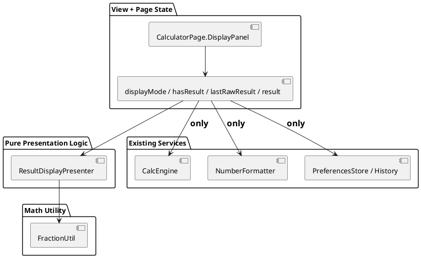
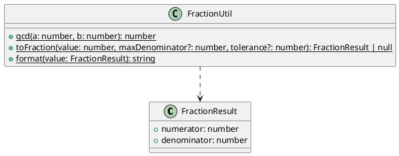
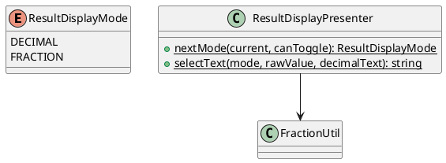
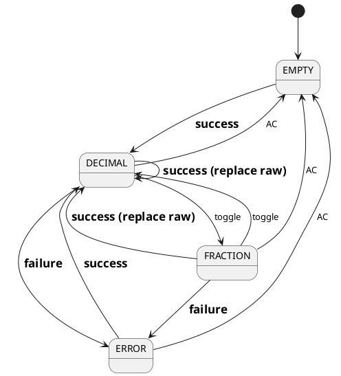

# 计算结果小数/分数切换增量设计

> 关联 Issue：#44（历史 #27）  
> 文档类型：delta-design  
> 设计基线：当前分支 `agent/issue-44-task-21`  
> 本文仅指导后续实现，不包含源代码变更。

## 1. 概述

### 1.1 应用定位
OpenCalc 是单 entry HAP 的 HarmonyOS 科学计算器。本增量为学生用户增加当前计算结果的小数/最简分数双向展示，并修复历史 #27 方案无法识别 `1/3` 的算法缺陷。

### 1.2 核心交互
1. 用户输入算式并点击 `=`；页面只求值一次，保存 raw number 和现有小数快照。
2. 成功结果区域出现紧凑的“小数/分数”切换入口。
3. 切到分数时，以 raw number 生成可靠最简分数；失败则继续显示小数快照。
4. 切回小数时恢复原快照；表达式和历史集合全程不变。

### 1.3 技术栈概览
- ArkTS、Stage 模型、ArkUI 声明式 UI
- 状态管理：V1 `@State`
- 模块：entry HAP；无 HAR/HSP/Native
- 既有 Kit：ArkUI、BasicServicesKit、AbilityKit、ArkData；本变更不新增 Kit
- 测试：`@ohos/hypium` 本地单元测试；关键 UI 交互在后续阶段用现有 HarmonyOS UI 测试能力验证

## 2. 功能清单
| 功能名 | 说明 | 入口 Ability/Page | 优先级 |
|--------|------|-------------------|--------|
| 可靠分数转换 | 有界连分数、误差门禁、GCD、格式化 | entry / pure common | P0 |
| 当前结果切换 | 同一 raw result 在两种文本间切换 | `CalculatorPage` | P0 |
| 安全降级 | 不可靠候选回退现有小数 | `CalculatorPage` | P0 |
| 状态一致性 | 切换不求值、不写历史 | `CalculatorPage` | P0 |
| 自动化测试 | 数学契约、状态选择、UI 交互 | `entry/src/test` / 后续 UI tests | P0 |

## 3. 实现模型

### 3.1 上下文视图
```plantuml
@startuml
actor "学生用户" as User
package "OpenCalc entry HAP" {
  [CalculatorPage] as Page
  [ResultDisplayPresenter] as Presenter
  [FractionUtil] as Fraction
  [NumberFormatter] as Decimal
  [CalcEngine] as Engine
  [HistoryItem[]] as History
}
User --> Page : 输入 / = / 切换
Page --> Engine : evaluate（仅 = 路径）
Engine --> Page : raw number
Page --> Decimal : 生成小数快照
Page --> Presenter : mode + raw + decimalText
Presenter --> Fraction : FRACTION 时转换
Presenter --> Page : visibleText
Page --> History : = 成功时写入一次
@enduml
```

### 3.2 总体架构


依赖方向保持 `View → pure presenter → math utility`，不反向依赖 UI 或系统 Kit。

### 3.3 HAP/HAR/HSP 模块划分
无变化。所有新增文件位于既有 entry HAP；不创建共享包或动态模块。

### 3.4 设计系统规格

#### 3.4.1 色彩系统
沿用 `CalculatorPage.getT1/getT2/getOp`。当前模式或可操作入口使用强调色，非活动说明文字用次要色。

#### 3.4.2 主题系统
随既有 `themeIdx` 自动取色；不新增主题资源。

#### 3.4.3 排版系统
结果文本保持既有竖屏 36fp、横屏 28fp；切换入口建议 11–12fp，不压缩结果可读区。

#### 3.4.4 间距与尺寸系统
入口触控目标至少 32vp；与结果右边距 12vp 对齐。结果文本为入口预留横向安全间距，避免覆盖末位数字。

#### 3.4.5 图标与图形资源
使用文本标识 `小数` / `分数` 或 `0.5` / `1/2`，不新增图片资源。可访问文本必须明确当前模式与可执行动作。

#### 3.4.6 动画规格
无需显式动画；切换由同步状态更新触发单次重绘。

#### 3.4.7 响应式断点与栅格
不新增断点。竖/横屏均在结果区域提供入口；横屏可使用更短标签，但不得完全隐藏本需求入口。

### 3.5 FractionUtil 模块实现设计

#### 3.5.1 模块介绍
新增 `entry/src/main/ets/common/FractionUtil.ets`，为无 Kit 依赖的纯数学工具。

#### 3.5.2 功能描述
- `gcd`：规范化整数并计算最大公约数。
- `toFraction`：对有限浮点值做有界连分数逼近，并以误差门禁验收。
- `format`：输出整数或 `a/b`，分母恒正。

#### 3.5.3 目录结构
```
entry/src/main/ets/common/
├── FractionUtil.ets              # 新增：数学转换
└── ResultDisplayPresenter.ets    # 新增：模式与展示纯逻辑
```

#### 3.5.4 架构图谱


#### 3.5.5 功能与用例分析
```
用例：1 / 3
前置：value = 0.3333333333333333
步骤：连分数项得到候选 1/3；分母 3 <= 10000；误差约 0，验收通过
后置：{numerator: 1, denominator: 3}

用例：Math.PI
前置：value ≈ 3.141592653589793
步骤：最大分母内可得近似候选，但误差大于 1e-12 相对/绝对门禁
后置：null，页面显示原小数
```

#### 3.5.6 接口设计
```ts
export interface FractionResult {
  numerator: number
  denominator: number
}

export class FractionUtil {
  static gcd(a: number, b: number): number
  static toFraction(
    value: number,
    maxDenominator: number = 10000,
    tolerance: number = 1e-12
  ): FractionResult | null
  static format(value: FractionResult): string
}
```

#### 3.5.7 状态管理设计
无状态、无缓存、无副作用。

#### 3.5.8 核心算法
使用连分数收敛项，维护前两组分子/分母：
```
if value 非有限 or maxDenominator < 1: return null
sign = value < 0 ? -1 : 1
x = abs(value)
if x 为安全整数: return { sign*x, 1 }

h[-2]=0, h[-1]=1, k[-2]=1, k[-1]=0
for i in 0..<32:
  a = floor(x)
  h = a*h[-1] + h[-2]
  k = a*k[-1] + k[-2]
  if h/k 非安全整数 or k > maxDenominator: break
  best = h/k
  if fractionalPart(x) 接近 0: break
  x = 1 / fractionalPart(x)

if 无 best: return null
normalize best with gcd and sign
allowed = max(tolerance, abs(value)*tolerance)
if abs(numerator/denominator - value) > allowed: return null
return normalized best
```
复杂度为 O(迭代上限 × GCD)，迭代上限固定 32。若越过最大分母，可计算边界半收敛项以获得分母约束内的最佳候选，但仍必须通过误差门禁。

#### 3.5.9 错误处理
- `NaN`/±Infinity、非法参数、安全整数溢出、无合法候选：返回 `null`。
- `0`/`-0`：返回 `0/1`，格式为 `0`。
- 负数：符号只保留在 numerator。
- 禁止用 `denominator=0` 表示失败。

#### 3.5.10 依赖关系
无内部或外部依赖。

### 3.6 ResultDisplayPresenter 模块实现设计

#### 3.6.1 模块介绍
新增纯展示选择模块，使关键交互规则可脱离 ArkUI 自动化验证。

#### 3.6.2 功能描述
- 定义 `ResultDisplayMode.DECIMAL/FRACTION`。
- `nextMode` 仅在有成功结果且无错误时翻转模式。
- `selectText` 根据模式调用 `FractionUtil`，失败返回 `decimalText`。

#### 3.6.3 目录结构
见 §3.5.3。

#### 3.6.4 架构图谱


#### 3.6.5 功能与用例分析
`nextMode(DECIMAL, true)` 返回 `FRACTION`；`nextMode(FRACTION, true)` 返回 `DECIMAL`；`canToggle=false` 时返回原模式。`selectText` 不修改任何输入。

#### 3.6.6 接口设计
```ts
export enum ResultDisplayMode {
  DECIMAL = 0,
  FRACTION = 1
}

export class ResultDisplayPresenter {
  static nextMode(current: ResultDisplayMode, canToggle: boolean): ResultDisplayMode
  static selectText(
    mode: ResultDisplayMode,
    rawValue: number,
    decimalText: string
  ): string
}
```

#### 3.6.7 状态管理设计
无状态；页面负责 `@State displayMode`。

#### 3.6.8 核心算法
条件选择，O(1) 加一次受限分数转换。

#### 3.6.9 错误处理
`decimalText` 是唯一降级值；工具异常不得传播，可由 `selectText` 防御性捕获并返回小数。

#### 3.6.10 依赖关系
仅依赖 `FractionUtil`。

### 3.7 CalculatorPage 模块实现设计

#### 3.7.1 模块介绍
修改既有 `pages/CalculatorPage.ets`，不新增页面或导航。

#### 3.7.2 功能描述
保存成功结果的 raw number，维护显示模式，显示派生文本，并确保切换路径无历史副作用。

#### 3.7.3 目录结构
原路径不变。

#### 3.7.4 架构图谱


#### 3.7.5 功能与用例分析
- 新计算成功后默认回到小数，避免把用户未检查的新值直接展示为近似分数。
- 当前模式为分数时，结果文本由 presenter 派生，不覆盖 `result` 小数快照。
- 历史依旧在 `onEquals` 成功分支写入 `fmt`，切换函数不接触历史。

#### 3.7.6 接口设计
页面新增/调整的内部成员：
```ts
@State displayMode: ResultDisplayMode = ResultDisplayMode.DECIMAL
@State hasResult: boolean = false
private lastRawResult: number = 0

private visibleResult(): string
onToggleResultDisplay(): void
```
`lastRawResult` 不必为 `@State`，因为模式或 `result` 的更新已触发渲染；如 ArkUI 编译约束要求可将其声明为 `@State`，但不得持久化。

#### 3.7.7 状态管理设计
| 状态 | 类型 | 写入点 | 清理点 |
|------|------|--------|--------|
| `result` | 既有 `@State string` | 成功求值的小数快照 | AC/错误 |
| `displayMode` | 新增 `@State enum` | 成功求值重置、切换 | AC 重置 |
| `hasResult` | 新增 `@State boolean` | 成功求值 true | AC/错误 false |
| `lastRawResult` | 新增 private number | 成功求值 | AC/错误置 0 |
| `history` | 既有 `@State HistoryItem[]` | 仅成功等号/删除/加载 | 切换不写 |

#### 3.7.8 核心算法
`visibleResult()` 调 `ResultDisplayPresenter.selectText(displayMode, lastRawResult, result)`；空态仍沿用 `0`。`onToggleResultDisplay()` 只更新 `displayMode = nextMode(displayMode, hasResult && errorMsg.length===0)`。

#### 3.7.9 错误处理
- 所有错误分支同步 `hasResult=false`、`lastRawResult=0`、`displayMode=DECIMAL`。
- `onAC` 做同样清理；历史不清除（保持既有行为）。
- 无结果/错误时入口隐藏或 disabled，事件处理仍有防御检查。
- `onCopy` 复制 `visibleResult()`，确保所见即所得；不改变 `result` 或历史。

#### 3.7.10 依赖关系
新增导入 `ResultDisplayMode`、`ResultDisplayPresenter`；不修改 Preferences 或 CalcEngine 契约。

### 3.8 测试模块实现设计

#### 3.8.1 测试文件规划
```
entry/src/test/
├── List.test.ets                         # 修改：注册新套件
├── FractionUtil.test.ets                 # 新增
└── ResultDisplayPresenter.test.ets       # 新增
```
后续 UI 自动化证据建议放变更目录 `ui-tests/`，不在 PLANNING 创建。

#### 3.8.2 核心测试矩阵
| 类别 | 用例 |
|------|------|
| 精确有限小数 | `0.5→1/2`、`0.25→1/4` |
| 循环小数近似 | `(1/3)→1/3`、`(2/3)→2/3` |
| 约分/格式 | `2÷4 raw 0.5→1/2`、`-0.5→-1/2`、`2→2`、`0→0` |
| 浮点噪声 | `0.1+0.2→3/10` |
| 降级 | NaN、Infinity、π、超安全范围、无门禁候选 |
| 模式 | 双向翻转、canToggle=false 不变、null 回退 decimalText |
| 交互 | 计算后切换不改变表达式与历史条目数量/内容；AC 后不可切换 |

## 4. 接口设计

### 4.1 内部数据访问 API
无新增数据访问接口；History/Preferences API 不变。

### 4.2 业务抽象接口
`FractionUtil` 和 `ResultDisplayPresenter` 的静态纯函数接口见 §3.5.6、§3.6.6。

### 4.3 后台任务与 ExtensionAbility 接口
无相关实现。

### 4.4 Want / Action 协议
无相关实现。

### 4.5 URI / Deep Link / AppLinking 协议
无相关实现。

### 4.6 IPC 与 RPC 接口
无相关实现。

### 4.7 Native（C/C++）接口
无相关实现。

### 4.8 文件交换接口
无相关实现。

## 5. 数据模型

### 5.1 关系型数据库模型
无相关实现。

### 5.2 领域模型
| 字段名 | 类型 | 必填 | 说明 |
|--------|------|------|------|
| `FractionResult.numerator` | number | 是 | 安全整数，包含符号 |
| `FractionResult.denominator` | number | 是 | 安全正整数 |
| `ResultDisplayMode` | enum | 是 | 页面会话内模式，不持久化 |

`HistoryItem` 不变。

### 5.3 Preferences 结构
无变化；不新增显示模式 key。

### 5.4 分布式数据对象模型
无相关实现。

### 5.5 文件格式 Schema
无相关实现。

## 6. UI设计系统

### 6.1 色彩系统
见 §3.4.1。

### 6.2 主题与暗色模式
见 §3.4.2。

### 6.3 排版系统
见 §3.4.3。

### 6.4 间距与尺寸规范
见 §3.4.4。

### 6.5 图标与图形资源
见 §3.4.5。

### 6.6 动画规格
见 §3.4.6。

### 6.7 一多响应式规范
手机竖屏和横屏均必须可切换；不新增平板/折叠屏专属布局，使用现有自适应逻辑。

## 7. 页面清单与导航

### 7.1 页面清单总表
| 页面名 | 路径 | 入口 Ability | 传参 | 功能摘要 |
|--------|------|-------------|------|----------|
| CalculatorPage | `entry/src/main/ets/pages/CalculatorPage.ets` | EntryAbility | 无 | 当前结果增加小数/分数切换 |

### 7.2 全局导航图
无变化，仍为单页/覆盖面板结构。

### 7.3 Deep Link / AppLinking 处理
无相关实现。

### 7.4 Want 跳转矩阵
无相关实现。

## 8. 用户交互规格

### 8.1 手势交互目录
| 入口 | 事件 | 条件 | 结果 |
|------|------|------|------|
| 结果模式入口 | `onClick` | `hasResult && errorMsg.length===0` | DECIMAL/FRACTION 翻转 |
| 结果区域长按 | 既有 LongPress | 有结果 | 复制当前可见文本 |

### 8.2 弹窗/Sheet/Menu 目录
无新增。

### 8.3 剪贴板与反馈行为
复制当前可见文本；不新增 Toast 文案，沿用“已复制”。模式切换无需 Toast。

### 8.4 卡片交互
无相关实现。

## 9. 平台集成

### 9.1 构建配置与依赖
无变化；不增加 OHPM 依赖或 Hvigor 配置。

### 9.2 权限与运行时请求
无新增权限。

### 9.3 系统能力（Kits）清单
无新增 Kit。

### 9.4 后台与 Extension
无相关实现。

### 9.5 备份与恢复
无相关实现。

### 9.6 分布式与跨端
无相关实现。

## 10. 偏好设置目录

### 10.1 结果显示模式
不持久化。每次页面会话默认 `DECIMAL`；这避免扩大 `CalculatorPreferences` schema 和启动兼容范围。若未来产品要求跨启动记忆，应作为独立需求增加 Preferences key 与迁移/兼容测试。

## 11. 追溯与自验证
| Spec | 设计位置 | 测试位置 |
|------|---------|---------|
| SR-00 | §3.5 | §3.8 FractionUtil tests |
| SR-01 | §3.6–3.7、§8 | Presenter tests + 后续 UI tests |
| SR-02 | §3.8 | `entry/src/test/List.test.ets` 注册与后续 UI 证据 |

自验证结论：
- 功能一致：全部 Issue AC 均有组件与测试设计。
- 页面一致：只修改 `CalculatorPage`，不新增导航。
- 数据一致：History schema 和 Preferences 不变。
- 权限/Kit 一致：无新增。
- 关键差异已显式处理：历史 #27 的 `1/3 -> null` 行为被有界连分数替代。

---
> 本文档由 mod-design skill 生成。  
> 标记 `[推断]` 的内容为基于设计推断，非确定性事实；本文无未决 `[推断]`。  
> 生成时间：2026-10-23
