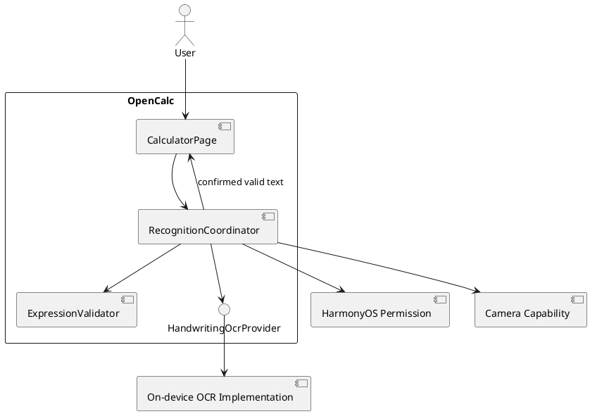
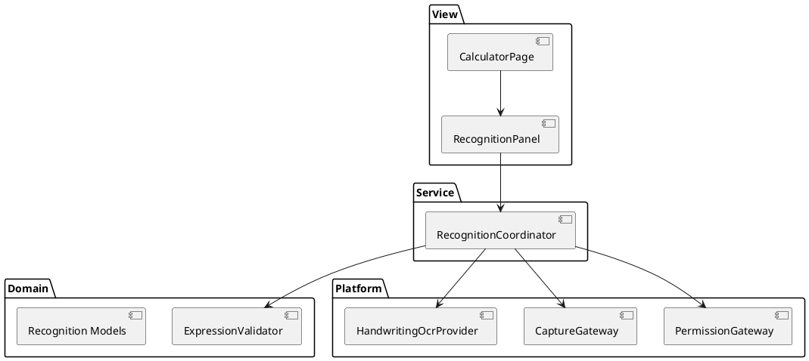
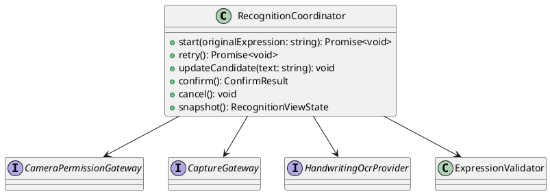
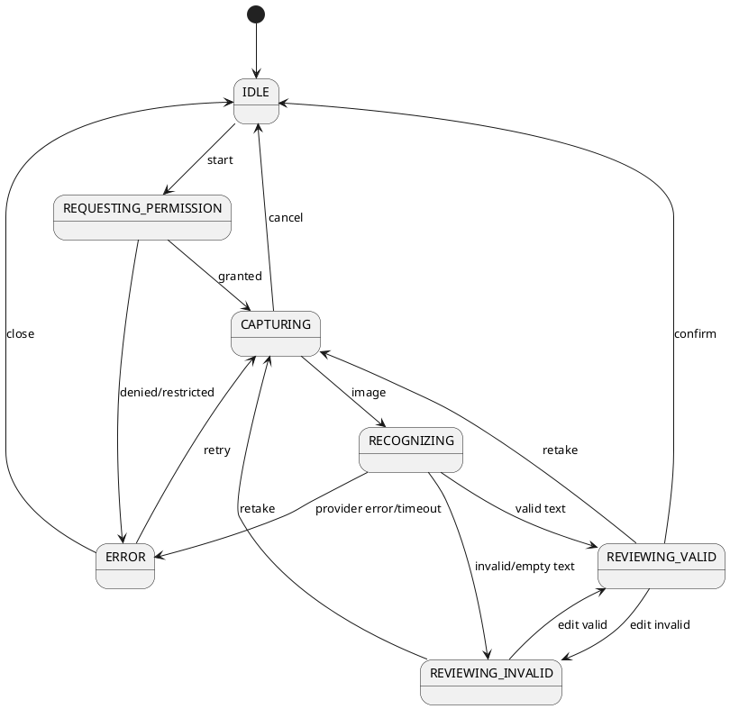
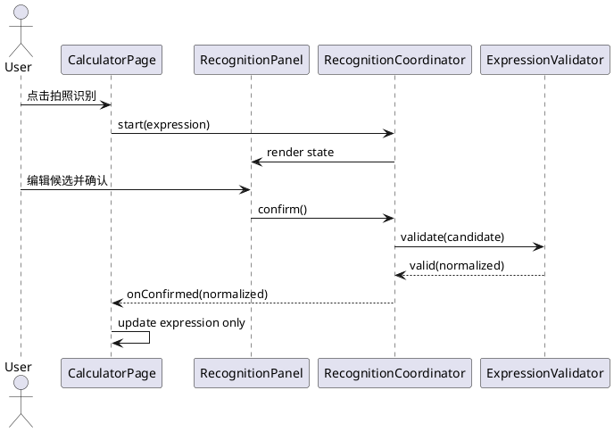
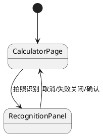

# 拍照识别手写算式 - 增量设计

> 本文由 mod-design 结构要求生成，并在 PR #48 head `19f7c3d146dc30574738dd2187dd99ec6877610d` 上按现有实现复核。普通产品歧义已按 Issue 授权选择安全、可逆的首期默认值；端侧 API 已由 API 12 编译探针验证。

## 1. 概述

### 1.1 应用定位

在 OpenCalc 现有手工输入之外增加一次性拍照 OCR 输入通道。识别结果始终经过人工确认和严格验证，确认动作只更新表达式，不触发计算。

### 1.2 核心交互

用户点击拍照识别 → 权限检查/申请 → 拍照 → 端侧离线识别 → 查看/编辑 → 验证通过 → 显式确认 → 替换当前表达式 → 用户自行点击等号。

### 1.3 技术栈概览

- 框架：ArkTS、Stage 模型、ArkUI 声明式 UI。
- 状态管理：保持现有 V1（`@State`），复杂状态放入普通 ArkTS coordinator，页面保存可渲染快照。
- 模块：单 entry HAP，不新增 HAP/HAR/HSP。
- Kit：AbilityKit（上下文/权限）、CameraKit `cameraPicker`、CoreVisionKit `textRecognition`、ImageKit `ImageSource/PixelMap`；最低 API 12，不允许云端回退。
- Native：无相关实现。

## 2. 功能清单

| 功能名 | 说明 | 入口 Ability/Page | 优先级 |
|--------|------|-------------------|--------|
| 拍照识别入口 | 从计算器启动识别会话 | EntryAbility/CalculatorPage | P0 |
| 权限与拍照 | 申请 CAMERA 并取得单张图片 | CalculatorPage/RecognitionPanel | P0 |
| OCR 编排 | 调用所选 provider 并收敛结果 | RecognitionCoordinator | P0 |
| 结果编辑确认 | 展示、修改、重拍、取消、确认 | RecognitionPanel | P0 |
| 安全表达式验证 | 归一化、白名单、严格语法 | ExpressionValidator | P0 |
| 原值保护与竞态隔离 | 单一 commit 点、session id | RecognitionCoordinator | P0 |

## 3. 实现模型

### 3.1 上下文视图



### 3.2 总体架构



数据流只允许 `image → provider → rawText → validator → editableCandidate → explicitConfirm → CalculatorPage.expression`。不存在 `rawText → CalcEngine` 路径。

### 3.3 HAP/HAR/HSP 模块划分

- 保持单 `entry` HAP；`installationFree=false`。
- 新逻辑位于 entry 内 `recognition/` 目录，便于当前小型项目集成。
- OCR 依赖已限于 API 12 系统 Kit，未增加 Native 库、网络、账号、凭据或付费服务；任何后续依赖扩展必须重新规划，不得静默扩展为云服务。

### 3.4 设计系统规格

#### 3.4.1 色彩系统

复用 `CalculatorPage.getBg/getPanelBg/getT1/getT2/getOp/getErr`，不新增硬编码主题体系。

#### 3.4.2 主题系统

跟随 `themeIdx` 的浅色、暗色、AMOLED 三主题。

#### 3.4.3 排版系统

| 名称 | 字号 | 用途 |
|------|------|------|
| 标题 | 18vp | 面板标题 |
| 候选输入 | 18vp | 可编辑表达式 |
| 正文 | 14vp | 权限/错误/帮助文本 |
| 辅助 | 12vp | 状态说明 |

#### 3.4.4 间距与尺寸系统

复用现有面板 16vp 外边距、按钮 40vp 高度；相机画面/系统拍照 UI 的尺寸由最终方案决定。

#### 3.4.5 图标与图形资源

拍照入口需可访问文本标签或 accessibilityText；具体图标资源待 UI 实现阶段在既有风格内选定，不影响产品语义。

#### 3.4.6 动画规格

不要求自定义动画；处理中仅展示确定性状态。减少动画偏好需遵循系统设置。

#### 3.4.7 响应式断点与栅格

phone/tablet、横竖屏均可退出识别会话；竖屏可复用全屏覆盖层，横屏不得遮断关闭/重拍/确认动作。

### 3.5 识别领域模块实现设计

#### 3.5.1 模块介绍

在 entry 内新增纯 ArkTS 模型、验证器和协调器；平台 API 只出现在 adapter。

#### 3.5.2 功能描述

维护会话状态、保存原值、调度权限/拍照/OCR、验证候选、处理取消/重试/确认及迟到回调。

#### 3.5.3 目录结构

```text
entry/src/main/ets/recognition/
├── model/RecognitionModels.ets
├── service/RecognitionCoordinator.ets
├── service/ExpressionValidator.ets
├── platform/CameraPermissionGateway.ets
├── platform/CaptureGateway.ets
├── platform/HandwritingOcrProvider.ets
└── view/RecognitionPanel.ets
```

现有 PR 已按此目录拆分；后续维护不得把职责边界回收到 `CalculatorPage` 单一大文件。

#### 3.5.4 架构图谱





#### 3.5.5 功能与用例分析

- SC001：权限返回值必须先转为领域状态，非 granted 不启动 capture。
- SC002：raw text 先验证，UI 只展示候选和原因；confirm 再验证一次。
- SC003：provider 错误/空值均进入可恢复状态。
- SC005：所有 async continuation 检查 `sessionId === activeSessionId`。

#### 3.5.6 接口设计

| 接口 | 签名草案 | 说明 |
|------|----------|------|
| CameraPermissionGateway | `getStatus(): Promise<CameraPermissionState>` | 不泄漏平台错误码 |
|  | `request(): Promise<CameraPermissionState>` | 明确 denied/permanentlyDenied |
| CaptureGateway | `capture(sessionId: number): Promise<CaptureResult>` | 成功/取消/错误联合类型 |
| HandwritingOcrProvider | `recognize(image: RecognitionImage, sessionId: number): Promise<OcrResult>` | 端侧离线；协调器施加 5 s 超时 |
| ExpressionValidator | `validate(raw: string, policy: ExpressionPolicy): ValidationResult` | 纯函数式、无副作用 |

#### 3.5.7 状态管理设计

`RecognitionCoordinator` 持有普通 ArkTS 状态；UI 使用单个 `@State recognitionState` 快照渲染。不要让多个布尔值组合出不可达状态。`expression` 仍由 CalculatorPage 所有。

#### 3.5.8 核心算法

验证流程为 O(n)：输入长度 → Unicode/空白归一化 → 运算符确定性映射 → 字符白名单 → token 化 → 括号栈 → 语法状态机。不得把 `Expression.addParenthesis` 的自动补全当作合法性证明。

固定 grammar：十进制数字、`.`、二元 `+ - * /`、圆括号；忽略空白，映射 `×/x/X→*`、`÷→/`、Unicode 减号→`-`。不允许隐式乘法、函数、常量、变量、多行及超过 128 code unit 的候选。`x/X` 在首期始终按乘号处理，因为变量不在本功能范围。

#### 3.5.9 错误处理

| 错误 | 用户行为 | 原输入 |
|------|----------|--------|
| PermissionDenied | 关闭/重试 | 不变 |
| PermissionPermanentlyDenied | 设置引导/关闭 | 不变 |
| CaptureCancelled | 返回计算器 | 不变 |
| OcrEmpty/OcrFailed/OcrTimeout | 重拍/关闭 | 不变 |
| UnsupportedCharacter/InvalidSyntax | 编辑/重拍 | 不变 |

日志只记录错误枚举、耗时和 session id 的非敏感形式，不记录照片和完整表达式。

质量采集仅用于 Tester 门禁：固定 100 图清晰单行数据集（至少 5 名书写者）计算规范化表达式完全匹配率，目标 ≥90%；在记录设备型号/系统版本的参考支持设备上统计“拍照确认→候选展示”耗时，P95 ≤2 s。单次 5 s 未完成由协调器转为 `RecognitionError.TIMEOUT`，允许重拍；断网条件必须完整通过同一流程。设备/数据集不可用不阻塞 Developer 交付，但不豁免最终验收。

#### 3.5.10 依赖关系

内部依赖现有 CalculatorPage 主题与 expression 提交回调；外部端侧 Kit 已通过 API 12 编译探针，禁止网络/账号/密钥依赖。

### 3.6 CalculatorPage 集成设计

#### 3.6.1 模块介绍

CalculatorPage 保持计算器表达式的唯一 UI 所有者，只新增入口、面板状态和有效确认回调。

#### 3.6.2 功能描述

- `onOpenRecognition()` 建立会话但不改变 expression。
- `onRecognitionConfirmed(validatedText)` 以规范化文本替换 `expression`，清除适当错误展示但不计算；预览确认就是唯一提交点。
- 关闭/失败/重拍不接触 expression。

#### 3.6.3 目录结构

页面位置不变：`entry/src/main/ets/pages/CalculatorPage.ets`；识别 UI 尽量放入独立 view 组件。

#### 3.6.4 架构图谱



#### 3.6.5 功能与用例分析

见 delta-spec SC002-UC001 与 SC003-UC001。

#### 3.6.6 接口设计

`onConfirmed(validatedExpression: string): void` 的参数必须来源于 validator 的成功结果类型，避免用裸字符串绕过验证。

#### 3.6.7 状态管理设计

页面只持有面板可见性/视图快照；协调器生命周期随面板创建/销毁。

#### 3.6.8 核心算法

无相关复杂算法。

#### 3.6.9 错误处理

页面不得 catch 后把 raw candidate 写入 expression；所有异常均回到领域错误态。

#### 3.6.10 依赖关系

不修改 `CalcEngine`、`ErrorFlags`、`PreferencesStore`、`FunctionPlotter` 或 `PlotAxis`。

## 4. 接口设计

### 4.1 内部数据访问 API

无相关实现；不持久化照片或 OCR 候选。

### 4.2 业务抽象接口

采用 §3.5.6 的四个接口；所有 Promise 返回联合结果，预期错误不靠 throw 表达。

### 4.3 后台任务与 ExtensionAbility 接口

无相关实现；识别仅在前台会话运行。

### 4.4 Want / Action 协议

永久拒绝时展示可理解说明与“打开设置”动作；具体 Want/action 在实现时按 API 12 SDK 类型定义编译核验，失败仍可关闭面板并继续手工输入。

### 4.5 URI / Deep Link / AppLinking 协议

无相关实现。

### 4.6 IPC 与 RPC 接口

无相关实现；首期无云端、网络、IPC 或 RPC。

### 4.7 Native（C/C++）接口

无相关实现；若端侧 SDK 强制 Native 依赖，需重新设计审视。

### 4.8 文件交换接口

图片只作为 `cameraPicker` 返回的临时 URI 和 ImageKit `PixelMap` 传递，不对外导出文件；provider 在 `finally` 释放 `PixelMap` 与 `ImageSource`。

## 5. 数据模型

### 5.1 关系型数据库模型

无相关实现。

### 5.2 领域模型

| 字段名 | 类型 | 必填 | 说明 |
|--------|------|------|------|
| sessionId | number | 是 | 单调递增会话身份 |
| state | RecognitionState | 是 | 单一状态枚举 |
| originalExpression | string | 是 | 进入会话时快照 |
| candidate | string | 否 | 当前可编辑候选 |
| validation | ValidationResult | 否 | valid 或错误枚举/位置 |
| error | RecognitionError | 否 | 权限/拍照/OCR 领域错误 |
| startedAt | number | 是 | 性能度量起点，不持久化 |

### 5.3 Preferences 结构

无新增 key。不得持久化相机权限判断、照片或候选。

### 5.4 分布式数据对象模型

无相关实现。

### 5.5 文件格式 Schema

无对外文件格式；临时图片表示为系统 picker URI，并在端侧转换为 `PixelMap`。

## 6. UI 设计系统

### 6.1 色彩系统

见 §3.4.1。

### 6.2 主题与暗色模式

三主题复用现有颜色函数；错误色 `getErr`，主动作 `getOp`，取消/辅助 `getBtnBg/getT2`。

### 6.3 排版系统

见 §3.4.3。

### 6.4 间距与尺寸规范

关键动作触控区域不得小于平台可访问性基线；具体值在实现前按目标 SDK 官方规范核验。

### 6.5 图标与图形资源

拍照图标必须有文字/无障碍描述；不得只靠图形表达权限错误。

### 6.6 动画规格

无强制动画。

### 6.7 一多响应式规范

phone/tablet、横竖屏适配；相机交互若由系统 UI 承担，以系统适配为准。面板动作在最小支持尺寸可见且可滚动。

## 7. 页面清单与导航

### 7.1 页面清单总表

| 页面名 | 路径 | 入口 Ability | 传参 | 功能摘要 |
|--------|------|-------------|------|----------|
| CalculatorPage | pages/CalculatorPage | EntryAbility | 无 | 现有计算器 + 拍照入口 |
| RecognitionPanel | CalculatorPage 内组件/覆盖层 | 同上 | view state/callback | 识别流程与确认 |

采用 CameraKit `cameraPicker.pick` 单次拍照能力，最小化自建相机预览范围；RecognitionPanel 契约不依赖 picker 细节。

### 7.2 全局导航图



### 7.3 Deep Link / AppLinking 处理

无相关实现。

### 7.4 Want 跳转矩阵

仅永久拒绝后的系统设置引导可能需要 Want，标识与兼容性待平台核验。

## 8. 用户交互规格

### 8.1 手势交互目录

| 交互 | 行为 |
|------|------|
| 点击拍照识别 | 开始会话/权限流程 |
| 点击拍摄/系统确认 | 提交当前图片 |
| 编辑候选 | 实时严格校验 |
| 点击重拍 | 保留 originalExpression，丢弃当前候选 |
| 点击确认 | 二次校验后替换当前 expression，不求值 |
| 返回/关闭 | 取消会话并释放资源 |

### 8.2 弹窗/Sheet/Menu 目录

- 权限说明/永久拒绝设置引导：AlertDialog 或面板内说明，具体按平台权限规范核验。
- 识别确认：建议全屏覆盖层以容纳图片/候选/错误；若最终采用系统拍照 UI，返回后进入覆盖层。

### 8.3 剪贴板与反馈行为

不读写剪贴板。短错误可 toast，但必须在面板保留可恢复动作，不能只显示瞬时提示。

### 8.4 卡片交互

无相关实现。

## 9. 平台集成

### 9.1 构建配置与依赖

| 项目 | 当前 | 变更 |
|------|------|------|
| module.json5 | VIBRATE | 增加 CAMERA user_grant 声明及资源化 reason/usedScene |
| oh-package.json5 | 无运行时依赖 | 优先不增加；仅端侧组件确有需要时添加固定版本并完成许可证/包体复核 |
| build-profile.json5 | API 12 | 保持；所选能力必须兼容或提出基线变更请求 |

### 9.2 权限与运行时请求

| 权限 | 类型 | reason | usedScene | 降级行为 |
|------|------|--------|-----------|----------|
| ohos.permission.CAMERA | user_grant | “用于拍摄纸面算式并识别”资源文案 | EntryAbility/前台 when in use（准确配置待 API 12 核验） | 保留手工输入；拒绝提示；永久拒绝设置引导 |

### 9.3 系统能力（Kits）清单

| Kit | 关键 API | 用途 |
|-----|----------|------|
| AbilityKit/Access control | API 12，已编译 | 权限状态与申请 |
| CameraKit `cameraPicker` | API 12，已编译 | 单次拍照 |
| CoreVisionKit `textRecognition` + ImageKit | API 12，已编译 | 离线文字识别与图片解码 |

### 9.4 后台与 Extension

无相关实现。

### 9.5 备份与恢复

不备份照片、会话和候选。

### 9.6 分布式与跨端

无相关实现。

## 10. 偏好设置目录

无新增偏好。若未来允许用户选择 OCR 路线，必须另立需求，不在本轮隐藏新增设置。

## 11. 可追溯性与自验证

| 需求 | 设计位置 | 状态 |
|------|----------|------|
| R1 权限与拍照 | §3.5、§9.2 | 设计完成；平台 API 由实现编译核验 |
| R2 OCR | §3.5.6、§9.3 | 端侧离线 provider、5 s 超时 |
| R3 编辑确认 | §3.6、§8 | 确认后替换，不追加、不求值 |
| R4 安全解析 | §3.5.8、§4.2 | 基础四则 grammar、最长 128 |
| R5 原值保护 | §3.5.7/9 | 完成 |
| R6 质量目标 | §3.5.9、§9 | 100 图集 ≥90%、P95 ≤2 s、离线可用 |

### 11.1 阶段门禁自验证

| 门禁 | 责任 | 结论 |
|------|------|------|
| API 12 build、Local Test、lint、可用模拟器恢复路径 | Developer | 上游 evidence 已完成，精确 head 可移交 Tester |
| 真实相机/OCR、固定数据集准确率、P95、飞行模式、持久文件扫描 | Tester | 下游风险；缺失不要求本轮改产品代码 |

---

> 本文档由 mod-design skill 生成。
> 标记为“编译核验”的平台符号属于实现期技术验证，不改变本文已定产品边界；任何云端、凭据、付费或隐私扩张必须另行获得授权。
> 生成时间：2026-10-23
