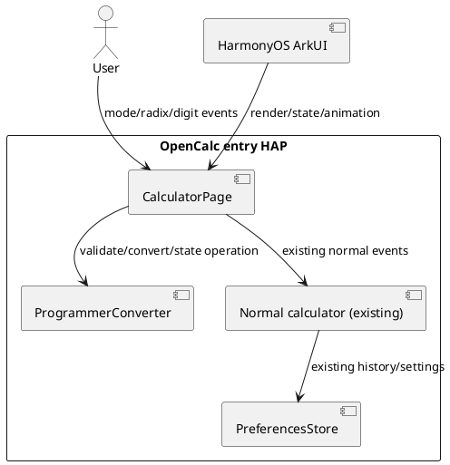
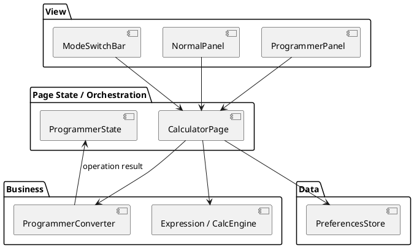
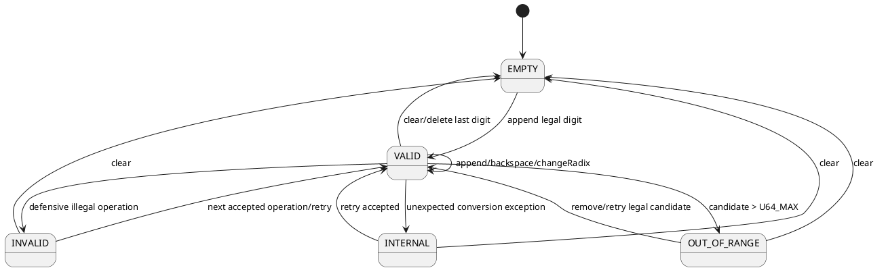
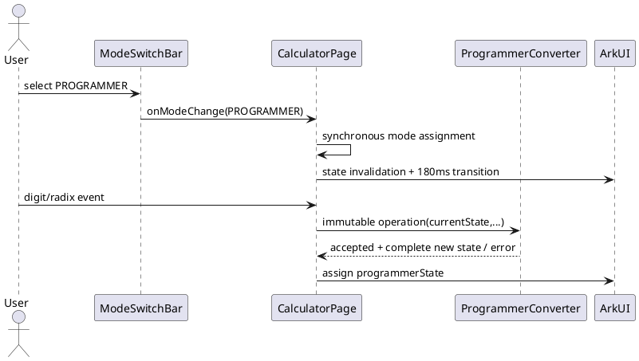
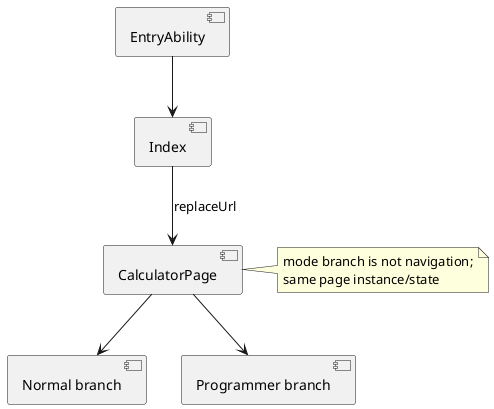

# 程序员模式与四进制转换增量设计

## 1. 概述

### 1.1 应用定位
本设计在 OpenCalc 单 entry HAP 中新增独立程序员模式，为程序员和计算机学习用户提供 U64 范围内 BIN/OCT/DEC/HEX 精确转换。设计只扩展页面内业务和呈现，不改变普通/科学计算、函数绘图、历史持久化或权限模型。【IR-45-R1~R5】

### 1.2 核心交互
```text
选择“程序员” → 默认 DEC 空态/恢复草稿 → 选择输入进制 → 按受限键盘输入
→ 每次合法变化同步显示四进制 → 可退格/清空/换进制 → 选择“普通”恢复原计算上下文
```

### 1.3 技术栈概览
- 框架：ArkTS、Stage 模型、ArkUI 声明式 UI，HarmonyOS API 12。
- 状态管理：V1 `@State`；所有程序员操作返回新对象并整体赋值，避免嵌套对象变更不可观察。
- 系统 Kit：沿用 `@kit.ArkUI`、`@kit.AbilityKit`、`@kit.ArkData`；本功能不新增 Kit。
- 精确整数：内部优先使用 ArkTS `bigint`；若实施编译验证失败，替换为精确字符串进制算法，外部接口不变。[推断]
- Native/HAR/HSP/OHPM：无新增。

## 2. 功能清单
| 功能名 | 说明 | 入口 Ability/Page | 优先级 | 追溯 |
|--------|------|-------------------|--------|------|
| 应用模式切换 | 普通/程序员双向切换，隔离状态和 180ms 过渡 | EntryAbility / CalculatorPage | P0 | SR-03/04/05 |
| 输入进制选择 | BIN/OCT/DEC/HEX，换进制保持数值 | CalculatorPage | P0 | SR-02 |
| 受限数字键盘 | 按进制启停 `0-9/A-F`，退格与 AC | CalculatorPage | P0 | SR-02/05 |
| 四进制同步结果 | 每次有效输入输出四行规范字符串 | CalculatorPage | P0 | SR-01 |
| 空/非法/越界反馈 | 中性空态、结构化错误、可恢复 | CalculatorPage | P0 | SR-01/02/05 |
| 普通功能回归 | 保持表达式、结果、历史、主题、绘图 | CalculatorPage | P0 | SR-04 |

## 3. 实现模型

### 3.1 上下文视图


### 3.2 总体架构


单向数据流：事件 → 纯业务操作 → 完整新状态/错误 → `@State` 整体赋值 → ArkUI 重绘。普通链路保持现状。

### 3.3 HAP/HAR/HSP 模块划分
| 模块 | 类型 | 变更 | 说明 |
|------|------|------|------|
| `entry` | HAP | 内部增量 | 新增 `programmer/` 业务目录，修改主页面与测试 |
| HAR/HSP/feature HAP | 不涉及 | 无 | 需求规模不支持新增部署/共享模块 |

### 3.4 设计系统规格

#### 3.4.1 色彩系统
| 名称 | Light | Dark/AMOLED | 用途 |
|------|-------|-------------|------|
| 主背景 | 复用 `getBg()` | 复用 `getBg()` | 页面/程序员面板 |
| 普通按键 | `getBtnBg()` | `getBtnBg()` | 可用数字键 |
| 禁用按键 | `getFuncBg()` + 0.35 opacity | 同左 | 当前进制非法字符 |
| 强调色 | `getOp()` | `getOp()` | 选中模式/进制、结果标签 |
| 错误色 | `getErr()` | `getErr()` | INVALID_DIGIT/OUT_OF_RANGE |
| 主/次文本 | `getT1()/getT2()` | 同 getter | 数值、说明和占位 |

#### 3.4.2 主题系统
完全复用 `themeIdx` 和现有颜色 getter；不添加资源或 Preferences key。【SR-04】

#### 3.4.3 排版系统
| 名称 | 字号 | 用途 |
|------|------|------|
| 模式/进制标签 | 12-14vp | 紧凑控制 |
| 结果标签 | 12vp | BIN/OCT/DEC/HEX |
| 结果值 | 18-24vp | 四进制值，单行尾部省略或适配 |
| 键盘字符 | 18-22vp（横屏 15-18vp） | 数字键 |
| 错误/引导 | 13-14vp | 内联反馈 |

#### 3.4.4 间距与尺寸系统
沿用现有 4/8/12/16vp 间距；圆角沿用 8vp 标签和 50vp 键。模式栏高度不超过 40vp，程序员键盘按 4×4 网格/等宽 Row 组织。[推断]

#### 3.4.5 图标与图形资源
不新增媒体资源；AC、`⌫` 和文本标签沿用当前字符方案。

#### 3.4.6 动画规格
| 项目 | 规格 |
|------|------|
| 触发 | `CalculatorMode` 实际变化 |
| 时长 | 180ms |
| 曲线 | ease-in-out |
| 效果 | opacity 0→1 + 垂直位移 4vp→0；离开分支反向 |
| 稳定性 | 模式同步写入；动画不使用延时提交/完成回调修改业务状态 |

#### 3.4.7 响应式断点与栅格
复用 `isLandscape`：竖屏结果区在键盘上方；横屏使用“结果区 : 键盘区 = 2 : 3”左右布局或压缩行高。[推断] phone/tablet 均通过现有 `onAreaChange` 适配，不新增断点服务。

### 3.5 程序员转换模块实现设计

#### 3.5.1 模块介绍
`entry/src/main/ets/programmer/ProgrammerConverter.ets` 是 entry HAP 内部纯业务模块，负责 SR-01、SR-02 和 SR-05；无 installationFree/Kit/IO 责任。

#### 3.5.2 功能描述
- 判断 digit 对 radix 是否允许。
- 把输入文本精确解析为 U64 并拒绝负号、前缀、分隔符、空格和越界。
- 生成四种规范字符串。
- 提供 append/backspace/clear/changeRadix 的不可变状态操作。

#### 3.5.3 目录结构
```text
entry/src/main/ets/
├── model/Models.ets                         # 扩展公共类型
├── programmer/ProgrammerConverter.ets       # 新增纯业务模块
└── pages/CalculatorPage.ets                 # 模式与 UI 集成
entry/src/test/
├── ProgrammerConverter.test.ets             # 新增
└── List.test.ets                            # 注册套件
```

#### 3.5.4 架构图谱
```plantuml
@startuml
enum CalculatorMode { NORMAL; PROGRAMMER }
enum Radix { BIN; OCT; DEC; HEX }
enum ProgrammerError { NONE; EMPTY; INVALID_DIGIT; OUT_OF_RANGE; INTERNAL }
class ConversionResult {
  +bin: string
  +oct: string
  +dec: string
  +hex: string
}
class ProgrammerState {
  +radix: Radix
  +input: string
  +result: ConversionResult | null
  +error: ProgrammerError
}
class ProgrammerConverter {
  +isDigitAllowed(digit, radix): boolean
  +convert(text, radix): ProgrammerOperationResult
  +appendDigit(state, digit): ProgrammerOperationResult
  +backspace(state): ProgrammerOperationResult
  +clear(state): ProgrammerOperationResult
  +changeRadix(state, target): ProgrammerOperationResult
}
ProgrammerConverter --> ProgrammerState
ProgrammerState --> ConversionResult
ProgrammerState --> Radix
ProgrammerState --> ProgrammerError
@enduml
```

#### 3.5.5 功能与用例分析
用例 SC002-UC001：DEC 10/HEX FF → converter 校验、解析、四格式输出。  
用例 SC002-UC002：BIN 非法字符失败不提交；DEC 10 改 BIN 后 input=1010。  
用例 SC003-UC001：clear/backspace 到空返回 EMPTY 且 result=null。  
用例 SC003-UC002：MAX 成功，MAX+1 返回 OUT_OF_RANGE。

#### 3.5.6 接口设计
```typescript
export class ProgrammerConverter {
  static isDigitAllowed(digit: string, radix: Radix): boolean
  static convert(text: string, radix: Radix): ProgrammerOperationResult
  static appendDigit(state: ProgrammerState, digit: string): ProgrammerOperationResult
  static backspace(state: ProgrammerState): ProgrammerOperationResult
  static clear(state: ProgrammerState): ProgrammerOperationResult
  static changeRadix(state: ProgrammerState, target: Radix): ProgrammerOperationResult
}
```
`ProgrammerOperationResult` 必须同时包含 `accepted: boolean`、`state: ProgrammerState`；失败时 state 的有效数据与入参一致，仅 error/feedback 可更新。为避免 ArkTS 复杂联合类型限制，优先使用显式 interface + enum。[推断]

#### 3.5.7 状态管理设计

页面使用 V1：`@State programmerState: ProgrammerState`，每次将返回对象整体赋值。错误操作是否在 state 内保留 `error` 同时保留旧 input/result，接口需通过 operation result 明确，不原位修改。

#### 3.5.8 核心算法
1. 空字符串直接返回 EMPTY，不解析。
2. 逐字符映射为 0..15，任一 digit ≥ radix 返回 INVALID_DIGIT。
3. 使用 `bigint` 累积 `value = value * base + digit`，每步比较 `U64_MAX` 可早停；复杂度 O(n)，额外空间 O(1)。[推断]
4. 使用精确值的 `toString(2/8/10/16).toUpperCase()` 输出四种表示。[推断]
5. 若 ArkTS 编译器拒绝上述源码能力，保持接口与测试不变，内部改用十六进制/二进制中间表示和字符串长除法；禁止 `number` 降级。

#### 3.5.9 错误处理
| 错误 | 触发 | UI 文案 | 状态策略 |
|------|------|---------|----------|
| EMPTY | 文本为空 | 请输入数值 | `result=null`，中性显示 |
| INVALID_DIGIT | 字符不属于当前 radix，含负号/前缀/分隔符 | 当前进制不支持该字符 | 不提交候选 input/result |
| OUT_OF_RANGE | 精确值 > U64_MAX 或明显超长 | 超出 64 位无符号整数范围 | 不显示候选的部分结果 |
| 内部异常 | 不预期异常 | 转换失败，请清空后重试 | catch 于业务边界，不传播到 UI；记录不含用户敏感数据的开发日志仅在需要时考虑 |

#### 3.5.10 依赖关系
内部只依赖 `model/Models`；无外部依赖、Kit、Native 或 Preferences。

### 3.6 主页面集成模块实现设计

#### 3.6.1 模块介绍
修改 `CalculatorPage`，负责 SR-03/04。保留现有普通字段和方法，仅新增应用模式/程序员状态以及 Builders。

#### 3.6.2 功能描述
- 始终可见的紧凑 `ModeSwitchBar`，横竖屏均可访问。
- NORMAL 分支复用当前完整布局；PROGRAMMER 分支渲染新面板。
- 事件 handler 调用 converter/state operation 并整体提交状态。

#### 3.6.3 目录结构
见 §3.5.3；不拆新页面，避免路由生命周期重建。

#### 3.6.4 架构图谱


#### 3.6.5 功能与用例分析
覆盖 SC001-UC001/002 和 SC002-UC002。普通分支快照不复制、不序列化；其原 `@State` 字段因同一页面实例保持。

#### 3.6.6 接口设计
页面私有 handler：
```typescript
private onCalculatorModeChange(mode: CalculatorMode): void
private onProgrammerDigit(digit: string): void
private onProgrammerBackspace(): void
private onProgrammerClear(): void
private onProgrammerRadixChange(radix: Radix): void
```

Builders：`ModeSwitchBar`、`ProgrammerPanel`、`ProgrammerResults`、`ProgrammerRadixRow`、`ProgrammerKeypad`、`ProgrammerDigitKey`。

#### 3.6.7 状态管理设计
新增：
```typescript
@State calculatorMode: CalculatorMode = CalculatorMode.NORMAL
@State programmerState: ProgrammerState = initialProgrammerState()
```
既有 `expression/result/errorMsg/history/scientific/...` 不重命名、不复用。模式变更不得调用普通 `onAC()`。

#### 3.6.8 核心算法
无复杂算法；handler 调用业务组件。键启停通过 `isDigitAllowed(label, radix)` 计算，禁用键不绑定有效提交事件或显式 `enabled(false)`。[推断]

#### 3.6.9 错误处理
操作结果 `accepted=false` 时保留 `input/result/radix`，只展示对应错误；AC/合法输入清除错误。快速切换通过同步幂等状态避免重入异常。

#### 3.6.10 依赖关系
新增依赖 `ProgrammerConverter` 与 Models 类型；继续依赖现有主题、Preferences、普通引擎和 plot 组件。

## 4. 接口设计

### 4.1 内部数据访问 API
无新增持久化 API；`PreferencesStore` 保持原样。

### 4.2 业务抽象接口
见 §3.5.6。接口对 entry 内部导出，返回字符串表示而非暴露可变 `bigint` 状态，减少 UI 与实现细节耦合。

### 4.3 后台任务与 ExtensionAbility 接口
无相关实现。

### 4.4 Want / Action 协议
无变更；`module.json5` 继续仅使用 `action.system.home`。

### 4.5 URI / Deep Link / AppLinking 协议
无相关实现。

### 4.6 IPC 与 RPC 接口
无相关实现。

### 4.7 Native（C/C++）接口
无相关实现。

### 4.8 文件交换接口
无相关实现。

## 5. 数据模型

### 5.1 关系型数据库模型
无相关实现。

### 5.2 领域模型
| 类型/字段 | 类型 | 必填 | 说明 |
|-----------|------|------|------|
| `CalculatorMode` | enum | 是 | NORMAL/PROGRAMMER |
| `Radix` | enum number | 是 | BIN=2/OCT=8/DEC=10/HEX=16 |
| `ConversionResult.bin` | string | 是 | 规范二进制 |
| `ConversionResult.oct` | string | 是 | 规范八进制 |
| `ConversionResult.dec` | string | 是 | 规范十进制 |
| `ConversionResult.hex` | string | 是 | 规范大写十六进制 |
| `ProgrammerState.radix` | Radix | 是 | 当前输入进制 |
| `ProgrammerState.input` | string | 是 | 当前规范/编辑草稿 |
| `ProgrammerState.result` | ConversionResult \| null | 是 | 空态为 null |
| `ProgrammerState.error` | ProgrammerError | 是 | NONE/EMPTY/INVALID_DIGIT/OUT_OF_RANGE/INTERNAL |

### 5.3 Preferences 结构
无新增 key。既有 Preferences schema 与默认值不变。

### 5.4 分布式数据对象模型
无相关实现。

### 5.5 文件格式 Schema
无相关实现。

## 6. UI 设计系统

### 6.1 色彩系统
见 §3.4.1，全部复用现有 getter。

### 6.2 主题与暗色模式
程序员面板必须在 `themeIdx=0/1/2` 下分别可读；禁用键除降低透明度外仍保留布局，不通过纯颜色之外的方式表达选中（边框/字体加粗）。

### 6.3 排版系统
见 §3.4.3；64 位 BIN 可能较长，结果行采用单行可缩放/横向适配或尾部保持完整可读的布局，不允许把不同结果行覆盖。[推断]

### 6.4 间距与尺寸规范
见 §3.4.4；触控目标沿用现有按钮 46-56vp，横屏不低于现有约 30-36vp 基线。

### 6.5 图标与图形资源
无新增。

### 6.6 动画规格
见 §3.4.6；Tester 阶段验证无明显闪烁，Developer 阶段只验证状态与构建，不声称设备动画覆盖。

### 6.7 一多响应式规范
phone/tablet + auto_rotation。竖屏顺序：模式栏→输入/结果→进制栏→反馈→键盘；横屏：模式栏固定，结果与键盘并列。极端尺寸优先保持返回普通模式入口、反馈和 AC/退格可操作。

## 7. 页面清单与导航

### 7.1 页面清单总表
| 页面名 | 路径 | 入口 Ability | 传参 | 功能摘要 |
|--------|------|-------------|------|----------|
| Index | `pages/Index` | EntryAbility | 无 | 既有重定向页，不变 |
| CalculatorPage | `pages/CalculatorPage` | Index router | 无 | 普通模式 + 新增程序员模式 |

### 7.2 全局导航图


### 7.3 Deep Link / AppLinking 处理
无相关实现。

### 7.4 Want 跳转矩阵
无变更。

## 8. 用户交互规格

### 8.1 手势交互目录
| 交互 | 触发 | 行为 |
|------|------|------|
| 模式标签点击 | NORMAL/PROGRAMMER | 同步设置目标模式并播放过渡 |
| 进制标签点击 | BIN/OCT/DEC/HEX | 空态只改 radix；有效态保持数值并改写 input |
| 数字键点击 | 合法 enabled key | append + 同步转换 |
| 禁用键点击 | 非法 key | 无状态写入；可访问性状态为 disabled |
| AC | 任意程序员状态 | DEC/radix 保持当前选择，input 清空，EMPTY |
| 退格 | 非空 input | 删除末字符并重算；删空进入 EMPTY |

### 8.2 弹窗/Sheet/Menu 目录
无新增弹窗；反馈内联显示，避免频繁 Toast 干扰连续输入。

### 8.3 剪贴板与反馈行为
本期不新增复制/粘贴。普通模式长按复制结果维持现状；程序员结果复制属未来范围。

### 8.4 卡片交互
无相关实现。

## 9. 平台集成

### 9.1 构建配置与依赖
`build-profile.json5`、`oh-package.json5`、`module.json5` 不需修改依赖/模块。实施新增 ArkTS 文件需由 entry 自动编译纳入。

### 9.2 权限与运行时请求
| 权限 | 类型 | reason | usedScene | 降级行为 |
|------|------|--------|-----------|----------|
| 新增权限 | 不涉及 | - | - | - |

既有 `ohos.permission.VIBRATE` 与本功能无新增关系。

### 9.3 系统能力（Kits）清单
| Kit | 关键 API | 用途 |
|-----|----------|------|
| ArkUI（既有） | `@State`, Builders, transition/animateTo | UI 与轻量动画 |

### 9.4 后台与 Extension
无相关实现。

### 9.5 备份与恢复
无新增持久化；不参与备份恢复。

### 9.6 分布式与跨端
无相关实现。

## 10. 偏好设置目录

### 10.1 程序员模式偏好
无相关实现。程序员模式、输入进制和草稿不写 Preferences；应用启动继续进入普通模式，确保向后兼容。

## 11. AR ↔ SR ↔ UC 追溯
| AR | 实现 SR | 关联 UC | AR-Tier |
|----|---------|---------|---------|
| AR-01 精确 U64 Converter | SR-01/SR-05 | SC002-UC001、SC003-UC002 | T0 |
| AR-02 不可变状态操作 | SR-02/SR-05 | SC002-UC002、SC003-UC001 | T1 |
| AR-03 程序员 UI 与模式栏 | SR-03 | SC001-UC001/002、SC002-UC002 | T2 |
| AR-04 普通状态隔离与回归 | SR-04 | SC001-UC001 | T3 |
| AR-05 Hypium 边界门禁 | SR-01~05 | 全部 UC | T0-T3 |

## 12. SR 验收门禁与开发顺序建议

### 12.1 验收门禁矩阵
| SR | SR 验收标准摘要 | 门禁 AR |
|----|----------------|---------|
| SR-01 | 10/FF/0/MAX 精确，MAX+1 拒绝 | AR-01/05 |
| SR-02 | 键矩阵、失败不提交、换进制保持值 | AR-02/05 |
| SR-03 | 双向/快速切换和响应式面板 | AR-03/05 |
| SR-04 | 普通状态/历史/绘图/设置不变 | AR-04/05 |
| SR-05 | CM-01~05 均有代码与测试措施 | AR-01~05 |

### 12.2 里程碑顺序
1. M1（T0）：模型 + converter + RED/GREEN 边界测试。
2. M2（T1）：状态操作 + 失败原子性与进制切换测试。
3. M3（T2）：模式栏/程序员面板/动画和布局。
4. M4（T3）：普通功能回归、完整构建与 Tester UI 用例交接。

---
> 本文档由 mod-design 工作流生成。标记 `[推断]` 的内容为基于设计推断，需在 APPLYING 编译/设备验证。  
> 生成时间：2026-10-23
