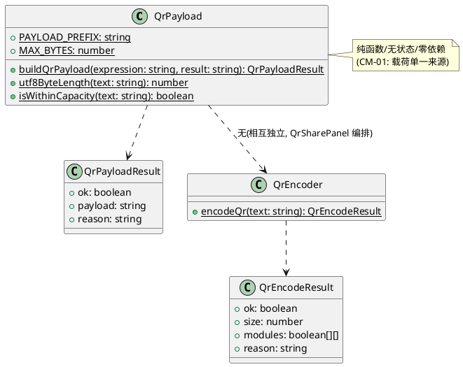
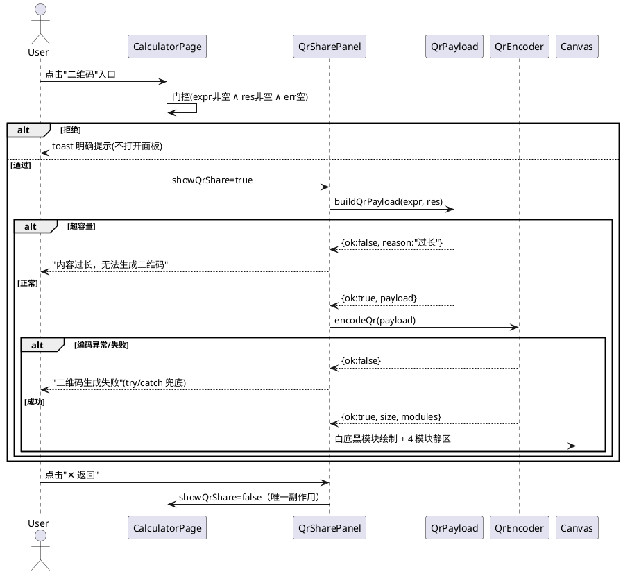
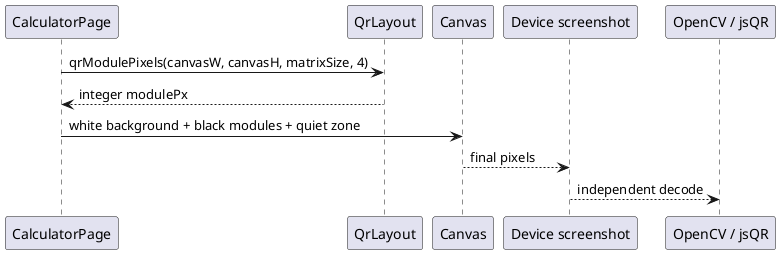
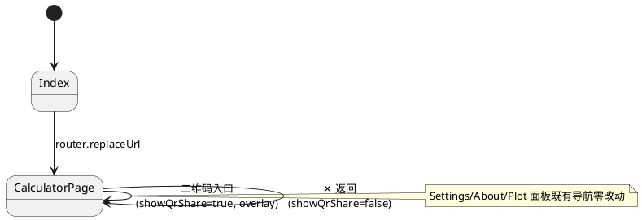
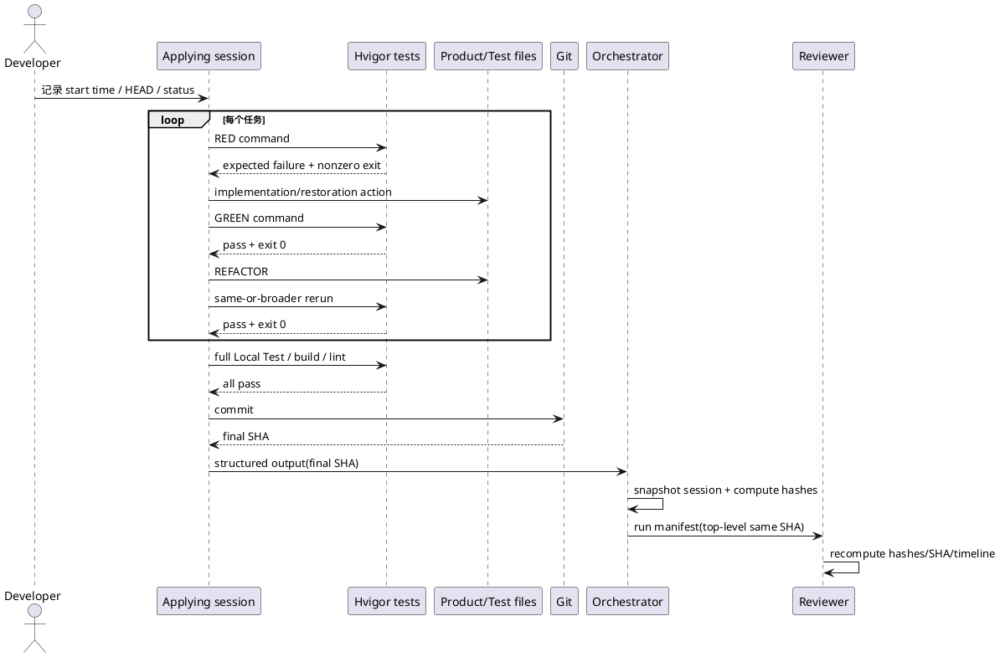

# 二维码分享 - 增量设计（delta-design.md）

> mod-design 产出（增量变更：`specs/changes/` 已存在）｜ 输入：info.md / proposal.md / delta-spec.md / new-arch.md
> 变更目录：specs/changes/20261023-requirement-add-qrcode-share/ ｜ 基线：`2500bf49d79b08b135059419c422a3d49dfb4a73`
> 2026-10-23 Tester 反馈修订：针对 PR #43 head `964c83e` 的设备截图解码失败，新增 QrLayout/Canvas 最终像素修复设计；本轮意图为 bugfix。
> 全局 specs/design.md 为归档维护占位（基线 stub），本文对未变更部分标注"见基线源码/无相关实现"，仅展开变更点。

## 1. 概述

### 1.1 应用定位
在 OpenCalc for HarmonyOS（单 UIAbility 单页面计算器）上增量新增"二维码分享"能力：结果有效时一次点击打开面板，离线生成仅含当前算式与当前结果的 UTF-8 文本二维码（对应 delta-spec IR-R1~R5，proposal §7 R1–R6）。

### 1.2 核心交互
用户完成计算（`=`）→ 点击显示屏区"二维码"入口 → 门控判定（AC1/AC4）→ QrSharePanel overlay 弹出（载荷现算→QR 编码→Canvas 绘制 + 人类可读回显）→ 外部设备扫码读取（与页面显示逐字一致，AC2）→ 关闭面板（状态零扰动，AC7）。

### 1.3 技术栈概览
- 框架：ArkTS + Stage 模型 + ArkUI 声明式（SDK 5.0.0(12)，runtimeOS HarmonyOS）
- 状态管理：**V1**（基线 CalculatorPage 全量 @State，本设计沿用 V1，不引入 @ComponentV2）
- Kit：@kit.ArkUI（Canvas/promptAction）、@kit.AbilityKit（UIAbilityContext，既有）、@ohos.data.preferences（既有，不触碰）
- 测试：@ohos/hypium 1.0.15（既有 devDependency）
- Native C++/Rust：无；Hvigor 插件：无；**OHPM 运行时依赖：无（零新增）**

## 2. 功能清单

| 功能名 | 说明 | 入口 Ability/Page | 优先级 |
|--------|------|-------------------|--------|
| 二维码分享入口（门控） | 显示屏区文字入口；三分支有效性判定；拒绝时明确提示 | CalculatorPage（竖屏/横屏） | P0 |
| 二维码分享面板 | overlay 展示二维码图形 + 人类可读算式/结果回显 + 关闭（状态零扰动） | CalculatorPage/QrSharePanel | P0 |
| 二维码载荷构建 | 固定三行 UTF-8 文本载荷；逐字取页面显示值；容量判定 | qrcode/QrPayload（纯函数） | P0 |
| 离线二维码编码器 | QR byte 模式/EC-M/版本 1–10/RS 纠错/掩模 → 模块矩阵 | qrcode/QrEncoder（纯函数） | P0 |
| 三主题可识别渲染 | 码区恒定白底黑模块 + 4 模块静区 + 足够模块尺寸 | QrSharePanel（Canvas） | P0 |
| 持久化自动化测试 | 载荷/编码断言 + 六类口径 + 容量边界；注册进 List.test.ets | entry/src/test/QrShare.test.ets | P0 |

## 3. 实现模型

### 3.1 上下文视图

```plantuml
@startuml
actor User as u
actor "外部扫码设备\n(标准解码器)" as scanner
rectangle "OpenCalc (entry HAP)" as app {
  rectangle "CalculatorPage" as page
  rectangle "QrSharePanel\n(overlay, 新增)" as panel
  rectangle "qrcode/QrPayload\n(新增, 纯函数)" as payload
  rectangle "qrcode/QrEncoder\n(新增, 纯函数)" as encoder
}
cloud "远端服务" as remote #line.dashed
u --> page : 点击入口/按键
page --> panel : showQrShare=true
panel --> payload : buildQrPayload(expr,res)
payload --> encoder : 载荷文本
encoder --> panel : boolean[][] 矩阵
panel --> scanner : 二维码画面(单向只读)
remote ..[noroute].. app : 无任何连接(离线约束)
@enduml
```

### 3.2 总体架构

```plantuml
@startuml
rectangle View as v #E8F0FE
rectangle ViewModel as vm #E8F0FE
rectangle Service as s #DEEBF7
rectangle Data as d #F5F5F5
database PlatformKit as k #EEEEEE
v : CalculatorPage\n(门控/入口/QrSharePanel/Canvas)
vm : @State showQrShare\nexpression/result/errorMsg
s : QrPayload · QrEncoder\n(纯函数, 新增)\nCalcEngine · NumberFormatter (复用)
d : PreferencesStore/Models/ErrorFlags\n(零改动)
k : ArkUI(Canvas,promptAction) · hypium
v --> vm : 状态读写
vm --> s : 现算载荷/编码
s --> d : 不触碰(零改动)
v --> k : Canvas 绘制/toast
@enduml
```

单向数据流：View 事件 → @State → 纯函数计算 → 渲染输出；无反向依赖、无缓存层。

### 3.3 HAP/HAR/HSP 模块划分

| 模块 | 类型 | 说明 |
|------|------|------|
| entry | HAP（唯一模块） | 主入口；新增 qrcode/ 源码目录（源码级模块，非独立 HAR/HSP） |
| HAR/HSP | 无 | 不新增共享包（保持零依赖与最小构建面） |
| OHPM 依赖 | 无新增 | dependencies 保持 `{}`；仅既有 devDependencies（hypium/hamock） |

### 3.4 设计系统规格

#### 3.4.1 色彩系统

| 名称 | Light 模式 | Dark/AMOLED 模式 | 用途 |
|------|-----------|------------------|------|
| 码区背景 QR_BG | #FFFFFF | #FFFFFF（**恒定**） | 二维码白底（CM-05） |
| 码区模块 QR_FG | #000000 | #000000（**恒定**） | 二维码黑模块（CM-05） |
| 面板卡片背景 | 复用 `getPanelBg()` | 复用（#FFFFFF/#323232/#0a0a0a） | 面板容器，随主题 |
| 主文字 | 复用 `getT1()` | 复用 | 回显/标题 |
| 次要文字 | 复用 `getT2()` | 复用 | 提示文案 |
| 错误文字 | #F44B3F（`getErr()`） | 同 | 容量/失败提示 |

> 码区恒定配色是 AC5 的直接实现：三主题下对比度恒为黑白最大值（21:1）。

#### 3.4.2 主题系统
沿用 themeIdx（0 浅色/1 AMOLED/2 暗色）与既有取色函数；二维码内容不参与主题换色，主题切换时码区无需重绘（仅容器取色自动更新）。

#### 3.4.3 排版系统

| 名称 | 字号 | 用途 |
|------|------|------|
| 面板标题 | 18fp Bold | "二维码分享" |
| 回显-算式 | 14fp（getT2） | "算式: …" |
| 回显-结果 | 16fp Bold（getT1） | "结果: …" |
| 提示文案 | 14fp（getErr） | 容量/失败/不可分享提示 |

#### 3.4.4 间距与尺寸系统

| 名称 | 值 | 用途 |
|------|-----|------|
| QR_QUIET_ZONE | 4（模块数） | 静区宽（CM-05，AC5） |
| QR_MODULE_PX | 面板宽按 `(size + 2×4)×modulePx ≤ 宽度-32vp` 反解，`modulePx ≥ 4`，取最大可行整值 | 模块边长（足够尺寸，AC5） |
| 面板内边距 | 16vp（沿用 PlotPanel 惯例） | 面板布局 |
| Canvas 尺寸 | 宽 100%、高按矩阵自适应（正方形码区） | 二维码画布 |

#### 3.4.5 图标与图形资源
无新增资源文件；入口/关闭沿用文字符号（"二维码"/"✕ 返回"），与基线 ToggleRow/PlotPanel 惯例一致。

#### 3.4.6 动画规格
无新增动画（同步一次性渲染，无过渡/循环动画，兼顾功耗 DFX）。

#### 3.4.7 响应式断点与栅格
不引入断点系统；沿用基线 `isLandscape`（onAreaChange 宽高比较）双布局：入口置于 DisplayPanel 区保证横竖屏均渲染（proposal 待定假设 9）。

### 3.5 qrcode 模块实现设计（新增）

#### 3.5.1 模块介绍
entry HAP 内源码目录 `entry/src/main/ets/qrcode/`，两个纯逻辑文件；非 installationFree 变更；无 UI 依赖、无 Kit 依赖、无三方依赖。

#### 3.5.2 功能描述
- QrPayload：`buildQrPayload(expression, result)` 三行固定格式构造；`utf8ByteLength(s)` 字节计数；容量判定统一为 ≤213 字节（EC-M v10 byte 模式上限）；超限返回失败态（CM-06）。
- QrEncoder：`encodeQr(text)` → `{ size, modules: boolean[][] }`；ISO 18004 子集：byte 模式 + UTF-8、EC-M、版本 1–10 自适应、RS 纠错、掩模（评分选优）；超限/畸形输入返回失败态，不产出残缺矩阵（CM-10）。

#### 3.5.3 目录结构

```
opencalc/entry/src/main/ets/
├── pages/CalculatorPage.ets      # 修改：入口 + showQrShare + QrSharePanel
├── qrcode/                       # 新增
│   ├── QrPayload.ets             # 载荷构造 + 容量判定（纯函数）
│   └── QrEncoder.ets             # QR 编码（纯函数）
└── （其余目录零改动）
opencalc/entry/src/test/
├── List.test.ets                 # 修改：注册 qrShareTest()
└── QrShare.test.ets              # 新增：持久化单测
```

#### 3.5.4 架构图谱

类图：


时序图（分享主链路）：


#### 3.5.5 功能与用例分析

```
用例：SC001-UC001 有效结果打开分享面板（delta-spec §7）
前置条件：expression 非空 ∧ result 非空 ∧ errorMsg 为空
步骤：1.点击入口 2.门控通过 3.面板挂载 4.现算载荷 5.编码 6.Canvas 绘制
后置条件：面板可见且含二维码；计算器状态不变
```

#### 3.5.6 接口设计
见 §4.2（签名级定义）。

#### 3.5.7 状态管理设计
qrcode 模块**无状态**（纯函数，无 @State/无模块级可变变量）——这是 CM-01/CM-02（单一来源、无缓存）的结构性保证。测试可直接同进程调用，无 mock 需求。

#### 3.5.8 核心算法（QR 编码，ISO 18004 子集）

| 步骤 | 算法 | 复杂度 |
|------|------|--------|
| 1 容量/版本选择 | 按 UTF-8 字节数 + 模式指示符 + 长度域选最小版本 v∈[1,10]（EC-M） | O(1)（查表） |
| 2 数据编码 | byte 模式：UTF-8 字节流 → 8bit 码字序列（含模式 0100、字符数指示、终止符、pad 0xEC/0x11） | O(n) |
| 3 RS 纠错 | 按 EC-M 每版本块结构分块，GF(256) 多项式除法生成纠错码字并交错 | O(n·d)（有效载荷 n≤213 字节；d 取决于版本分块） |
| 4 矩阵布置 | (4v+17)² 矩阵：定位图案×3/分隔符/校正图案/时序图案/暗模块/格式信息（BCH(15,5)）/版本信息（v≥7，BCH(18,6)）/数据码字之字形填充 | O(N²)，N≤57 |
| 5 掩模 | 8 个标准掩模条件逐一异或，按 N1–N4 规则评分取最低 | O(8·N²) |
| 6 输出 | `{size: 4v+17, modules}` | O(1) |

总体：v10 规模内同步毫秒级；单次矩阵分配，无放大分配。

#### 3.5.9 错误处理

| 场景 | 处理 | 关联措施 |
|------|------|---------|
| 载荷超 213 字节 | QrPayload 返回 `{ok:false, reason}` → 面板"内容过长，无法生成二维码" | CM-06 |
| 编码内部失败/未知异常 | QrEncoder 返回失败态；面板调用处 try/catch 兜底 →"二维码生成失败" | CM-10 |
| 空串/畸形输入 | 入口前置校验拒绝（编码器同样防御性校验，双保险） | CM-03/CM-10 |

无网络/无 IO，无重试语义；不引入埋点（本地单测即维测手段，SDR-05）。

#### 3.5.10 依赖关系
内部依赖：无（qrcode 不依赖任何其他模块，保证独立可测）；外部依赖：无（零 Kit、零 OHPM）。被依赖方：CalculatorPage（UI 编排）、QrShare.test.ets（断言）。

### 3.6 CalculatorPage 二维码分享扩展实现设计（修改）

#### 3.6.1 模块介绍
既有主页面（~700 行）的增量扩展：1 个 @State、1 个入口、1 个 @Builder 面板；不改动既有函数、手势与布局结构（AC8）。

#### 3.6.2 功能描述
入口门控（AC1/AC4）→ 面板编排（回显 AC6、Canvas 绘码、提示分支、关闭 AC7）。

#### 3.6.3 目录结构
不新增目录；改动集中于 `pages/CalculatorPage.ets`（新增段与新增 @Builder，见 §3.5.3）。

#### 3.6.4 架构图谱
见 §3.5.4 时序图；面板挂载遵循既有 Stack overlay 模式（SettingsPanel/AboutPanel/PlotPanel 三先例）。

#### 3.6.5 功能与用例分析
覆盖 SC-001~SC-004 全部 8 UC（delta-spec §7）；门控三分支对应 SC002-UC001；关闭零扰动对应 SC003-UC001。

#### 3.6.6 接口设计
页面内私有方法：`onOpenQrShare(): void`（门控+提示/置位）、`drawQr(): void`（Canvas 重绘，PlotPanel drawPlot 同款守卫 `size>0`）；无对外导出。

#### 3.6.7 状态管理设计（V1）

| 状态 | 类型 | 变更点 | 说明 |
|------|------|--------|------|
| showQrShare | @State boolean | 新增 | 面板开关；关闭路径唯一副作用 `= false`（CM-07） |
| qrPayloadOk | @State boolean | 新增 | 本次载荷/编码成功与否（提示分支渲染） |
| qrErrorText | @State string | 新增 | 容量/失败提示文案 |

数据流：expression/result（既有 @State，只读消费）→ 打开时现算（无缓存，CM-02）→ qrPayloadOk/qrErrorText → 条件渲染。载荷与矩阵不驻留 @State（临时局部量），杜绝陈旧内容。

#### 3.6.8 核心算法
门控：`expression.length > 0 && result.length > 0 && errorMsg.length === 0`（三分支单测覆盖，CM-03）。Canvas 绘制：`modulePx = qrModulePixels(canvasW, canvasH, matrix.size, 4)`，结果必须为整数且不超过经设备截图验证的 `MAX_SCREENSHOT_MODULE_PX=4`；静区偏移 `+4×modulePx`，Canvas 组件背景与 bitmap 均显式白色，再逐模块填黑。`onReady`、`onAreaChange` 及主题切换后以最新宽高重绘；若空间不足以达到最小可绘制模块，不得静默 return 后留下空白/旧码，须进入明确失败分支。

#### 3.6.9 错误处理
编码调用包 try/catch → qrErrorText 兜底文案（CM-10）；toast 复用 `promptAction.showToast`（不可分享提示，CM-03）。

#### 3.6.10 依赖关系
内部：qrcode/QrPayload、qrcode/QrEncoder（单向）；既有 calculator/、preferences/ 只读不动。外部：@kit.ArkUI（Canvas/promptAction，API 12）。

### 3.7 持久化测试模块实现设计（新增）

#### 3.7.1 模块介绍
`entry/src/test/QrShare.test.ets`，hypium 本地单测；default 导出注册函数经 `List.test.ets` 挂载（沿用 PlotFunction.test.ets 惯例：模块级辅助函数，禁嵌套）。

#### 3.7.2 功能描述
载荷断言（三行结构/前缀/逐字）、编码断言（尺寸公式 `(4v+17)²`/定位图案×3/时序图案/确定性）、六类口径数据驱动、容量边界（213 通过/214 拒绝）、QrLayout 模块像素上限与小画布边界。

#### 3.7.3 用例清单（AC9 口径）

| 口径 | 样例输入 | 断言要点 |
|------|---------|---------|
| 普通算式 | ("1+2","3") | 载荷逐字 `OpenCalc\n算式: 1+2\n结果: 3`；矩阵合法 |
| 科学函数 | ("sin(30)","0.5") | 同上（AC2 主样例） |
| 小数结果 | ("1÷8","0.125") | 小数逐字保留 |
| 负数结果 | ("0-5","-5") | 负号逐字保留 |
| 长表达式 | 构造 ≈200 字节算式 | 版本自适应正确、编码成功 |
| 不可分享状态 | ("", "") / errorMsg 态 | 门控判定函数拒绝（不含 UI 的判定逻辑提为可测纯函数 `isShareable(expr,res,err)`） |
| 容量边界 | 213/214 字节 | 通过/拒绝（CM-06） |
| 多字节 | 含 × ÷ π 的算式 | UTF-8 字节级断言（CM-09） |
| 结构断言 | 任一样例载荷 | 尺寸公式/定位×3/时序/确定性（CM-04） |

#### 3.7.4 错误处理
断言失败即 hvigor 构建失败；断言信息含期望/实际值，定位到载荷或矩阵层。

#### 3.7.5 依赖关系
仅依赖 qrcode/* 纯函数与 `../main/ets/...` 相对导入（既有惯例）；既有 PlotFunction.test.ets 零改动、同批执行（AC8 回归口径，CM-08）。

### 3.8 QrLayout 截图可解码布局修复设计（新增，Tester 反馈）

#### 3.8.1 模块介绍

`entry/src/main/ets/qrcode/QrLayout.ets` 是零 UI 依赖的布局纯函数模块，仅负责把 Canvas 可用尺寸、矩阵边长和静区宽度转换为可绘制的整数模块像素。它不改变 QR 矩阵、不持有状态，也不依赖主题。

#### 3.8.2 功能描述

- 计算完整码面边长：`(matrixSize + 2 * quietModules) * modulePx`。
- 结果使用整数像素，保证模块边界落在稳定采样网格上。
- 对大画布应用 `MAX_SCREENSHOT_MODULE_PX=4` 上限，避免设备截图采样后的超大模块/网格伪影影响定位。
- 对小画布返回实际可用整数值；调用方必须显式判断最小可绘制值，空间不足时显示失败提示，不得留下旧码或空白 Canvas。
- 4 模块静区计入尺寸计算且不得被裁切。

#### 3.8.3 目录结构

```text
entry/src/main/ets/qrcode/
├── QrPayload.ets
├── QrEncoder.ets
└── QrLayout.ets      # Canvas 模块像素布局纯函数
```

#### 3.8.4 架构图谱



#### 3.8.5 功能与用例分析

用例：SC005-UC001 三主题最终截图解码。前置条件是矩阵已成功生成且 Canvas 获得有效宽高；调用布局函数后完整居中绘制；后置条件是原始设备截图可由独立标准解码器还原精确载荷。

用例：SC005-UC002 内容更新后截图载荷同步。重开时先清除旧矩阵/成功态，生成新矩阵并在最新布局尺寸下重绘；第二张截图必须解码为新载荷。

#### 3.8.6 接口设计

```typescript
export const MAX_SCREENSHOT_MODULE_PX: number = 4
export function qrModulePixels(
  canvasWidth: number,
  canvasHeight: number,
  matrixSize: number,
  quietModules: number
): number
```

契约：入参必须为有限非负尺寸，`matrixSize > 0`、`quietModules >= 4`；返回非负整数。调用方负责将小于最小可绘制模块的结果映射到明确错误态。

#### 3.8.7 状态管理设计

QrLayout 无状态。CalculatorPage 沿用 V1；每次打开先清空旧 `qrMatrix/qrPayloadOk/qrErrorText`，完成编码后由 `onReady/onAreaChange` 使用最新 Canvas 尺寸绘制。主题变化不得改变码面黑白色值，必要时触发完整重绘。

#### 3.8.8 核心算法

```text
available = floor(min(canvasWidth, canvasHeight) / (matrixSize + 2 * quietModules))
modulePx = min(available, MAX_SCREENSHOT_MODULE_PX)
side = (matrixSize + 2 * quietModules) * modulePx
offset = floor((canvasSize - side) / 2)
```

先清除 Canvas，再绘制 `side × side` 白底，最后从 `(offset + quietModules * modulePx)` 开始绘制黑模块。禁止对最终截图做裁剪或重采样来掩盖应用输出缺陷。

#### 3.8.9 错误处理

非法尺寸、`modulePx` 不足、矩阵为空或绘制异常均进入“二维码生成失败/显示空间不足”明确提示分支；不得展示残缺码，不得复用上次矩阵。

#### 3.8.10 依赖关系

内部：CalculatorPage 单向依赖 QrLayout；QrLayout 无反向依赖。外部：无新增 Kit、OHPM 包或权限。

## 4. 接口设计

### 4.1 内部数据访问 API
无相关实现（不新增偏好/存储访问；PreferencesStore 零改动）。

### 4.2 业务抽象接口

```typescript
// qrcode/QrPayload.ets（纯函数，API 12）
export interface QrPayloadResult { ok: boolean; payload: string; reason: string }
export function buildQrPayload(expression: string, result: string): QrPayloadResult
export function utf8ByteLength(text: string): number
export function isShareable(expression: string, result: string, errorMsg: string): boolean

// qrcode/QrEncoder.ets（纯函数，API 12）
export interface QrMatrix { size: number; modules: boolean[][] }
export interface QrEncodeResult { ok: boolean; matrix: QrMatrix | null; reason: string }
export function encodeQr(text: string): QrEncodeResult

// qrcode/QrLayout.ets（纯函数，API 12）
export const MAX_SCREENSHOT_MODULE_PX: number
export function qrModulePixels(canvasWidth: number, canvasHeight: number,
  matrixSize: number, quietModules: number): number
```

同步、无 async、无副作用；失败以 `ok:false + reason` 显式表达（CM-06/CM-10）。

### 4.3 后台任务与 ExtensionAbility 接口
无相关实现。

### 4.4 Want / Action 协议
无相关实现。

### 4.5 URI / Deep Link / AppLinking 协议
无相关实现。

### 4.6 IPC 与 RPC 接口
无相关实现。

### 4.7 Native（C/C++）接口
无相关实现。

### 4.8 文件交换接口（分享载荷契约）

| 项 | 契约 |
|----|------|
| 格式 | UTF-8 纯文本，固定三行：`OpenCalc\n算式: {expression}\n结果: {result}` |
| 取值 | {expression}/{result} 逐字取页面显示串（含千分位逗号/负号/小数，AC2） |
| 容量 | ≤213 UTF-8 字节（EC-M v10 byte 模式）；超限显式失败（CM-06） |
| 字符集 | QR byte 模式 + UTF-8（无 ECI 段，解码端按 UTF-8 约定读取） |
| 消费方 | 任意标准 QR 解码器（ISO 18004）；单向只读，无导入执行语义（"本次不包含"） |

## 5. 数据模型

### 5.1 关系型数据库模型
无相关实现（无 RDB）。

### 5.2 领域模型

| 字段名 | 类型 | 必填 | 说明 |
|--------|------|------|------|
| QrPayloadResult.ok | boolean | 是 | 构造是否成功 |
| QrPayloadResult.payload | string | 是（ok 时） | 三行载荷文本 |
| QrPayloadResult.reason | string | 否 | 失败原因（提示用） |
| QrMatrix.size | number | 是 | 矩阵边长 = 4×version+17 |
| QrMatrix.modules | boolean[][] | 是 | true=深色模块 |
| QrEncodeResult | 同 §4.2 | — | 编码结果封装 |

### 5.3 Preferences 结构
无相关实现（零新增 key；既有 key 零改动）。

### 5.4 分布式数据对象模型
无相关实现。

### 5.5 文件格式 Schema
见 §4.8（载荷即对外交换格式；无文件落盘）。

## 6. UI设计系统

色彩/主题/排版/间距/图形/动画见 §3.4；一多响应式：无断点系统，沿用 `isLandscape` 双布局，入口位于 DisplayPanel 区（横竖屏均渲染），面板 Canvas 宽度自适应（`宽度-32vp` 内反解 modulePx）。

## 7. 页面清单与导航

### 7.1 页面清单总表

| 页面名 | 路径 | 入口 Ability | 传参 | 功能摘要 |
|--------|------|-------------|------|---------|
| Index（既有） | pages/Index | EntryAbility | 无 | 启动重定向 |
| CalculatorPage（既有，修改） | pages/CalculatorPage | EntryAbility | 无 | +二维码入口与 QrSharePanel |
| QrSharePanel（新增 @Builder） | 页面内 overlay（无新路由） | — | 无（读 @State） | 二维码+回显+关闭 |

### 7.2 全局导航图



### 7.3 Deep Link / AppLinking 处理
无相关实现。

### 7.4 Want 跳转矩阵
无相关实现。

## 8. 用户交互规格

### 8.1 手势交互目录

| 手势 | 目标 | 行为 | 关联AC |
|------|------|------|--------|
| onClick | "二维码"入口 | 门控判定 → 打开面板/toast 提示 | AC1/AC4 |
| onClick | 面板"✕ 返回" | 仅 showQrShare=false | AC7 |
| LongPressGesture（既有） | DisplayPanel | 长按复制，零改动 | AC8 |

### 8.2 弹窗/Sheet/Menu 目录

| 组件 | 触发 | 内容 |
|------|------|------|
| QrSharePanel（Stack overlay，非系统弹窗） | 入口门控通过 | 标题/回显/Canvas 码/提示分支/关闭 |
| promptAction.showToast | 门控拒绝 | "请先完成一次有效计算"（文案 §13 待确认项 3） |

### 8.3 剪贴板与反馈行为
不新增剪贴板行为（既有长按复制不动）；反馈仅 toast 与面板内错误文案。

### 8.4 卡片交互
无相关实现。

## 9. 平台集成

### 9.1 构建配置与依赖
零新增依赖：entry 与根 oh-package.json5 `dependencies` 保持 `{}`；build-profile/module.json5 零改动（签名配置沿用仓库现状，Tester 侧本地适配，AC10）。

### 9.2 权限与运行时请求
无新增权限（module.json5 零改动；既有仅 `ohos.permission.VIBRATE` system_grant）——离线约束（TM-02）的可验证证据。

### 9.3 系统能力（Kits）清单

| Kit | 关键 API | 用途 |
|-----|---------|------|
| @kit.ArkUI（API 12） | Canvas/CanvasRenderingContext2D、promptAction.showToast | 码面绘制/提示 |
| @ohos/hypium（测试） | describe/it/expect | 持久化单测 |

### 9.4 后台与 Extension
无相关实现。

### 9.5 备份与恢复
无相关实现（无新增持久化数据）。

### 9.6 分布式与跨端
无相关实现（跨端传递仅经外部扫码器单向读取，无系统分布式能力）。

## 10. 偏好设置目录

| key | 类型 | 默认值 | 说明 | 行为影响 |
|-----|------|--------|------|---------|
| （零新增） | — | — | 本需求不新增任何偏好项；既有 key（vibrateOn/preventSleep/radianMode/theme/scientific 等）零改动 | 无 |

## 11. Reviewer 反馈的过程证据设计（SC-006 / SR-05）

> 本节是 mod-design 对 proposal §11、delta-spec §14 的增量设计。它设计 Developer 证据链，不改变 D1–D10 的产品实现模型。

### 11.1 设计目标

1. 同一 Applying session 能从时间线证明每个任务的 RED、实现动作、GREEN 与 REFACTOR 复跑。
2. 新 run manifest 不再出现顶层 SHA 与 structured output SHA 分裂。
3. Reviewer 可只依赖已固化文件重算 hash、核对提交时间和复现关键命令。
4. 保留 Tester run-47 的结果事实，但不让其替代 Developer process audit。

### 11.2 证据组件与职责

| 组件 | 职责 | 禁止行为 |
|---|---|---|
| Applying session JSONL | 记录真实工具调用、修改、命令输出与时间顺序 | session 后补文字冒充历史执行 |
| per-task verification log | 记录 phase、command、started/finished、exit code、expected/actual | 只写“通过”而不留原始输出 |
| Git commit | 固化本轮最终变更并提供提交时间 | 提交早于 session、却宣称由 session 实现 |
| structured output | 用 final SHA 生成 Developer→Tester 交接 | 使用旧 SHA 或未验证值 |
| run manifest | 顶层关联 final SHA、structured output hash、session snapshot hash | 顶层与内层 SHA 不一致 |
| delivery.json | orchestrator-host 的远端 PR/head 事实 | 网络不可用时臆造 GitHub 状态 |

### 11.3 执行时序



### 11.4 RED 真实性契约

- RED 必须来自实际命令并返回非零退出码，失败点必须是该任务预期新增/恢复的行为；环境安装、网络或缓存失败不计为 RED。
- 若当前 4f81d91 已满足拟写断言，该断言不能作为 RED。后续 IMPLEMENTING 必须把工作拆为能在不扩大 Issue 范围的前提下形成真实缺口的最小任务；若无法形成，必须阻塞并向 Reviewer 请求接受 originating evidence 替代，不得伪造。
- 可采用受控、可恢复的实现缺口来重复既有修复，但 session 必须显示缺口建立、失败、实现恢复和通过；最终 tree 必须保持或增强既有行为。
- 每个 RED 与后续 GREEN 必须使用相同测试目标；REFACTOR 使用相同或更大的目标。

### 11.5 日志数据模型

| 字段 | 类型 | 必填 | 说明 |
|---|---|---|---|
| task_id | string | 是 | 与后续 tasks.md 条目一致 |
| phase | `RED`/`GREEN`/`REFACTOR` | 是 | TDD 阶段 |
| command | string | 是 | 实际执行命令，含工作目录语义 |
| started_at/finished_at | ISO-8601 | 是 | 支持时间线复核 |
| exit_code | number | 是 | RED 非零；GREEN/REFACTOR 为 0 |
| expected | string | 是 | 本阶段预期 |
| observed | string | 是 | 实际断言/摘要 |
| log_path | string | 是 | 原始日志可访问路径 |
| source_state | string | 是 | 执行前相关文件/HEAD 状态摘要 |

### 11.6 exact-head manifest 生成规则

```text
final_sha = git rev-parse HEAD
assert worktree is clean
assert final_sha == git rev-parse <origin tracking ref>
assert final_sha == delivery.remote_head_sha (when delivery exists)
structured_output.commit_sha = final_sha
structured_output.head_sha = final_sha
run_manifest.head_sha = final_sha
run_manifest.structured_output_sha256 = sha256(canonical structured output)
run_manifest.session.sha256 = sha256(session snapshot bytes)
```

任一断言失败时，交接状态必须为 blocked；不能通过局部编辑旧 run-46 伪装一致。新 run 应引用本轮新 session 与新 structured output。

### 11.7 与产品验证的关系

- 全量 Local Test、HAP build、CodeLinter 与保护模块 diff 仍是 Developer GREEN/REFACTOR 后的回归门禁。
- Tester run-47 可证明 `4f81d91` 的产品结果；若本轮产生新 final SHA，即使产品源码等价，也必须由 Tester 对新 SHA 重新构建、安装与取证。
- AC11 仅由 Reviewer 在 result audit 与 process audit 均通过后关闭；Developer 不自批、不归档。

### 11.8 自验证

| 校验项 | 设计覆盖 |
|---|---|
| Reviewer finding 1：run manifest SHA 分裂 | §11.6 单一 final SHA 生成与断言 |
| Reviewer finding 2：session 晚于提交且只审计已有状态 | §11.3–§11.4 要求 session 先于实现提交并包含真实 RED/修改/GREEN/REFACTOR |
| hash 可重算 | §11.6 structured output/session snapshot 双 hash |
| 不扩大产品范围 | §11.1、§11.7；产品 D1–D10 不变 |
| 不猜 material ambiguity | 未找到 originating session 的证据事实决定采用 Reviewer 明示的 repeat 路径 |

## 自验证（与 delta-spec 交叉校验）

| 校验项 | 结果 |
|--------|------|
| 功能一致性 | IR-R1~R6 与原功能清单保持对应；Tester 缺陷修复 F7 ↔ SC005/SR-03/SR-04/§3.8：通过 |
| 页面一致性 | 无新路由页；QrSharePanel 为页面内 overlay ↔ §7.1：通过 |
| 数据一致性 | 零持久化新增 ↔ §5.3/§10：通过 |
| 权限一致性 | 零新增权限 ↔ §9.2：通过 |
| Kit 一致性 | 仅 ArkUI/hypium ↔ §9.3：通过 |
| 措施落点 | CM-01~CM-10 均有 §3.5/§3.6/§3.7 实现落点；run-35 截图解码失败有 §3.8 与 SC005 落点：通过 |
| Reviewer 过程反馈 | SC-006/SR-05 ↔ §11 的 TDD 时间线、日志模型、exact-head manifest 设计：通过 |

---
> 本文档由 mod-design skill 生成。
> 标记 [推断] 的内容为基于设计推断，非确定性事实。Tester 反馈修订未把运行时根因写成确定事实；模块尺寸上限是待独立设备证据验证的修复设计约束。
> 生成时间: 2026-10-23
