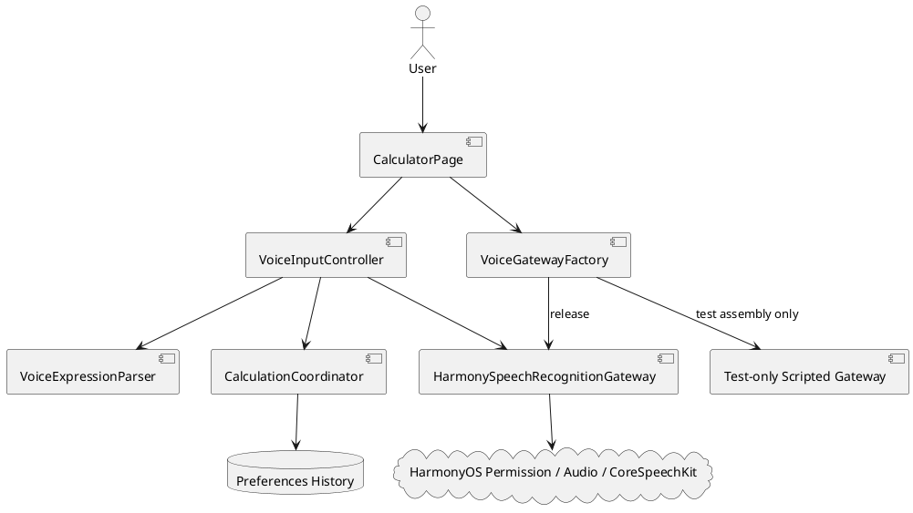
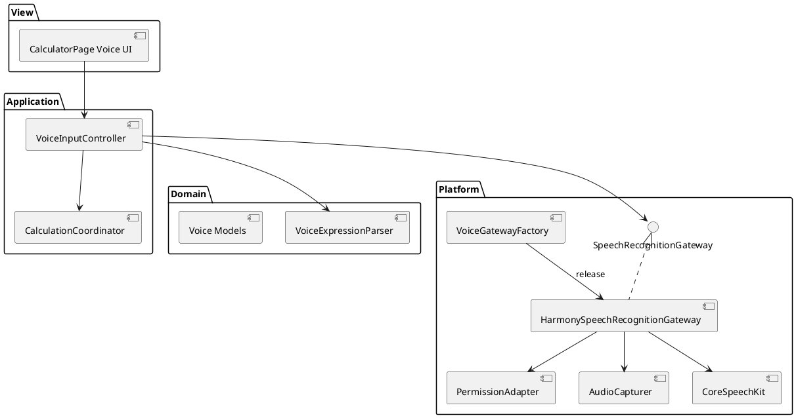
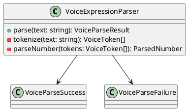
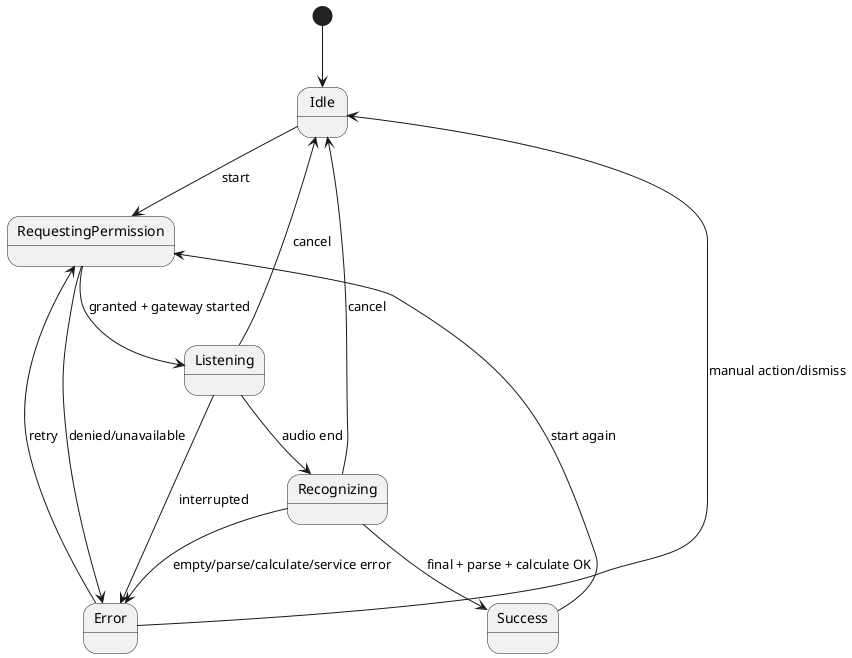
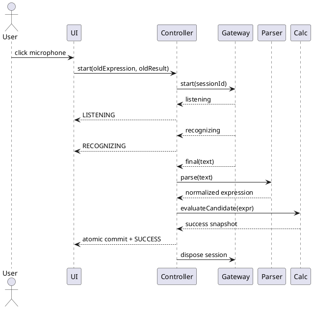

# 中文语音输入算式并自动计算 — 增量设计

## 1. 概述

### 1.1 应用定位

在 OpenCalc 单 `entry` HAP 内增加前台、单轮、中文四则语音输入。设计重点不是扩展计算能力，而是把不稳定的平台语音结果安全地转换成既有计算链可消费的候选表达式，并确保失败不产生副作用；Tester 反馈后的增量设计进一步让同一页面在设备测试构建中可确定性装配 scripted gateway，同时封死 release fake 激活路径。（原子需求 IR-001～IR-018）

### 1.2 核心交互

用户点击麦克风 → 按需授权 → 看到监听/识别状态 → 系统只消费当前会话最终文本 → 严格解析 → 原子计算 → 同时显示识别原文、规范式和结果 → 写一条既有格式历史。任一失败/取消均清理本轮并保留旧计算状态。

### 1.3 技术栈概览

| 项目 | 选择 |
|------|------|
| 框架/模型 | ArkTS、Stage 模型、ArkUI 声明式，API 12 |
| 状态管理 | 延续 V1 `@State`；业务状态由 controller 快照投影到页面 |
| 系统 Kit | `@kit.AbilityKit`/abilityAccessCtrl、`@kit.AudioKit`、`@kit.CoreSpeechKit` |
| 识别参数 | `[推断] language=zh-CN`、`online=0`；16 kHz/mono/16-bit PCM |
| 持久化 | 仅复用 Preferences 历史；无新 Schema；不保存音频/原文 |
| Native | 无 C++/Rust |
| Hvigor | 复用现有 entry HAP 配置，无新增模块/插件 |
| 测试装配 | Local fake 留在 test；设备 UI scripted gateway 仅测试源码集/Ability/profile；release factory 固定真实 gateway |

## 2. 功能清单

| 功能名 | 说明 | 入口 | 优先级/追溯 |
|--------|------|------|-------------|
| 语音入口与状态 | 开始、监听、识别、成功、失败、取消、重试 | CalculatorPage 普通模式 | P0 / SR-01 |
| 权限与在线识别 | 按需 MIC、前台 PCM、CoreSpeechKit | CalculatorPage → gateway | P0 / SR-02 |
| 中文算式解析 | 首期数字/小数/四则严格规范化 | VoiceExpressionParser | P0 / SR-03 |
| 原子计算提交 | 复用计算/格式化/历史，成功恰好一次 | CalculationCoordinator | P0 / SR-04/05 |
| 可测试注入 | fake 文本/错误/竞态与真机补证 | controller/gateway seam | P0/P1 / SR-06 |
| 设备 UI 测试装配 | allowlisted scripted scenarios 驱动同一页面，release 不可达 | test Ability/profile → gateway factory | P0 / SR-06 |

## 3. 实现模型

### 3.1 上下文视图



### 3.2 总体架构



依赖方向保持 UI → 应用 → 领域端口；具体平台实现反向实现端口。Local Test 直接注入 fake；设备测试由测试 Ability/profile 在页面创建前向 factory 提供 allowlisted scripted gateway。release factory 不解析测试 Want、深链或环境变量。

### 3.3 HAP/HAR/HSP 模块划分

仍为现有 `entry` HAP；不新增 HAR/HSP/feature HAP。生产端口/factory 在 `entry/src/main/ets/voice/`，Local Test fake 在 `entry/src/test/`；设备 scripted gateway 与 scenario registry 放在测试源码集/测试 Ability/profile，随设备测试包交付但不得进入 release HAP。

### 3.4 设计系统规格

#### 3.4.1 色彩系统

沿用 `getT1/getT2/getOp/getErr/getBtnBg`，不新增固定主题色。监听中使用强调色 `getOp()`；失败使用 `getErr()`。

#### 3.4.2 主题系统

三种既有主题均由 getter 派生；语音控件不得硬编码只适用于浅色的前景色。

#### 3.4.3 排版系统

状态/识别文本使用 12～14 fp，规范式与结果沿用 DisplayPanel 现有字号；最多两行并支持长文本省略，不挤压数字键盘核心点击区。

#### 3.4.4 间距与尺寸系统

麦克风、取消和重试最小触控区域 44 vp；竖屏放在 `ToggleRow`，横屏放在 DisplayPanel 的操作区或等价不遮挡位置。

#### 3.4.5 图标与图形资源

优先使用无额外图片资源的可访问文本/系统符号；控件必须有文字状态，不以颜色或图标作为唯一信息。

#### 3.4.6 动画规格

首期无必须动画。状态切换即时；取消后的视觉状态在同一 UI 事件周期更新。

#### 3.4.7 响应式断点与栅格

沿用 `isLandscape`，不新增断点；语音行不得改变 ButtonGrid 的列数或核心按钮命中区域。

### 3.5 VoiceExpressionParser 模块实现设计

#### 3.5.1 模块介绍

纯 ArkTS、无 SDK/UI 依赖，负责把识别文本转换为规范式或结构化失败。（SR-03；AC-003～006、018）

#### 3.5.2 功能描述

1. Unicode 空白/中文标点的有限清理。
2. 运算符映射：加/+→`+`，减/-→`-`，乘/×→`*`，除/÷→`/`。
3. `NumberParser` 分别处理阿拉伯数字、中文数位与逐位小数。
4. 语法只接受 `signedNumber operator signedNumber`，必须完整消费。

#### 3.5.3 目录结构

```text
entry/src/main/ets/voice/
├── VoiceModels.ets
├── VoiceExpressionParser.ets
├── VoiceInputController.ets
├── SpeechRecognitionGateway.ets
└── HarmonySpeechRecognitionGateway.ets
```

#### 3.5.4 架构图谱



#### 3.5.5 功能与用例分析

- `123加456` → `123+456`；`二十乘三` → `20*3`；`十点五减二点五` → `10.5-2.5`。
- `负二加五` 允许；多运算符、未知字、空操作数、多点拒绝。
- “一百二”等可能存在口语省略的文本 fail-closed，不推断成 102/120。

#### 3.5.6 接口设计

```typescript
export enum VoiceParseErrorCode { EMPTY, UNSUPPORTED_TOKEN, AMBIGUOUS_NUMBER, INVALID_NUMBER, INVALID_STRUCTURE }
export interface VoiceParseSuccess { ok: true; normalizedExpression: string }
export interface VoiceParseFailure { ok: false; code: VoiceParseErrorCode; userMessage: string }
export type VoiceParseResult = VoiceParseSuccess | VoiceParseFailure
export interface VoiceExpressionParserPort { parse(text: string): VoiceParseResult }
```

#### 3.5.7 状态管理设计

无状态；同一输入始终得到同一输出。

#### 3.5.8 核心算法

- 单次扫描切词，O(n) 时间/O(n) token 空间。
- 中文单位数采用节/位累积法，限制到 `万`；逐位数只在无单位字符时启用。
- 小数点后仅允许数字字符逐位转换；空或包含单位字符则失败。
- 运算符定位时区分开头/第二操作数前的一元 `-` 与二元减号；最终必须仅有一个二元运算符。

#### 3.5.9 错误处理

返回业务错误对象，不抛出用户输入异常；UI 统一显示可理解文案，不回显内部 token/堆栈。

#### 3.5.10 依赖关系

仅 ArkTS 标准字符串/数组；无 Kit、网络或持久化。

### 3.6 VoiceInputController 模块实现设计

#### 3.6.1 模块介绍

协调 UI、gateway、parser 和 calculation port，维护单会话状态与原状态快照。（SR-01/05/06）

#### 3.6.2 状态机



#### 3.6.3 接口设计

```typescript
export enum VoiceInputState { IDLE, REQUESTING_PERMISSION, LISTENING, RECOGNIZING, SUCCESS, ERROR }
export interface VoiceUiSnapshot { state: VoiceInputState; recognizedText: string; errorMessage: string; canCancel: boolean; canRetry: boolean }
export interface VoiceInputController {
  start(originalExpression: string, originalResult: string): Promise<void>
  cancel(): Promise<void>
  dispose(): Promise<void>
}
```

实际 controller 通过构造参数注入 `SpeechRecognitionGateway`、parser、candidate evaluator 和状态回调。每次 start 递增 session token；每个 token 有 `consumed` 标记。

#### 3.6.4 关键时序



#### 3.6.5 错误处理

所有终态走同一幂等 cleanup。回调携带 sessionId；非 current 或已 consumed 立即丢弃。cancel 先令 token 失效并更新 UI，再等待底层清理，保证“立即”可见。

### 3.7 HarmonySpeechRecognitionGateway 模块实现设计

#### 3.7.1 模块介绍

唯一直接依赖平台语音类型的适配器。release factory 默认装配它；测试构建可在不修改页面业务代码的条件下装配 scripted gateway。（SR-02/06）

#### 3.7.2 接口设计

```typescript
export enum VoiceGatewayErrorCode { PERMISSION_DENIED, SERVICE_UNAVAILABLE, BUSY, RECORDING_INTERRUPTED, NO_RESULT, INTERNAL }
export type VoiceGatewayEvent = ListeningEvent | RecognizingEvent | FinalTextEvent | GatewayErrorEvent
export interface SpeechRecognitionGateway {
  start(sessionId: string, emit: (event: VoiceGatewayEvent) => void): Promise<void>
  cancel(sessionId: string): Promise<void>
  dispose(): Promise<void>
}
```

#### 3.7.3 平台调用顺序

1. `abilityAccessCtrl` 请求/检查 `ohos.permission.MICROPHONE`。
2. `speechRecognizer.createEngine({ language: 'zh-CN', online: 0 })`。
3. `setListener`；创建 16 kHz/mono/16-bit PCM AudioCapturer。
4. `startListening` 后启动 capturer；读取并整理为 640/1280 字节块调用 `writeAudio`。
5. 音频结束调用 `finish`；仅 final/last 事件输出最终文本。
6. cancel/error/complete 路径停止/释放 capturer，cancel/shutdown engine；每步可重复调用而不抛出到 UI。

#### 3.7.4 错误映射

| 来源 | 业务错误 | UI 文案 |
|------|----------|---------|
| 权限拒绝 | PERMISSION_DENIED | 需要麦克风权限才能使用语音输入 |
| create/start busy/unavailable | SERVICE_UNAVAILABLE/BUSY | 语音服务暂不可用，请重试 |
| capturer 异常 | RECORDING_INTERRUPTED | 录音已中断，请重试 |
| final 空白 | NO_RESULT | 未识别到内容，请重试 |
| 未知 BusinessError | INTERNAL | 语音输入失败，请重试 |

### 3.8 VoiceGatewayFactory 与设备测试 harness 设计

#### 3.8.1 装配契约

```typescript
export interface VoiceGatewayFactory {
  create(): SpeechRecognitionGateway
}
```

- `ReleaseVoiceGatewayFactory.create()` 只返回 `HarmonySpeechRecognitionGateway(CoreSpeechPlatformDriver)`。
- `ScriptedVoiceGatewayFactory` 只编译到设备测试源码集/Ability/profile，并仅接受枚举 `VoiceTestScenarioId`，不接受 release Want 中的任意 transcript。
- 测试 Ability 在加载同一 `CalculatorPage` 前完成 factory 绑定；页面只依赖 factory，不感知 scenario。
- 每个 scenario 输出结构化事件：`sessionStarted/state/event/cleanup/historyBefore/historyAfter`，同时由 UI 自动化采集树和截图。

#### 3.8.2 场景注册表

allowlist 至少包含：operatorTable、integerTable、decimal、ambiguous、empty、divideByZero、serviceUnavailable、recordingInterrupted、cancelLateCallback、duplicateStart、duplicateFinal。每个场景的 transcript/event 序列与 `acceptance-criteria.json` oracle 同源，禁止测试实现自行放宽期望。

#### 3.8.3 release 封闭性

- release `module.json5` 不注册测试 Ability/action/URI。
- release factory 没有 scenario setter；EntryAbility 不读取 `voiceTest*` Want 参数。
- 构建/包审计确认 release HAP 不包含 scripted registry，自动化断言 `releaseInjectionReachable=false`。
- fake 只用于 AC-019；AC-015 必须由真实 factory 和能力预检通过的环境执行。

### 3.9 CalculationCoordinator 模块实现设计

#### 3.9.1 设计目标

把 `CalculatorPage.onEquals()` 的清洗、求值、错误判定、格式化抽为无 UI 副作用的候选求值。手动和语音均调用同一实现。（SR-04/05）

#### 3.9.2 接口

```typescript
export interface CalculationSuccess { ok: true; expression: string; result: string }
export interface CalculationFailure { ok: false; userMessage: string }
export type CalculationOutcome = CalculationSuccess | CalculationFailure
evaluateCandidate(expression: string, radianMode: boolean): CalculationOutcome
```

成功后由页面的单一 `commitCalculation(outcome)` 创建一个 `HistoryItem`、更新数组并调用 `setHistory`。失败只更新语音错误，绝不先改 `expression/result/history`。

## 4. 接口设计

### 4.1 内部数据访问 API

无新增数据访问 API；继续使用 `PreferencesStore.setHistory(items)`。为测试可把“追加历史”包装成最小 `HistorySink`，但不改变持久化格式。

### 4.2 业务抽象接口

| 接口 | 所属 | 同步性 | 追溯 |
|------|------|--------|------|
| `VoiceExpressionParserPort.parse` | Domain | sync | SR-03 |
| `SpeechRecognitionGateway.start/cancel/dispose` | Platform port | async | SR-02/SR-06 |
| `evaluateCandidate` | Application | sync | SR-04/SR-05 |
| `VoiceStateListener` | UI port | callback | SR-01 |
| `VoiceGatewayFactory.create` | Composition | sync | SR-06 / IR-009 |
| `VoiceTestScenarioRegistry.resolve` | Test-only composition | sync | SR-06 / AC-019 |

### 4.3 后台任务与 ExtensionAbility 接口

无相关实现；明确不增加后台录音或 ExtensionAbility。

### 4.4 Want / Action 协议

release 无相关 Want/Action。设备测试包可注册独立测试 Ability action，但该 action 不能出现在 release `module.json5`；测试参数只允许枚举 scenarioId，不接受任意 transcript。

### 4.5 URI / Deep Link / AppLinking 协议

无相关实现。

### 4.6 IPC 与 RPC 接口

无相关实现。

### 4.7 Native（C/C++）接口

无相关实现。

### 4.8 文件交换接口

无相关实现；音频不落文件。

## 5. 数据模型

### 5.1 关系型数据库模型

无相关实现。

### 5.2 领域模型

| 模型 | 关键字段 | 说明 |
|------|----------|------|
| VoiceUiSnapshot | state, recognizedText, errorMessage, canCancel, canRetry | 页面可观察投影 |
| VoiceGatewayEvent | sessionId, kind, text?/error? | 平台与 controller 契约 |
| VoiceParseResult | ok, normalizedExpression?/code?/userMessage? | 严格 parser 输出 |
| CalculationOutcome | ok, expression?/result?/userMessage? | 原子候选计算结果 |

`HistoryItem` 保持现有 `id/expression/result/timestamp`，不增加 voice source 字段以维持兼容。

### 5.3 Preferences 结构

无新增 key；复用 `history` 和 `historySize`。

### 5.4 分布式数据对象模型

无相关实现。

### 5.5 文件格式 Schema

无相关实现。

## 6. UI 设计系统

### 6.1～6.6

见 §3.4。语音状态必须同时提供文本与控件状态；不可仅靠颜色/动画。

### 6.7 一多响应式规范

- 手机竖屏：入口与“基础/绘图/历史/设置”同一轻量操作区域；活动状态在 DisplayPanel 下方显示。
- 手机横屏/平板：入口不占用数字键区域；历史侧栏逻辑不变。
- 识别原文最多两行，超长省略；规范式仍使用现有表达式区域。

## 7. 页面清单与导航

### 7.1 页面清单总表

| 页面 | 路径 | 变化 |
|------|------|------|
| CalculatorPage | `entry/src/main/ets/pages/CalculatorPage.ets` | 增加语音入口、状态和原文；无新页面 |

### 7.2 全局导航图

无导航变化。

### 7.3 Deep Link / AppLinking 处理

无相关实现。

### 7.4 Want 跳转矩阵

无相关实现。

## 8. 用户交互规格

### 8.1 手势交互目录

| 控件 | 操作 | 行为 |
|------|------|------|
| 麦克风 | 点击 | 空闲时 start；活动时不创建第二会话 |
| 取消 | 点击 | token 立即失效、UI 回 idle、后台清理 |
| 重试 | 点击 | 从 permission/service/error 重新发起一轮 |
| 数字/运算/AC/等号 | 既有点击 | 保持既有行为；手动编辑清除旧 voice success/error 状态但可保留最近原文至编辑发生 |

### 8.2 弹窗/Sheet/Menu 目录

MIC 首次请求使用系统权限框；应用内不自制替代授权弹窗。拒绝后在页面内显示用途说明与重试入口，不循环弹窗。

### 8.3 剪贴板与反馈行为

复制结果行为不变。失败使用页面内明确文本，避免只用短暂 toast 导致不可核对。

### 8.4 卡片交互

无相关实现。

## 9. 平台集成

### 9.1 构建配置与依赖

不新增 OHPM 依赖。API 12 SDK 已含 CoreSpeechKit/AudioKit/AbilityKit 类型。构建产物分为 release 候选与设备测试装配；二者记录相同源码 SHA，测试包可附加测试 Ability/profile，release 包必须通过 fake 不可达审计。

### 9.2 权限与运行时请求

| 权限 | 类型 | reason/usedScene | 降级行为 |
|------|------|------------------|----------|
| `ohos.permission.MICROPHONE` | user_grant | 资源化中文说明“用于识别您主动说出的计算表达式”；使用页面前台 | 显示说明/重试，不启动录音，手动输入可用 |
| `ohos.permission.INTERNET` | system_grant | 在线 CoreSpeechKit | 服务不可用提示/重试；不影响手动输入 |

不申请 `MICROPHONE_BACKGROUND`。

### 9.3 系统能力（Kits）清单

| Kit | 关键 API | 用途 | 最低版本 |
|-----|----------|------|----------|
| AbilityKit | abilityAccessCtrl requestPermissionsFromUser | MIC 授权 | API 9 promise 形式（权限本身 API 8） |
| AudioKit | AudioCapturer create/start/read/stop/release | PCM 采集 | 目标 API 12 可用定义 |
| CoreSpeechKit | createEngine/setListener/startListening/writeAudio/finish/cancel/shutdown | zh-CN 在线识别 | API 11 |

Tester run 114 已确认目标模拟器在真实权限 grant 后仍因 zh-CN CoreSpeechKit 不可用而失败；该环境用于 AC-010、AC-016 和 AC-019，不用于宣称 AC-015。真实 E2E 前必须预检 MIC、网络和 zh-CN engine 可创建。

#### 9.3.1 AC-016 / AC-015 分层证据设计

| 关注点 | 证据装配 | 确定 Oracle | 禁止替代 |
|--------|----------|-------------|----------|
| AC-016 授权顺序 | 真实 HarmonyOS 权限框 + ohosTest scripted gateway/recorder + 同一 CalculatorPage | 权限结果返回前 `gatewayStartCount=0`；随后 `permissionGranted → gatewayStartInvoked → scriptedListening → uiListening` | 不要求无服务模拟器产生真实 capturer/recognizer 事件 |
| AC-015 真实链路 | release factory + 能力预检通过的 MIC/网络/zh-CN CoreSpeechKit 环境 | 真实 `listening → recognizing → success`，原文、`123+456`、`579` | scripted gateway 不得关闭该 AC |

实现边界：权限顺序证据优先复用测试 Ability 的启动命令时间、系统权限交互记录、`VoiceTestEventRecorder.sessionStarted` 和 UI tree 时间戳；若后续需要新增事件，只能新增到 ohosTest recorder，不在 release 暴露诊断或注入 API。（IR-003、IR-017、IR-018；AC-015、AC-016、AC-019）

### 9.4 后台与 Extension

无；会话只允许页面前台活动。

### 9.5 备份与恢复

无新增数据；既有历史备份行为不变。

### 9.6 分布式与跨端

无相关实现。

## 10. 偏好设置目录

无新增偏好。首期语音入口固定可用（能力不可用时安全报错），不增加开关、默认语言或服务选择，避免范围扩张。

## 11. AR ↔ SR ↔ UC 追溯

| AR | 设计分配 | SR | UC/AC |
|----|----------|----|-------|
| AR-VOICE-01 | VoiceInputController 状态/session | SR-01/SR-05 | SC001-UC001、SC003-UC003 / AC-001,012,017 |
| AR-VOICE-02 | HarmonySpeechRecognitionGateway | SR-02 | SC003-UC001/002 / AC-002,010,011,016 |
| AR-VOICE-03 | VoiceExpressionParser | SR-03 | SC002-* / AC-003～006,018 |
| AR-VOICE-04 | CalculationCoordinator + commit | SR-04/SR-05 | SC001-UC002 / AC-007,009,013 |
| AR-VOICE-05 | Local fake | SR-06 | SC004-UC001 / AC-014 |
| AR-VOICE-06 | release-sealed factory + test-only scripted gateway | SR-06 | SC004-UC002 / AC-019 |
| AR-VOICE-07 | 真实平台能力预检与证据 | SR-06 | SC005-UC001 / AC-015 |

## 12. 自验证与设计决策

- proposal F1～F6 均映射至 SR-01～SR-06 和 AR-VOICE-01～07。
- 页面仅 CalculatorPage；无导航/数据 Schema 遗漏。
- 权限与 Kit 在 §9 明确，拒绝/不可用/中断/取消均有 AC。
- 成功和失败都通过候选原子提交保护原输入，满足 backward compatibility。
- `[推断]` 的具体音频参数与语言值是基于本地 SDK 契约的保守默认；实现阶段可在不改变端口/AC 的前提下适配设备差异。
- AC-014 证明本地 parser/controller；AC-019 证明设备 UI；AC-015 独立证明真实语音，三类证据不可互相替代。

---
> 本文档由 mod-design skill 生成。
> 标记 [推断] 的内容为基于设计推断，非确定性事实。
> 生成时间: 2026-10-25（Tester 反馈后修订）
