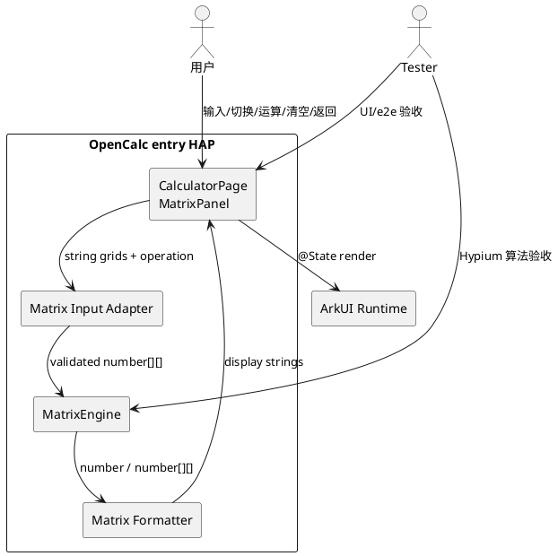
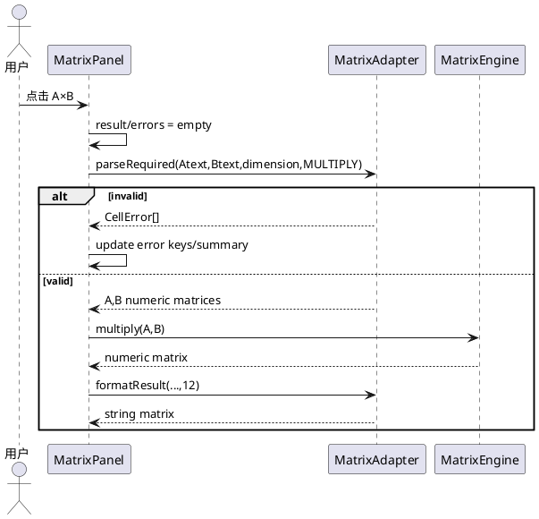
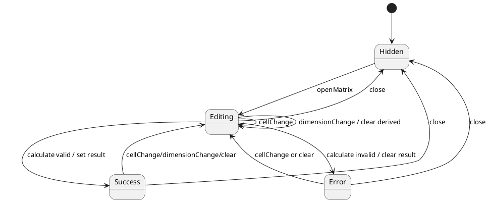
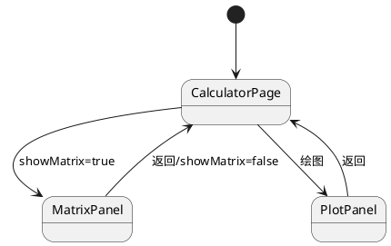
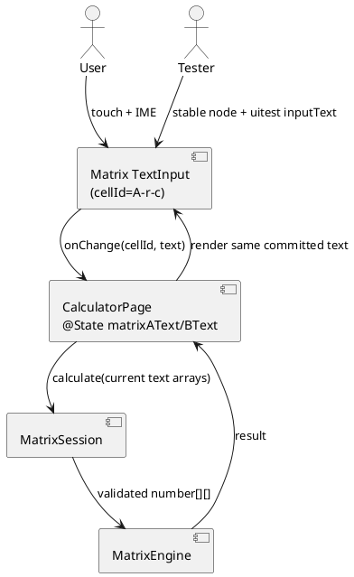
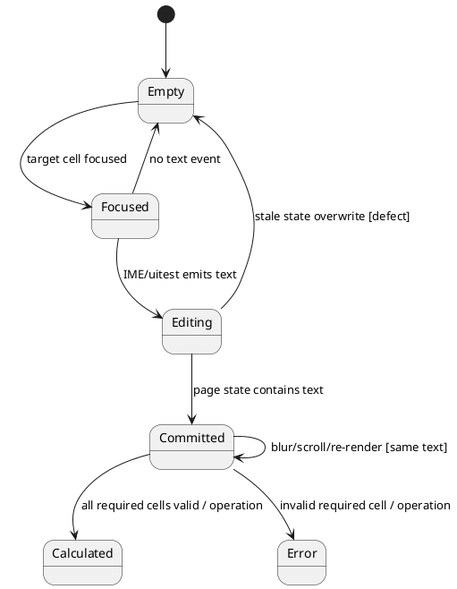
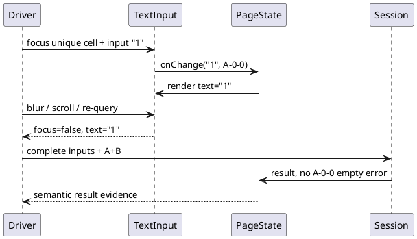

# 2×2 / 3×3 矩阵运算（Issue #51）增量设计

> 增量设计，基线见 `opencalc/spec/DESIGN.md`、`opencalc/spec/ARCH_ANALYSIS.md` 与 `info.md`。需求追溯以 `acceptance-criteria.json` 为权威。

## 1. 概述

### 1.1 应用定位
OpenCalc 新增会话内矩阵工作区，支持 2×2/3×3 同维方阵 A/B 的加、减、乘和 A 行列式。设计优先隔离矩阵与现有标量/绘图状态，不扩展权限、依赖或存储。

### 1.2 核心交互
用户 → ToggleRow“矩阵” → MatrixPanel → 选择 2×2/3×3 → 编辑 A/B → 点击 A+B/A-B/A×B/det(A) → 校验 → 只读矩阵/标量结果；可清空或返回主计算器。

### 1.3 技术栈概览
- ArkTS、Stage 模型、ArkUI 声明式；API 12（随现有 build profile）。
- 状态管理：V1 `@State`，与 CalculatorPage 一致；不引入 V2。
- Kit：仅现有 ArkUI；无新增 Kit、OHPM、Native、Hvigor 插件。
- 算法：ArkTS `number`，n≤3 的同步纯逻辑。
- 测试：现有 `@ohos/hypium 1.0.15` + Tester 独立设备 UI 证据。

## 2. 功能清单
| 功能名 | 说明 | 入口 Ability/Page | 优先级 | 追溯 |
|---|---|---|---|---|
| 矩阵入口/返回 | 打开独立覆盖面板并恢复主视图 | EntryAbility/CalculatorPage | P0 | SR-00, AC-001/012 |
| 维度与双网格 | 2×2/3×3，A/B 字符串单元 | MatrixPanel | P0 | SR-00, AC-001/010 |
| 输入校验 | 操作感知必填范围、全部错误定位 | MatrixPanel handler | P0 | SR-02, AC-007/008/009 |
| 四类运算 | add/subtract/multiply/determinant | MatrixEngine | P0 | SR-01, AC-002..005 |
| 结果格式 | 12 位有效数字、-0→0、整数简洁 | format helper | P0 | SR-01, AC-006 |
| 清空/状态失效 | 一次性重置或切换清派生状态 | Matrix handlers | P0 | SR-00, AC-010/011 |
| 范围控制/回归 | 仅约定控制，既有模式不回归 | CalculatorPage | P0 | SR-03, AC-012/013 |

## 3. 实现模型

### 3.1 上下文视图


### 3.2 总体架构
```text
View（CalculatorPage / MatrixPanel）
  → Application Adapter（parse/validate/state transitions/format）
    → Domain（MatrixEngine pure functions）
      → Platform（ArkUI only；无 Data/Persistence 依赖）
```
单向数据流：用户输入字符串 → 新数组引用 → 校验 → 数值结果 → 展示字符串 → ArkUI 刷新。

### 3.3 HAP/HAR/HSP 模块划分
不变：单 `entry` HAP，phone/tablet；不新增 HAR/HSP/feature HAP。新增源码建议位于 `entry/src/main/ets/calculator/MatrixEngine.ets`，测试位于 `entry/src/test/MatrixEngine.test.ets`。

### 3.4 设计系统规格

#### 3.4.1 色彩系统
复用 `CalculatorPage` 现有 `getBg/getPanelBg/getT1/getT2/getOp/getErr/getBtnBg/getBtnText`。错误单元边框使用 `getErr()`；活动维度/运算使用 `getOp()`；不新增资源色。

#### 3.4.2 主题系统
沿用 `themeIdx` 0/1/2；MatrixPanel 不缓存主题颜色，渲染时调用既有函数（AC-012）。

#### 3.4.3 排版系统
| 名称 | 字号 | 用途 |
|---|---|---|
| MatrixTitle | 18 Bold | “矩阵运算”标题 |
| MatrixLabel | 14 Bold | A/B/结果标签 |
| MatrixCell | 14 | 输入和结果单元 |
| MatrixAction | 13-14 | 维度与运算按钮 |
| MatrixError | 13-14 | 错误摘要 |

#### 3.4.4 间距与尺寸系统
面板 padding 16；cell 最小高度 40、间隔 4；操作按钮最小高度 40；网格宽度按 `layoutWeight(1)` 分配。2×2 不拉伸为超大输入；3×3 允许纵向 Scroll 保证小屏操作可达。[推断]

#### 3.4.5 图标与图形资源
无新增图片/SVG；入口和返回沿用文本标识。

#### 3.4.6 动画规格
无新增动画，覆盖层瞬时切换，与 PlotPanel 一致。

#### 3.4.7 响应式断点与栅格
不引入新断点。MatrixPanel 全屏，内部用 Scroll + 两个垂直排列矩阵（小屏）为默认；宽屏是否 A/B 并排可由 `isLandscape` 选择，但语义和 cell key 不变。[推断]

### 3.5 MatrixEngine 模块实现设计

#### 3.5.1 模块介绍
entry 内纯逻辑模块，无 `@Component`、Kit、Preferences 或静态全局错误依赖，可被 Hypium 直接构造。承载 SR-01；输入校验 helper 可同文件内聚，但 UI error 文案留在页面层。

#### 3.5.2 功能描述
- `add/subtract`：逐元素。
- `multiply`：标准行乘列。
- `determinant`：2 阶闭式；3 阶按第一行代数余子式或 Sarrus，设计选择前者以符号清晰。
- `validateShape`：防御 n∈{2,3}、方阵、同维、finite。
- `normalizeForDisplay/formatValue`：展示边界消噪。

#### 3.5.3 目录结构
```text
entry/src/main/ets/
├── calculator/
│   └── MatrixEngine.ets          # planned: types + engine + pure helpers
└── pages/
    └── CalculatorPage.ets        # modified: MatrixPanel + state/handlers
entry/src/test/
├── MatrixEngine.test.ets         # planned
└── List.test.ets                 # modified registration
```

#### 3.5.4 架构图谱
```plantuml
@startuml
enum MatrixOperation { ADD; SUBTRACT; MULTIPLY; DETERMINANT }
class MatrixEngine {
  +add(a: Matrix,b: Matrix): Matrix
  +subtract(a: Matrix,b: Matrix): Matrix
  +multiply(a: Matrix,b: Matrix): Matrix
  +determinant(a: Matrix): number
  -assertMatrix(a: Matrix): number
}
class MatrixAdapter {
  +parseRequired(aText,bText,size,op): ParseResult
  +formatResult(result,precision): DisplayResult
}
class CalculatorPage
CalculatorPage --> MatrixAdapter
MatrixAdapter --> MatrixEngine
@enduml
```



#### 3.5.5 功能与用例分析
```text
SC002-UC001：2×2 标准向量验证所有公式与结果类型。
SC002-UC002：3×3 单位阵、负小数与格式边界。
SC003-UC001：解析失败返回所有 cell errors，Engine 不被调用。
```

#### 3.5.6 接口设计
```typescript
export type Matrix = number[][]

export enum MatrixOperation {
  ADD = 'add',
  SUBTRACT = 'subtract',
  MULTIPLY = 'multiply',
  DETERMINANT = 'determinant'
}

export interface CellError {
  matrix: 'A' | 'B'
  row: number
  column: number
  reason: 'empty' | 'invalid'
}

export interface ParseResult {
  valid: boolean
  a?: Matrix
  b?: Matrix
  errors: CellError[]
}

export interface MatrixDisplayResult {
  kind: 'matrix' | 'scalar'
  matrix?: string[][]
  scalar?: string
}

export class MatrixEngine {
  add(a: Matrix, b: Matrix): Matrix
  subtract(a: Matrix, b: Matrix): Matrix
  multiply(a: Matrix, b: Matrix): Matrix
  determinant(a: Matrix): number
}
```
ArkTS 若对字符串 literal union 支持/规范有限，[推断] 可改为 enum，不改变契约语义。所有接口同步，无 async。

#### 3.5.7 状态管理设计
Engine 无状态。CalculatorPage 规划状态：
```typescript
@State showMatrix: boolean = false
@State matrixSize: number = 2
@State matrixAText: string[][] = emptyTextMatrix(3) // 固定 3×3 容器，仅显示 size 区域 [推断]
@State matrixBText: string[][] = emptyTextMatrix(3)
@State matrixErrors: string[] = []                 // key: A-0-1
@State matrixErrorSummary: string = ''
@State matrixResultKind: number = 0                // 0 none, 1 matrix, 2 scalar
@State matrixResultText: string[][] = []
@State matrixScalarText: string = ''
```
推荐固定 3×3 存储、按 size 投影 UI：2→3 自然保留重叠；3→2 时规范要求外围被舍弃，因此切回 2 时必须主动清 `[row>=2 || col>=2]`，避免再次升维恢复已舍弃的旧值。每次深层更新创建新 row 和外层 array 引用。

#### 3.5.8 核心算法
```text
add/sub: out[i][j] = a[i][j] ± b[i][j]
multiply: out[i][j] = Σ(k=0..n-1) a[i][k] * b[k][j]
det2: a00*a11 - a01*a10
det3: a00*(a11*a22-a12*a21)
    - a01*(a10*a22-a12*a20)
    + a02*(a10*a21-a11*a20)
```
复杂度：加减 O(n²)，乘法 O(n³)，det 固定 O(1)；空间 O(n²)。

数字解析正则语义：`^[+-]?(?:\d+(?:\.\d*)?|\.\d+)$`（对 trim 后文本）；随后 `Number(text)` + `Number.isFinite`。实现时根据 ArkTS RegExp/Number API 兼容性等价表达。[推断]

格式：
1. 若非 finite → 内部错误，不渲染数值。
2. `normalized = Number(value.toPrecision(precision))`，precision 默认 12。
3. 若 `Object.is(normalized,-0)` 或 `abs(normalized)<10^-precision`，设 0。[推断：epsilon 仅用于显示，不改数学结果。]
4. `normalized.toString()`；整数自然无 `.0`；需要时再用 NumberFormatter 分组。

#### 3.5.9 错误处理
| 错误 | 层 | 行为 |
|---|---|---|
| empty cell | adapter | `CellError(empty)`；不调用 Engine |
| illegal syntax/non-finite | adapter | `CellError(invalid)`；不调用 Engine |
| wrong shape/dimension | Engine defense | 抛出/返回内部错误；UI 显示“矩阵维度错误”，清结果 |
| non-finite result | formatter | 显示“结果超出可表示范围”，清结果 |
| unexpected exception | page handler | 捕获，显示“矩阵计算错误”，保持输入可修复 |

禁止复用静态 `ErrorFlags`，避免跨标量/绘图污染。

#### 3.5.10 依赖关系
内部仅标准 Math/Array 与可选 NumberFormatter；外部无。

### 3.6 MatrixPanel 模块实现设计

#### 3.6.1 模块介绍
CalculatorPage 内新增 Builder，遵循 PlotPanel 全屏覆盖惯例。为控制现有单文件增长，[推断] 若 ArkUI 状态传递可在不增加复杂度下稳定实现，可抽为 `view/MatrixPanel.ets`；默认先内聚在页面以保持现有模式。

#### 3.6.2 功能描述
标题/返回、维度单选、A/B 标签与输入、四个运算按钮、清空、错误摘要、只读结果。

#### 3.6.3 目录结构
默认无新增 view 目录；所有公式在 MatrixEngine，页面只含 Builder/handlers。

#### 3.6.4 架构图谱


#### 3.6.5 功能与用例分析
对应 SC001、SC003、SC004；特别验证切换、清空、返回和错误 cell 独立性。

#### 3.6.6 接口设计
页面私有 handler：[推断]
```typescript
private onOpenMatrix(): void
private onCloseMatrix(): void
private onMatrixSize(size: number): void
private onMatrixCell(matrix: number, row: number, column: number, value: string): void
private onMatrixCalculate(operation: MatrixOperation): void
private onMatrixClear(): void
private invalidateMatrixDerivedState(): void
```

#### 3.6.7 状态管理设计
- `onOpenMatrix`：`showPlot/showSettings/showAbout=false; showMatrix=true`，不改 scalar 状态。
- `onMatrixSize`：若变化则清被移除外围（3→2），设置 size，清 result/errors。
- `onMatrixCell`：复制目标矩阵和 row，写 value；移除该 key 的 error；清 result（避免陈旧结果）。
- `onMatrixCalculate`：先清 result/errors，再 parse 全部 required cells；错误一次性提交；成功一次性提交 result。
- `onMatrixClear`：清两个 3×3 容器、结果、错误，保留 size。

#### 3.6.8 核心算法
UI 不含矩阵算法。网格通过双层固定循环/ForEach 产生；key=`matrixName-row-column`。每个 TextInput 的 onChange 闭包捕获不可变 row/column 值，避免所有 hit target 写同一格。

#### 3.6.9 错误处理
错误单元使用边框/辅助提示，摘要至少区分“有空单元格”和“有非法数字”。不依赖颜色作为唯一信号；可访问文本包含矩阵名和 1-based 坐标，例如“矩阵 A 第1行第2列不能为空”。[推断]

#### 3.6.10 依赖关系
依赖 MatrixEngine/adapter、CalculatorPage 主题方法、ArkUI TextInput/Button/Scroll；不依赖 Preferences。

## 4. 接口设计

### 4.1 内部数据访问 API
无矩阵数据访问 API；不接 RDB/Preferences。

### 4.2 业务抽象接口
见 §3.5.6。接口只在 entry 内使用，不导出跨 HAP 契约。

### 4.3 后台任务与 ExtensionAbility 接口
无相关实现。

### 4.4 Want / Action 协议
无变更。

### 4.5 URI / Deep Link / AppLinking 协议
无相关实现。

### 4.6 IPC 与 RPC 接口
无相关实现。

### 4.7 Native（C/C++）接口
无相关实现。

### 4.8 文件交换接口
无相关实现。

## 5. 数据模型

### 5.1 关系型数据库模型
无相关实现。

### 5.2 领域模型
| 字段/类型 | 类型 | 必填 | 说明 |
|---|---|---|---|
| Matrix | `number[][]` | 是 | 仅完整 2/3 阶 finite 方阵进入 Engine |
| MatrixOperation | enum | 是 | ADD/SUBTRACT/MULTIPLY/DETERMINANT |
| CellError.matrix | enum/string | 是 | A 或 B |
| CellError.row/column | number | 是 | 0-based 内部坐标 |
| CellError.reason | enum | 是 | empty/invalid |
| DisplayResult.kind | enum | 是 | none/matrix/scalar |
| DisplayResult.matrix/scalar | string[][]/string | 条件 | 与 kind 互斥 |

### 5.3 Preferences 结构
无新增 key。读取现有 `numberPrecision` 可作为后续兼容增强；第一版默认 12 与现有默认一致。

### 5.4 分布式数据对象模型
无相关实现。

### 5.5 文件格式 Schema
无相关实现。

## 6. UI 设计系统

### 6.1 色彩系统
见 §3.4.1；错误颜色同时配合文本/边框语义。

### 6.2 主题与暗色模式
随 CalculatorPage `themeIdx` 即时刷新，不另存主题。

### 6.3 排版系统
见 §3.4.3。

### 6.4 间距与尺寸规范
见 §3.4.4；所有主要按钮保持可点击尺寸，不因 3×3 网格被挤出屏幕。

### 6.5 图标与图形资源
无新增资源。

### 6.6 动画规格
无新增动画。

### 6.7 一多响应式规范
- phone portrait：A/B 垂直排列，整体可滚动，操作区不遮挡返回。
- landscape/tablet：[推断] 可并排 A/B；若不实现并排也必须全量可滚动可达。
- 旋转不改变 matrixSize、输入、result/errors；布局变化不重建业务状态。

## 7. 页面清单与导航

### 7.1 页面清单总表
| 页面/面板 | 路径 | 入口 | 传参 | 摘要 |
|---|---|---|---|---|
| CalculatorPage | `pages/CalculatorPage` | EntryAbility/Index | 无 | 既有主页面 |
| MatrixPanel | 同页 Builder/overlay | ToggleRow“矩阵” | 共享页面内 matrix state | 新增矩阵工作区 |

### 7.2 全局导航图


### 7.3 Deep Link / AppLinking 处理
无相关实现。

### 7.4 Want 跳转矩阵
无变更；MatrixPanel 不新增路由。

## 8. 用户交互规格

### 8.1 手势交互目录
| 控件 | 手势 | 行为 | 状态影响 |
|---|---|---|---|
| 矩阵入口 | tap | 打开并关闭其他 overlay | showMatrix |
| 2×2/3×3 | tap | 切换维度 | preserve overlap + clear derived |
| cell | edit | 更新唯一坐标 | cloned text matrix + invalidate result |
| 四运算 | tap | 校验并计算 | errors 或 result |
| 清空 | tap | 幂等重置 | inputs/result/errors empty |
| 返回 | tap | 关闭矩阵 | 主标量状态不变 |

### 8.2 弹窗/Sheet/Menu 目录
无新增弹窗；错误在面板内联显示，避免重复弹窗打断逐格修复。

### 8.3 剪贴板与反馈行为
不新增矩阵复制（Issue 未要求）。标量结果长按复制行为不变。

### 8.4 卡片交互
无相关实现。

## 9. 平台集成

### 9.1 构建配置与依赖
不修改 build-profile、oh-package 或 Hvigor 配置；保持 API 12、entry HAP、Hypium 1.0.15。

### 9.2 权限与运行时请求
不新增权限；现有 `ohos.permission.VIBRATE` 保持。

### 9.3 系统能力（Kits）清单
| Kit | 关键能力 | 用途 |
|---|---|---|
| ArkUI（现有） | TextInput/Row/Column/Scroll/条件渲染/@State | 矩阵交互和显示 |

### 9.4 后台与 Extension
无相关实现。

### 9.5 备份与恢复
无相关实现；矩阵会话不持久化。

### 9.6 分布式与跨端
无相关实现。

## 10. 偏好设置目录

### 10.1 现有数值精度
| key/来源 | 类型 | 默认值 | 说明 | 行为影响 |
|---|---|---|---|---|
| `CalculatorPreferences.numberPrecision` | number | 12 | 现有模型默认精度；当前页面未加载 | 矩阵 formatter 默认参数 12，与现有策略对齐 |

不新增矩阵偏好。若后续把 numberPrecision 接入 UI，formatter 应接收该值而非改 AC 的消噪语义。

## 11. 自验证记录（mod-design）
| 校验项 | 结论 | 证据 |
|---|---|---|
| 功能一致性 | 通过 | §2 覆盖 SR-00..04 / AC-001..014 |
| 页面一致性 | 通过 | §7 仅新增同页 MatrixPanel |
| 数据一致性 | 通过 | §5 无持久化，领域类型对应 info/spec |
| 权限一致性 | 通过 | §9.2 明确无新增权限 |
| Kit 一致性 | 通过 | §9.3 仅 ArkUI |
| 兼容性 | 通过 | 独立状态/Engine，不改 scalar/preferences/route |

### 11.1 AC → 设计追溯
| AC | 设计落点 |
|---|---|
| AC-001 | §3.6 MatrixPanel 网格与 §7 入口 |
| AC-002 | §3.5.8 add/sub 算法 |
| AC-003 | §3.5.8 multiply 行乘列算法 |
| AC-004 | §3.5.8 det2 与 scalar result kind |
| AC-005 | §3.5.8 det3 / multiply 与 §3.5.5 单位阵用例 |
| AC-006 | §3.5.8 展示规范化 |
| AC-007 | §3.5.8 完整十进制语法 |
| AC-008 | §3.5.9、§3.6.9 全量错误定位 |
| AC-009 | §3.6.7 operation-aware required matrices |
| AC-010 | §3.5.7 / §3.6.7 resize 状态转换 |
| AC-011 | §3.6.7 `onMatrixClear` |
| AC-012 | §3.6.7 overlay 互斥与 §7 返回 |
| AC-013 | §2 精确维度/运算功能集合 |
| AC-014 | §1.3、§3.3 与平台测试边界 |

---
> 本文档由 mod-design skill 工作流生成。
> 标记 [推断] 的内容为基于设计推断，非确定性事实。
> 生成时间：2026-10-24（Asia/Shanghai）

## 12. Tester-feedback 增量设计（2026-10-25）

### 12.1 设计目标与边界

本修订对应 IR-012、SR-05/SR-06、SC006-UC001、AC-015。目标是在不改变矩阵算法、数字语法、精度、状态规则和其他计算器模式的前提下，修复设备 TextInput 从焦点/输入事件到页面 `@State`、可见文本和 MatrixSession 的提交闭环。

- 保留同页 MatrixPanel、ArkUI V1 `@State` 与现有 MatrixSession。
- 不新增自定义数字键盘、测试专用注入接口、权限、网络、存储、OHPM 依赖或路由。
- 不将 `inputText` 命令 exit 0 当作成功；成功必须由焦点、文本、失焦保持和最终计算共同证明。

### 12.2 根因诊断门禁

在后续实现阶段修改行为前，先对精确失败构建执行最小诊断：

| 观察时点 | 必须记录 | 判定 |
|---|---|---|
| 输入前 | A[1,1] 唯一节点 identity、bounds、focus=false、text empty | 定位基线 |
| 输入命令后立即 | 命令参数/exit、focus、UI tree text、截图 | 未 focus=驱动/坐标；focus 且 text empty=事件/组件问题 |
| IME 收起/失焦后 | 同一 identity 的 text 与页面错误状态 | 先有值后为空=陈旧状态回写 |
| 补齐并计算后 | A[1,1] error、结果单元格 | UI 有值但判空=UI/Session 不同步 |

诊断只用于选择最小修复，不向产品加入永久调试后门。

### 12.3 组件与状态设计



设计约束：

1. 每个输入节点的逻辑 identity 为 `{matrix}-{row}-{column}`，A/B 与所有 2×2/3×3 位置均唯一且切换后稳定。
2. 顶层 `matrixAText`/`matrixBText` 是唯一持久到重绘的文本真源；输入事件按 cell identity 创建新行/新矩阵引用并原子替换对应 `@State`。
3. MatrixSession 不持有与 UI 竞争的长期文本所有权；计算时从当前页面快照加载，计算完成只回写派生状态。若保留现有 load/store 往返，必须证明它不会把输入前空快照写回。
4. 嵌套 `ForEach` 必须具有稳定 key/identity；事件闭包的 matrix/row/column 与可见单元格一致。
5. 焦点、键盘类型或测试标识仅增强标准 TextInput 可达性，不改变输入语法；最终合法性仍由 MatrixInputAdapter 统一决定。

### 12.4 状态机与时序





### 12.5 接口与文件规划

不新增公共业务 API。后续实现只允许在以下最小边界内选择：

| 位置 | 允许调整 | 保持不变 |
|---|---|---|
| `CalculatorPage.ets` MatrixGrid/handler | stable cell identity、焦点/测试可定位性、直接且原子的顶层文本状态更新、派生状态失效 | 四个运算入口、布局范围、其他模式状态 |
| `MatrixEngine.ets` MatrixSession | 仅在证明确有空快照回写时收窄 UI 文本同步职责 | 运算、解析、格式化、维度/清空契约 |
| 测试资产 | 增加 AC-015 的焦点/文本/失焦/计算断言 | 既有算法向量和 AC-001..014 |

[推断] 优先方案是在页面输入 handler 中直接更新唯一顶层 `@State` 文本矩阵并单独失效派生状态，避免为一次 cell edit 执行完整 Session load/store；若诊断证明问题仅是自动化坐标/焦点，则只增强稳定节点 identity 与测试定位，不改业务状态链。

### 12.6 错误处理与恢复

- 自动化未聚焦目标节点：测试步骤失败并重新定位；应用不得伪造成功值。
- 文本事件到达但渲染回空：保留输入事件与 UI tree 证据，修正状态所有权后重测。
- UI/Session 不一致：阻止通过并以最终运算 oracle 定位；不得只增加等待时间掩盖竞争。
- 修复后执行 AC-015，再完整重跑 AC-002..012 的输入依赖设备 UI 场景；算法/构建/lint 门禁仍保留。

### 12.7 平台、权限与兼容设计

沿用 API 12 ArkUI TextInput 和系统 IME，无新增 Kit/权限/配置。MatrixPanel 的外部契约不变，普通/科学/绘图/分数/程序员模式无修改。输入状态仍为会话内数据，不持久化。此修订不需要更新 HAP/HAR/HSP 架构或 `new-arch.md`。

### 12.8 AC → 设计追溯补充

| AC | 设计落点 |
|---|---|
| AC-015 | §12.2 分时点诊断；§12.3 唯一 identity/单一状态所有权；§12.4 状态机/时序；§12.6 恢复与设备回归 |

### 12.9 mod-design 自验证补充

| 校验项 | 结论 |
|---|---|
| 功能一致性 | IR-012/SR-05/06/AC-015 全部有设计落点，原 AC 不降级 |
| 页面一致性 | 仍为 CalculatorPage 同页 MatrixPanel，无新页面/路由 |
| 数据一致性 | 只调整会话文本状态所有权，不新增持久化 schema |
| 权限/Kit 一致性 | 无新增权限或 Kit |
| 兼容性 | 不改 MatrixEngine 运算语义和其他模式状态 |

---
> 本节由 mod-design 工作流基于 Tester handoff 59 生成；标记 [推断] 的内容须由后续诊断验证。
> 修订时间：2026-10-25（Asia/Shanghai）
