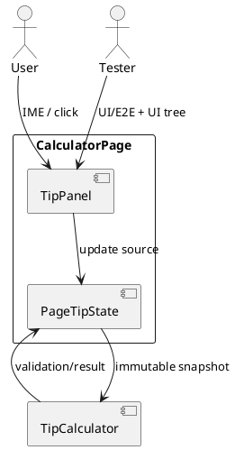
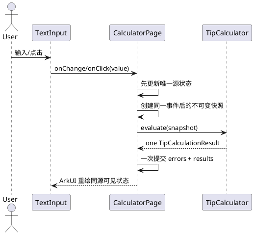
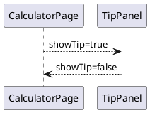

# 小费计算器与多人账单分摊增量设计

> 2026-10-25 Tester 反馈迭代 1；依据 proposal.md、delta-spec.md、info.md 正向设计。本轮只产出设计，不应用代码。

## 1. 概述

### 1.1 应用定位
在 OpenCalc 既有 CalculatorPage 内提供本地小费分摊覆盖面板，并纠正真机上可见输入与计算快照脱节的 P0 问题。

### 1.2 核心交互
用户进入面板 → 通过系统键盘编辑账单/人数或选择比例 → 页面以同一响应式源状态求值 → 原子显示错误或三项金额 → 返回且主计算器状态不变。

### 1.3 技术栈概览
- ArkTS、Stage 模型、ArkUI 声明式 UI。
- V1 状态管理：页面标量 `@State`；不把可变普通类实例当 UI 事实源。
- entry HAP；无新 Kit、OHPM 包、Native、权限、路由或持久化。
- `TipCalculator` 保持同步、无副作用、整数分值计算。

## 2. 功能清单
| 功能 | 说明 | 入口 | 优先级 | 追溯 |
|---|---|---|---|---|
| 隔离入口 | 横竖屏进入/返回 | CalculatorPage | P0 | AC-001/009 |
| 输入与比例 | 账单、人数、四预设、自定义 0～100 | TipPanel | P0 | AC-002～004/006～008 |
| 响应式即时计算 | 单一源快照派生三结果 | TipPanel | P0 | AC-002～005/011 |
| 校验恢复 | 字段错误、原子清结果、修正恢复 | TipPanel | P0 | AC-006～008/011 |
| 测试可观测性 | 稳定 ID、exact-head 证据 | entry HAP | P0 | AC-010/011 |

## 3. 实现模型

### 3.1 上下文视图


### 3.2 总体架构
```text
View: CalculatorPage.TipPanel
  ↓ user event
State owner: CalculatorPage @State scalars (single source of truth)
  ↓ immutable snapshot
Business: TipCalculator evaluate/parseCustomPercent
  ↓ one result object
Derived UI state: errors + tip/total/perPerson (atomic commit in one handler)
```
关键约束：删除 UI 链路对 `TipSession` 可变镜像状态的依赖。若保留该类用于测试兼容，它不得同时拥有页面输入和派生显示状态，也不得参与生产 UI 的回写环。

### 3.3 HAP/HAR/HSP 模块划分
仅修改既有 entry HAP 内部；无 HAR/HSP/feature HAP 变化。

### 3.4 设计系统规格
- 复用现有主题色、排版、间距、44vp 输入和按钮高度。
- 错误使用文本而非仅颜色；结果固定两位。
- 横竖屏均可滚动到输入、错误、结果和返回入口。
- 保留稳定 ID：`tip-bill-input`、`tip-people-input`、四预设、自定义输入和三结果。

### 3.5 TipCalculator 模块实现设计

#### 3.5.1 模块介绍
无副作用业务模块，接收本次事件后的完整输入快照，不读取 UI、History 或 Preferences。

#### 3.5.2 接口设计
| 接口 | 输入 | 输出 | 约束 |
|---|---|---|---|
| `evaluate` | billText、tipBasisPoints、peopleText | valid/errors/tip/total/perPerson | 同步、不抛业务异常 |
| `parseCustomPercent` | 自定义比例文本 | 0～10000 或非法标记 | 最多两位小数 |

#### 3.5.3 核心算法
1. 金额转整数分，比例转 basis point，人数验证为 ≥1 安全整数。
2. `tipCents = halfUp(billCents * basisPoints / 10000)`。
3. `totalCents = billCents + tipCents`。
4. `perPersonCents = halfUp(totalCents / people)`。
5. 格式化两位；任何错误返回三项 `--`。

#### 3.5.4 错误处理
金额、比例、人数分别给出字段错误；验证先于除法；过大值拒绝；不得返回 NaN/Infinity。

### 3.6 CalculatorPage/TipPanel 模块实现设计

#### 3.6.1 状态所有权
源状态仅为页面级 `tipBillText`、`tipPeopleText`、`tipPresetBasisPoints`、`tipUsingCustom`、`tipCustomText` 和 touched 标志。派生状态仅为三个错误和三个结果。所有字段均由 ArkUI `@State` 驱动可见 UI。

#### 3.6.2 事件事务

禁止顺序：先修改 `TipSession`、再从该普通对象镜像回页面；这会形成页面状态、会话状态和原生输入缓冲区三源。

#### 3.6.3 事件规则
| 事件 | 源状态变化 | 求值比例 |
|---|---|---|
| 账单 onChange | bill=value，touched=true | 当前预设/自定义 |
| 人数 onChange | people=value | 当前预设/自定义 |
| 预设 click | preset=value，usingCustom=false，custom='' | preset |
| 自定义 onChange | custom=value，usingCustom=true | parse(custom) |

#### 3.6.4 初始与恢复
首次账单空且未触碰时隐藏账单错误、结果 `--`；清空已触碰账单则显示明确错误。修正任何非法值后由同一事件立即恢复结果。

#### 3.6.5 兼容隔离
TipPanel 只切换 `showTip`；不调用 `onEquals`、`setHistory`、Preferences、CalcEngine、Plotter 或路由。关闭/重开可保留页面生命周期内源状态，应用重启不恢复。

## 4. 接口设计

### 4.1 内部数据访问 API
无相关实现。

### 4.2 业务抽象接口
沿用 `TipCalculator.evaluate`；UI 传入完整快照。`TipSession` 不作为生产 UI 数据源。

### 4.3 后台任务与 ExtensionAbility 接口
无相关实现。

### 4.4 Want / Action 协议
无相关实现。

### 4.5 URI / Deep Link / AppLinking 协议
无相关实现。

### 4.6 IPC 与 RPC 接口
无相关实现。

### 4.7 Native 接口
无相关实现。

### 4.8 文件交换接口
无产品接口；Tester 证据为阶段制品。

## 5. 数据模型

### 5.1 关系型数据库模型
无相关实现。

### 5.2 领域模型
| 字段 | 类型 | 所有者 | 说明 |
|---|---|---|---|
| billText/peopleText/customText | string | CalculatorPage @State | 唯一可见文本源 |
| presetBasisPoints/usingCustom | number/boolean | CalculatorPage @State | 唯一比例模式源 |
| errors/tip/total/perPerson | string | CalculatorPage @State | 同一快照派生 |
| TipCalculationResult | interface | TipCalculator | 单次求值不可变结果 |

### 5.3 Preferences 结构
无新增 key。

### 5.4 分布式数据对象模型
无相关实现。

### 5.5 文件格式 Schema
无相关实现。

## 6. UI 设计系统
见 §3.4。Tester 必须用真实系统键盘产生用户编辑事件，并在证据点同时读取三个输入/选中态和三个结果；只向原生控件注入文本而未触发应用事件不能单独证明产品状态同步。

## 7. 页面清单与导航
| 页面 | 路径 | 变化 |
|---|---|---|
| CalculatorPage | pages/CalculatorPage | 既有同页 TipPanel 条件覆盖层；无新路由 |



Deep Link、AppLinking、Want 均无相关实现。

## 8. 用户交互规格
| 控件 | 行为 | 可见后置条件 |
|---|---|---|
| 横/竖屏小费入口 | click | TipPanel 可见 |
| 返回 | click | 主界面恢复且状态不变 |
| 账单/人数 | system IME onChange | 可见文本与同帧结果匹配 |
| 四预设 | 每个独立 click | 唯一选中且使用自身值 |
| 自定义比例 | onChange | 自定义态选中，0～100 校验 |
| 非法输入 | onChange | 字段错误、三结果 `--` |

无新增弹窗、剪贴板、卡片或手势。

## 9. 平台集成
- 构建、依赖、module、pages 配置均不变。
- 无新增权限、Kit、后台、备份、分布式或跨端能力。
- 最低 API 沿用项目基线。
- 测试门禁：Local Test 验证计算/快照逻辑；真机 UI/E2E 验证 AC-002/004/011 的真实 IME 响应式链路。

## 10. 偏好设置目录
无新增偏好项；既有主题、科学模式和历史契约保持不变。

## 自验证
| 校验 | 结果 |
|---|---|
| 功能一致性 | proposal F1～F5 和 spec SR-00～05 均有设计落点 |
| 页面一致性 | 仅 CalculatorPage 覆盖层，无新页面/路由 |
| 数据一致性 | 页面唯一源状态；无持久化模型 |
| 权限/Kit | 无新增 |
| Tester 反馈 | 多源状态风险已由单一源事件事务和 AC-011 门禁闭环 |
| 兼容性 | 不依赖 History/Preferences/CalcEngine/Plotter |

### AC 设计落点矩阵
| AC | 设计落点 |
|---|---|
| AC-001 | §3.6.5、§7 |
| AC-002 | §3.5 算法、§3.6 事件事务、真实 IME 核心示例 |
| AC-003 | §3.5 算法、§3.6 事件事务、88.80 示例 |
| AC-004 | §3.6.1～3、§8 |
| AC-005 | §3.5 算法、0% 和舍入边界 |
| AC-006 | §3.5.4、§3.6.4 账单校验恢复 |
| AC-007 | §3.5.4、§3.6.4 人数校验恢复 |
| AC-008 | §3.5.4、§3.6.4 比例校验恢复 |
| AC-009 | §3.6.5、§10 |
| AC-010 | §6、§9 测试可观测性 |
| AC-011 | §3.6.1～2、§6、§9 真机 IME 门禁 |

---
> 本文档由 mod-design skill 生成。标记为基于代码和 Tester 证据的正向纠正设计；未实施代码。
