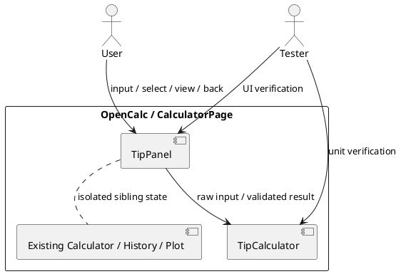
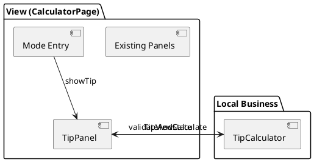
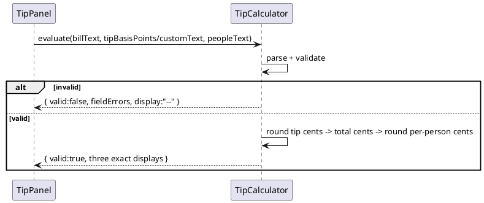
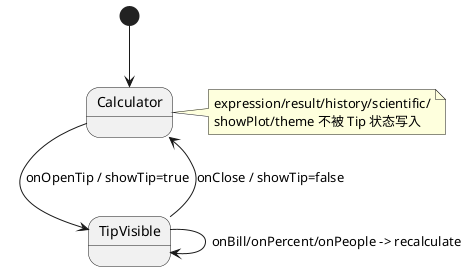
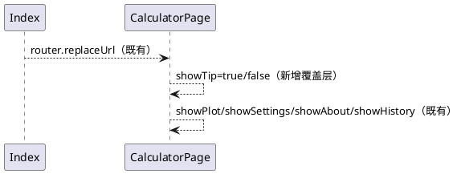

# 小费计算器与多人账单分摊增量设计

## 1. 概述

### 1.1 应用定位
在 OpenCalc 现有单页计算器中增加一个本地、无持久化的小费分摊工具。设计追溯 `IR-001～IR-007`、`SR-00～SR-05` 和 `AC-001～AC-011`。

### 1.2 核心交互
用户从横屏或竖屏主界面点击“小费” → TipPanel 显示 → 输入账单、选择比例、输入人数 → 每次变化立即显示结果或字段错误 → 点击返回 → 原表达式、结果、历史和模式状态保持。

### 1.3 技术栈概览
- 框架：ArkTS、Stage 模型、ArkUI 声明式 UI。
- 状态管理：沿用 V1 `@State`，不引入 V2。
- 模块：entry HAP 内新增纯 ArkTS `tip/TipCalculator.ets`；扩展 `pages/CalculatorPage.ets`。
- Kits：只复用既有 ArkUI；不新增 Kit、OHPM 包、Native 模块、权限或路由。
- 测试：既有 `@ohos/hypium` 本地测试；UI 证据由后续 Tester 在模拟器/真机执行。

---

## 2. 功能清单
| 功能名 | 说明 | 入口 Ability/Page | 优先级 | 追溯 |
|--------|------|-------------------|--------|------|
| 小费入口与覆盖面板 | 横竖屏进入/退出，主题一致 | EntryAbility / CalculatorPage | P0 | SR-00, AC-001 |
| 账单和人数输入 | 保留原始文本，字段级校验 | TipPanel | P0 | SR-01/03 |
| 比例选择 | 0/10/15/20 与自定义互斥 | TipPanel | P0 | SR-01, AC-005/009 |
| 即时货币计算 | 小费、总额、每人结果 | TipCalculator + TipPanel | P0 | SR-02, AC-002～006 |
| 错误清理与恢复 | 非法时结果 `--`，修正后自动恢复 | TipCalculator + TipPanel | P0 | SR-03, AC-007～009 |
| 状态/历史隔离 | 不调用主引擎与 Preferences | CalculatorPage | P0 | SR-04, AC-010 |
| 可测试性 | 纯逻辑接口、稳定 UI 标识 | tip/test/UI | P1 | SR-05, AC-011 |

---

## 3. 实现模型

### 3.1 上下文视图


### 3.2 总体架构


数据流保持单向：UI 原始字符串 → 纯逻辑校验/计算 → 不可变结果 DTO → `@State` 文本刷新。不存在 Data/Platform 层调用。

### 3.3 HAP/HAR/HSP 模块划分
- `entry`：唯一 HAP，现状不变。
- 不新增 feature HAP、HAR、HSP 或 OHPM 依赖。
- 新文件只是 entry HAP 内 ArkTS 源模块。

### 3.4 设计系统规格

#### 3.4.1 色彩系统
全部复用 `getPanelBg/getBtnBg/getFuncBg/getOp/getErr/getT1/getT2/getBtnText`，覆盖浅色、暗色和 AMOLED；不新增硬编码主题颜色。

#### 3.4.2 主题系统
TipPanel 每次 build 读取 `themeIdx` 的既有派生方法，主题切换后自然重绘；不创建本地主题副本。

#### 3.4.3 排版系统
| 名称 | 字号 | 用途 |
|------|------|------|
| PanelTitle | 18vp | “小费计算器” |
| FieldLabel/ResultLabel | 14vp | 输入与结果标签 |
| Input/ResultValue | 18–24vp | 输入和金额 |
| Error | 12–14vp | 字段错误 |
| Action | 14–16vp | 比例和返回 |

#### 3.4.4 间距与尺寸系统
沿用 PlotPanel：外边距 16vp，控件间距 8vp；输入和比例点击区域高度至少 40vp；结果卡横/竖屏允许换行但不得裁掉标签和值。

#### 3.4.5 图标与图形资源
无新增资源；返回沿用文本“✕ 返回”。

#### 3.4.6 动画规格
无新增动画，条件渲染即时切换。

#### 3.4.7 响应式断点与栅格
- 竖屏：入口加入 ToggleRow；TipPanel 单列布局。
- 横屏：入口加入 DisplayPanel 右侧操作区；TipPanel 使用两列（输入/比例与结果）或可滚动单列，保证全部字段可见。
- 不引入新断点常量，继续使用 `isLandscape`。

### 3.5 TipCalculator 模块实现设计

#### 3.5.1 模块介绍
新增 `opencalc/entry/src/main/ets/tip/TipCalculator.ets`。模块无 ArkUI、Preferences、网络和计算器引擎依赖，负责确定性解析、校验、计算与格式化。

#### 3.5.2 功能描述
1. 解析不带符号、最多两位小数的账单文本为整数分值。
2. 解析预设或自定义比例为 basis points（百分比的 1/100，范围 0～10000）。
3. 验证人数为 `>=1` 的十进制整数。
4. 按既定舍入顺序返回三项分值及固定两位文本。
5. 任一失败返回字段错误，绝不返回部分/旧计算结果。

#### 3.5.3 目录结构
```text
entry/src/main/ets/
├── pages/CalculatorPage.ets          # 修改
└── tip/TipCalculator.ets             # 新增
entry/src/test/
└── TipCalculator.test.ets            # 后续阶段新增
```

#### 3.5.4 架构图谱


#### 3.5.5 功能与用例分析
- SC002-UC001/002：精确示例与舍入。
- SC002-UC003：任一输入变化均重复调用 evaluate。
- SC003-UC001/002/003：校验失败和恢复。

#### 3.5.6 接口设计
```typescript
export enum TipField {
  NONE = 'none', BILL = 'bill', PERCENT = 'percent', PEOPLE = 'people'
}

export interface TipErrors {
  bill: string
  percent: string
  people: string
}

export interface TipCalculationResult {
  valid: boolean
  errors: TipErrors
  tip: string       // valid=false 时 '--'
  total: string
  perPerson: string
}

export class TipCalculator {
  evaluate(billText: string, tipBasisPoints: number, peopleText: string): TipCalculationResult
  parseCustomPercent(text: string): number // 失败返回 -1；有效 0..10000
}
```

`tipBasisPoints` 由预设直接提供：0/1000/1500/2000；自定义通过 `parseCustomPercent` 得到。实现时可将解析函数保持 private，并按实际测试便利度暴露最小接口。

#### 3.5.7 状态管理设计
纯逻辑模块无状态。每次输入产生新 `TipCalculationResult`，不缓存上一次结果。

#### 3.5.8 核心算法

**十进制解析**
- 账单正则：`^(0|[1-9][0-9]*)(\.[0-9]{1,2})?$`。
- 百分比正则同上；转换为 basis points 后要求 `0..10000`。
- 人数正则：`^[1-9][0-9]*$`，数值必须为安全整数。
- 账单转换：`whole * 100 + fraction.padEnd(2, '0')`。要求分值不超过 `floor(Number.MAX_SAFE_INTEGER / 10000)`，使最坏比例乘法仍保持安全整数。

**计算与舍入（全部输入非负）**
```text
tipCents = floor((billCents * tipBasisPoints + 5000) / 10000)
totalCents = billCents + tipCents
perPersonCents = floor((totalCents + people / 2) / people)
display(cents) = floor(cents/100) + '.' + (cents%100).padStart(2,'0')
```
最大账单约束还需保证 `totalCents <= Number.MAX_SAFE_INTEGER`；若不满足返回“金额过大”。该方案对非负数实现 half-up，与本期“货币精度四舍五入”一致。

#### 3.5.9 错误处理
| 条件 | 错误文本（允许等义微调） | 结果 |
|------|-------------------------|------|
| bill 空 | 请输入账单金额 | 全部 `--` |
| bill 格式非法/负数 | 账单金额必须为非负数字，最多两位小数 | 全部 `--` |
| bill 超安全范围 | 账单金额过大 | 全部 `--` |
| percent 空/格式非法/越界 | 小费比例必须为 0%–100%，最多两位小数 | 全部 `--` |
| people 空/0/负数/小数/非数字 | 人数必须为不小于 1 的整数 | 全部 `--` |

验证顺序固定为 bill → percent → people，但 UI 可以同时显示所有字段错误；任何错误都禁止进入计算。

#### 3.5.10 依赖关系
无内部或外部依赖；只使用 ArkTS/ECMAScript 基础字符串和 number 运算。

### 3.6 CalculatorPage / TipPanel 实现设计

#### 3.6.1 模块介绍
修改既有 `CalculatorPage.ets`，复用 PlotPanel 的覆盖层惯例。不拆新页面，不触发 Ability/router 生命周期。

#### 3.6.2 功能描述
- 竖屏 ToggleRow 增加“小费”。
- 横屏 DisplayPanel 操作区增加“小费”，与历史开关并列。
- TipPanel 显示账单、比例、人数、字段错误和三项结果。
- 返回只更新 `showTip=false`。

#### 3.6.3 目录结构
CalculatorPage 原文件内新增 Builder 和少量事件方法；不移动既有代码。

#### 3.6.4 架构图谱


#### 3.6.5 功能与用例分析
- SC001-UC001：入口与返回。
- SC002-UC003：`@State` 输入变化重算和选中态。
- SC004-UC001：主状态/历史零污染。

#### 3.6.6 接口设计
候选私有方法：
| 方法 | 签名 | 职责 |
|------|------|------|
| `onOpenTip` | `(): void` | `showTip=true`；首次保持 bill 空、15%、1 人 |
| `onTipBillChange` | `(value: string): void` | 更新 bill、标记 touched、重算 |
| `onTipPreset` | `(basisPoints: number): void` | 切预设、清自定义错误、重算 |
| `onTipCustomChange` | `(value: string): void` | 切自定义、解析并重算 |
| `onTipPeopleChange` | `(value: string): void` | 更新人数并重算 |
| `recalculateTip` | `(): void` | 调 TipCalculator，原子更新错误和三项文本 |
| `TipPanel` | `@Builder (): void` | 构建覆盖 UI |

#### 3.6.7 状态管理设计
```typescript
@State showTip: boolean = false
@State tipBillText: string = ''
@State tipPeopleText: string = '1'
@State tipPresetBasisPoints: number = 1500
@State tipUsingCustom: boolean = false
@State tipCustomText: string = ''
@State tipBillTouched: boolean = false
@State tipBillError: string = ''
@State tipPercentError: string = ''
@State tipPeopleError: string = ''
@State tipAmountText: string = '--'
@State tipTotalText: string = '--'
@State tipPerPersonText: string = '--'
```

更新规则：事件先改源状态，再调用 `recalculateTip()`；结果对象一次性映射到所有派生状态，避免部分刷新。初始 bill 未触碰时隐藏 bill 错误但结果保持 `--`。

#### 3.6.8 核心算法
UI 不实现算法，只决定有效的 basis points 来源并委托 TipCalculator。

#### 3.6.9 错误处理
- `recalculateTip` 外层保持防御性 `try/catch`；意外异常统一为“无法计算，请检查输入”，结果 `--`，不得传播到 UI。
- 字段错误紧邻字段显示并使用 `getErr()`。
- 输入从有效变无效时同一事件清除旧结果；从无效变有效时同一事件恢复。

#### 3.6.10 依赖关系
新增单向依赖 `CalculatorPage → TipCalculator`。TipCalculator 不反向依赖 UI，也不依赖 Preferences/History/CalcEngine。

---

## 4. 接口设计

### 4.1 内部数据访问 API
无相关实现；不读写 Preferences、RDB 或文件。

### 4.2 业务抽象接口
`TipCalculator.evaluate` 与 `TipCalculationResult` 见 §3.5.6。接口同步、无副作用、不抛业务异常。

### 4.3 后台任务与 ExtensionAbility 接口
无相关实现。

### 4.4 Want / Action 协议
无相关实现。

### 4.5 URI / Deep Link / AppLinking 协议
无相关实现。

### 4.6 IPC 与 RPC 接口
无相关实现。

### 4.7 Native（C/C++）接口
无相关实现。

### 4.8 文件交换接口
无相关实现；Tester 证据格式由后续测试阶段产出，不是产品接口。

---

## 5. 数据模型

### 5.1 关系型数据库模型
无相关实现。

### 5.2 领域模型
| 字段名 | 类型 | 必填 | 说明 |
|--------|------|------|------|
| billText | string | 是 | UI 原始账单文本 |
| peopleText | string | 是 | UI 原始人数文本 |
| tipBasisPoints | number | 是 | 0..10000 的整数比例 |
| TipErrors.* | string | 是 | 空字符串表示无错误 |
| result.tip/total/perPerson | string | 是 | 两位金额或 `--` |

### 5.3 Preferences 结构
无新增 key。TipPanel 表单和结果不持久化。

### 5.4 分布式数据对象模型
无相关实现。

### 5.5 文件格式 Schema
无相关实现。

---

## 6. UI设计系统
见 §3.4。补充要求：
- 输入字段设置稳定标识（建议 `tip-bill-input`、`tip-custom-percent-input`、`tip-people-input`）。
- 预设按钮和结果文本使用稳定标识，支持 Tester 精确定位。
- 错误不仅依赖颜色，同时显示可理解文本。
- 横竖屏不得裁切返回入口、字段错误或三项结果。

---

## 7. 页面清单与导航

### 7.1 页面清单总表
| 页面名 | 路径 | 入口 Ability | 传参 | 功能摘要 |
|--------|------|--------------|------|----------|
| Index | pages/Index | EntryAbility | 无 | 不变，replaceUrl 到 CalculatorPage |
| CalculatorPage | pages/CalculatorPage | EntryAbility | 无 | 增加 TipPanel 条件覆盖层 |

### 7.2 全局导航图


### 7.3 Deep Link / AppLinking 处理
无相关实现。

### 7.4 Want 跳转矩阵
无相关实现。

---

## 8. 用户交互规格

### 8.1 手势交互目录
| 组件 | 行为 | 状态结果 |
|------|------|----------|
| 竖屏/横屏“小费” | onClick | `showTip=true` |
| “✕ 返回” | onClick | `showTip=false`，主状态不变 |
| 账单 TextInput | onChange | bill source 更新并重算 |
| 0/10/15/20 按钮 | onClick | 预设唯一选中并重算 |
| 自定义 TextInput | onChange | 自定义态选中并重算 |
| 人数 TextInput | onChange | people source 更新并重算 |

### 8.2 弹窗/Sheet/Menu 目录
无新增；错误采用行内字段提示，不用 Toast/Dialog。

### 8.3 剪贴板与反馈行为
无新增。小费结果本期不复制，避免扩大范围。

### 8.4 卡片交互
无相关实现。

---

## 9. 平台集成

### 9.1 构建配置与依赖
`build-profile.json5`、`oh-package.json5`、`hvigorfile.ts`、`main_pages.json`、`module.json5` 均不改。新增源文件由 entry 常规编译发现。

### 9.2 权限与运行时请求
无新增权限。

### 9.3 系统能力（Kits）清单
| Kit | 关键 API | 用途 |
|-----|----------|------|
| ArkUI（既有） | Stack/Column/Row/TextInput/Button/Text 与 `@State` | TipPanel UI 和响应式刷新 |

最低 API version 随现有项目基线（SDK 12），不提高 minSdk。

### 9.4 后台与 Extension
无相关实现。

### 9.5 备份与恢复
无相关实现；表单不持久化。

### 9.6 分布式与跨端
无相关实现。

---

## 10. 偏好设置目录
无新增偏好项。既有主题、科学模式和历史 Preferences 契约保持不变。

---

## 自验证（mod-design Step 3）
| 校验项 | 结果 |
|--------|------|
| 功能一致性 | proposal F1～F5、delta-spec SR-00～05 均在 §2/§3 有设计落点 |
| 页面一致性 | 仅 CalculatorPage 覆盖层，无未声明页面/路由 |
| 数据一致性 | 仅会话 DTO；与“不持久化/不写历史”一致 |
| 权限一致性 | 无权限需求、无权限设计 |
| Kit 一致性 | 只复用 ArkUI，无新增 Kit |
| AC 一致性 | AC-001～010 有对应 UI/逻辑/兼容性设计；AC-011 由稳定标识和纯逻辑接口支撑 |
| 兼容性 | 依赖方向单向，不修改 CalcEngine/Expression/NumberFormatter/Preferences/Plot |

### AC 设计落点矩阵
| AC | 设计落点 |
|----|----------|
| AC-001 | §3.4.7、§3.6、§7：横竖屏入口、覆盖层与返回 |
| AC-002 | §3.5.8：100/15%/2 的整数分值算法 |
| AC-003 | §3.5.8：88.80/10%/3 的相同确定性路径 |
| AC-004 | §3.5.8：0 basis points 边界 |
| AC-005 | §3.6.7、§8.1：三个输入事件统一重算和自定义选中态 |
| AC-006 | §3.5.8：per-person half-up 与固定两位格式 |
| AC-007 | §3.5.9、§3.6.9：金额错误、结果清理和恢复 |
| AC-008 | §3.5.8/9：人数整数验证先于除法 |
| AC-009 | §3.5.8/9、§3.6.7：0～100 边界与预设恢复 |
| AC-010 | §3.6.4/10、§5.3：主状态、历史和 Preferences 隔离 |
| AC-011 | §3.5.3、§6：纯逻辑测试点与稳定 UI 标识 |

---
> 本文档由 mod-design skill 生成。
> 标记 [推断] 的内容为基于设计推断，非确定性事实；本文中的安全范围与 UI 标识属于可逆实现设计。
> 生成时间: 2026-10-24
